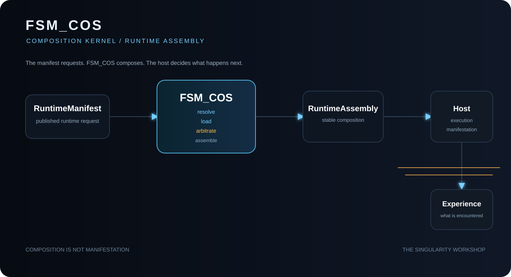

# ✳️ 00 The Singularity Workshop — FSM_COS

[](https://opensource.org/licenses/MIT)
[](https://www.nuget.org/packages/TheSingularityWorkshop.FSM_COS)
[](https://www.nuget.org/packages/TheSingularityWorkshop.FSM_COS)
[](https://github.com/TrentBest/TheSingularityWorkshop.FSM_COS/actions/workflows/package.yml)
[](https://codecov.io/gh/TrentBest/TheSingularityWorkshop.FSM_COS)

<p align="center">
  
</p>

*If a picture is worth a thousand words, then what is a living picture worth?* FSM_COS uses source-backed diagrams to explain dependency closure, preflight validation, failure boundaries, and the host handoff.

**[Gallery](docs/GALLERY.md)** — a visual index of composition, validation, arbitration, and host handoff.

**[Learn FSM_COS by following one request](docs/LEARNING_GUIDE.md)** — a picture-led walkthrough with a runnable example and a small experiment.

**[Minimal consumer recipe](https://github.com/TrentBest/TheSingularityWorkshop.FSM_COS/blob/development/samples/FSM_COS.MinimalConsumer/Program.md)** — source, UML class card, use cases, and reproduction notes.

FSM_COS is The Singularity Workshop's **runtime composition kernel**. It takes a request for capabilities, resolves the MicroBundles and dependencies needed to satisfy it, and hands the assembled result to a host.

## 🟦 01 — What is FSM_COS?

Think of a runtime manifest as an order: it says which capabilities are wanted. FSM_COS works out what else must be present for that order to make sense, loads the composition, and gives its bundles a bounded chance to reconcile their composition state. It hands the result to the host only if that arbitration process reports convergence.

The result is a `RuntimeAssembly`—a handoff to another system, not a finished application.

**In one line:** the manifest says what is requested; FSM_COS assembles what must exist together; the host decides what happens next.

## 🟣 02 — Why does it exist?

Without a distinct composition layer, each host can end up owning its own dependency logic and capability wiring. That makes reusable behavior harder to share and encourages application-specific concerns to leak into lower-level libraries.

FSM_COS gives that work a focused home. A browser app, desktop program, service, simulation, or headless tool can supply its own catalog and decide how to use the resulting assembly. The kernel does not require a particular interface or application type.

This is an architectural boundary, not a promise that every capability is automatically portable. Compatibility still depends on the contracts, dependencies, and abilities of the host.

## 🩵 03 — How does it work?

```text
Runtime Manifest
      │ requested MicroBundles and versions
      ▼
   FSM_COS
      ├── resolve roots and exact versions
      ├── preflight the full dependency closure
      ├── validate identities, requests, and cycles
      ├── load dependencies first (iterative DFS)
      └── arbitrate toward convergence
      ▼
RuntimeAssembly
      │ handoff
      ▼
Host / application / experience
```

Each part has a clear owner:

- **MicroBundleDomain** defines the MicroBundle contract.
- **The host or repository** supplies a catalog that can find the requested bundles.
- **FSM_COS** resolves dependencies, loads the composition, and runs bounded arbitration.
- **The host** owns application lifecycle, execution, user interface, and presentation.

FSM_COS is not a GUI, engine, artifact repository, transport layer, or application loop. For the exact contracts and responsibility boundaries, see [Architecture](docs/ARCHITECTURE.md) and [Runtime Boundary](docs/RUNTIME_BOUNDARY.md). Security scope, explicit trust assumptions, and the adversarial verification matrix are documented in [Security](SECURITY.md).

Alpha.7 exposes read-only snapshots for assembly and plan collections: callers cannot mutate the collection structure through those public views. This does **not** make the `MicroBundle` objects inside those collections immutable; their behavior remains owned by their domain contracts.

## 🟢 04 — See it in a minute

The repository includes a tiny runnable consumer that demonstrates the package's actual purpose: assembling a requested bundle and its dependency. You need Git and the **.NET 8 SDK**.

```bash
git clone https://github.com/TrentBest/TheSingularityWorkshop.FSM_COS.git
cd TheSingularityWorkshop.FSM_COS
dotnet run --project samples/FSM_COS.MinimalConsumer/FSM_COS.MinimalConsumer.csproj
```

**What should happen?** The sample loads bundle `2` (the data-source prerequisite) before bundle `1` (the report), then prints `Assembly order: 2 -> 1`. The sample defines its own in-memory catalog and two tiny MicroBundles; those are example code, not extra types supplied by FSM_COS.

This is a source-repository example and references the local FSM_COS project so it can be verified before a release is published. For the exact published package status, check the [NuGet package page](https://www.nuget.org/packages/TheSingularityWorkshop.FSM_COS). To build your own host, start with [Consuming MicroBundles](docs/CONSUMING_MICROBUNDLES.md), which explains the catalog, manifest, configuration, and bundle contracts.

The package targets **.NET 8** and is versioned `0.1.0-alpha.7`.

## 🟪 05 — Documentation

- **Start here:** [What Is FSM_COS?](docs/WHAT_IS_FSM_COS.md) and [Learn by Following One Request](docs/LEARNING_GUIDE.md)
- **Understand the runtime:** [Architecture](docs/ARCHITECTURE.md), [Runtime Manifest](docs/RUNTIME_MANIFEST.md), [RuntimeAssembly](docs/RUNTIME_ASSEMBLY.md), [Arbitration](docs/ARBITRATION.md), and [Runtime Boundary](docs/RUNTIME_BOUNDARY.md).
- **Build a consumer:** [Consuming MicroBundles](docs/CONSUMING_MICROBUNDLES.md) explains the catalog, manifest, configuration, and bundle contracts.
- **Integrate a host:** [WebPage Integration](docs/WEBPAGE_INTEGRATION.md) describes the browser-host integration boundary and what a host must supply; FSM_COS does not ship a WebPage adapter.
- **Explore the examples:** [Gallery](docs/GALLERY.md) and the [minimal consumer recipe](https://github.com/TrentBest/TheSingularityWorkshop.FSM_COS/blob/development/samples/FSM_COS.MinimalConsumer/Program.md).
- **Find a topic:** [Documentation Index](DOCUMENTATION_INDEX.md).
---
<p align="center">
  <a href="https://github.com/TrentBest/WebPage" aria-label="Visit The Singularity Workshop">
    
  </a><br />
  <strong>The Singularity Workshop</strong><br />
  <em>If a picture is worth a thousand words, what is a living picture worth?</em><br />
  <a href="https://github.com/TrentBest">GitHub</a> ·
  <a href="https://coderlegion.com/">Coder Legion</a> ·
  <a href="https://www.patreon.com/c/TheSingularityWorkshop">Patreon</a> ·
  <a href="https://www.paypal.com/donate/?hosted_button_id=3Z7263LCQMV9J">PayPal</a><br />
  <a href="https://github.com/TrentBest/FSM_API">FSM_API</a> ·
  <a href="https://github.com/TrentBest/TheSingularityWorkshop.FSM_Serialization">FSM_Serialization</a> ·
  <a href="https://github.com/TrentBest/WebPage">WebPage</a><br />
  <strong>Because state shouldn't be a mess.</strong><br />
  <em>And because static boundaries are invitations to cause trouble.</em>
</p>

---

## 🔗 Resources & Support

### 📦 Project & Code

- **FSM_COS:** [Source code](https://github.com/TrentBest/TheSingularityWorkshop.FSM_COS)
- **FSM_API:** [Source code](https://github.com/TrentBest/FSM_API)
- **FSM_Serialization:** [Source code](https://github.com/TrentBest/TheSingularityWorkshop.FSM_Serialization)
- **WebPage:** [Source code](https://github.com/TrentBest/WebPage)
- **The Singularity Workshop:** [GitHub profile](https://github.com/TrentBest) · [Coder Legion profile](https://coderlegion.com/user/The%2BSingularity%2BWorkshop)

### 💖 Support The Singularity Workshop

- [Patreon](https://www.patreon.com/c/TheSingularityWorkshop)
- [PayPal](https://www.paypal.com/donate/?hosted_button_id=3Z7263LCQMV9J)
- [Coder Legion community](https://coderlegion.com/)

<!-- THE SINGULARITY WORKSHOP FOOTER -->
<p align="center">
  <a href="https://github.com/TrentBest" aria-label="The Singularity Workshop on GitHub">
    
  </a>
</p>

<p align="center">
  <em>The Singularity Workshop — Tools for the curious, the bold, and the systemically inclined.</em><br />
  <strong>Because state shouldn't be a mess.</strong><br />
  <em>And because static boundaries are invitations to cause trouble.</em>
</p>
