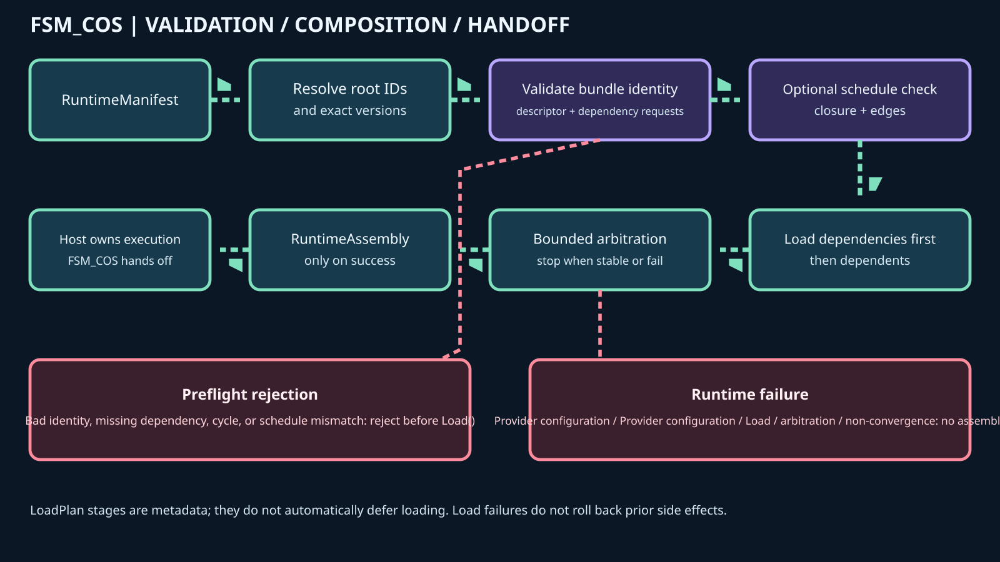
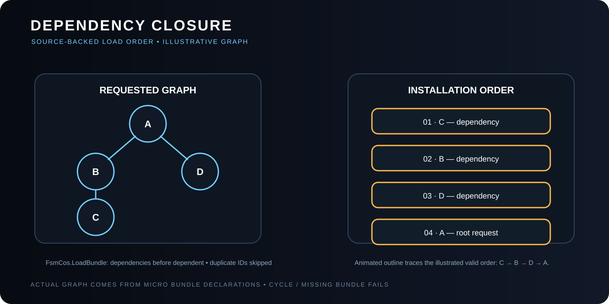

# FSM_COS Architecture

> **Architecture answers how the composition kernel performs the theory.** For the deeper “why,” start with [FSM_COS Theory](THEORY.md).

FSM_COS is a small composition kernel. This document describes how its pieces cooperate rather than redefining concepts owned by neighboring systems.

## Runtime flow




*Generated from `samples/DocumentationVisuals/Program.cs` using GUI.SVG. The development workflow regenerates and checks the committed SVG against a pinned GUI.SVG source revision. This is a contract map, not a live execution trace; the schedule check applies only when a schedule is supplied.*


## Core contracts

### RuntimeManifest
Identifies the runtime being assembled and supplies versioned root MicroBundle entries. It can also carry an optional host-provided `SemanticIntent`, an optional load-plan description, and an optional dependency schedule. Intent is passed through to the result; staged metadata is validated according to the current alpha contract and does not, by itself, activate repository localization or staged execution. The manifest is composition input, not application behavior. See [Runtime Manifest](RUNTIME_MANIFEST.md) and [Runtime Manifest Theory](MANIFEST_THEORY.md).

### MicroBundle manifest entries
A manifest entry identifies a requested MicroBundle and its requested version. Configuration is intentionally not part of the manifest. A separate configuration source may provide per-MicroBundle configuration at runtime.

### IMicroBundleCatalog
Resolves a bundle identity to the IMicroBundle required for installation. The catalog is supplied by the host, so future Warehouse-backed or generated resolvers do not require a different composition algorithm.

### IMicroBundle
Consumes the domain-owned `MicroBundleDescriptor` for identity/version/providers, while retaining composition-specific dependency configuration, Load, and Arbitrate behavior. FSM_COS does not redefine MicroBundle domain metadata. It does not expose a GUI, web server, or host lifecycle contract.

### MicroBundleLoadContext
Carries runtime identity and configuration available during installation. Configuration remains opaque to FSM_COS.

### ArbitrationContext
Exposes runtime identity, the currently loaded bundle set, and an optional FSM_API `IStateContext` supplied by the host. It is composition context, not host lifecycle state.

### RuntimeAssembly
The result surface of the composition pass: runtime identity, loaded bundles, the zero-based index of the round that reported convergence, and the optional `SemanticIntent` carried by the request. An `ArbitrationRounds` value of `0` means the first round converged; it is not the number of `Arbitrate` calls. Intent is passed through for the host; it does not make FSM_COS an input handler or presentation layer. See [RuntimeAssembly](RUNTIME_ASSEMBLY.md) and [FSM_COS Theory — RuntimeAssembly is the handoff object](THEORY.md#9-runtimeassembly-is-the-handoff-object).



The conceptual reason for deriving this order rather than encoding it in the manifest is explained in [FSM_COS Theory — Composition starts with roots, not a giant object graph](THEORY.md#4-composition-starts-with-roots-not-a-giant-object-graph).

## Dependency resolution

FSM_COS first resolves and validates the complete reachable dependency closure before calling any bundle's `Load`. This rejects missing dependencies, malformed dependency contracts, identity mismatches, and cycles before bundle loading can create side effects. It snapshots the resolved bundle objects and dependency requests for the load pass, so the catalog is not queried a second time during loading. The subsequent depth-first installation order is iterative rather than recursive, avoiding call-stack exhaustion on deep graphs.

    requested A
       │
       ├── B
       │   └── C
       └── D

The resulting installation order is C, B, D, A.

Two guards remain fundamental during installation: already-loaded IDs are skipped, and IDs currently loading are tracked to detect cycles. The preflight graph validation independently detects cycles before installation begins.

Missing bundles and dependency cycles are composition failures.

## Configuration propagation

Configuration is an external runtime input. FSM_COS accepts configuration through an abstraction supplied by the host/repository layer; it does not read configuration files or interpret their format. If no configuration is available for a bundle, the bundle is loaded without external configuration and uses its defaults.

## Arbitration

FSM_COS resolves the catalog's actual reachable dependency graph and validates identity/dependency declarations before calling any MicroBundle `Load` method. When a manifest supplies a dependency schedule, it also checks the resolved closure, versions, and edges against that schedule before loading. This is a validation boundary, not a claim that FSM_COS localizes artifacts or implements staged/background loading. After reachable bundles are loaded, FSM_COS creates one ArbitrationContext.

    for each round
        for each loaded bundle
            changed |= bundle.Arbitrate(context, round)
        if no change → converged

If the configured maximum is reached without convergence, FSM_COS throws instead of returning an unstable assembly. The current default is ten rounds.

## Failure and partial side effects

Resolution, configuration lookup, bundle loading, and arbitration failures propagate to the caller; FSM_COS does not return a `RuntimeAssembly` when composition fails. Arbitration begins only after all reachable bundles have completed `Load`.

Composition is **not a transactional rollback boundary**. If a dependency completes `Load` and a later dependent bundle throws from `Load`, the earlier dependency's in-memory changes or external side effects cannot be generically undone by FSM_COS. The failing bundle is not added to the internal loaded set, and arbitration does not begin, but already-executed `Load` code may have changed state outside FSM_COS. Bundle authors and hosts must make loading safe for their lifecycle, and perform any required cleanup at the layer that owns those side effects.

The same principle applies to exceptions during arbitration: FSM_COS propagates the failure and does not hand off an assembly, but it cannot reverse arbitrary mutations performed by bundle code. Hosts should treat a failed `Execute` as a failed composition attempt, not as proof that all bundle-side effects were reverted.

### Diagnostic surface

The diagnostic contract is deliberately small: `Execute` either returns a converged `RuntimeAssembly` or throws. FSM_COS does not keep a logging pipeline, diagnostics registry, or partially successful assembly for the host to inspect. For failures it detects itself, exception messages identify the relevant bundle IDs and, where applicable, requested/resolved versions, dependency cycles, missing schedule entries, or mismatched dependency edges. Exceptions raised by the catalog, configuration source, `Load`, or `Arbitrate` are allowed to propagate so their owning layer retains the original failure details.

Hosts should catch failures at their composition boundary, preserve the exception and its context in their own logging/telemetry system, and apply cleanup according to their lifecycle policy. Message text is useful for troubleshooting, but consumers should not treat exact prose as a stable machine-readable error code.

## Catalog boundary

The catalog stays outside the composition algorithm:

    FSM_COS ← Catalog ← in-memory / generated registry / Warehouse / cache / Domain resolver

The composition engine should not need to know where a bundle came from.

## Host boundary

    FSM_COS
       │
       ▼
RuntimeAssembly
       │
       ├── WebPage → browser experience
       ├── AnyApp → desktop/local experience
       └── other hosts → their own manifestation

## Current development boundary

The active development line is refining the manifest/configuration boundary while preserving the small composition kernel:

```text
Manifest (bundle + version)
        ↓
resolver / catalog
        ↓
configuration source (optional)
        ↓
dependency closure
        ↓
Load()
        ↓
Arbitrate() until stable
        ↓
RuntimeAssembly
```

File I/O, repository transport, serialization, host lifecycle, and presentation remain outside the kernel.

Execution scheduling, resource allocation, Warehouse integration, and host lifecycle belong to later layers when their contracts are sufficiently clear.

---

## 🔗 The Singularity Workshop

FSM_COS is one layer in a deliberately troublesome ecosystem:

- **[FSM_API](https://github.com/TrentBest/FSM_API)** — behavior and state.
- **[FSM_COS](https://github.com/TrentBest/TheSingularityWorkshop.FSM_COS)** — composition and runtime assembly.
- **[FSM_Serialization](https://github.com/TrentBest/TheSingularityWorkshop.FSM_Serialization)** — representation and the byte boundary.
- **[WebPage](https://github.com/TrentBest/WebPage)** — browser manifestation and proving ground.
- **[FSM_API_Unity](https://github.com/TrentBest/FSM_API_Unity)** — Unity manifestation.

<p align="center"><em>The Singularity Workshop — Tools for the curious, the bold, and the systemically inclined.</em><br><strong>Because state shouldn't be a mess.</strong><br><em>And because static boundaries are invitations to cause trouble.</em></p>
