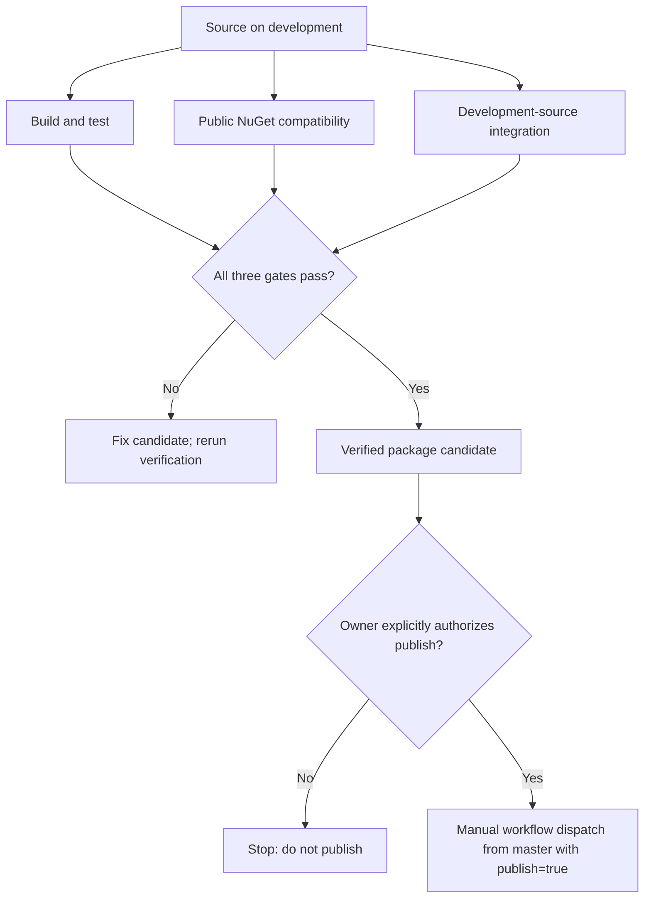

# FSM_COS Development

> There are two active branches by design: master and development.

This repository deliberately avoids a forest of simultaneously-current feature branches.

## Branch policy

### master

`master` is the stable baseline.

It should represent code that has been deliberately consolidated and is suitable to treat as the public stable line. Release preparation is performed from a known-good development state; it is not an alternative permanent development branch.

### development

`development` is the current integration and architecture branch.

All normal FSM_COS evolution should happen here unless a short-lived branch is genuinely useful for isolating a risky experiment.

> **If you need to ask which branch is current, the answer should be `development`.**

### Short-lived branches

The durable branch set should remain exactly `master` and `development`. Prefer working directly on `development`; use a temporary branch only when a substantial architecture experiment or risky change genuinely needs isolation.

When a temporary branch is used, consolidate it into `development`, close its PR, and delete the branch. Do not retain feature, release, or experiment branches as additional sources of truth.

## Consolidation record

The repository previously accumulated overlapping branches for the domain-contract correction, staged manifest loading, and release preparation.

The domain-contract correction was merged into `development`.

The staged-manifest and release-preparation PRs were closed as superseded designs. Their branches remain historical references; they are not active development lanes.

This is intentional housekeeping, not deletion of architectural history.

## Development sequence

```text
idea / issue
    ↓
development
    ↓
implementation + tests + documentation
    ↓
CI
    ↓
review
    ↓
development remains current
    ↓
stable checkpoint
    ↓
master
    ↓
explicit release
```

Do not publish a package merely because a development branch builds.

## Documentation standard

FSM_COS documentation should explain four things together:

1. Why the boundary exists.
2. What contract crosses the boundary.
3. How the implementation realizes the contract.
4. What does not belong here.

A document is not finished merely because the code example compiles. It should leave a reader able to answer who owns a concept, who supplies it, who interprets it, where it stops, what happens when an optional piece is absent, and what the stable handoff is.

Architecture diagrams are part of that explanation, not decoration.

## Current architecture direction

```text
MicroBundleDomain ───────── defines the MicroBundle contract ──────┐
                                                                   │
Optional sources / catalogs ─ locate and resolve available bundles ┤
  ├── in-memory or generated catalog                              │
  ├── repository-backed catalog                                   │
  └── host-owned implementation                                   │
                                                                   ▼
                                                               FSM_COS
                                                                   │
                                                        composes requested runtime
                                                                   ▼
                                                            RuntimeAssembly
                                                                   │
                                                                   ▼
                                                            Host / Experience
```

MicroBundleRepository is one possible source behind a catalog, not a mandatory hop in every composition. A small host can use an in-memory catalog; another host can supply repository-backed discovery without changing FSM_COS's composition algorithm.

The Runtime Manifest belongs to the composition request:

```text
Manifest
  ├── MicroBundle identity
  └── requested version
```

Per-MicroBundle configuration is deliberately separate:

```text
Configuration source
  ├── MicroBundle A → configuration
  ├── MicroBundle B → configuration
  └── MicroBundle C → absent → defaults
```

FSM_COS may consume configuration through an abstraction, but it does not become a file reader, serializer, repository, or application configuration framework.

## Dependency modes in CI

The same repository has two deliberately different dependency modes. They answer different questions and must not be blended into one ambiguous build.

| Context | MicroBundleDomain source | What the build proves |
|---|---|---|
| Push to `development` or a pull request targeting it | Checkout the dependency's `development` branch and pack it into an isolated local feed | Current integration code is tested against current dependency development code |
| Push to `master`, or a pull request targeting another base | Restore dependencies from public NuGet | The stable/release line does not silently rely on an unpublished source checkout |
| Public-package compatibility job | Public NuGet only, with no local dependency feed | The documented package dependency graph can restore and build as a consumer would |

For development restores, NuGet package-source mapping routes **only** `TheSingularityWorkshop.MicroBundleDomain` to the locally packed development package. Other package IDs resolve from nuget.org. This matters because the development checkout can carry the same declared package version as the published package: adding a local feed without source mapping would not prove which copy restore selected.

The public-package compatibility job remains separate from the development integration build. A green development build is not evidence that a new package version is published, and a green public-feed build is not evidence that the latest dependency development code has been integrated.

This workflow is verification, not release authorization. Publication remains behind the required `workflow_dispatch` boolean input (`publish`, default `false`) and is allowed only when the workflow is deliberately dispatched from `master` with that input set to `true`, after verifying the intended master commit against public dependencies. Pushes and pull requests never publish. Do not dispatch publication from `development`, weaken this safeguard, or publish as part of routine development.

## Documentation visual tooling

The preflight illustration is generated with **GUI.SVG** as a build-time authoring tool. The `samples/DocumentationVisuals/DocumentationVisuals.csproj` project references the GUI.SVG source project under `_dependencies/GUI`. On `development` pushes and pull requests targeting `development`, the package workflow checks out that source at a pinned commit and runs the generator before packing. The generated result is an SVG asset, not a runtime service or library used by FSM_COS. The generated SVG is also committed under `docs/assets`, so public-feed and `master` builds can package the same illustration without restoring GUI.SVG tooling.

The shipping project, `src/FSM_COS/FSM_COS.csproj`, must not reference GUI.SVG as either a package or project dependency. That keeps the NuGet package focused on its actual runtime contracts (`FSM_API`, `FSM_UserIO`, and `MicroBundleDomain`) while still allowing the documentation pipeline to use richer visual tooling. `scripts/verify_nuget_package.py` enforces that `TheSingularityWorkshop.GUI.SVG` does not appear in the package's direct dependency list.

## Verification

The package workflow has three independent verification gates. Publication is a separate, explicitly requested action and is not implied by a green verification run.



*This diagram summarizes the current `.github/workflows/package.yml` job dependencies and manual publication gate. A successful verification run alone does not publish a package.*


Run the minimal consumer sample as part of validating the public composition path:

```bash
dotnet run --project samples/FSM_COS.MinimalConsumer/FSM_COS.MinimalConsumer.csproj
```

It should load bundle 2 before bundle 1 and print `Assembly order: 2 -> 1`. The sample references the source project and is a source-level integration proof, not proof that a particular NuGet version is published or installable.

Before a development change is considered complete:

- production code builds with zero warnings;
- tests pass;
- XML documentation remains coherent;
- README and architecture docs describe the actual code;
- package dependencies point at published/staged versions intentionally;
- examples do not reference removed contracts;
- branch purpose is obvious from GitHub;
- no accidental publication occurs.

## Release discipline

A release is a separate decision from development:

```text
development
    ↓
stable documentation
    ↓
green CI
    ↓
explicit approval
    ↓
merge to master
    ↓
verify the intended master commit with public dependencies
    ↓
explicit workflow dispatch from master (`publish: true`)
```

No automatic branch state should be interpreted as permission to publish a NuGet package.

---

<p align="center"><em>The Singularity Workshop — Tools for the curious, the bold, and the systemically inclined.</em><br><strong>Because state shouldn't be a mess.</strong><br><em>And because static boundaries are invitations to cause trouble.</em></p>

---

**The Singularity Workshop**  
[GitHub](https://github.com/TrentBest) · [Coder Legion](https://coderlegion.com/) · [Patreon](https://www.patreon.com/c/TheSingularityWorkshop) · [PayPal](https://www.paypal.com/donate/?hosted_button_id=3Z7263LCQMV9J)  
[ FSM_API ](https://github.com/TrentBest/FSM_API) · [ FSM_Serialization ](https://github.com/TrentBest/TheSingularityWorkshop.FSM_Serialization) · [ WebPage ](https://github.com/TrentBest/WebPage) · [ FSM_COS Documentation Standard ](https://github.com/TrentBest/TheSingularityWorkshop.FSM_COS/blob/development/DOCUMENTATION_STANDARD.md)  
**Because state shouldn't be a mess.**  
*And because static boundaries are invitations to cause trouble.*
