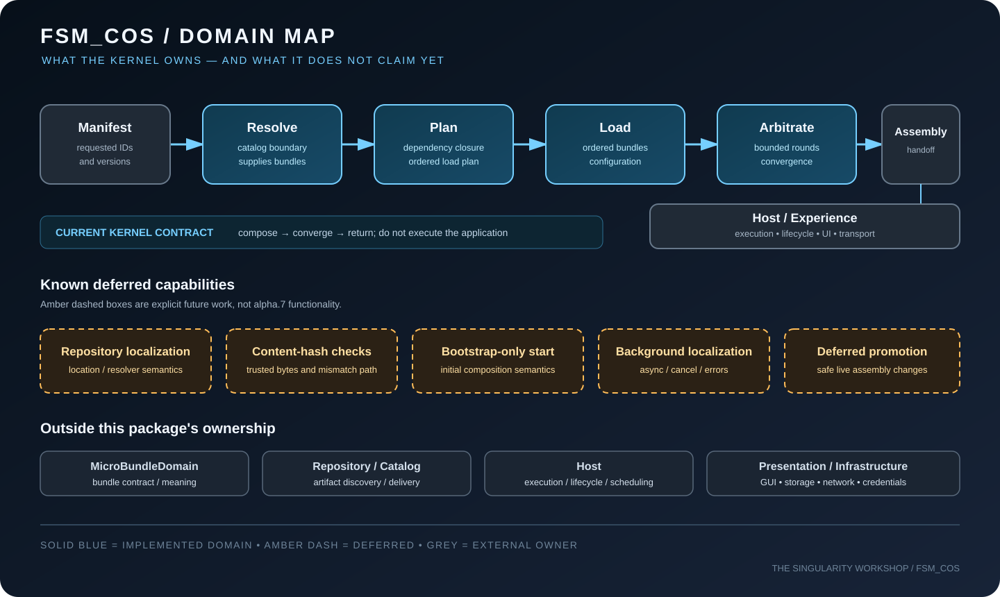

# FSM_COS Domain Completion and Release Roadmap

> **Candidate:** `0.1.0-alpha.7` on `development`  
> **Publication status:** not published by this document. Verify the NuGet feed and successful publish workflow independently.  
> **Purpose:** define the whole FSM_COS domain, distinguish shipped behavior from intended behavior, and prevent the release candidate from implying that deferred capabilities already exist.

## 1. Domain in one picture

The [overview](assets/fsm-cos-overview.svg) shows the public runtime handoff. The [composition crane](assets/fsm-cos-crane.svg) explains the assembly metaphor. This map adds the implementation boundary: solid blue is current kernel responsibility; dashed amber is explicitly deferred; grey belongs to another domain or host.

## 2. The domain FSM_COS owns

FSM_COS is the **composition kernel** between a request for capabilities and a stable `RuntimeAssembly`. It does not become the application or own the artifact repository.

| Concern | Kernel responsibility | Boundary |
|---|---|---|
| Request | Accept a runtime manifest with requested MicroBundle identities and versions | The manifest describes the request; it is not artifact storage |
| Resolution | Ask the supplied catalog/resolver for requested bundles | Catalog and repository own discovery and artifact delivery |
| Dependency planning | Compute required dependency closure and an ordered load plan | MicroBundleDomain owns the bundle contract and dependency declarations |
| Loading | Load the planned composition in dependency order | Bundle behavior remains owned by each MicroBundle |
| Configuration | Deliver available per-bundle configuration | The bundle interprets its own configuration; host/repository chooses its source |
| Arbitration | Run bounded reconciliation rounds toward convergence | Kernel does not promise convergence for every arbitrary bundle set |
| Handoff | Return a `RuntimeAssembly` after successful composition | Host owns execution, lifecycle, UI, transport, persistence, and presentation |
| Contract safety | Expose read-only snapshots for validated assembly and plan collections | Underlying MicroBundle instances remain domain-owned and may have mutable behavior |

## 3. Runtime lifecycle

1. The caller supplies a `RuntimeManifest`.
2. The catalog/resolver supplies the requested MicroBundles.
3. FSM_COS computes the dependency closure and validates/plans the composition.
4. The planned bundles are loaded in dependency order.
5. Available configuration is delivered to the appropriate bundle.
6. FSM_COS performs bounded arbitration.
7. A converged composition is exposed as a `RuntimeAssembly`; responsibility then passes to the host.

A failed resolution, invalid plan, loading failure, or non-converged arbitration must not be described as a successful stable handoff. Exact failure behavior should remain defined by the corresponding API contracts and tests.

## 4. Dependency gate: update roots before consumers

The current project file declares these direct NuGet dependencies:

| Package | Declared version | Release gate |
|---|---:|---|
| FSM_API | `1.0.13` | Stable package; update only if a verified FSM_COS requirement or defect needs it |
| FSM_UserIO | `0.1.0-alpha.1` | Pre-release contract; retain alpha status while this dependency is pre-release |
| MicroBundleDomain | `1.0.1` | Domain contract package; update first if the composition contract must change |

These are source declarations, not proof of restore success, package availability, or compatibility for a particular candidate. **Current CI status and package evidence belong only in the [alpha.7 readiness gate](0.1.0-alpha.7-READINESS.md)** and must be tied to the exact candidate commit and artifact. Historical runs must not be described as evidence for a newer candidate.

Dependency order when a contract change is required:

1. Identify the owning package for the changed contract.
2. Fix and test that package on its development branch.
3. Verify its package contents, documentation, and release workflow; publish that dependency before a consumer references a new public version.
4. Update the FSM_COS package reference and source-integration graph together.
5. Re-run public-feed compatibility and full source integration for the exact consumer candidate.
6. Only then prepare the FSM_COS package.

Do not bump dependency versions merely because newer source commits exist. Conversely, do not release a consumer that requires an unpublished dependency version.

## 5. Implemented behavior described by the alpha.7 source candidate

The source candidate includes:

- Runtime manifest planning and dependency-aware ordering.
- Bundle loading and bounded arbitration/convergence handoff.
- `RuntimeAssembly` output.
- Read-only snapshots for `RuntimeAssembly.Bundles`, `RuntimeManifestSchedule` collections, and `RuntimeManifestLoadPlan.Entries`.
- Regression tests that verify exposed collections cannot be mutated through casts to mutable collection interfaces.
- A minimal consumer sample intended to demonstrate dependency order `2 -> 1`.
- A package verifier for package identity/version, dependency metadata, target assembly and XML docs, README/license, release notes, and required living SVG assets.
- CI jobs for build/test, public-package compatibility, development-source integration, package-content verification, and artifact creation.

This is an inventory of source and workflow intent, **not a claim that the current candidate has passed verification**. Evidence is tied to a specific commit and run; a passing run is not interchangeable with a later commit's result. See the readiness gate for the live verification state.

## 6. Explicitly deferred — not alpha.7 functionality

These are known omissions, not hidden promises:

| Deferred capability | What must be designed/implemented before claiming support | Minimum proof |
|---|---|---|
| Repository localization | Define how a requested bundle is mapped to a repository/location without moving repository ownership into FSM_COS | Resolver contract tests and a consumer integration test using distinct locations |
| Content-hash verification of localized bytes | Define the trusted hash source, canonical bytes, and mismatch failure behavior; carrying a hash as metadata alone does not verify bytes | Matching, missing, and mismatched-hash tests |
| Bootstrap-only initial composition | Define the bootstrap boundary and how it differs from ordinary requested composition | Tests showing bootstrap inclusion/exclusion and deterministic ordering |
| Background localization | Define asynchronous discovery/cancellation/error semantics without silently changing the synchronous contract | Deterministic async tests, cancellation and failure tests |
| Live promotion of Deferred bundles | Define when a deferred bundle becomes eligible and how a running assembly changes safely | State-transition tests proving no partial/invalid assembly is exposed |

The read-only snapshot fix protects collection structure; it does **not** make each MicroBundle immutable, guarantee safe live mutation of an assembly, or implement any of the deferred capabilities above.

## 7. Domain completion work beyond the current candidate

These are follow-on engineering tracks, not requirements to inflate alpha.7:

- **Contract traceability:** every public runtime type and failure mode links to source, focused documentation, and at least one relevant test.
- **Failure-path coverage:** resolution miss, missing dependency, dependency cycle, load failure, arbitration non-convergence, and configuration absence/failure must have explicit tests where those cases are part of the implemented contract.
- **Manifest compatibility:** define and test behavior for duplicate requests, version conflicts, dependency/version conflicts, and deterministic ordering.
- **Composition observability:** document what diagnostics are available to a host without making FSM_COS a logging framework or execution loop.
- **Living documentation:** SVGs should explain actual boundaries and behavior, not imply unimplemented capabilities. Where GUI.SVG is used to generate/manifest diagrams, keep the authored SVG or source scene in the repository and make the resulting artifact inspectable.
- **Release parity:** package verification must run on both the development candidate and the public-feed package; release notes, README, documentation index, and project version must agree.

A track is complete only when its contract is written, implementation is present, tests demonstrate it, and packaged documentation accurately states the result.

## 8. Release readiness authority

The candidate-specific release checklist is maintained in one place: the [alpha.7 readiness gate](0.1.0-alpha.7-READINESS.md). Use that file for source/contract gates, CI evidence, exact-package inspection, documentation/accessibility closure, and the definition of pre-publication readiness.

This roadmap intentionally does not duplicate the release checklist or track workflow run IDs, artifact names, package hashes, or publication authorization. Those facts are candidate-specific and must be verified from current Actions results and the exact package artifact. Publication approval and post-publication checks remain separate from pre-publication readiness.

## 9. Source authority

Use [DOMAIN](DOMAIN.md) for ownership boundaries, [ARCHITECTURE](ARCHITECTURE.md) for component responsibilities, [STAGED_MANIFEST_LOADING](STAGED_MANIFEST_LOADING.md) for planning/loading, [RUNTIME_MANIFEST](RUNTIME_MANIFEST.md) for requests, [RUNTIME_ASSEMBLY](RUNTIME_ASSEMBLY.md) for the handoff, [ARBITRATION](ARBITRATION.md) for convergence, and [DEVELOPMENT](DEVELOPMENT.md) for reproducible verification.

If this roadmap and implementation disagree, implementation and tests determine current behavior; correct the discrepancy rather than silently treating intended behavior as implemented.
