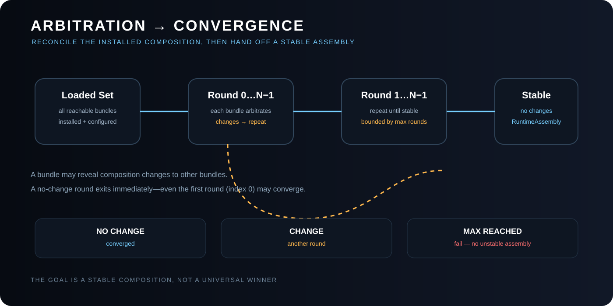
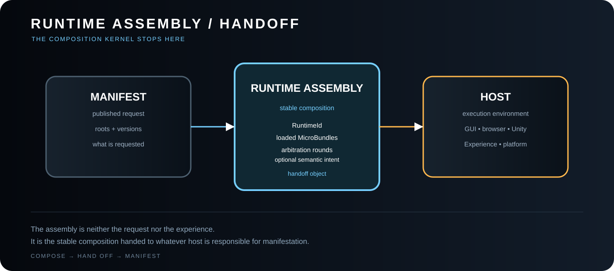
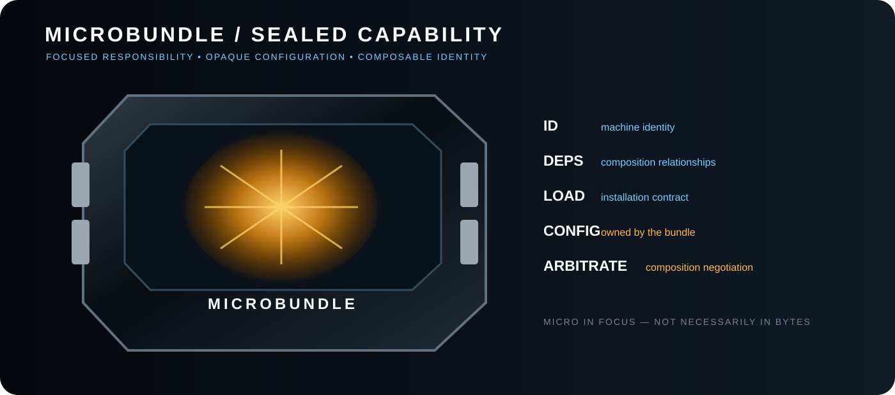
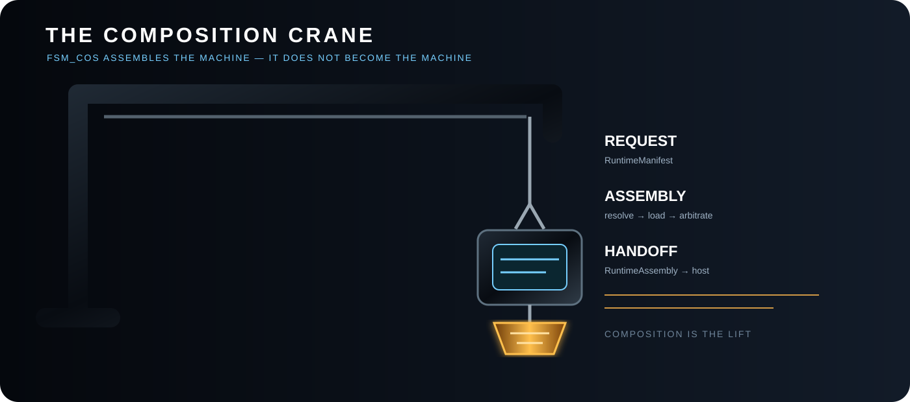

<!-- The Singularity Workshop moniker -->

# FSM_COS Gallery

**Describe the capability. Resolve its prerequisites. Assemble the runtime. Hand it back to the host.**

FSM_COS turns a declared request into a dependency-ordered composition. These exhibits show the journey from requested capability to `RuntimeAssembly`, with each visual linked to a guide for using the corresponding contract. Animated elements explain the flow; they are not live runtime telemetry.

## Start here — from request to runtime

A manifest names the capabilities the host wants. Dependencies add the prerequisites those capabilities need. FSM_COS validates and loads the complete composition, then returns a `RuntimeAssembly` to the host.

**Build this flow into your application:** [Consuming MicroBundles](CONSUMING_MICROBUNDLES.md) · [Run the minimal consumer](https://github.com/TrentBest/TheSingularityWorkshop.FSM_COS/blob/development/samples/FSM_COS.MinimalConsumer/Program.md).

## 01 — Runtime composition at a glance

**See:** how a manifest request becomes a dependency-closed runtime assembly.

**Deep dive:** [What FSM_COS is](WHAT_IS_FSM_COS.md) · [Architecture](ARCHITECTURE.md).

## 02 — Dependency resolution

**See:** why the requested capability set may require additional MicroBundles before it can be assembled.

**Deep dive:** [Domain and composition model](DOMAIN.md) · [Consuming MicroBundles](CONSUMING_MICROBUNDLES.md).

## 03 — Preflight validation and failure boundaries

**See:** checks that must happen before the host receives an assembly.

**Deep dive:** [Runtime manifest](RUNTIME_MANIFEST.md) · [Runtime boundary](RUNTIME_BOUNDARY.md).

## 04 — Arbitration and convergence

**See:** the bounded reconciliation stage in which loaded MicroBundles can reconcile composition state before handoff.

**Deep dive:** [Arbitration](ARBITRATION.md).

## 05 — RuntimeAssembly handoff

**See:** the composition kernel's output boundary. RuntimeAssembly is a handoff to a host, not an application, game loop, or execution engine.

**Deep dive:** [Runtime assembly](RUNTIME_ASSEMBLY.md) · [WebPage integration](WEBPAGE_INTEGRATION.md).

## 06 — MicroBundle as a composable unit

**See:** the conceptual unit of reusable capability that the composition kernel resolves and loads.

**Deep dive:** [Consuming MicroBundles](CONSUMING_MICROBUNDLES.md) · [Theory](THEORY.md).

## 07 — The crane metaphor

**See:** the assembly-crane metaphor: FSM_COS composes the requested capability set and hands it to the host. The animated variant is a visual metaphor, not an executing runtime trace.

**Deep dive:** [Architecture](ARCHITECTURE.md) · [Runtime Boundary](RUNTIME_BOUNDARY.md).

## Choose your next step

- **Understand the problem and model:** [What Is FSM_COS?](WHAT_IS_FSM_COS.md).
- **Use the composition API:** [Consuming MicroBundles](CONSUMING_MICROBUNDLES.md).
- **Inspect runtime boundaries:** [RuntimeAssembly](RUNTIME_ASSEMBLY.md) and [Runtime Boundary](RUNTIME_BOUNDARY.md).
- **Explore related projects:** [The Singularity Workshop repository guide](WORKSHOP_REPOSITORIES.md).

---

[Documentation index](../DOCUMENTATION_INDEX.md)

---

## 🔗 Resources & Support

- **Project:** [FSM_COS](https://github.com/TrentBest/TheSingularityWorkshop.FSM_COS)
- **Workshop projects:** [FSM_API](https://github.com/TrentBest/FSM_API) · [FSM_Serialization](https://github.com/TrentBest/TheSingularityWorkshop.FSM_Serialization) · [WebPage](https://github.com/TrentBest/WebPage)
- **Connect:** [GitHub](https://github.com/TrentBest) · [Coder Legion profile](https://coderlegion.com/user/The%2BSingularity%2BWorkshop) · [Coder Legion community](https://coderlegion.com/)
- **Support:** [Patreon](https://www.patreon.com/c/TheSingularityWorkshop) · [PayPal](https://www.paypal.com/donate/?hosted_button_id=3Z7263LCQMV9J)

<!-- THE SINGULARITY WORKSHOP FOOTER -->

