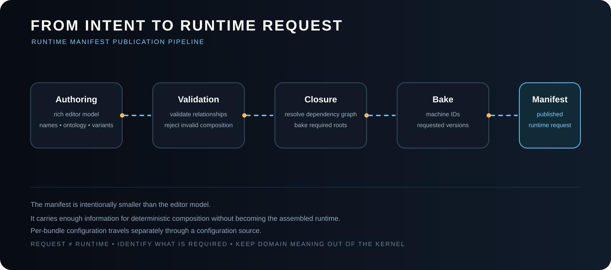

<!-- The Singularity Workshop moniker -->
<p align="center"><a href="https://github.com/TrentBest"></a></p>

# Runtime Manifest

> **The manifest says which MicroBundles and versions are requested. Configuration is a separate concern. FSM_COS composes the request.**

The **Runtime Manifest** is the machine-oriented composition request that crosses from authoring/tooling into FSM_COS.

It answers:

> **Which MicroBundles, at which requested versions, belong in this runtime composition?**

It deliberately does **not** answer:

- how a MicroBundle is configured;
- where a MicroBundle artifact is stored;
- how configuration is serialized;
- how the host presents the resulting Experience;
- how the assembled runtime is scheduled after composition.



*Scope note: this is the intended authoring/publication pipeline, not a claim that FSM_COS currently ships those editor, validation, closure-baking, or manifest-publication stages. The implemented contract begins with `RuntimeManifest`; `FsmCos.Execute` validates and composes that request.*


## UML class diagram: manifest and published plan

This is a simplified, source-derived UML overview, not a complete per-type API inventory. The manifest's root requests are distinct from optional published identity/stage metadata and dependency edges. The content hash is recorded in MicroBundleReference; this type does not itself fetch or verify artifact bytes. Exact signatures and nullability remain defined by the source and contract sections below.

~~~mermaid
classDiagram
    class RuntimeManifest {
        +RuntimeId: ulong
        +Bundles: IReadOnlyList~MicroBundleManifestEntry~
        +ExperienceContext: IStateContext
        +LoadPlan: IReadOnlyList~RuntimeManifestEntry~
        +Schedule: RuntimeManifestSchedule
        +Intent: SemanticIntent
        +Empty(runtimeId, context, intent)$ RuntimeManifest
        +ValidateStagedPlan() void
    }
    class MicroBundleManifestEntry {
        <<record struct>>
        +BundleId: ulong
        +Version: string
    }
    class RuntimeManifestEntry {
        <<record>>
        +Reference: MicroBundleReference
        +Stage: ManifestLoadStage
        +IsValid: bool
    }
    class MicroBundleReference {
        <<record struct>>
        +BundleId: ulong
        +Version: string
        +ContentHash: string
        +IsValid: bool
        +Matches(entry) bool
    }
    class ManifestLoadStage {
        <<enumeration>>
        Bootstrap
        Resident
        Deferred
    }
    class RuntimeManifestDependency {
        <<record struct>>
        +BundleId: ulong
        +DependencyId: ulong
        +IsValid: bool
    }
    class RuntimeManifestSchedule {
        +Entries: IReadOnlyList~RuntimeManifestEntry~
        +Dependencies: IReadOnlyList~RuntimeManifestDependency~
        +IndependentEntries: IReadOnlyList~RuntimeManifestEntry~
        +DependencyEntries: IReadOnlyList~RuntimeManifestEntry~
        +DependenciesOf(bundleId) IReadOnlyList
        +IsDependencyReady(bundleId, isLoaded) bool
    }

    RuntimeManifest *-- "0..*" MicroBundleManifestEntry : root requests
    RuntimeManifest o-- "0..*" RuntimeManifestEntry : optional load plan
    RuntimeManifest o-- "0..1" RuntimeManifestSchedule : optional dependency plan
    RuntimeManifestEntry --> MicroBundleReference : identity
    RuntimeManifestEntry --> ManifestLoadStage : intended stage
    RuntimeManifestSchedule o-- "0..*" RuntimeManifestEntry : entries
    RuntimeManifestSchedule o-- "0..*" RuntimeManifestDependency : edges
    RuntimeManifestDependency ..> RuntimeManifestEntry : links by BundleId
~~~

The schedule is a validated dependency plan. It does not localize artifacts, execute a process schedule, or by itself enable deferred loading. The diagram reflects the current source model, including that the root manifest requests a version while published references also carry ContentHash.

## The contract

The current development contract is intentionally small:

```csharp
public sealed record RuntimeManifest(
    ulong RuntimeId,
    IReadOnlyList<MicroBundleManifestEntry> Bundles,
    IStateContext? ExperienceContext = null,
    IReadOnlyList<RuntimeManifestEntry>? LoadPlan = null,
    RuntimeManifestSchedule? Schedule = null,
    SemanticIntent? Intent = null);
```

Each entry identifies one root MicroBundle and the version requested by the manifest:

```csharp
public readonly record struct MicroBundleManifestEntry(
    ulong BundleId,
    string Version);
```

The concrete implementation validates that the ID is non-zero and the version is present.

Conceptually:

```text
RuntimeManifest
├── RuntimeId
├── Bundles
│   ├── MicroBundle ID + requested version
│   ├── MicroBundle ID + requested version
│   └── MicroBundle ID + requested version
├── optional ExperienceContext
├── optional staged LoadPlan + Schedule
└── optional FSM_UserIO SemanticIntent
```

The manifest names **roots**. FSM_COS discovers the dependency closure from those roots.

## Optional intent and published dependency plan

`Intent` carries an optional `FSM_UserIO.SemanticIntent` to the returned `RuntimeAssembly`. It describes application-owned semantic intent; it does not grant device authority or cause an Experience to start.

`LoadPlan` and `Schedule` are optional published metadata. When a schedule is present, FSM_COS resolves the dependency closure before loading and verifies that the scheduled bundle IDs, resolved versions, and dependency edges match the domain-owned MicroBundle declarations. A mismatch fails before any bundle `Load` call. This is a consistency check, not artifact localization or hash verification.

## Example

```csharp
var manifest = new RuntimeManifest(
    RuntimeId: 1001,
    Bundles:
    [
        new MicroBundleManifestEntry(10, "1.2.0"),
        new MicroBundleManifestEntry(20, "3.1.0")
    ]);
```

This means:

- runtime `1001` is being assembled;
- MicroBundle `10` is requested at `1.2.0`;
- MicroBundle `20` is requested at `3.1.0`;
- configuration is **not** embedded in the manifest.

The catalog/resolver is responsible for locating a compatible artifact. FSM_COS verifies the resolved root reports the requested version before loading it.

### Conflicting requests for the same root identity

A manifest must not request the same MicroBundle ID at two different versions. For example, requesting bundle `10` at both `1.2.0` and `2.0.0` is ambiguous: one runtime composition cannot silently satisfy both root requests by choosing whichever catalog result happens to load first. FSM_COS detects conflicting versions for the same root ID and fails before loading the composition.

If two parts of an application genuinely require incompatible versions of one capability, model that incompatibility explicitly rather than relying on duplicate IDs in one manifest.

**An explicit root version also remains authoritative when that same MicroBundle is reached through another root's dependency graph.** FSM_COS resolves the distinct root ID/version requests before invoking any MicroBundle `Load` method, then reuses those selected root instances during dependency traversal. If a requested root version cannot be resolved, composition fails before loading begins. When a published schedule is supplied, its dependency-graph validation uses those same selected root instances, so the schedule check and actual composition cannot silently disagree about the version chosen for an explicitly requested root.

## Version is part of the request

Version belongs in the manifest because the manifest is a publication-level statement of **what composition was requested**.

```text
Manifest
    │
    ├── Bundle 10 → version 1.2.0
    └── Bundle 20 → version 3.1.0

Catalog / Repository
    │
    └── locate those requested artifacts

FSM_COS
    │
    └── compose the resolved artifacts
```

The manifest does not need to know whether an artifact came from an in-memory catalog, a repository, Azure Blob, a package cache, or another delivery mechanism.

## Configuration is deliberately outside the manifest

Configuration answers a different question:

> **How should this particular MicroBundle participate in this particular runtime?**

That information belongs in a separate configuration source.

```text
runtime 1001

MicroBundle 10
    └── configuration file exists
            ↓
        configuration bytes

MicroBundle 20
    └── no configuration file
            ↓
        use MicroBundle defaults
```

FSM_COS exposes the composition boundary through:

```csharp
public interface IMicroBundleConfigurationSource
{
    bool TryGetConfiguration(
        ulong runtimeId,
        ulong bundleId,
        string version,
        out ReadOnlyMemory<byte> configuration);
}
```

The interface is intentionally about **availability**, not storage.

The implementation might read a local configuration file, an Azure Blob, a repository artifact, generated resources, or another application-owned source.

FSM_COS does not choose among those.

### No configuration means defaults

This is an important semantic rule:

```text
configuration exists
        │
        ▼
provide bytes to the MicroBundle
        │
        ▼
MicroBundle interprets its own configuration

configuration absent
        │
        ▼
provide no external configuration
        │
        ▼
MicroBundle loads its defaults
```

There is no empty “default configuration file” requirement. Absence itself has meaning.

## Configuration format is not an FSM_COS concern

FSM_COS does not parse JSON, YAML, XML, binary records, generated C#, or any other configuration representation.

If configuration becomes a serialized byte-level contract, the serialization responsibility remains with the appropriate serialization layer.

```text
representation
     ↓
configuration source
     ↓
FSM_COS
     ↓
MicroBundle
```

## Roots versus dependencies

Suppose the requested root is:

```text
A
├── B
│   └── C
└── D
```

The manifest only needs:

```text
[A @ requested-version]
```

FSM_COS discovers:

```text
C → B → D → A
```

and loads dependencies before the root.

A dependency's domain-owned `MicroBundleDependencyRequest` may still carry dependency-specific configuration for compatibility with the MicroBundleDomain runtime contract. When an external configuration source supplies configuration for that dependency, the external value is used.

That compatibility detail does **not** move configuration into the manifest.

## What does not belong in a Runtime Manifest?

A manifest should not quietly become:

- an application configuration file;
- a GUI layout;
- a browser lifecycle description;
- a Unity scene;
- a Warehouse database;
- an Experience execution script;
- a serialized RuntimeAssembly;
- a repository API response.

The boundary is:

```text
Manifest
    = what MicroBundles + which versions

Configuration
    = how a MicroBundle is configured

Repository / Resolver
    = where the artifact comes from

FSM_COS
    = how the requested composition is assembled

RuntimeAssembly
    = what FSM_COS successfully assembled
```

## Authoring → publication → composition

A rich authoring environment may know far more than the runtime needs:

```text
rich authoring model
        │
        ├── names
        ├── ontology
        ├── variants
        ├── dependencies
        ├── provenance
        └── editor metadata
        │
        ▼
     validation
        │
        ▼
MicroBundle IDs + requested versions
        │
        ▼
 Runtime Manifest
        │
        ├─────────────── optional configuration source
        │                                  │
        ▼                                  ▼
 Catalog / Resolver ───────────────► FSM_COS
                                        │
                                        ▼
                                 RuntimeAssembly
```

This is a compression boundary: authoring can be rich without forcing the composition kernel to become an editor.

## Stability

A useful long-term property is:

> **The same semantic manifest, resolved against the same compatible catalog and versions, should produce the same composition.**

That does not require every host to render or execute the result identically.

It means the composition request remains meaningful when moved between hosts.

A newer manifest is a new versioned request, not an in-place update to an active `RuntimeAssembly`. The current kernel does not retrieve or refresh manifests, obtain developer consent for side-by-side replacement, switch a running composition to a new generation, or retire an older generation. This package does not define those lifecycle contracts.

## Related documents

- [FSM_COS Architecture](ARCHITECTURE.md)
- [FSM_COS Theory](THEORY.md)
- [Consuming MicroBundles](CONSUMING_MICROBUNDLES.md)
- [RuntimeAssembly](RUNTIME_ASSEMBLY.md)
- [Arbitration and Convergence](ARBITRATION.md)

---

<p align="center"><em>The Singularity Workshop — Tools for the curious, the bold, and the systemically inclined.</em><br><strong>Because state shouldn't be a mess.</strong><br><em>And because static boundaries are invitations to cause trouble.</em></p>

---

## 🔗 Resources & Support

- **Project:** [FSM_COS](https://github.com/TrentBest/TheSingularityWorkshop.FSM_COS)
- **Workshop projects:** [FSM_API](https://github.com/TrentBest/FSM_API) · [FSM_Serialization](https://github.com/TrentBest/TheSingularityWorkshop.FSM_Serialization) · [WebPage](https://github.com/TrentBest/WebPage)
- **Connect:** [GitHub](https://github.com/TrentBest) · [Coder Legion profile](https://coderlegion.com/user/The%2BSingularity%2BWorkshop) · [Coder Legion community](https://coderlegion.com/)
- **Support:** [Patreon](https://www.patreon.com/c/TheSingularityWorkshop) · [PayPal](https://www.paypal.com/donate/?hosted_button_id=3Z7263LCQMV9J)

---

## 🔗 Resources & Support

- [FSM_COS](https://github.com/TrentBest/TheSingularityWorkshop.FSM_COS) · [FSM_API](https://github.com/TrentBest/FSM_API) · [FSM_Serialization](https://github.com/TrentBest/TheSingularityWorkshop.FSM_Serialization) · [WebPage](https://github.com/TrentBest/WebPage)
- [GitHub](https://github.com/TrentBest) · [Coder Legion](https://coderlegion.com/) · [Profile](https://coderlegion.com/user/The%2BSingularity%2BWorkshop) · [Patreon](https://www.patreon.com/c/TheSingularityWorkshop) · [PayPal](https://www.paypal.com/donate/?hosted_button_id=3Z7263LCQMV9J)

<!-- THE SINGULARITY WORKSHOP FOOTER -->
<p align="center"></p>
