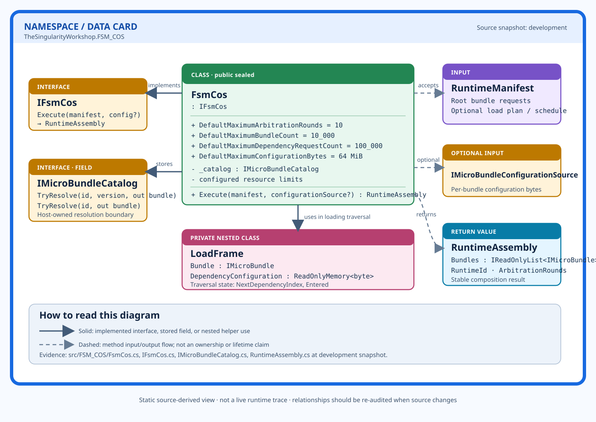

# FsmCos — source-grounded class view

**Source:** [`FsmCos.cs`](../../../src/FSM_COS/FsmCos.cs) · [`IFsmCos.cs`](../../../src/FSM_COS/IFsmCos.cs) · [`IMicroBundleCatalog.cs`](../../../src/FSM_COS/IMicroBundleCatalog.cs) · [`RuntimeAssembly.cs`](../../../src/FSM_COS/RuntimeAssembly.cs)

## Responsibility

`FsmCos` is the sealed composition engine implementing `IFsmCos`. Its public entry point is `Execute(RuntimeManifest, IMicroBundleConfigurationSource?)`, returning a `RuntimeAssembly`. A consumer supplies the catalog used to resolve domain-owned `IMicroBundle` implementations; the composition kernel does not itself imply that artifact bytes are loaded as executable assemblies.

## Source-observed public surface

- Three constructor overloads configure the catalog and resource limits.
- Default arbitration rounds: `10`.
- Default root/load-plan bundle limit: `10,000`.
- Default dependency-request limit: `100,000`.
- Default configuration-byte limit: `64 MiB`.
- `Execute` rejects null required input, bounds caller-owned manifest collections, snapshots mutable collections, validates root identities/versions, and proceeds through resolution, graph validation, loading, arbitration, and runtime handoff. The exact order and all exceptional paths must be read in source; the diagram intentionally compresses those details.

## Relationships shown

| Relationship | Evidence | Meaning |
|---|---|---|
| `FsmCos` implements `IFsmCos` | Class declaration | Public composition abstraction |
| `FsmCos` stores `IMicroBundleCatalog` | `_catalog` field and constructor | Consumer-provided bundle resolution boundary |
| `Execute` accepts `RuntimeManifest` | Method signature | Request input |
| `Execute` optionally accepts `IMicroBundleConfigurationSource` | Method signature | Optional configuration source |
| `Execute` returns `RuntimeAssembly` | Method signature | Composition result |
| `FsmCos` uses nested `LoadFrame` | Private nested type and load traversal | Internal traversal state, not a public extension point |

## Diagram semantics and limits

- Thick blue border identifies the namespace/data card.
- Color identifies card category; text labels remain explicit for accessibility.
- Solid connectors show implementation, stored-field, or nested-helper relationships.
- Dashed connectors show method input/output flow, not object ownership or lifetime.
- This is a static source-derived diagram, not a runtime visualization.
- It is manually authored at this stage. No generator, SVG rendering test, accessibility automation, build, or test run is claimed by this artifact.

## Refresh rule

Re-audit the source and regenerate/review this diagram whenever the relevant C# source changes. The development branch is the current working line; this artifact is not a release or publication claim.
