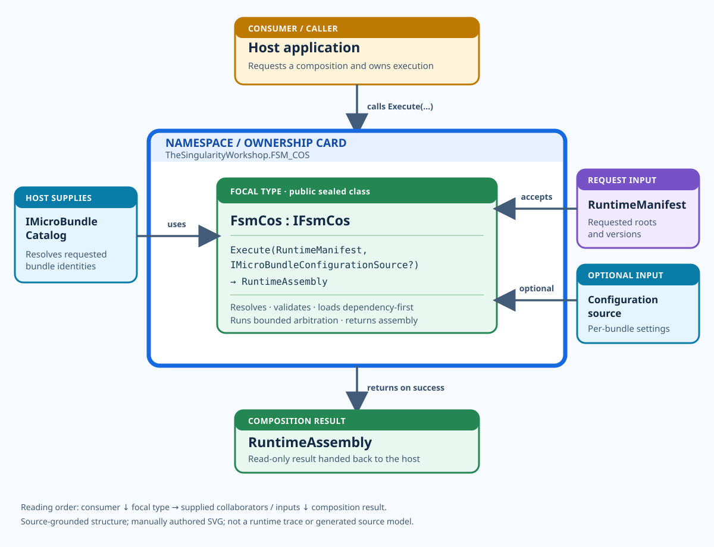

<!-- The Singularity Workshop moniker -->

# FsmCosUML — the composition entry point

**Purpose:** show how a host consumes the focal type `FsmCos`: the caller sits above the class, the call direction is downward, host-provided collaborators are labeled at the edges, and the composition result is returned below. This is a source-grounded, manually authored data-card view—not a runtime trace.

**Source:** [`FsmCos.cs`](../../../src/FSM_COS/FsmCos.cs) · [`IFsmCos.cs`](../../../src/FSM_COS/IFsmCos.cs) · [`IMicroBundleCatalog.cs`](../../../src/FSM_COS/IMicroBundleCatalog.cs) · [`RuntimeManifest.cs`](../../../src/FSM_COS/RuntimeManifest.cs) · [`RuntimeAssembly.cs`](../../../src/FSM_COS/RuntimeAssembly.cs)

## Responsibility

`FsmCos` implements `IFsmCos`. Its public composition entry point accepts a `RuntimeManifest` and an optional `IMicroBundleConfigurationSource`, resolves requested MicroBundles through a consumer-supplied `IMicroBundleCatalog`, validates and loads the dependency closure in dependency order, performs bounded arbitration, and returns a `RuntimeAssembly` when composition succeeds. The host remains responsible for executing and presenting the resulting application.

## Use cases

### 1. A host composes a requested capability

- **Goal:** assemble a capability and its prerequisites without hard-coding every dependency combination in the host.
- **Consumer provides:** a `RuntimeManifest` and an `IMicroBundleCatalog` that can resolve the requested MicroBundles.
- **Entry point:** `FsmCos.Execute(manifest, configurationSource?)`.
- **Result:** a `RuntimeAssembly` whose bundle order respects dependency prerequisites.
- **Boundary:** the result is a composition result, not proof that an application is running or that a GUI has been rendered.

### 2. A host supplies per-bundle configuration

- **Goal:** make configuration available to the requested composition without making FSM_COS own the host's configuration store.
- **Consumer provides:** an `IMicroBundleConfigurationSource` when configuration is needed.
- **Entry point:** the optional configuration-source argument to `Execute`.
- **Result:** composition evaluates configuration through the supplied boundary while FSM_COS retains responsibility for composition.

### 3. A requested composition is invalid or cannot be completed

- **Goal:** avoid handing the host a successful assembly when the requested dependency graph cannot be resolved or validated.
- **Consumer observes:** an unsuccessful composition when required bundles are missing, dependencies are invalid, resource bounds are exceeded, or bounded arbitration fails to converge.
- **Boundary:** exact exceptions and failure details are defined by the current [source](../../../src/FSM_COS/FsmCos.cs) and [tests](../../../tests/FSM_COS.Tests/FsmCosTests.cs); this diagram intentionally does not replace those contracts.

## Read the structure

- **Consumer above:** the host calls the composition entry point; the diagram does not imply that FSM_COS owns the host.
- **Focal type centered:** the primary public operation is the visual anchor.
- **Collaborators and inputs at the sides:** the catalog is supplied by the consumer; the manifest and optional configuration are inputs.
- **Result below:** `RuntimeAssembly` returns to the host only after successful composition.
- **Recursive ownership:** the namespace card contains the focal type card. Side connectors show collaboration, not ownership.

## Limits

This is a manually authored SVG and Markdown companion. It has not been generated from an AST, and it does not prove runtime execution. Read the linked source and tests for exact signatures and behavior. See [the Workshop visual standard](../../UML_VISUAL_STYLE.md) and [the UML index](../README.md) for the complete card vocabulary and related references.

---

## 🔗 Resources & Support

- [FSM_COS](https://github.com/TrentBest/TheSingularityWorkshop.FSM_COS) · [FSM_API](https://github.com/TrentBest/FSM_API) · [FSM_Serialization](https://github.com/TrentBest/TheSingularityWorkshop.FSM_Serialization) · [WebPage](https://github.com/TrentBest/WebPage)
- [GitHub](https://github.com/TrentBest) · [Coder Legion](https://coderlegion.com/) · [Profile](https://coderlegion.com/user/The%2BSingularity%2BWorkshop) · [Patreon](https://www.patreon.com/c/TheSingularityWorkshop) · [PayPal](https://www.paypal.com/donate/?hosted_button_id=3Z7263LCQMV9J)

<!-- THE SINGULARITY WORKSHOP FOOTER -->

