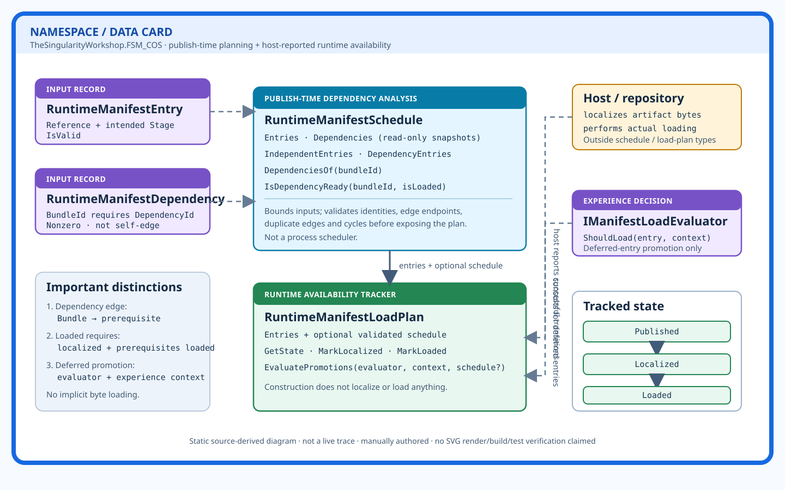

# Runtime manifest schedule and load plan

**Source files:** [`RuntimeManifestSchedule.cs`](../../../src/FSM_COS/RuntimeManifestSchedule.cs) · [`RuntimeManifestLoadPlan.cs`](../../../src/FSM_COS/RuntimeManifestLoadPlan.cs) · [`RuntimeManifestEntry.cs`](../../../src/FSM_COS/RuntimeManifestEntry.cs) · [`RuntimeManifestDependency.cs`](../../../src/FSM_COS/RuntimeManifestDependency.cs) · [`IManifestLoadEvaluator.cs`](../../../src/FSM_COS/IManifestLoadEvaluator.cs)

## What this view explains

FSM_COS separates two concerns that can look similar when viewed only from the outside:

- **`RuntimeManifestSchedule`** analyzes a published dependency graph. It snapshots bounded inputs, validates entries and dependency edges, rejects duplicate IDs/edges and cycles, and exposes dependency readiness. It is explicitly not a process scheduler.
- **`RuntimeManifestLoadPlan`** tracks the availability state of published entries. It does not fetch bytes or load bundles; a host/repository adapter performs those actions and reports successful transitions.

## State and promotion rules visible in source

- New load-plan entries start in `Published`.
- `MarkLocalized` transitions a known entry to `Localized` (and leaves an already loaded entry loaded).
- `MarkLoaded` requires the entry to be localized. When a schedule is present, all declared prerequisites must already be `Loaded`.
- `EvaluatePromotions` considers localized entries in stage order. Deferred entries require `IManifestLoadEvaluator.ShouldLoad(entry, experienceContext)`; dependency readiness is also checked when a schedule is available.
- A supplied promotion schedule must agree with the load plan's identities and stages. When a plan already owns a schedule, dependency edges must also be preserved.

## Relationship semantics

| Relationship | Meaning |
|---|---|
| Entry → schedule | Entry identities and intended load stages are analyzed as a plan |
| Dependency edge → schedule | `BundleId` declares a prerequisite `DependencyId` |
| Schedule → load plan | Optional dependency constraints for safe state transitions |
| Host/repository → load plan | Host reports localization/loading outcomes; the plan does not perform those operations |
| Evaluator → promotion decision | Experience-specific choice about deferred entries |

## Diagram limits

This is a manually authored static diagram derived from the linked C# source, not a runtime trace or generated UML. It does not prove that an artifact was fetched, hash-verified, loaded, or executed. SVG rendering, accessibility automation, build, and tests have not been run as part of this documentation change.
