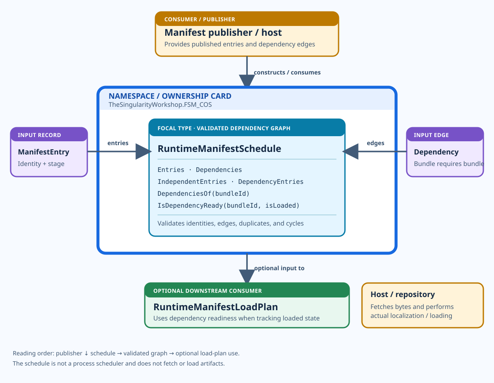

<!-- The Singularity Workshop moniker -->

# RuntimeManifestScheduleUML — dependency readiness

**Purpose:** explain the dependency schedule from the publisher/host perspective: entries and dependency edges flow into the centered focal type, which validates the graph and exposes readiness information to downstream composition logic.

**Source:** [`RuntimeManifestSchedule.cs`](../../../src/FSM_COS/RuntimeManifestSchedule.cs) · [`RuntimeManifestEntry.cs`](../../../src/FSM_COS/RuntimeManifestEntry.cs) · [`RuntimeManifestDependency.cs`](../../../src/FSM_COS/RuntimeManifestDependency.cs) · [`RuntimeManifestLoadPlan.cs`](../../../src/FSM_COS/RuntimeManifestLoadPlan.cs) · [`IManifestLoadEvaluator.cs`](../../../src/FSM_COS/IManifestLoadEvaluator.cs)

## Responsibility

`RuntimeManifestSchedule` validates a published dependency graph and exposes dependency-readiness information. It does not schedule processes, fetch artifact bytes, localize repositories, or load bundles. `RuntimeManifestLoadPlan` can use the schedule to enforce dependency prerequisites when tracking host-reported availability.

## Use cases

### 1. Validate a published dependency graph

- **Goal:** reject invalid composition metadata before it is used for dependency-aware loading.
- **Consumer provides:** bounded `RuntimeManifestEntry` and `RuntimeManifestDependency` collections.
- **Entry point:** construct a `RuntimeManifestSchedule`.
- **Result:** a validated schedule exposing entries, dependency relationships, and readiness queries.
- **Failure boundary:** invalid identities, missing edge endpoints, duplicate entries/edges, or cycles are rejected according to the current source and tests.

### 2. Track loaded state without violating prerequisites

- **Goal:** avoid marking a bundle loaded before its prerequisites are loaded.
- **Consumer provides:** a `RuntimeManifestLoadPlan`, optionally using the validated schedule, and reports successful localization/loading transitions.
- **Entry point:** `MarkLocalized`, `MarkLoaded`, and `EvaluatePromotions` on the load plan.
- **Result:** the plan can enforce dependency readiness while the host remains responsible for actual localization and loading.

### 3. Decide whether a deferred entry is wanted

- **Goal:** make an experience-specific decision without embedding the host's policy in the schedule.
- **Consumer provides:** an `IManifestLoadEvaluator` and experience context to the load-plan evaluation path.
- **Result:** the evaluator informs promotion decisions; it does not fetch or load an artifact itself.

## Read the structure

- **Publisher above:** the host/publisher provides the graph inputs.
- **Focal type centered:** graph validation and readiness are the main subject.
- **Entry and dependency cards at the sides:** they are inputs, not children owned by the schedule.
- **Load plan below:** downstream code may use the schedule to constrain state transitions.
- **Host boundary:** artifact retrieval and actual loading remain outside these types.

## Limits

This SVG is manually authored and source-grounded, not a runtime trace or generated AST view. The diagram compresses details; consult the linked source and tests for exact validation and exception behavior. See [the Workshop visual standard](../../UML_VISUAL_STYLE.md) and [the UML index](../README.md).

---

## 🔗 Resources & Support

- [FSM_COS](https://github.com/TrentBest/TheSingularityWorkshop.FSM_COS) · [FSM_API](https://github.com/TrentBest/FSM_API) · [FSM_Serialization](https://github.com/TrentBest/TheSingularityWorkshop.FSM_Serialization) · [WebPage](https://github.com/TrentBest/WebPage)
- [GitHub](https://github.com/TrentBest) · [Coder Legion](https://coderlegion.com/) · [Profile](https://coderlegion.com/user/The%2BSingularity%2BWorkshop) · [Patreon](https://www.patreon.com/c/TheSingularityWorkshop) · [PayPal](https://www.paypal.com/donate/?hosted_button_id=3Z7263LCQMV9J)

<!-- THE SINGULARITY WORKSHOP FOOTER -->

