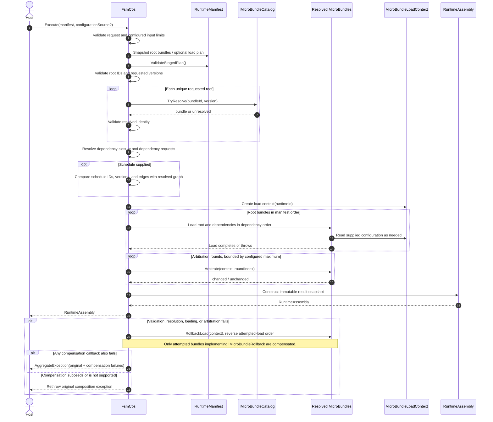

<!-- The Singularity Workshop moniker -->

# Sequence: Compose a Runtime from a Manifest

**ID:** SEQ-FSMCOS-001  
**Status:** Source-reviewed, manually authored  
**Branch assessed:** `development`  
**Focal operation:** `FsmCos.Execute(RuntimeManifest, IMicroBundleConfigurationSource?)`  
**Related API:** `FsmCos.TryExecute(...)`  
**Evidence class:** Static source reading; not runtime-captured and not generated.

## Purpose

Show the main success and compensation paths through the composition kernel. The call flow below is based on `src/FSM_COS/FsmCos.cs`; public contracts are described in `RuntimeManifest.cs`, `IMicroBundleCatalog.cs`, `IMicroBundleConfigurationSource.cs`, `RuntimeAssembly.cs`, and `RuntimeCompositionResult.cs`.

## Sequence

### Important qualifications

- The dependency graph is resolved and validated **before** bundle loading begins; invalid root/dependency identities are rejected before load callbacks.
- The exact traversal is implemented by private helpers in `FsmCos.cs`. This diagram intentionally abstracts helper internals; it is not a compiler-derived call graph.
- Arbitration exits when a round reports no changes. If every allowed round reports changes, composition fails rather than returning a non-converged assembly.
- Compensation is opt-in per bundle through `IMicroBundleRollback`. It is not a universal transaction: side effects from bundles without that contract are not automatically undone.
- `TryExecute` wraps the same core path and returns the active `RuntimeCompositionPhase` plus the original exception on failure. `Execute` remains exception-based.
- Conditional `WORKSHOP_USE_REPOSITORY_SOURCES` builds include a published/pre-resolved path with different loading/arbitration behavior. The sequence above represents the ordinary authoring-composition path; published execution needs its own focused diagram.

## Complexity notes (static estimate, not benchmark evidence)

| Operation | Dominant work | Estimate / limitation |
|---|---|---|
| Request snapshots and root checks | Enumerate caller-provided roots and optional plan | Linear in the number of supplied entries, bounded by configured limits |
| Root catalog resolution | One versioned lookup per unique requested root | Depends on catalog implementation and lookup cost |
| Dependency closure | Traverse discovered bundles and dependency requests while tracking resolved IDs | Expected linear in vertices plus edges if dictionary/set operations are expected O(1); catalog and user callbacks are external costs |
| Schedule consistency | Compare resolved IDs, versions, and dependency-edge sets | Expected linear in vertices plus edges, plus sorting only when formatting mismatch details |
| Loading | Visit resolved dependencies and invoke user-defined load/configuration callbacks | Graph traversal cost plus unbounded-by-this-class callback latency |
| Arbitration | Up to configured maximum rounds, each visiting loaded bundles | O(R × L × callback cost), where R is the configured round bound and L is loaded bundle count |
| Failure compensation | Walk attempted loads in reverse order | Linear in attempted bundle count, plus rollback callback costs |

These are algorithm-shape estimates from source, not measured timing or hard wall-clock guarantees. Configuration byte, bundle-count, dependency-request, and arbitration-round limits constrain parts of the input, but external catalog and MicroBundle callback costs remain outside a deterministic time guarantee.

## Source and test evidence

- [FsmCos.cs](../../../src/FSM_COS/FsmCos.cs) — public entry points, phase changes, validation, graph resolution, load/arbitration, compensation.
- [RuntimeManifest.cs](../../../src/FSM_COS/RuntimeManifest.cs) — manifest fields and staged-plan validation.
- [RuntimeAssembly.cs](../../../src/FSM_COS/RuntimeAssembly.cs) — read-only assembly snapshot and lookup helpers.
- [RuntimeCompositionResult.cs](../../../src/FSM_COS/RuntimeCompositionResult.cs) — failure phases and non-throwing result contract.
- [FsmCosTests.cs](../../../tests/FSM_COS.Tests/FsmCosTests.cs) — composition, failure, rollback, bounds, arbitration, and TryExecute behavior.

**Verification state:** Source files inspected on `development`; tests were not run for this documentation change. Diagram freshness is not automated.

<!-- THE SINGULARITY WORKSHOP FOOTER -->

