<!-- The Singularity Workshop moniker -->

# State/lifecycle — RuntimeExperienceRegistry

**ID:** STATE-FSMCOS-001  
**Focus:** Registry membership and host-selected runtime identity  
**Evidence type:** Manually authored, source-reviewed lifecycle view  
**Source revision reviewed:** `development` source for `RuntimeExperienceRegistry`  
**Authority:** `RuntimeExperienceRegistry.cs` and `RuntimeExperienceRegistryTests.cs`

This view documents only the registry's metadata state. It does not describe MicroBundle execution, presentation, disposal, or unloading.

## State model

```mermaid
stateDiagram-v2
    direction LR
    [*] --> Empty: new registry
    Empty --> RetainedNoSelection: TryRegister(new RuntimeId)
    RetainedNoSelection --> RetainedNoSelection: register another unique ID
    RetainedNoSelection --> Selected: TryActivate(registered ID)
    Selected --> Selected: TryActivate(other registered ID)
    Selected --> Selected: TryRegister(unique ID)
    Selected --> Selected: TryActivate(unknown ID) / false; selection unchanged
    RetainedNoSelection --> RetainedNoSelection: TryActivate(unknown ID) / false
    Selected --> RetainedNoSelection: ClearActive()
    Selected --> RetainedNoSelection: TryRemove(active ID)
    RetainedNoSelection --> RetainedNoSelection: TryRemove(registered inactive ID)
    RetainedNoSelection --> Empty: TryRemove(last retained ID)
    Selected --> Selected: TryRemove(non-active ID)
    Empty --> Empty: duplicate/unknown operation rejected
```

## State invariants

| State | Invariant |
|---|---|
| **Empty** | No registered assemblies; `ActiveRuntimeId == null`. |
| **RetainedNoSelection** | One or more assemblies retained; `ActiveRuntimeId == null`. |
| **Selected** | One or more assemblies retained; `ActiveRuntimeId` identifies an entry in the registry. |

## Transition contract

- **Register:** `TryRegister` retains an assembly keyed by `RuntimeId`; it does not select it. A duplicate ID returns `false` and does not replace the original.
- **Activate:** `TryActivate` succeeds only for a registered ID. An unknown ID returns `false` without changing the prior selection.
- **Clear:** `ClearActive` clears selection while preserving membership.
- **Remove:** `TryRemove` returns `false` for an unknown ID. Removing the selected ID clears selection; removing another ID preserves selection.
- **Read:** `Assemblies` returns a copied read-only snapshot. Read operations do not change registry state.
- **Concurrency:** registry dictionary and selection operations are guarded by `_gate`; each individual operation is synchronized.

## Ownership boundary

Removal forgets registry membership only. It does not dispose, unload, or otherwise transfer ownership of an assembly's MicroBundles. The current domain contract has no general unload operation. Selection is host metadata; it does not execute or present the selected runtime.

## Test traceability

Source tests in [RuntimeExperienceRegistryTests.cs](../../../tests/FSM_COS.Tests/RuntimeExperienceRegistryTests.cs) cover switching between retained runtimes, duplicate identity, failed activation preserving selection, active removal, and snapshot isolation. The diagram was checked against source and test text; **tests were not run as part of this documentation change**.

## Provenance

- Implementation: [RuntimeExperienceRegistry.cs](../../../src/FSM_COS/RuntimeExperienceRegistry.cs)
- Related workflow: [SEQ-FSMCOS-003 — Runtime experience selection](../SequenceDiagrams/RuntimeExperienceHost-Selection.md)
- Related user goal: [UC-FSMCOS-002 — Manage runtime experiences](../UseCases/User%20Goals/UC-FSMCOS-002-Manage-Runtime-Experiences.md)
- Standard: [State and Lifecycle Diagrams](../Standard/STATE_LIFECYCLE.md)

This is a manual, source-reviewed diagram. It is not generated, symbol-resolved, or freshness-checked by CI.

<!-- THE SINGULARITY WORKSHOP FOOTER -->

