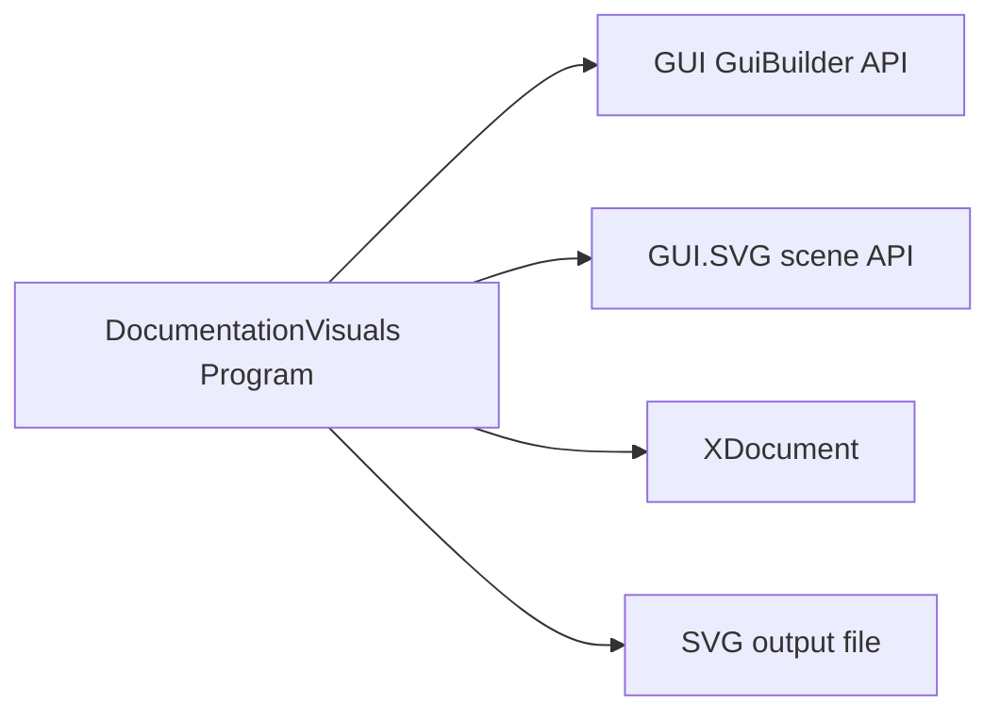

# DocumentationVisuals Program

**Source:** `samples/DocumentationVisuals/Program.cs`  
**Baseline:** `ce43e8f5bf3dfc229f28678fc2e0d944c5c8d38a`  
**Authorship:** manually authored; not GUI.SVG-generated.

## Source-grounded summary

Top-level sample uses GUI GuiBuilder and GUI.SVG APIs to author an SVG contract map and writes to the command-line path or docs/assets/fsm-cos-preflight.svg. It also imports XDocument.

## Diagram

## Evidence boundary

The source scene describes itself as a contract map, not a live execution trace. Connector motion is explanatory. This sample does not provide runtime telemetry from a running FsmCos instance.

For behavior beyond the declaration summarized here, inspect the implementation and relevant tests at the same baseline. This page is not evidence of hosted rendering or accessibility behavior by itself.

---

**The Singularity Workshop**  
[GitHub](https://github.com/TrentBest) · [Coder Legion](https://coderlegion.com/) · [Patreon](https://www.patreon.com/c/TheSingularityWorkshop) · [PayPal](https://www.paypal.com/donate/?hosted_button_id=3Z7263LCQMV9J)  
[ FSM_API ](https://github.com/TrentBest/FSM_API) · [ FSM_Serialization ](https://github.com/TrentBest/TheSingularityWorkshop.FSM_Serialization) · [ WebPage ](https://github.com/TrentBest/WebPage) · [ FSM_COS Documentation Standard ](https://github.com/TrentBest/TheSingularityWorkshop.FSM_COS/blob/development/DOCUMENTATION_STANDARD.md)  
**Because state shouldn't be a mess.**  
*And because static boundaries are invitations to cause trouble.*
