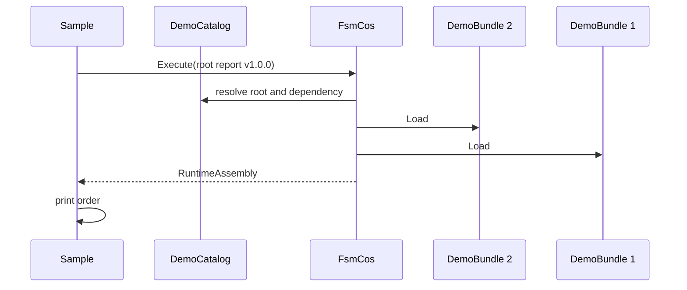

# MinimalConsumer Program

**Source:** `samples/FSM_COS.MinimalConsumer/Program.cs`  
**Baseline:** `ce43e8f5bf3dfc229f28678fc2e0d944c5c8d38a`  
**Authorship:** manually authored; not GUI.SVG-generated.

## Source-grounded summary

Top-level console sample defines DemoCatalog and DemoBundle. It requests report bundle ID 1/version 1.0.0; report declares data bundle ID 2 as prerequisite. It prints the composed order.

## Diagram

## Evidence boundary

This is an in-memory example of dependency-first composition, not production catalog/storage/network/lifecycle code.

For behavior beyond the declaration summarized here, inspect the implementation and relevant tests at the same baseline. This page is not evidence of hosted rendering or accessibility behavior by itself.

---

**The Singularity Workshop**  
[GitHub](https://github.com/TrentBest) · [Coder Legion](https://coderlegion.com/) · [Patreon](https://www.patreon.com/c/TheSingularityWorkshop) · [PayPal](https://www.paypal.com/donate/?hosted_button_id=3Z7263LCQMV9J)  
[ FSM_API ](https://github.com/TrentBest/FSM_API) · [ FSM_Serialization ](https://github.com/TrentBest/TheSingularityWorkshop.FSM_Serialization) · [ WebPage ](https://github.com/TrentBest/WebPage) · [ FSM_COS Documentation Standard ](https://github.com/TrentBest/TheSingularityWorkshop.FSM_COS/blob/development/DOCUMENTATION_STANDARD.md)  
**Because state shouldn't be a mess.**  
*And because static boundaries are invitations to cause trouble.*
