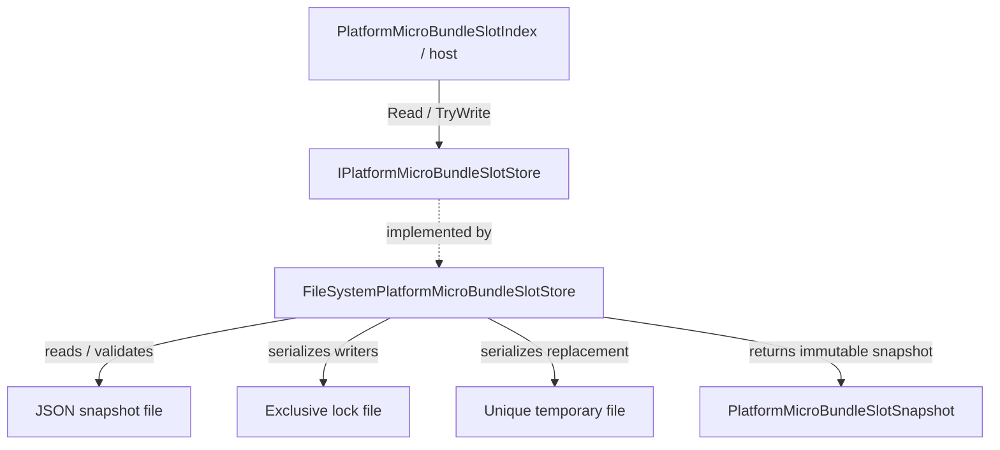
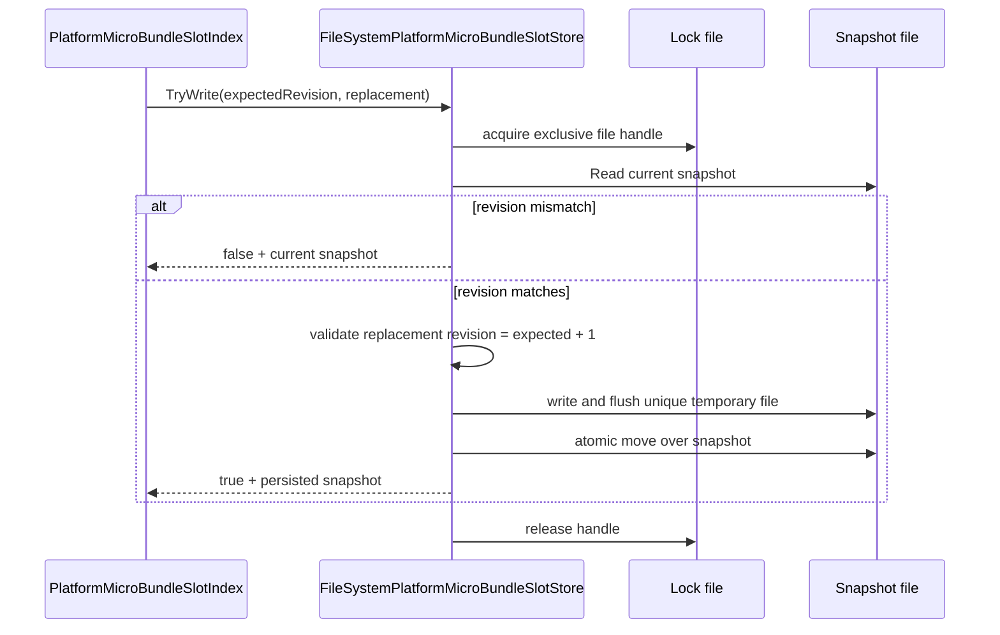

<!-- The Singularity Workshop moniker -->

# FileSystemPlatformMicroBundleSlotStore — UML neighborhood

**Evidence class:** source-checked type structure and persistence sequence. **Target:** `TheSingularityWorkshop.FSM_COS.FileSystemPlatformMicroBundleSlotStore`. **Source revision:** `development`; manually maintained.

## Persistence sequence

## Limits

The diagram represents the file-level implementation and its interface boundary. It does not claim a distributed transaction, artifact cache, encryption layer, or multi-machine shared-store guarantee beyond the filesystem's atomic rename and exclusive file-handle semantics.

See [source companion](FileSystemPlatformMicroBundleSlotStore.md), [slot-index companion](PlatformMicroBundleSlotIndex.md), and [data models and lineage](../../Standard/DATA_MODELS_AND_LINEAGE.md).

<!-- THE SINGULARITY WORKSHOP FOOTER -->

