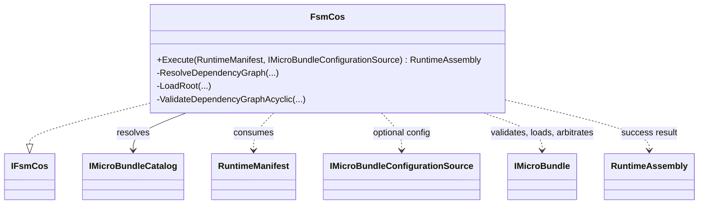

# FsmCos

**Source:** `src/FSM_COS/FsmCos.cs`  
**Baseline:** `ce43e8f5bf3dfc229f28678fc2e0d944c5c8d38a`  
**Authorship:** manually authored; not GUI.SVG-generated.

## Source-grounded summary

Sealed composition engine implementing IFsmCos. Execute validates/snapshots manifest inputs, resolves root versions and dependency closure, validates identities and graph, loads dependencies before dependents, arbitrates to stability within a bound, and returns RuntimeAssembly only on success.

## Diagram

## Evidence boundary

Resource limits: default 10 arbitration rounds, 10,000 bundles, 100,000 dependency requests, 64 MiB total configuration. Preflight happens before Load callbacks. Iterative graph traversal avoids recursive stack growth. Configuration bytes are copied. If a later Load fails, earlier bundle side effects are not rolled back; tests cover this. A schedule is not the FSM_API process scheduler.

For behavior beyond the declaration summarized here, inspect the implementation and relevant tests at the same baseline. This page is not evidence of hosted rendering or accessibility behavior by itself.
