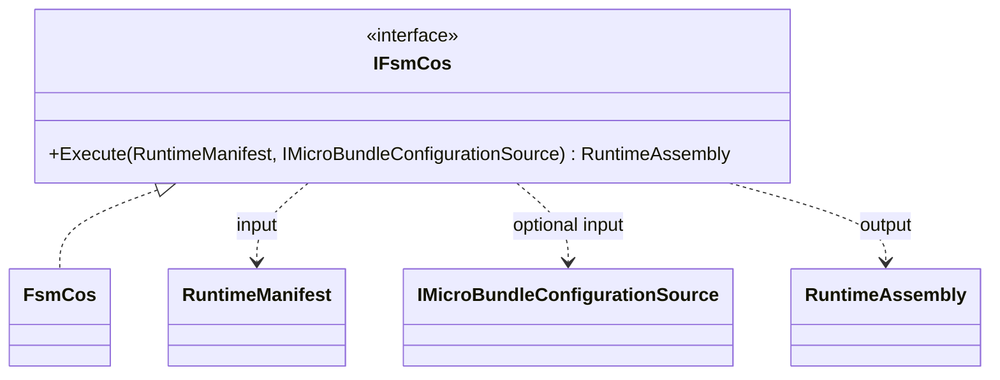

# IFsmCos

**Source:** `src/FSM_COS/IFsmCos.cs`  
**Baseline:** `ce43e8f5bf3dfc229f28678fc2e0d944c5c8d38a`  
**Authorship:** manually authored; not GUI.SVG-generated.

## Source-grounded summary

Public composition interface with one method: Execute(RuntimeManifest, optional IMicroBundleConfigurationSource) returning RuntimeAssembly.

## Diagram

## Evidence boundary

The signature alone does not promise graph resolution, load order, rollback, thread safety, or lifecycle management; attribute those to implementation/tests.

For behavior beyond the declaration summarized here, inspect the implementation and relevant tests at the same baseline. This page is not evidence of hosted rendering or accessibility behavior by itself.
