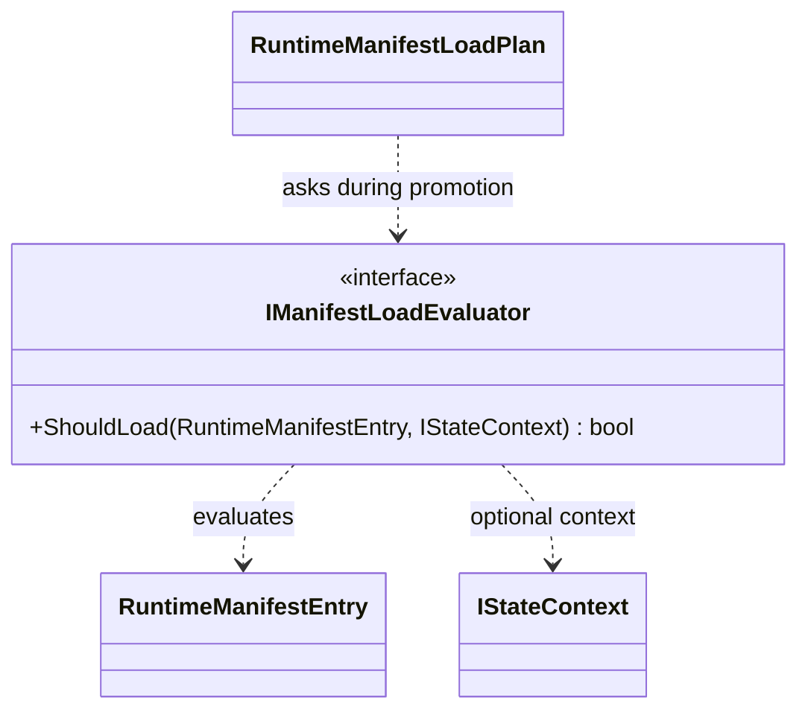

# IManifestLoadEvaluator

**Source:** `src/FSM_COS/IManifestLoadEvaluator.cs`  
**Baseline:** `ce43e8f5bf3dfc229f28678fc2e0d944c5c8d38a`  
**Authorship:** manually authored; not GUI.SVG-generated.

## Source-grounded summary

Experience-owned decision interface: ShouldLoad(RuntimeManifestEntry, nullable IStateContext). XML remarks exclude dependency resolution, artifact localization, and loading from this contract.

## Diagram

## Evidence boundary

The source establishes a contract and call site, not a particular policy or host evaluator correctness.

For behavior beyond the declaration summarized here, inspect the implementation and relevant tests at the same baseline. This page is not evidence of hosted rendering or accessibility behavior by itself.
