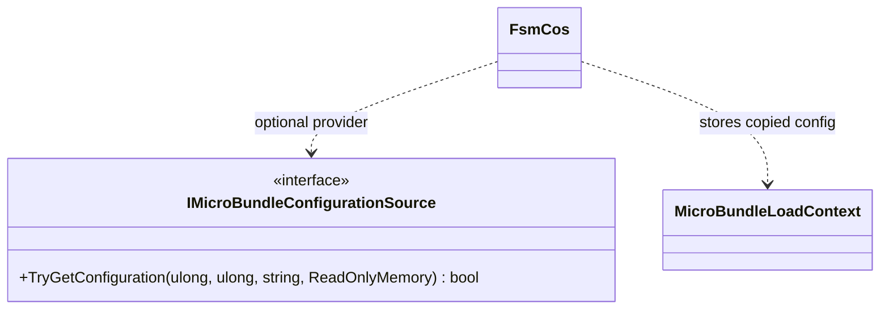

# IMicroBundleConfigurationSource

**Source:** `src/FSM_COS/IMicroBundleConfigurationSource.cs`  
**Baseline:** `ce43e8f5bf3dfc229f28678fc2e0d944c5c8d38a`  
**Authorship:** manually authored; not GUI.SVG-generated.

## Source-grounded summary

Optional provider contract keyed by runtime ID, bundle ID, and resolved version; returns ReadOnlyMemory<byte> plus a boolean presence result.

## Diagram

## Evidence boundary

FsmCos copies returned memory before storing it and bounds total configuration bytes. The interface does not guarantee provider purity, confidentiality, persistence, or immutability.

For behavior beyond the declaration summarized here, inspect the implementation and relevant tests at the same baseline. This page is not evidence of hosted rendering or accessibility behavior by itself.

---

**The Singularity Workshop**  
[GitHub](https://github.com/TrentBest) · [Coder Legion](https://coderlegion.com/) · [Patreon](https://www.patreon.com/c/TheSingularityWorkshop) · [PayPal](https://www.paypal.com/donate/?hosted_button_id=3Z7263LCQMV9J)  
[ FSM_API ](https://github.com/TrentBest/FSM_API) · [ FSM_Serialization ](https://github.com/TrentBest/TheSingularityWorkshop.FSM_Serialization) · [ WebPage ](https://github.com/TrentBest/WebPage) · [ FSM_COS Documentation Standard ](https://github.com/TrentBest/TheSingularityWorkshop.FSM_COS/blob/development/DOCUMENTATION_STANDARD.md)  
**Because state shouldn't be a mess.**  
*And because static boundaries are invitations to cause trouble.*
