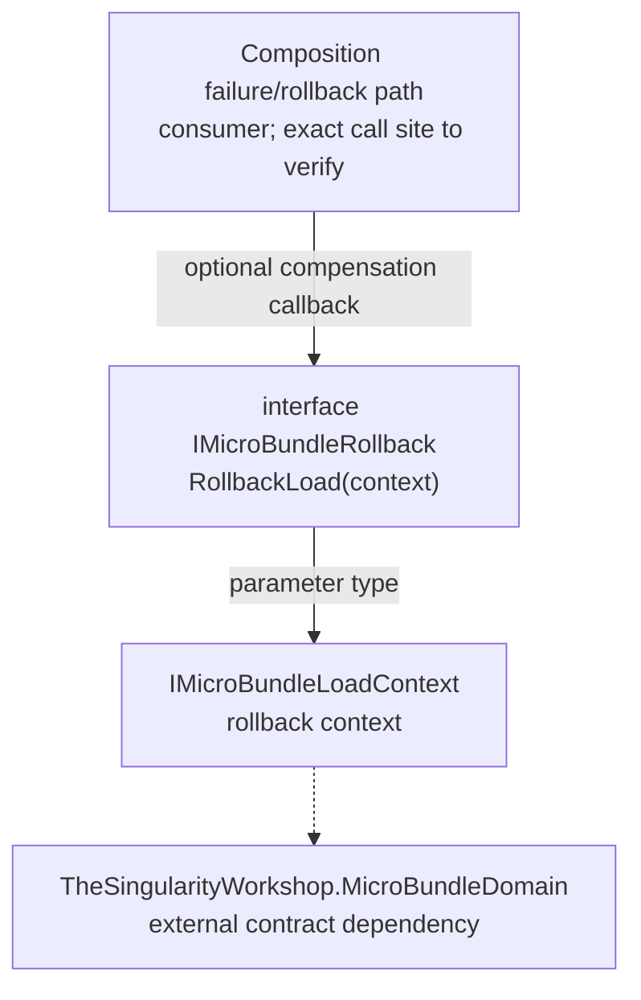

# IMicroBundleRollback — UML neighborhood

**Evidence class:** source-checked structural neighborhood with human-authored use cases. **Target:** `TheSingularityWorkshop.FSM_COS.IMicroBundleRollback`. **Source revision:** `development` at documentation update time. Not generated; runtime call edges are not claimed as verified by this page.

## Use cases

1. **Compensate a failed load attempt.** A bundle that implements this optional contract receives a callback to undo its own load-time side effects.
2. **Partial compensation.** A bundle may not implement the contract or its callback may not fully reverse side effects; no transactional guarantee is implied.

## Limits

The consumer node represents the documented responsibility, not a fully traced call graph. Confirm invocation sites and exception handling from source before upgrading this diagram to source-derived call-flow evidence.

See [source page](IMicroBundleRollback.md) and [sequence standard](../../Standard/SEQUENCE_DIAGRAMS_AND_COMPLEXITY.md).
