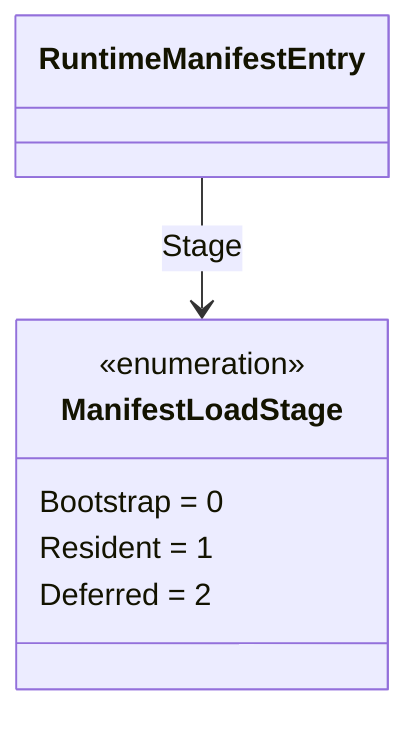

# ManifestLoadStage

**Source:** `src/FSM_COS/ManifestLoadStage.cs`  
**Baseline:** `ce43e8f5bf3dfc229f28678fc2e0d944c5c8d38a`  
**Authorship:** manually authored; not GUI.SVG-generated.

## Source-grounded summary

Enum values: Bootstrap=0, Resident=1, Deferred=2. They label intended plan roles.

## Diagram

## Evidence boundary

The source explicitly says stage labels do not themselves implement stage-specific loading. FsmCos.Execute does not automatically defer/promote based on this enum. RuntimeManifestLoadPlan separately evaluates candidates.

For behavior beyond the declaration summarized here, inspect the implementation and relevant tests at the same baseline. This page is not evidence of hosted rendering or accessibility behavior by itself.
