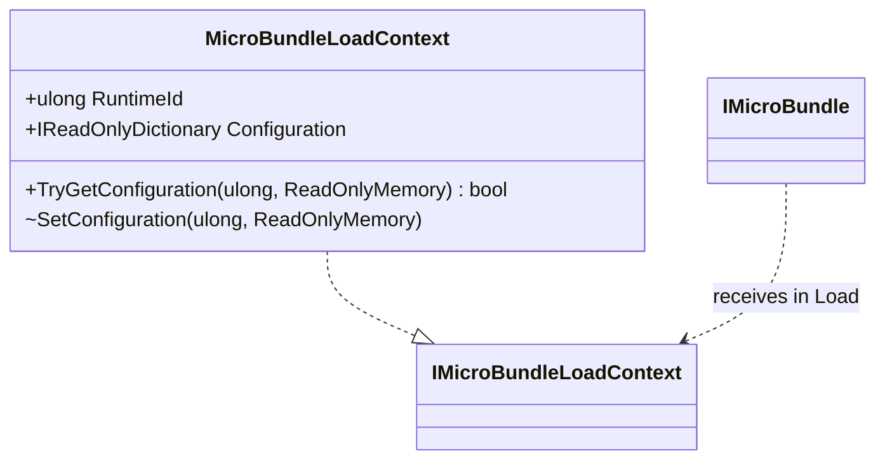

# MicroBundleLoadContext

**Source:** `src/FSM_COS/MicroBundleLoadContext.cs`  
**Baseline:** `ce43e8f5bf3dfc229f28678fc2e0d944c5c8d38a`  
**Authorship:** manually authored; not GUI.SVG-generated.

## Source-grounded summary

Sealed IMicroBundleLoadContext implementation with runtime ID, configuration dictionary view, TryGetConfiguration, and internal SetConfiguration.

## Diagram

## Evidence boundary

The property exposes the private dictionary through IReadOnlyDictionary, not a defensive wrapper. FsmCos snapshots configuration byte buffers before insertion; do not infer deep immutability of arbitrary memory.

For behavior beyond the declaration summarized here, inspect the implementation and relevant tests at the same baseline. This page is not evidence of hosted rendering or accessibility behavior by itself.
