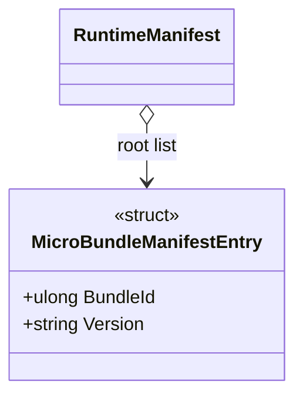

# MicroBundleManifestEntry

**Source:** `src/FSM_COS/MicroBundleManifestEntry.cs`  
**Baseline:** `ce43e8f5bf3dfc229f28678fc2e0d944c5c8d38a`  
**Authorship:** manually authored; not GUI.SVG-generated.

## Source-grounded summary

Readonly record struct with BundleId and Version; its explicit constructor rejects ID 0 and blank versions.

## Diagram

## Evidence boundary

default(MicroBundleManifestEntry) bypasses the validating constructor. FsmCos.Execute explicitly rejects zero IDs and blank root versions.

For behavior beyond the declaration summarized here, inspect the implementation and relevant tests at the same baseline. This page is not evidence of hosted rendering or accessibility behavior by itself.
