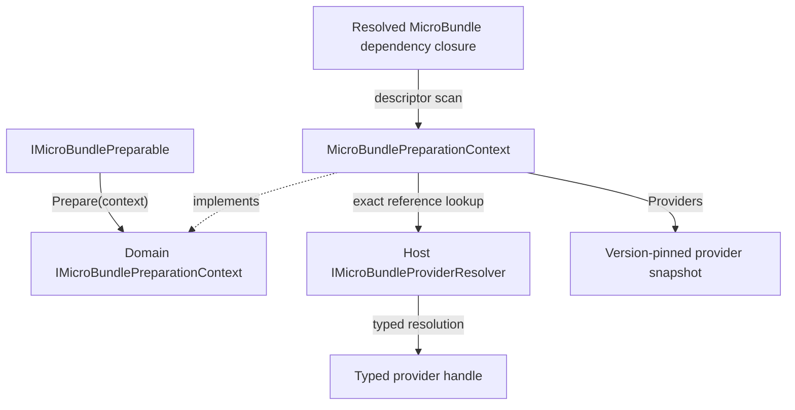
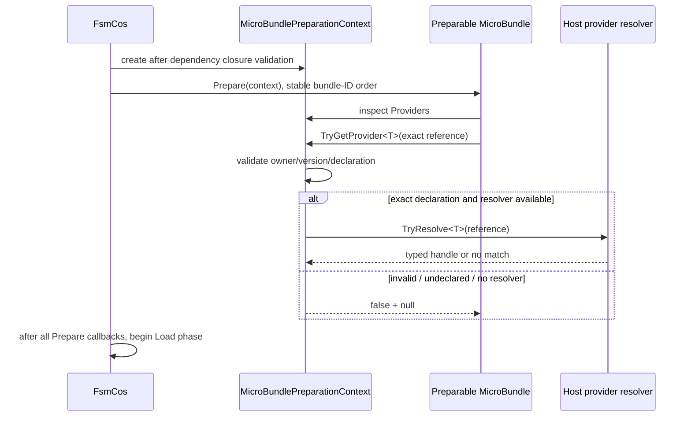

<!-- The Singularity Workshop moniker -->

# MicroBundlePreparationContext — UML neighborhood

**Evidence class:** source-checked adapter structure and authored resolution flow. **Target:** `TheSingularityWorkshop.FSM_COS.MicroBundlePreparationContext`. **Source revision:** `development`; manually maintained.

## Resolution sequence

## Limits

This adapter does not define `IDiegeticGUI`, GUI rendering, creator trust, or provider execution. Those belong to the GUI/authoring host and its adapters. The source-mode contract is intentionally separate from the public package build until the MicroBundleDomain package dependency is advanced.

See [source companion](MicroBundlePreparationContext.md), [composition sequence](../../SequenceDiagrams/FsmCos-Execute.md), and [typed provider integration](../../../CONSUMING_MICROBUNDLES.md).

<!-- THE SINGULARITY WORKSHOP FOOTER -->

