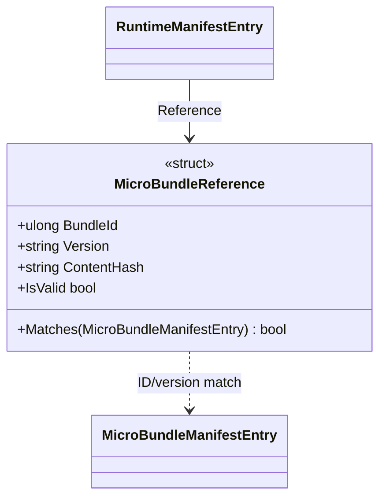

# MicroBundleReference

**Source:** `src/FSM_COS/MicroBundleReference.cs`  
**Baseline:** `ce43e8f5bf3dfc229f28678fc2e0d944c5c8d38a`  
**Authorship:** manually authored; not GUI.SVG-generated.

## Source-grounded summary

Readonly record struct of BundleId, Version, ContentHash, with IsValid and Matches(MicroBundleManifestEntry).

## Diagram

## Evidence boundary

IsValid checks nonzero ID and nonblank version/hash. Matches compares ID and version ordinally. Neither verifies content hash against artifact bytes nor resolves an artifact.

For behavior beyond the declaration summarized here, inspect the implementation and relevant tests at the same baseline. This page is not evidence of hosted rendering or accessibility behavior by itself.
