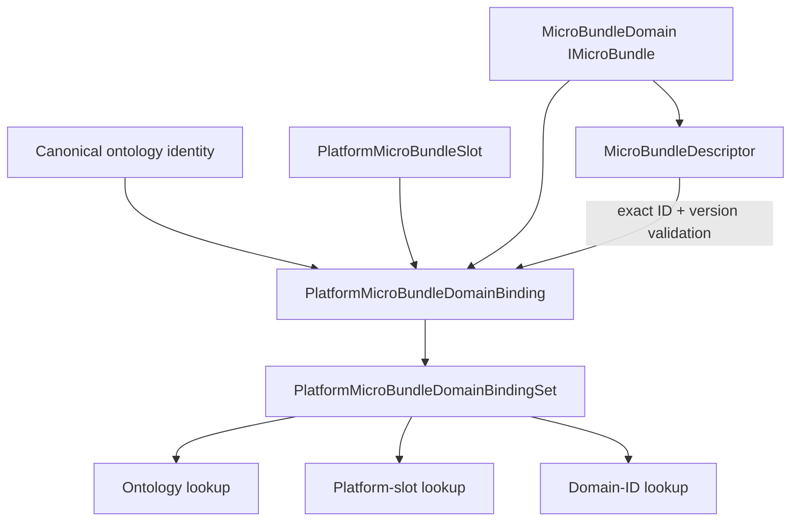

<!-- The Singularity Workshop moniker -->

# PlatformMicroBundleDomainBinding — UML neighborhood

**Evidence class:** source-checked relationships and authored use cases. **Target:** `TheSingularityWorkshop.FSM_COS.PlatformMicroBundleDomainBinding` and `PlatformMicroBundleDomainBindingSet`. **Source revision:** `development`; manually maintained.

## Use cases

1. Materialize a verified portable capability and explicitly record its platform slot and Domain numeric ID.
2. Resolve the same binding by ontology, platform slot, or Domain ID without treating those values as interchangeable.
3. Reject duplicate or mismatched identities before the binding set enters a staged runtime.

## Limits

This file records the identity projection boundary. It does not resolve portable artifacts, allocate slots, load MicroBundles, or establish that an artifact is trusted.

See [source companion](PlatformMicroBundleDomainBinding.md), [slot-index companion](PlatformMicroBundleSlotIndex.md), and [runtime boundary](../../RUNTIME_BOUNDARY.md).

<!-- THE SINGULARITY WORKSHOP FOOTER -->

