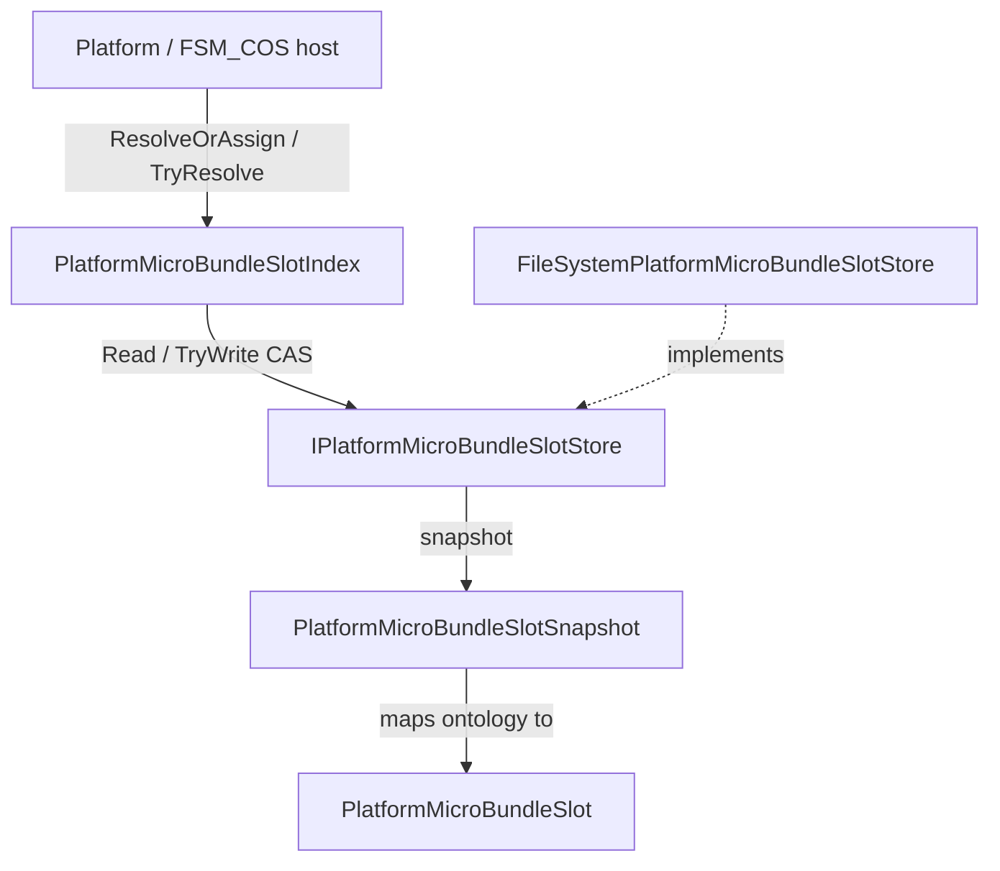

<!-- The Singularity Workshop moniker -->
<p align="center"><a href="https://github.com/TrentBest"></a></p>

# PlatformMicroBundleSlotIndex — UML neighborhood

**Evidence class:** source-checked value objects, allocation algorithm, and persistence contract. **Target:** `TheSingularityWorkshop.FSM_COS.PlatformMicroBundleSlotIndex` and its file-level companion types. **Source revision:** `development`; manually maintained.



## Allocation sequence

```mermaid
sequenceDiagram
    participant Caller
    participant Index as PlatformMicroBundleSlotIndex
    participant Store as IPlatformMicroBundleSlotStore
    Caller->>Index: ResolveOrAssign(ontology)
    Index->>Index: validate canonical ontology
    loop bounded CAS attempts (max 64)
        Index->>Store: Read()
        alt assignment exists
            Store-->>Index: snapshot with slot
            Index-->>Caller: existing slot
        else assignment absent
            Index->>Index: allocate max(slot)+1; revision+1
            Index->>Store: TryWrite(expectedRevision, replacement)
            alt write wins
                Store-->>Index: persisted snapshot
                Index-->>Caller: assigned slot
            else conflict
                Store-->>Index: latest snapshot
                Index->>Index: retry / reuse winner
            end
        end
    end
```

## Limits

The allocator guarantees uniqueness only within the store's platform namespace. It does not create globally portable IDs or map a slot to a Domain ID; that explicit projection belongs to [PlatformMicroBundleDomainBinding](PlatformMicroBundleDomainBinding.md).

See [source companion](PlatformMicroBundleSlotIndex.md), [filesystem store](FileSystemPlatformMicroBundleSlotStore.md), and [data models and lineage](../../Standard/DATA_MODELS_AND_LINEAGE.md).

<!-- THE SINGULARITY WORKSHOP FOOTER -->
<p align="center"></p>
