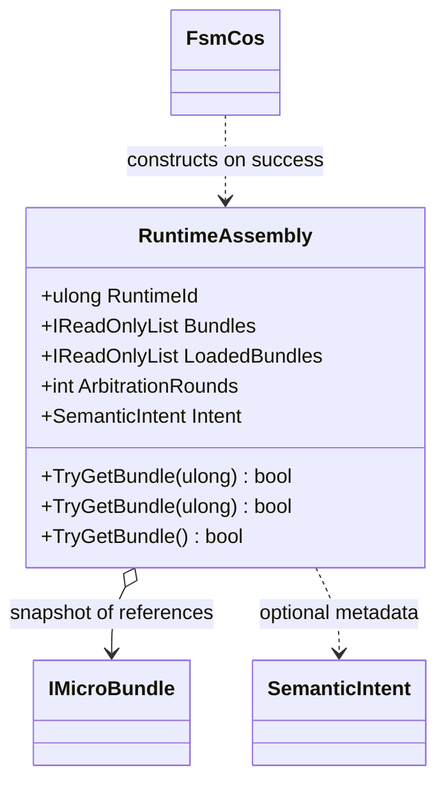

# RuntimeAssembly

**Source:** `src/FSM_COS/RuntimeAssembly.cs`  
**Baseline:** `ce43e8f5bf3dfc229f28678fc2e0d944c5c8d38a`  
**Authorship:** manually authored; not GUI.SVG-generated.

## Source-grounded summary

Sealed composition result. Internal constructor snapshots bundle references into an array wrapped by Array.AsReadOnly. Exposes RuntimeId, Bundles/LoadedBundles, ArbitrationRounds, optional SemanticIntent, and lookup overloads.

## Diagram

## Evidence boundary

Lookup methods search the snapshot by ID and/or type. The list wrapper prevents normal list mutation but does not make bundle instances immutable or roll back side effects.

For behavior beyond the declaration summarized here, inspect the implementation and relevant tests at the same baseline. This page is not evidence of hosted rendering or accessibility behavior by itself.
