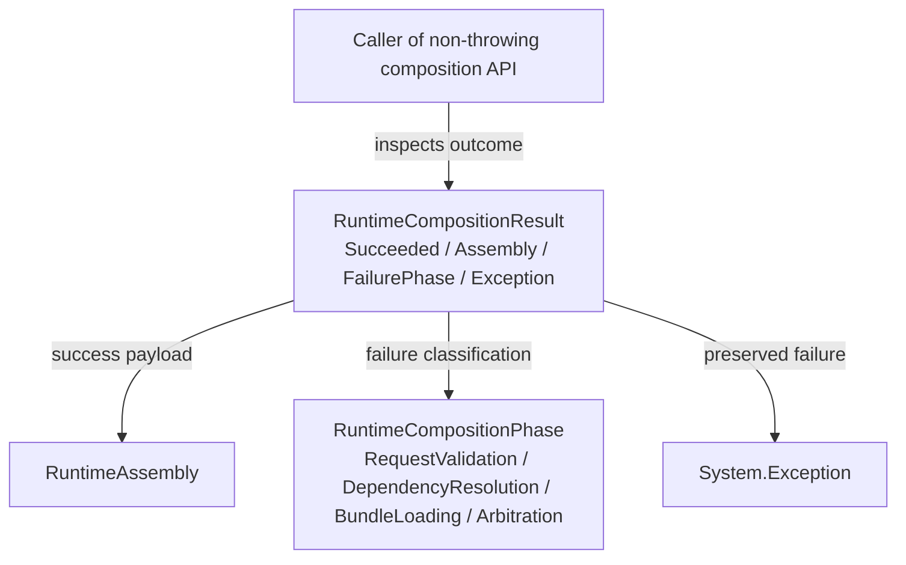

<!-- The Singularity Workshop moniker -->

# RuntimeCompositionResult — UML neighborhood

**Evidence class:** source-checked type structure plus authored use cases. **Target:** `TheSingularityWorkshop.FSM_COS.RuntimeCompositionResult`. **Source revision:** `development`; manually maintained.

## Use cases

1. Inspect successful composition and obtain its assembly.
2. Diagnose a failed attempt by phase and original exception without assuming side effects were rolled back.

## Limits

The enum and class share one source file. Diagram edges represent declared type/member relationships, not a runtime sequence.

See [source page](RuntimeCompositionResult.md) and [data lineage standard](../../Standard/DATA_MODELS_AND_LINEAGE.md).

<!-- THE SINGULARITY WORKSHOP FOOTER -->

