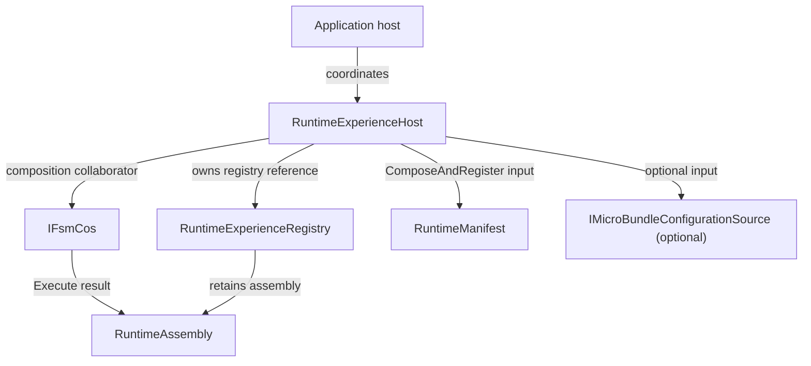

<!-- The Singularity Workshop moniker -->

# RuntimeExperienceHost — UML neighborhood

**Evidence class:** source-checked declaration relationships; use cases authored from XML documentation and implementation. **Target:** `TheSingularityWorkshop.FSM_COS.RuntimeExperienceHost`. **Source revision:** `development`; manually maintained.

## Use cases

1. Compose and register an experience without changing the currently selected experience.
2. Activate an already registered experience by runtime ID.
3. Clear the selection while retaining composed experiences.

## Limits

The diagram does not imply that this class executes MicroBundles or owns their lifecycle. See [source page](RuntimeExperienceHost.md) and [runtime boundary](../../../../RUNTIME_BOUNDARY.md).

<!-- THE SINGULARITY WORKSHOP FOOTER -->

