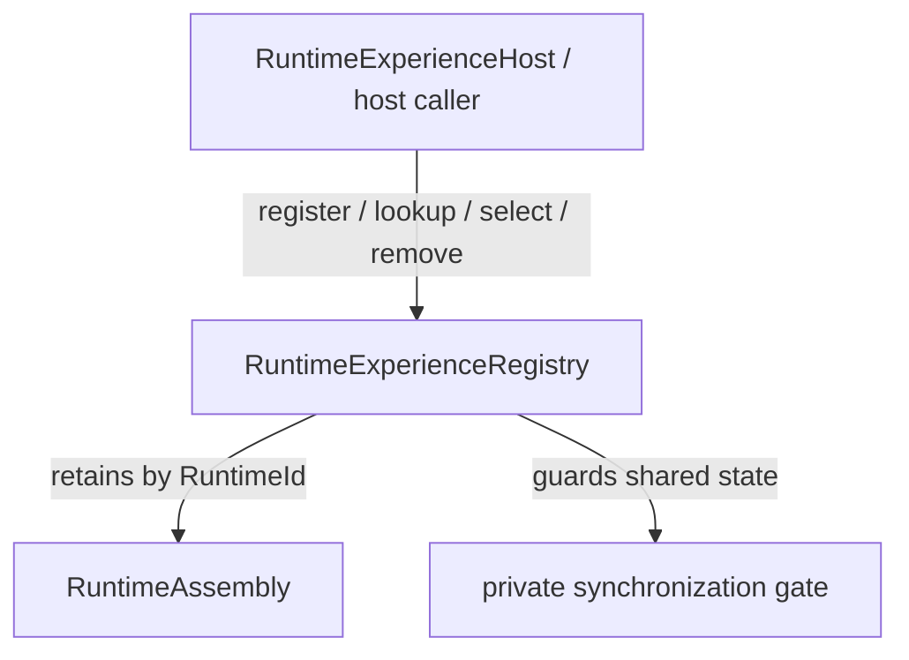
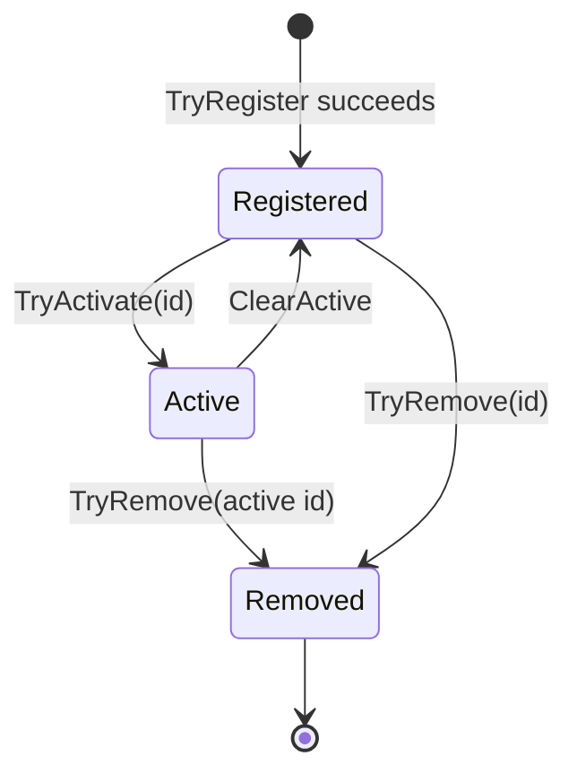

<!-- The Singularity Workshop moniker -->

# RuntimeExperienceRegistry — UML neighborhood

**Evidence class:** source-checked declaration and synchronization behavior; use cases authored. **Target:** `TheSingularityWorkshop.FSM_COS.RuntimeExperienceRegistry`. **Source revision:** `development`; manually maintained.

## Use cases

1. Register multiple composed assemblies without automatically activating them.
2. Select an existing runtime identity; an unknown identity leaves the selection unchanged.
3. Remove an entry without implying bundle disposal or unload.

## Lifecycle state

The state view models registry metadata only. It does not represent MicroBundle activation, execution, disposal, or unloading.

See [source page](RuntimeExperienceRegistry.md) and [state/lifecycle standard](../../Standard/STATE_LIFECYCLE.md).

<!-- THE SINGULARITY WORKSHOP FOOTER -->

