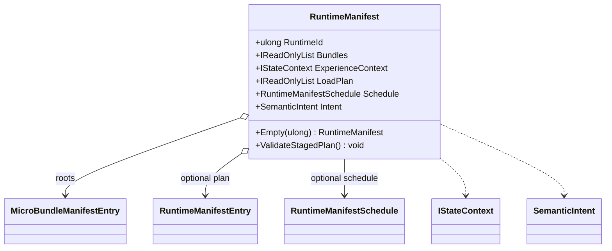

# RuntimeManifest

**Source:** `src/FSM_COS/RuntimeManifest.cs`  
**Baseline:** `ce43e8f5bf3dfc229f28678fc2e0d944c5c8d38a`  
**Authorship:** manually authored; not GUI.SVG-generated.

## Source-grounded summary

Sealed record carrying RuntimeId, root Bundles, optional ExperienceContext, optional LoadPlan, optional Schedule, and optional Intent. Empty creates a zero-root manifest; ValidateStagedPlan checks consistency.

## Diagram

## Evidence boundary

ValidateStagedPlan bounds enumeration, checks entry validity/unique IDs, root/version coverage, and schedule identity/stage agreement. It does not localize bytes or activate staged execution. Record syntax does not make caller-owned collections immutable.

For behavior beyond the declaration summarized here, inspect the implementation and relevant tests at the same baseline. This page is not evidence of hosted rendering or accessibility behavior by itself.

---

**The Singularity Workshop**  
[GitHub](https://github.com/TrentBest) · [Coder Legion](https://coderlegion.com/) · [Patreon](https://www.patreon.com/c/TheSingularityWorkshop) · [PayPal](https://www.paypal.com/donate/?hosted_button_id=3Z7263LCQMV9J)  
[ FSM_API ](https://github.com/TrentBest/FSM_API) · [ FSM_Serialization ](https://github.com/TrentBest/TheSingularityWorkshop.FSM_Serialization) · [ WebPage ](https://github.com/TrentBest/WebPage) · [ FSM_COS Documentation Standard ](https://github.com/TrentBest/TheSingularityWorkshop.FSM_COS/blob/development/DOCUMENTATION_STANDARD.md)  
**Because state shouldn't be a mess.**  
*And because static boundaries are invitations to cause trouble.*
