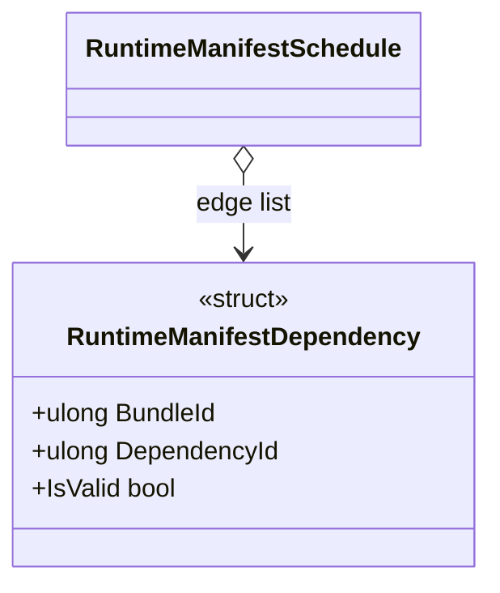

# RuntimeManifestDependency

**Source:** `src/FSM_COS/RuntimeManifestDependency.cs`  
**Baseline:** `ce43e8f5bf3dfc229f28678fc2e0d944c5c8d38a`  
**Authorship:** manually authored; not GUI.SVG-generated.

## Source-grounded summary

Readonly record struct expressing directed edge BundleId -> DependencyId. IsValid requires both IDs nonzero and distinct.

## Diagram

## Evidence boundary

The value records a relationship but does not load anything. RuntimeManifestSchedule validates endpoint existence, duplicates, and cycles. Default struct value is invalid.

For behavior beyond the declaration summarized here, inspect the implementation and relevant tests at the same baseline. This page is not evidence of hosted rendering or accessibility behavior by itself.
