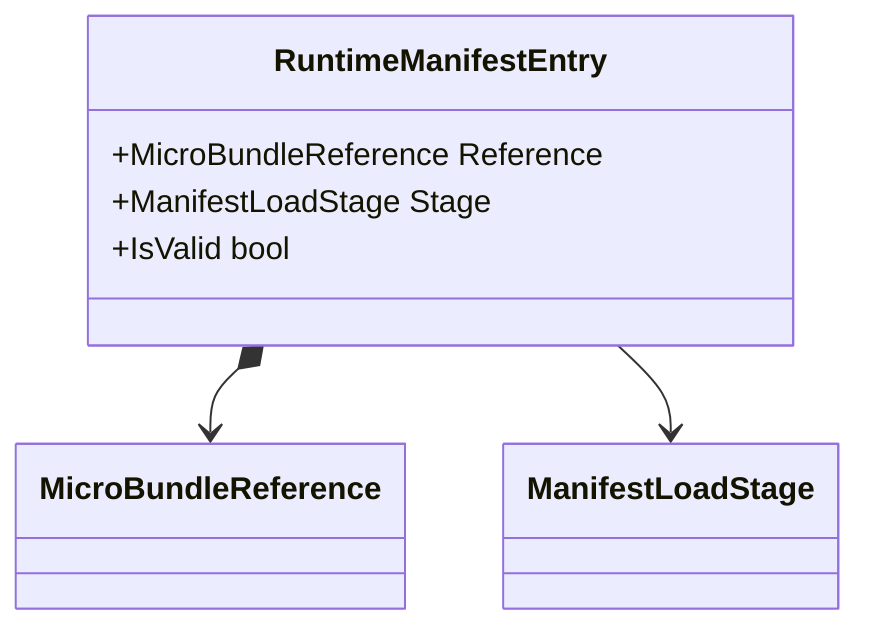

# RuntimeManifestEntry

**Source:** `src/FSM_COS/RuntimeManifestEntry.cs`  
**Baseline:** `ce43e8f5bf3dfc229f28678fc2e0d944c5c8d38a`  
**Authorship:** manually authored; not GUI.SVG-generated.

## Source-grounded summary

Sealed record containing MicroBundleReference and ManifestLoadStage (default Resident). IsValid requires valid reference and defined enum value.

## Diagram

## Evidence boundary

This is published identity/stage metadata, not artifact loading or content-hash verification. Schedule/load-plan consumers validate entries and their relationships.

For behavior beyond the declaration summarized here, inspect the implementation and relevant tests at the same baseline. This page is not evidence of hosted rendering or accessibility behavior by itself.
