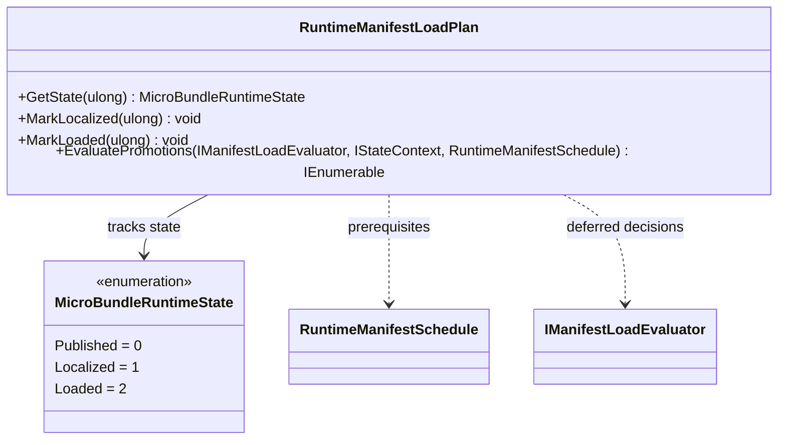

# RuntimeManifestLoadPlan

**Source:** `src/FSM_COS/RuntimeManifestLoadPlan.cs`  
**Baseline:** `ce43e8f5bf3dfc229f28678fc2e0d944c5c8d38a`  
**Authorship:** manually authored; not GUI.SVG-generated.

## Source-grounded summary

Tracks Published, Localized, Loaded state per entry. Exposes GetState, MarkLocalized, MarkLoaded, and lazy EvaluatePromotions. The same file declares MicroBundleRuntimeState values 0/1/2.

## Diagram

## Evidence boundary

Constructor snapshots/bounds entries and rejects invalid/duplicate IDs; optional schedule must match identity/stage coverage. MarkLoaded requires Localized and loaded prerequisites. EvaluatePromotions considers localized entries in stage order, calls evaluator only for Deferred entries, and validates replacement schedule consistency. This is a tracker/candidate evaluator, not an artifact loader or hot-reload mechanism.

For behavior beyond the declaration summarized here, inspect the implementation and relevant tests at the same baseline. This page is not evidence of hosted rendering or accessibility behavior by itself.
