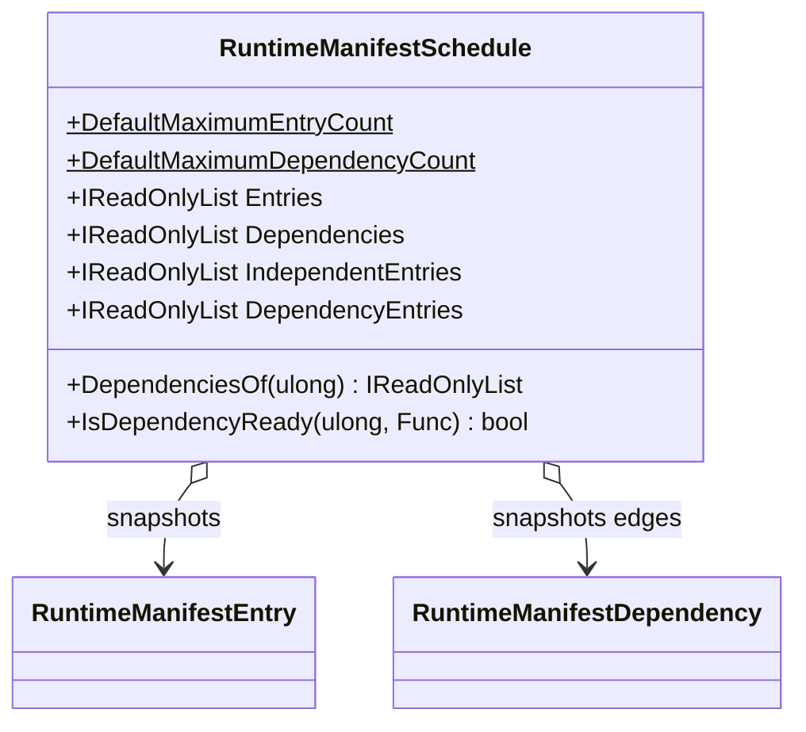

# RuntimeManifestSchedule

**Source:** `src/FSM_COS/RuntimeManifestSchedule.cs`  
**Baseline:** `ce43e8f5bf3dfc229f28678fc2e0d944c5c8d38a`  
**Authorship:** manually authored; not GUI.SVG-generated.

## Source-grounded summary

Bounded, snapshotting publish-time dependency plan. Validates entries/edges, duplicate IDs/edges, missing endpoints, and cycles iteratively. Exposes Entries, Dependencies, IndependentEntries, DependencyEntries, DependenciesOf, and IsDependencyReady.

## Diagram

## Evidence boundary

Limits are 10,000 entries and 100,000 edges. IsDependencyReady rejects null predicate/unknown ID and requires every dependency predicate to be true; predicate exceptions propagate. This is not an execution scheduler and does not load artifacts.

For behavior beyond the declaration summarized here, inspect the implementation and relevant tests at the same baseline. This page is not evidence of hosted rendering or accessibility behavior by itself.

---

**The Singularity Workshop**  
[GitHub](https://github.com/TrentBest) · [Coder Legion](https://coderlegion.com/) · [Patreon](https://www.patreon.com/c/TheSingularityWorkshop) · [PayPal](https://www.paypal.com/donate/?hosted_button_id=3Z7263LCQMV9J)  
[ FSM_API ](https://github.com/TrentBest/FSM_API) · [ FSM_Serialization ](https://github.com/TrentBest/TheSingularityWorkshop.FSM_Serialization) · [ WebPage ](https://github.com/TrentBest/WebPage) · [ FSM_COS Documentation Standard ](https://github.com/TrentBest/TheSingularityWorkshop.FSM_COS/blob/development/DOCUMENTATION_STANDARD.md)  
**Because state shouldn't be a mess.**  
*And because static boundaries are invitations to cause trouble.*
