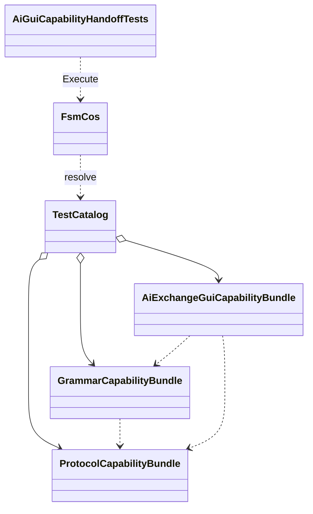

# AiGuiCapabilityHandoffTests

**Source:** `tests/FSM_COS.Tests/AiGuiCapabilityHandoffTests.cs`  
**Baseline:** `ce43e8f5bf3dfc229f28678fc2e0d944c5c8d38a`  
**Authorship:** manually authored; not GUI.SVG-generated.

## Source-grounded summary

Three test methods check core assembly reference boundaries, composition of ProtocolAI/GrammarAI/GUI capabilities with dependency-first ordering and typed retrieval, and a grammar reference to a protocol symbol.

## Diagram

## Evidence boundary

Fixtures are private to this test file. Assertions do not prove every integration path, hosted rendering, accessibility-tree exposure, keyboard support, or screen-reader behavior.

For behavior beyond the declaration summarized here, inspect the implementation and relevant tests at the same baseline. This page is not evidence of hosted rendering or accessibility behavior by itself.
