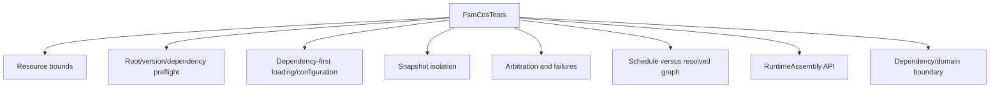

# FsmCosTests

**Source:** `tests/FSM_COS.Tests/FsmCosTests.cs`  
**Baseline:** `ce43e8f5bf3dfc229f28678fc2e0d944c5c8d38a`  
**Authorship:** manually authored; not GUI.SVG-generated.

## Source-grounded summary

Large unit-test suite with private test catalogs, bundles, configuration providers, and malformed/mutating fixtures. Coverage areas include constructor/resource limits, preflight identity/version/graph validation, dependency-first load, configuration snapshotting, failure propagation, arbitration convergence, schedule consistency, and RuntimeAssembly lookup/snapshot.

## Diagram

## Evidence boundary

Representative assertions include full-closure preflight before Load, deep-chain traversal without recursive stack growth, cycle rejection, configuration copy/limits, non-convergence failure, and read-only assembly snapshot. This page maps test assertions; it does not claim exhaustive coverage of every hostile or concurrent production scenario.

For behavior beyond the declaration summarized here, inspect the implementation and relevant tests at the same baseline. This page is not evidence of hosted rendering or accessibility behavior by itself.

---

**The Singularity Workshop**  
[GitHub](https://github.com/TrentBest) · [Coder Legion](https://coderlegion.com/) · [Patreon](https://www.patreon.com/c/TheSingularityWorkshop) · [PayPal](https://www.paypal.com/donate/?hosted_button_id=3Z7263LCQMV9J)  
[ FSM_API ](https://github.com/TrentBest/FSM_API) · [ FSM_Serialization ](https://github.com/TrentBest/TheSingularityWorkshop.FSM_Serialization) · [ WebPage ](https://github.com/TrentBest/WebPage) · [ FSM_COS Documentation Standard ](https://github.com/TrentBest/TheSingularityWorkshop.FSM_COS/blob/development/DOCUMENTATION_STANDARD.md)  
**Because state shouldn't be a mess.**  
*And because static boundaries are invitations to cause trouble.*
