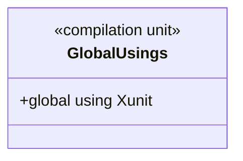

# GlobalUsings

**Source:** `tests/FSM_COS.Tests/GlobalUsings.cs`  
**Baseline:** `ce43e8f5bf3dfc229f28678fc2e0d944c5c8d38a`  
**Authorship:** manually authored; not GUI.SVG-generated.

## Source-grounded summary

Compilation-unit file containing exactly `global using Xunit;`; defines no runtime type.

## Diagram

## Evidence boundary

Makes xUnit names available throughout this test project. It is compilation configuration, not behavioral evidence.

For behavior beyond the declaration summarized here, inspect the implementation and relevant tests at the same baseline. This page is not evidence of hosted rendering or accessibility behavior by itself.
