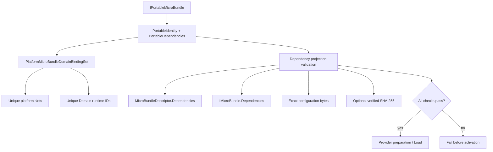

<!-- The Singularity Workshop moniker -->

# PortableMicroBundleBindingTests — UML neighborhood

**Evidence class:** executable source tests and authored test relationships. **Target:** FSM_COS.Tests.PortableMicroBundleBindingTests. **Source revision:** development; manually maintained.

## Use cases

1. Execute a valid portable dependency closure using explicit slot-to-Domain bindings.
2. Reject an absent binding, identity mismatch, version mismatch, digest mismatch, or configuration mismatch.
3. Verify that rejected compositions invoke no bundle Load callback.

## Limits

These tests verify host-side projection and pre-activation validation. They do not verify repository retrieval, cryptographic publisher identity, or the materializer's byte-hashing implementation.

See [test companion](PortableMicroBundleBindingTests.md), [binding contract](../../src/FSM_COS/PlatformMicroBundleDomainBinding.md), and [binding UML](../../src/FSM_COS/PlatformMicroBundleDomainBindingUML.md).

<!-- THE SINGULARITY WORKSHOP FOOTER -->

