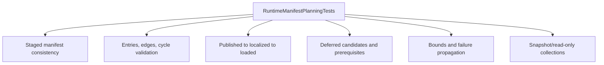

# RuntimeManifestPlanningTests

**Source:** `tests/FSM_COS.Tests/RuntimeManifestPlanningTests.cs`  
**Baseline:** `ce43e8f5bf3dfc229f28678fc2e0d944c5c8d38a`  
**Authorship:** manually authored; not GUI.SVG-generated.

## Source-grounded summary

33 test methods cover bounded input enumeration, staged root/version consistency, schedule validation and deep/cyclic graphs, stage ordering, deferred promotion readiness, invalid/duplicate identities and edges, load-plan transitions, mismatched schedules, snapshot/read-only behavior, and propagated failures.

## Diagram

## Evidence boundary

This suite tests metadata and state-tracker contracts. It does not prove real artifact localization, hosted lifecycle behavior, or automatic hot swapping.

For behavior beyond the declaration summarized here, inspect the implementation and relevant tests at the same baseline. This page is not evidence of hosted rendering or accessibility behavior by itself.

---

**The Singularity Workshop**  
[GitHub](https://github.com/TrentBest) · [Coder Legion](https://coderlegion.com/) · [Patreon](https://www.patreon.com/c/TheSingularityWorkshop) · [PayPal](https://www.paypal.com/donate/?hosted_button_id=3Z7263LCQMV9J)  
[ FSM_API ](https://github.com/TrentBest/FSM_API) · [ FSM_Serialization ](https://github.com/TrentBest/TheSingularityWorkshop.FSM_Serialization) · [ WebPage ](https://github.com/TrentBest/WebPage) · [ FSM_COS Documentation Standard ](https://github.com/TrentBest/TheSingularityWorkshop.FSM_COS/blob/development/DOCUMENTATION_STANDARD.md)  
**Because state shouldn't be a mess.**  
*And because static boundaries are invitations to cause trouble.*
