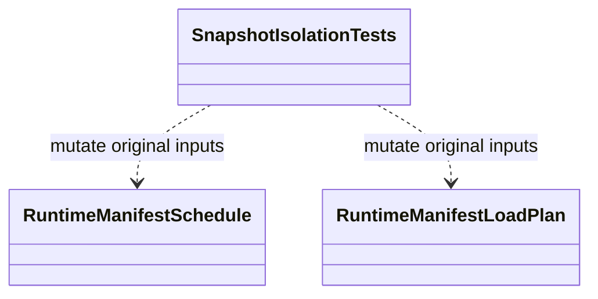

# SnapshotIsolationTests

**Source:** `tests/FSM_COS.Tests/SnapshotIsolationTests.cs`  
**Baseline:** `ce43e8f5bf3dfc229f28678fc2e0d944c5c8d38a`  
**Authorship:** manually authored; not GUI.SVG-generated.

## Source-grounded summary

Three tests verify schedule snapshots of caller entries/edges, load-plan snapshots of caller entries, and mutation rejection for derived schedule collections through list interfaces.

## Diagram

## Evidence boundary

These assertions establish collection-level isolation for the tested objects, not deep immutability of referenced records or arbitrary MicroBundle instances.

For behavior beyond the declaration summarized here, inspect the implementation and relevant tests at the same baseline. This page is not evidence of hosted rendering or accessibility behavior by itself.
