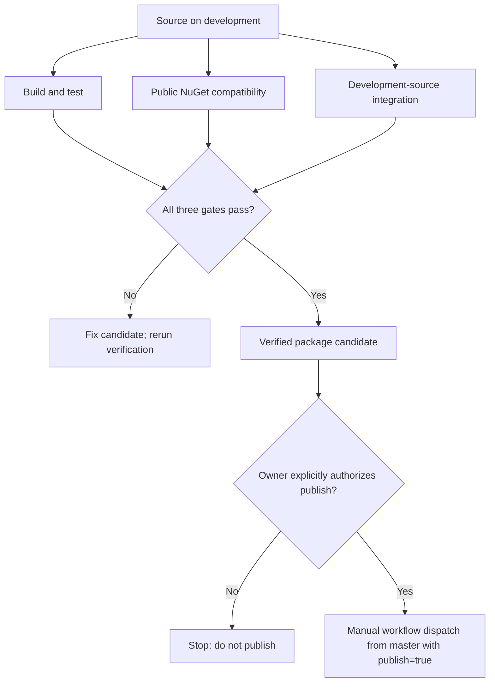

# Preserved additional alpha.7 integration documentation (batch 2)

Verbatim snapshots from `work/alpha7-living-docs-integration`, reviewed 2026-10-21. Historical status statements may be stale. These are recovery copies, not merged/certified content.


---

## docs/CONSUMING_MICROBUNDLES.md
Source blob: `f900e91ce259b2deba345b433df8af53cf3f1264`


# Consuming MicroBundles

> This document is about **using MicroBundles with FSM_COS**, not defining the MicroBundle domain. The authoritative MicroBundle contract and domain model live in MicroBundleDomain.

> **FSM_COS does not define the MicroBundle domain. It defines how a developer composes MicroBundles into a runtime.**

The authoritative MicroBundle contract is supplied by **TheSingularityWorkshop.MicroBundleDomain**.

This document is intentionally narrow. It explains what an FSM_COS consumer supplies, what FSM_COS does with it, and how a developer can choose the surrounding infrastructure.

## The boundary


*Verified against `FsmCos.Execute` and its load pass: FSM_COS resolves the complete dependency closure, validates identities/declarations and cycles before any `Load`, then uses the same resolved objects for iterative dependency-first loading. Already-loaded IDs are skipped. The catalog supplies resolution; FSM_COS owns traversal and load order. The A → B,D → C graph is illustrative, not a fixed runtime.*


```text
your MicroBundle source
        │
        │ IMicroBundle
        ▼
 IMicroBundleCatalog
        │
        ▼
     FSM_COS
        │
        ├── resolve manifest roots
        ├── discover dependency closure
        ├── obtain optional configuration
        ├── load bundles
        ├── arbitrate to convergence
        ▼
 RuntimeAssembly
        │
        ▼
      your host
```

The source can be an in-memory catalog, a repository adapter, local artifacts, generated resources, remote delivery, or another implementation you control.

FSM_COS does not require a particular storage or delivery mechanism.

## What FSM_COS consumes

FSM_COS consumes three intentionally small inputs.

### 1. Runtime Manifest

The manifest identifies the runtime and the root MicroBundles it requests.

Each root carries:

```csharp
new MicroBundleManifestEntry(
    BundleId: 10,
    Version: "1.2.0");
```

The manifest does **not** contain configuration bytes.

See [Runtime Manifest](RUNTIME_MANIFEST.md).

### 2. MicroBundle catalog

The catalog is your resolution boundary.

For manifest roots, FSM_COS asks:

```csharp
bool TryResolve(
    ulong bundleId,
    string version,
    out IMicroBundle? bundle);
```

For domain-declared dependencies, FSM_COS asks:

```csharp
bool TryResolve(
    ulong bundleId,
    out IMicroBundle? bundle);
```

This lets you decide how resolution works.

You can resolve from:

- a dictionary;
- a package cache;
- a MicroBundle repository;
- Azure-backed delivery;
- generated code;
- a remote service;
- a test fixture.

FSM_COS only needs the catalog contract.

### 3. Optional configuration source

Configuration is supplied separately:

```csharp
bool TryGetConfiguration(
    ulong runtimeId,
    ulong bundleId,
    string version,
    out ReadOnlyMemory<byte> configuration);
```

The implementation decides where those bytes come from.

It might be a file, blob, repository artifact, generated resource, or another application-owned source.

FSM_COS does not read the file or interpret its format.

If no configuration exists, the bundle receives no external configuration and uses its own defaults.

## Minimal composition

Start by running the complete, source-controlled example:

```bash
dotnet run --project samples/FSM_COS.MinimalConsumer/FSM_COS.MinimalConsumer.csproj
```

The [Minimal Consumer sample in the source repository](https://github.com/TrentBest/TheSingularityWorkshop.FSM_COS/blob/development/samples/FSM_COS.MinimalConsumer/Program.cs) is intentionally small and includes the pieces a real composition needs: a catalog, two MicroBundles, a versioned manifest, and the call to `FsmCos.Execute`. Its output demonstrates that a requested bundle's dependency is loaded first.

The sample references the local FSM_COS project so it can be built and checked before a candidate version is published. It is not a package-installation test. Once using a published package, reference the available version from NuGet and use the same public contracts.

The sample uses an in-memory catalog. No repository is required. No configuration source is required. No GUI framework is required. No serialization framework is required.

The composition kernel is useful with only the contracts it actually consumes.

## Adding configuration

Configuration is optional and separate from the manifest. To supply it, implement the public `IMicroBundleConfigurationSource` contract and pass that implementation as the second argument to `FsmCos.Execute`.

```csharp
RuntimeAssembly assembly = cos.Execute(manifest, configurationSource);
```

Here, `cos`, `manifest`, and `configurationSource` refer to objects your application has already created; `configurationSource` must implement `IMicroBundleConfigurationSource`. FSM_COS does not ship a built-in file, Azure, or repository-backed configuration reader. Those are application or adapter responsibilities.

The source can obtain configuration from local files, Azure Blob, a repository artifact, generated resources, or another application-owned location. FSM_COS receives the bytes through the contract and does not interpret their format. If no configuration exists, the MicroBundle uses its own defaults.

## Using a repository

A repository adapter can implement `IMicroBundleCatalog` and provide the artifacts requested by the manifest.

```text
RuntimeManifest
      │
      ▼
repository-backed catalog
      │
      ├── locate root @ requested version
      ├── locate dependency
      └── materialize IMicroBundle
      │
      ▼
    FSM_COS
```

This is where **TheSingularityWorkshop.MicroBundleRepository** can participate.

FSM_COS does not need to know whether the catalog came from that repository, another repository, or an application's own implementation.

## Supplying your own MicroBundle

FSM_COS does not prescribe the internal implementation of a MicroBundle. For the complete domain definition, use MicroBundleDomain documentation. Here we only show the portion an FSM_COS developer must provide to the composition boundary.

It consumes the domain-owned contract:

```csharp
public interface IMicroBundle
{
    MicroBundleDescriptor Descriptor { get; }
    ulong Id { get; }
    IReadOnlyList<MicroBundleDependencyRequest> Dependencies { get; }

    void Load(IMicroBundleLoadContext context);

    bool Arbitrate(
        IMicroBundleArbitrationContext context,
        int roundIndex);
}
```

The implementation remains yours.

FSM_COS gives that implementation a composition lifecycle:

```text
resolve
   ↓
dependencies
   ↓
load
   ↓
arbitration rounds
   ↓
stable assembly
```

For the complete domain contract, use the MicroBundleDomain package documentation rather than duplicating it here.

## Dependency consumption

FSM_COS consumes dependencies as relationships exposed by the domain-owned contract. It resolves those relationships, loads the reachable closure, deduplicates repeated identities, and rejects missing or cyclic composition. The semantics of what a dependency means inside a MicroBundle remain the MicroBundle domain's responsibility.

## Dependencies

A root MicroBundle can declare dependencies through the domain contract.

For example:

```text
Experience
├── GUI
│   └── Input
└── Physics
```

The manifest needs only the requested root.

FSM_COS walks the reachable dependency graph and loads dependencies before their dependents.

The resulting order is an implementation detail of composition traversal; the important guarantee is that a dependency is loaded before the bundle that requires it.

Repeated identities are deduplicated.

Missing identities fail composition.

Cycles fail composition.

FSM_COS does not silently invent a substitute.

## Version selection

Version is a manifest concern for root requests.

```text
Manifest
    │
    └── GUI @ 1.2.0
             │
             ▼
       catalog / resolver
             │
             ▼
       resolved artifact
             │
             ▼
          FSM_COS
```

FSM_COS verifies that the resolved root reports the requested version.

This prevents a catalog from silently returning a different version than the published composition request named.

Dependency version policy remains a concern of the domain/repository contract that supplies those dependency relationships. FSM_COS does not invent a second versioning system inside the composition kernel.

## Arbitration

After loading, FSM_COS gives every loaded MicroBundle an opportunity to participate in reconciliation.

```csharp
bool changed = bundle.Arbitrate(
    arbitrationContext,
    roundIndex);
```

A `true` result means the composition may have changed.

FSM_COS runs another round.

A complete round with no changes is stable.

The default maximum is **10 rounds**.

If the composition still reports changes after the maximum, FSM_COS fails rather than returning an assembly it knows is unstable.

See [Arbitration and Convergence](ARBITRATION.md).

## Failure behavior and cleanup

A failed `Execute` propagates the failure and does not return a `RuntimeAssembly`. FSM_COS completes all reachable bundle loads before it begins arbitration, so a load failure prevents arbitration from starting.

This is not transactional loading: if a dependency's `Load` succeeds and a later dependent bundle's `Load` throws, FSM_COS cannot undo the dependency's arbitrary in-memory or external side effects. Exceptions during arbitration likewise do not produce an assembly, but FSM_COS cannot roll back mutations made by bundle code. Put cleanup and lifecycle recovery at the layer that owns those effects; do not assume a failed composition attempt automatically restores every bundle to its previous state. See [Architecture — Failure and partial side effects](ARCHITECTURE.md#failure-and-partial-side-effects).

## Troubleshooting

| Symptom | What to check |
|---|---|
| A requested root cannot be resolved | Confirm the catalog contains the requested bundle ID **and exact manifest version**. Root resolution uses both values. |
| A dependency cannot be resolved | Confirm the catalog can resolve every dependency ID declared by the bundle. Dependency lookup uses the domain-declared identity. |
| The catalog returns the wrong bundle or version | Check the catalog's identity mapping. FSM_COS validates root identity and version rather than silently accepting a substitute. |
| Composition reports a dependency cycle | Trace the dependency chain and remove the cycle or redesign the participating contracts. FSM_COS cannot choose a meaningful substitute for a cycle. |
| Arbitration does not converge | Review each bundle's `Arbitrate` implementation. A bundle should return `true` only when it actually changes composition-relevant state; repeated changes must eventually stop. The default limit is ten rounds. |
| A bundle receives no configuration | Configuration is optional. Check whether your `IMicroBundleConfigurationSource` returns configuration for the runtime ID, bundle ID, and resolved version. If none is available, the bundle should use its own defaults. |
| The sample does not start | Run it from a clone of the source repository with the .NET 8 SDK installed. The sample references the local FSM_COS project; it is not included in the NuGet package. |
| Source CI passes but a package consumer cannot restore | Check the exact package versions and the public-feed compatibility job. A local development feed and the public NuGet feed are different dependency environments. |

These checks help locate the failing boundary. Avoid fixing a catalog or host problem by adding storage, UI, or transport responsibilities to FSM_COS itself.

## RuntimeAssembly

Successful composition produces:

```csharp
RuntimeAssembly assembly = cos.Execute(manifest);
```

The assembly exposes:

- the runtime identity;
- the loaded MicroBundles;
- the zero-based index of the converging arbitration round (`0` means the first round converged; it is not the total number of `Arbitrate` calls).

A host can retrieve a bundle by identity:

```csharp
if (assembly.TryGetBundle(bundleId, out var bundle))
{
    // host-specific use
}
```

Or by a host-known type:

```csharp
if (assembly.TryGetBundle<MyBundle>(bundleId, out var bundle))
{
    // host-specific use
}
```

FSM_COS stops at the assembly boundary.

The host decides what the assembly means operationally.

## Different developers, same kernel

The same FSM_COS package can support very different environments.

```text
Developer A
    manifest
      ↓
in-memory catalog
      ↓
FSM_COS
      ↓
desktop host

Developer B
    manifest
      ↓
repository catalog
      ↓
FSM_COS
      ↓
WebPage / Blazor

Developer C
    manifest
      ↓
remote catalog
      ↓
FSM_COS
      ↓
distributed host
```

The composition algorithm does not need to change because the delivery mechanism changed.

That is the point of the boundary.

## What FSM_COS does not consume

FSM_COS deliberately does not require:

- a GUI framework;
- a browser;
- Unity;
- a specific repository;
- a specific serialization format;
- a specific configuration file format;
- an application scheduler;
- a particular host;
- a particular rendering engine.

Those systems may feed the composition boundary through contracts, but they do not become part of the composition kernel.

## Dependency consumption summary

FSM_COS currently has three direct package dependencies, each with a distinct responsibility:

| Package | FSM_COS consumes | FSM_COS does not define |
|---|---|---|
| **FSM_API** | state/context primitives, including optional runtime experience context | state-machine semantics beyond what composition requires |
| **MicroBundleDomain** | MicroBundle identity, version metadata, dependencies, load context, arbitration context, and runtime contract | the meaning, ontology, authoring model, or storage of MicroBundles |
| **FSM_UserIO** | the optional `SemanticIntent` value carried from `RuntimeManifest` to `RuntimeAssembly` | input-device handling, UI presentation, or execution authority |

This is the intended documentation boundary:

> **A dependency's repository explains the dependency. FSM_COS explains how FSM_COS consumes it.**

## Related documents

- [Architecture](ARCHITECTURE.md)
- [Runtime Manifest](RUNTIME_MANIFEST.md)
- [RuntimeAssembly](RUNTIME_ASSEMBLY.md)
- [Arbitration and Convergence](ARBITRATION.md)
- [Runtime Boundary](RUNTIME_BOUNDARY.md)
- [Development](DEVELOPMENT.md)

---

<p align="center"><em>The Singularity Workshop — Tools for the curious, the bold, and the systemically inclined.</em><br><strong>Because state shouldn't be a mess.</strong><br><em>And because static boundaries are invitations to cause trouble.</em></p>

---

**The Singularity Workshop**  
[GitHub](https://github.com/TrentBest) · [Coder Legion](https://coderlegion.com/) · [Patreon](https://www.patreon.com/c/TheSingularityWorkshop) · [PayPal](https://www.paypal.com/donate/?hosted_button_id=3Z7263LCQMV9J)  
[ FSM_API ](https://github.com/TrentBest/FSM_API) · [ FSM_Serialization ](https://github.com/TrentBest/TheSingularityWorkshop.FSM_Serialization) · [ WebPage ](https://github.com/TrentBest/WebPage) · [ FSM_COS Documentation Standard ](https://github.com/TrentBest/TheSingularityWorkshop.FSM_COS/blob/development/DOCUMENTATION_STANDARD.md)  
**Because state shouldn't be a mess.**  
*And because static boundaries are invitations to cause trouble.*


---

## docs/CONTINUATION_BRIEF_ALPHA6_FORGE_ANYAPP_WEBPAGE.md
Source blob: `b45fb6ff5d0dfa38648335cb3e1e610c82405dab`


# Archived Continuation Brief — FSM_COS alpha.6 / Forge / AnyApp / WebPage

> **Archive status:** This is a historical handoff snapshot from October 9, 2026. It is not the current release checklist, branch instruction, or authorization to publish.
>
> The alpha.6 target, old branch comparisons, PR numbers, and workflow instructions below described the state at that time. They must not be used to infer today's source contract, candidate SHA, CI status, package availability, or publication state.

## Current authorities

Use these maintained documents instead of reviving this dated task list:

- [Alpha.7 release-readiness gate](0.1.0-alpha.7-READINESS.md) — the sole release gate for the exact candidate SHA and package evidence.
- [Domain completion roadmap](DOMAIN_COMPLETION_ROADMAP.md) — kernel responsibilities, implemented behavior, deferred capabilities, and follow-on work.
- [Development and CI modes](DEVELOPMENT.md) — current branch policy, verification jobs, and manual publication gate.
- [Documentation index](../DOCUMENTATION_INDEX.md) — navigation and authority map.
- [Alpha.7 release notes](releases/0.1.0-alpha.7.md) — release scope and behavioral contract.

## Durable architectural conclusions from the archived work

- FSM_COS is a platform-neutral composition boundary. It resolves requested MicroBundles and dependencies, loads them, arbitrates within a bounded limit, and hands a `RuntimeAssembly` to its host.
- Hosts and repository/catalog providers own discovery, transport, persistence, presentation, and execution after handoff.
- Forge owns authoring and compilation of runtime-facing configuration; it is not a runtime dependency of FSM_COS.
- WebPage and AnyApp must prove their own host integration paths. A package reference, successful build, or composition call alone does not prove that the host uses the returned `RuntimeAssembly` for active experience behavior.
- Preserve requested-version validation, dependency ordering, configuration-source boundaries, bounded arbitration, and regression coverage when changing the kernel contract.
- Do not equate an artifact being packed with publication to NuGet.

## Historical verification record

The dated notes below were written against alpha.6-era commits and workflows. Their run IDs and conclusions are historical evidence for those exact commits only. The former `&& false` safeguard described in this archive is not the current workflow contract; read `.github/workflows/package.yml` and [Development](DEVELOPMENT.md) for the current manual `workflow_dispatch` gate.

## Resume rule

Start from the current `development` HEAD and the alpha.7 readiness checklist. Verify every result against the exact current SHA. Do not merge, publish, or change branches based on this archive. Publication remains a separate action requiring explicit owner authorization.

---

**The Singularity Workshop**  
[GitHub](https://github.com/TrentBest) · [Coder Legion](https://coderlegion.com/) · [Patreon](https://www.patreon.com/c/TheSingularityWorkshop) · [PayPal](https://www.paypal.com/donate/?hosted_button_id=3Z7263LCQMV9J)  
[ FSM_API ](https://github.com/TrentBest/FSM_API) · [ FSM_Serialization ](https://github.com/TrentBest/TheSingularityWorkshop.FSM_Serialization) · [ WebPage ](https://github.com/TrentBest/WebPage) · [ FSM_COS Documentation Standard ](https://github.com/TrentBest/TheSingularityWorkshop.FSM_COS/blob/development/DOCUMENTATION_STANDARD.md)  
**Because state shouldn't be a mess.**  
*And because static boundaries are invitations to cause trouble.*


---

## docs/DEPENDENCY_ALIGNMENT_CHECKLIST.md
Source blob: `89ec7bf420682dd206df8e8004c8a567df3fe80f`


# Archived Dependency Alignment Checklist

> **Archive status:** cross-repository package/source inventory captured on October 8, 2026. Package pins, project versions, branch names, and proposed migrations in the original checklist are historical observations. Do not use them as current dependency facts or a release plan.

## Current authorities for FSM_COS alpha.7

- [Alpha.7 release-readiness gate](0.1.0-alpha.7-READINESS.md) — exact candidate SHA, CI, package, and documentation evidence.
- [Development and CI modes](DEVELOPMENT.md) — current source-versus-public-package verification modes.
- [Domain completion roadmap](DOMAIN_COMPLETION_ROADMAP.md) — direct dependency boundary and kernel responsibilities.
- [FSM_COS project file](../src/FSM_COS/FSM_COS.csproj) — declared target framework, version, and direct package references.
- [Documentation index](../DOCUMENTATION_INDEX.md) — primary document for each topic.

## Durable dependency rules

- Distinguish a project-file version declaration, an available public NuGet version, a consumer's pinned version, and the exact package artifact produced by a workflow.
- Do not infer package availability or API compatibility from source metadata alone; use clean restore/build/test evidence against the intended package feed.
- Verify dependencies at the public package boundary as well as against source checkouts when both modes are supported.
- Keep FSM_COS platform-neutral. GUI, browser, rendering, storage, REST, repository transport, and application lifecycle remain outside the kernel unless a concrete, tested shared contract proves otherwise.
- Lower-level packages must not acquire dependencies on FSM_COS or other higher-level hosts.
- Do not publish or change consumer pins as a side effect of an audit. Consumer migrations require their own scoped change and verification.

## Historical inventory

The original cross-repository matrix and branch comparisons remain in repository history. They were removed from this working document because their dated alpha.5/alpha.6 references and former `&& false` workflow descriptions no longer match the current alpha.7 candidate workflow. Rebuild a fresh matrix from live project files, package feeds, and tests when a specific consumer migration is authorized.

---

**The Singularity Workshop**  
[GitHub](https://github.com/TrentBest) · [Coder Legion](https://coderlegion.com/) · [Patreon](https://www.patreon.com/c/TheSingularityWorkshop) · [PayPal](https://www.paypal.com/donate/?hosted_button_id=3Z7263LCQMV9J)  
[ FSM_API ](https://github.com/TrentBest/FSM_API) · [ FSM_Serialization ](https://github.com/TrentBest/TheSingularityWorkshop.FSM_Serialization) · [ WebPage ](https://github.com/TrentBest/WebPage) · [ FSM_COS Documentation Standard ](https://github.com/TrentBest/TheSingularityWorkshop.FSM_COS/blob/development/DOCUMENTATION_STANDARD.md)  
**Because state shouldn't be a mess.**  
*And because static boundaries are invitations to cause trouble.*


---

## docs/DEVELOPMENT.md
Source blob: `94b6818186a2b225de41c7d910a5001a65592628`


# FSM_COS Development

> There are two active branches by design: master and development.

This repository deliberately avoids a forest of simultaneously-current feature branches.

## Branch policy

### master

`master` is the stable baseline.

It should represent code that has been deliberately consolidated and is suitable to treat as the public stable line. Release preparation is performed from a known-good development state; it is not an alternative permanent development branch.

### development

`development` is the current integration and architecture branch.

All normal FSM_COS evolution should happen here unless a short-lived branch is genuinely useful for isolating a risky experiment.

> **If you need to ask which branch is current, the answer should be `development`.**

### Short-lived branches

The durable branch set should remain exactly `master` and `development`. Prefer working directly on `development`; use a temporary branch only when a substantial architecture experiment or risky change genuinely needs isolation.

When a temporary branch is used, consolidate it into `development`, close its PR, and delete the branch. Do not retain feature, release, or experiment branches as additional sources of truth.

## Consolidation record

The repository previously accumulated overlapping branches for the domain-contract correction, staged manifest loading, and release preparation.

The domain-contract correction was merged into `development`.

The staged-manifest and release-preparation PRs were closed as superseded designs. Their branches remain historical references; they are not active development lanes.

This is intentional housekeeping, not deletion of architectural history.

## Development sequence

```text
idea / issue
    ↓
development
    ↓
implementation + tests + documentation
    ↓
CI
    ↓
review
    ↓
development remains current
    ↓
stable checkpoint
    ↓
master
    ↓
explicit release
```

Do not publish a package merely because a development branch builds.

## Documentation standard

FSM_COS documentation should explain four things together:

1. Why the boundary exists.
2. What contract crosses the boundary.
3. How the implementation realizes the contract.
4. What does not belong here.

A document is not finished merely because the code example compiles. It should leave a reader able to answer who owns a concept, who supplies it, who interprets it, where it stops, what happens when an optional piece is absent, and what the stable handoff is.

Architecture diagrams are part of that explanation, not decoration.

## Current architecture direction

```text
MicroBundleDomain ───────── defines the MicroBundle contract ──────┐
                                                                   │
Optional sources / catalogs ─ locate and resolve available bundles ┤
  ├── in-memory or generated catalog                              │
  ├── repository-backed catalog                                   │
  └── host-owned implementation                                   │
                                                                   ▼
                                                               FSM_COS
                                                                   │
                                                        composes requested runtime
                                                                   ▼
                                                            RuntimeAssembly
                                                                   │
                                                                   ▼
                                                            Host / Experience
```

MicroBundleRepository is one possible source behind a catalog, not a mandatory hop in every composition. A small host can use an in-memory catalog; another host can supply repository-backed discovery without changing FSM_COS's composition algorithm.

The Runtime Manifest belongs to the composition request:

```text
Manifest
  ├── MicroBundle identity
  └── requested version
```

Per-MicroBundle configuration is deliberately separate:

```text
Configuration source
  ├── MicroBundle A → configuration
  ├── MicroBundle B → configuration
  └── MicroBundle C → absent → defaults
```

FSM_COS may consume configuration through an abstraction, but it does not become a file reader, serializer, repository, or application configuration framework.

## Dependency modes in CI

The same repository has two deliberately different dependency modes. They answer different questions and must not be blended into one ambiguous build.

| Context | MicroBundleDomain source | What the build proves |
|---|---|---|
| Push to `development` or a pull request targeting it | Checkout the dependency's `development` branch and pack it into an isolated local feed | Current integration code is tested against current dependency development code |
| Push to `master`, or a pull request targeting another base | Restore dependencies from public NuGet | The stable/release line does not silently rely on an unpublished source checkout |
| Public-package compatibility job | Public NuGet only, with no local dependency feed | The documented package dependency graph can restore and build as a consumer would |

For development restores, NuGet package-source mapping routes **only** `TheSingularityWorkshop.MicroBundleDomain` to the locally packed development package. Other package IDs resolve from nuget.org. This matters because the development checkout can carry the same declared package version as the published package: adding a local feed without source mapping would not prove which copy restore selected.

The public-package compatibility job remains separate from the development integration build. A green development build is not evidence that a new package version is published, and a green public-feed build is not evidence that the latest dependency development code has been integrated.

This workflow is verification, not release authorization. Publication remains behind the required `workflow_dispatch` boolean input (`publish`, default `false`) and is allowed only when the workflow is deliberately dispatched from `master` with that input set to `true`, after verifying the intended master commit against public dependencies. Pushes and pull requests never publish. Do not dispatch publication from `development`, weaken this safeguard, or publish as part of routine development.

## Documentation visual tooling

The preflight illustration is generated with **GUI.SVG** as a build-time authoring tool. The `samples/DocumentationVisuals/DocumentationVisuals.csproj` project references the GUI.SVG source project under `_dependencies/GUI`. On `development` pushes and pull requests targeting `development`, the package workflow checks out that source at a pinned commit and runs the generator before packing. The generated result is an SVG asset, not a runtime service or library used by FSM_COS. The generated SVG is also committed under `docs/assets`, so public-feed and `master` builds can package the same illustration without restoring GUI.SVG tooling.

The shipping project, `src/FSM_COS/FSM_COS.csproj`, must not reference GUI.SVG as either a package or project dependency. That keeps the NuGet package focused on its actual runtime contracts (`FSM_API`, `FSM_UserIO`, and `MicroBundleDomain`) while still allowing the documentation pipeline to use richer visual tooling. `scripts/verify_nuget_package.py` enforces that `TheSingularityWorkshop.GUI.SVG` does not appear in the package's direct dependency list.

## Verification

The package workflow has three independent verification gates. Publication is a separate, explicitly requested action and is not implied by a green verification run.



*This diagram summarizes the current `.github/workflows/package.yml` job dependencies and manual publication gate. A successful verification run alone does not publish a package.*


Run the minimal consumer sample as part of validating the public composition path:

```bash
dotnet run --project samples/FSM_COS.MinimalConsumer/FSM_COS.MinimalConsumer.csproj
```

It should load bundle 2 before bundle 1 and print `Assembly order: 2 -> 1`. The sample references the source project and is a source-level integration proof, not proof that a particular NuGet version is published or installable.

Before a development change is considered complete:

- production code builds with zero warnings;
- tests pass;
- XML documentation remains coherent;
- README and architecture docs describe the actual code;
- package dependencies point at published/staged versions intentionally;
- examples do not reference removed contracts;
- branch purpose is obvious from GitHub;
- no accidental publication occurs.

## Release discipline

A release is a separate decision from development:

```text
development
    ↓
stable documentation
    ↓
green CI
    ↓
explicit approval
    ↓
merge to master
    ↓
verify the intended master commit with public dependencies
    ↓
explicit workflow dispatch from master (`publish: true`)
```

No automatic branch state should be interpreted as permission to publish a NuGet package.

---

<p align="center"><em>The Singularity Workshop — Tools for the curious, the bold, and the systemically inclined.</em><br><strong>Because state shouldn't be a mess.</strong><br><em>And because static boundaries are invitations to cause trouble.</em></p>

---

**The Singularity Workshop**  
[GitHub](https://github.com/TrentBest) · [Coder Legion](https://coderlegion.com/) · [Patreon](https://www.patreon.com/c/TheSingularityWorkshop) · [PayPal](https://www.paypal.com/donate/?hosted_button_id=3Z7263LCQMV9J)  
[ FSM_API ](https://github.com/TrentBest/FSM_API) · [ FSM_Serialization ](https://github.com/TrentBest/TheSingularityWorkshop.FSM_Serialization) · [ WebPage ](https://github.com/TrentBest/WebPage) · [ FSM_COS Documentation Standard ](https://github.com/TrentBest/TheSingularityWorkshop.FSM_COS/blob/development/DOCUMENTATION_STANDARD.md)  
**Because state shouldn't be a mess.**  
*And because static boundaries are invitations to cause trouble.*


---

## docs/DOMAIN.md
Source blob: `ffd38f522fffeb3079806ad1a3e28017fe0cfb4d`


# FSM_COS Domain

> **FSM_COS owns the composition of computation. It does not own the application that consumes the result.**

This is the domain map for this package. Concepts owned by neighboring packages are named only to explain the boundary across which FSM_COS consumes them.

## What FSM_COS owns


*Use this map to orient the domain; the explicit ownership and non-ownership lists below define the contract in words.*


FSM_COS owns the operational problem of taking a computation request and producing a stable assembled computation.

- runtime composition requests;
- MicroBundle root selection and requested versions;
- dependency closure;
- composition-time loading;
- optional configuration delivery;
- arbitration rounds;
- convergence;
- the RuntimeAssembly handoff.

The kernel is deliberately **platform-neutral and application-neutral**.

## What computation platform means

FSM_COS is common operational machinery that can sit beneath many kinds of digital systems.

```text
                computation request
                       |
                       v
                    FSM_COS
                       |
          +------------+------------+
          v            v            v
       WebApp       AnyApp      DistributedApp
          |            |            |
          +------------+------------+
                       v
              any digital system
```

Those are examples, not special cases. FSM_COS does not contain a browser model, desktop model, Unity model, renderer model, spreadsheet model, game model, business-application model, or distributed-systems product model.

## The domain seam

FSM_COS consumes neighboring contracts rather than redefining neighboring domains.

```text
FSM_API ───────── state/context primitive ─────────────┐
MicroBundleDomain ─ MicroBundle runtime contract ──────┤
FSM_UserIO ──────── optional SemanticIntent value ─────┤
catalog / resolver ─ resolved MicroBundles ────────────┤
configuration source ─ optional configuration bytes ──┤
                                                       ▼
                                                     FSM_COS
                                                       │
                                                       ▼
                                                 RuntimeAssembly
```

FSM_COS does not define what a MicroBundle is. It consumes the runtime contract it needs to resolve, load, and arbitrate one.

Likewise, the repository/catalog owns artifact location and delivery. FSM_COS consumes the resolver boundary; it does not become the repository.

## Composition lifecycle

```text
RuntimeManifest
      | MicroBundle IDs + requested versions
      v
catalog / resolver
      | resolved MicroBundles
      v
dependency closure
      v
Load()
      v
Arbitrate()
      |
      +-- changed -> next round
      |
      +-- stable
             v
      RuntimeAssembly
```

The result is deliberately a handoff object. FSM_COS does not continue by becoming the user's application.

## Configuration boundary

Configuration is separate from the manifest.

```text
Manifest
  = which MicroBundles + requested versions

Configuration source
  = optional configuration for a particular MicroBundle

FSM_COS
  = delivers available configuration and performs composition

MicroBundle
  = interprets its own configuration
```

If configuration is absent, the MicroBundle receives no external configuration and uses its defaults.

FSM_COS does not prescribe whether configuration comes from a file, blob, repository artifact, generated resource, or another application-owned mechanism.

## What FSM_COS does not own

- MicroBundle definition and domain meaning;
- MicroBundle artifact storage;
- REST transport;
- serialization formats;
- GUI semantics or rendering;
- browser lifecycle;
- desktop lifecycle;
- Unity lifecycle;
- Experience semantics;
- application-specific scheduling;
- application configuration frameworks;
- databases or Warehouse infrastructure;
- credentials and provider sessions;
- networking protocols;
- product-specific behavior.

These can participate in a composition. They do not redefine the composition kernel.

## Developer use

A developer supplies a catalog, manifest, and optional configuration source appropriate to their system, then uses the kernel without adopting a particular application framework. The [Minimal Consumer sample](https://github.com/TrentBest/TheSingularityWorkshop.FSM_COS/blob/development/samples/FSM_COS.MinimalConsumer/Program.cs) provides a complete source-repository example.

The snippet below is schematic: `MyCatalog` and `MyConfigurationSource` are placeholders for implementations supplied by your application, not types included in FSM_COS.

```csharp
var catalog = new MyCatalog();
var configuration = new MyConfigurationSource();
var cos = new FsmCos(catalog);

var assembly = cos.Execute(manifest, configuration);
```

The developer remains free to decide where MicroBundles come from, how configuration is stored, how the assembly is executed, how it is exposed, whether there is a UI, and whether execution is local, remote, distributed, interactive, or headless.

FSM_COS supplies the composition machinery, not those application decisions.

## Documentation rule

If a concept requires a long explanation of its own domain, that explanation belongs in the package that owns the concept.

FSM_COS should instead explain:

1. what contract it consumes;
2. why it consumes it;
3. what FSM_COS does with it;
4. what crosses the boundary;
5. what remains outside FSM_COS.

This keeps package documentation useful without turning every README into an encyclopedia of the entire Workshop.

---

<p align="center"><em>The Singularity Workshop — Tools for the curious, the bold, and the systemically inclined.</em><br><strong>Because state shouldn't be a mess.</strong><br><em>And because static boundaries are invitations to cause trouble.</em></p>

---

**The Singularity Workshop**  
[GitHub](https://github.com/TrentBest) · [Coder Legion](https://coderlegion.com/) · [Patreon](https://www.patreon.com/c/TheSingularityWorkshop) · [PayPal](https://www.paypal.com/donate/?hosted_button_id=3Z7263LCQMV9J)  
[ FSM_API ](https://github.com/TrentBest/FSM_API) · [ FSM_Serialization ](https://github.com/TrentBest/TheSingularityWorkshop.FSM_Serialization) · [ WebPage ](https://github.com/TrentBest/WebPage) · [ FSM_COS Documentation Standard ](https://github.com/TrentBest/TheSingularityWorkshop.FSM_COS/blob/development/DOCUMENTATION_STANDARD.md)  
**Because state shouldn't be a mess.**  
*And because static boundaries are invitations to cause trouble.*


---

## docs/DOMAIN_COMPLETION_ROADMAP.md
Source blob: `8c8aec7526a308a404e43505e543650efb2c7f30`


# FSM_COS Domain Completion and Release Roadmap

> **Candidate:** `0.1.0-alpha.7` on `development`  
> **Publication status:** not published by this document. Verify the NuGet feed and successful publish workflow independently.  
> **Purpose:** define the whole FSM_COS domain, distinguish shipped behavior from intended behavior, and prevent the release candidate from implying that deferred capabilities already exist.

## 1. Domain in one picture


The [overview](assets/fsm-cos-overview.svg) shows the public runtime handoff. The [composition crane](assets/fsm-cos-crane.svg) explains the assembly metaphor. This map adds the implementation boundary: solid blue is current kernel responsibility; dashed amber is explicitly deferred; grey belongs to another domain or host.

## 2. The domain FSM_COS owns

FSM_COS is the **composition kernel** between a request for capabilities and a stable `RuntimeAssembly`. It does not become the application or own the artifact repository.

| Concern | Kernel responsibility | Boundary |
|---|---|---|
| Request | Accept a runtime manifest with requested MicroBundle identities and versions | The manifest describes the request; it is not artifact storage |
| Resolution | Ask the supplied catalog/resolver for requested bundles | Catalog and repository own discovery and artifact delivery |
| Dependency planning | Compute required dependency closure and an ordered load plan | MicroBundleDomain owns the bundle contract and dependency declarations |
| Loading | Load the planned composition in dependency order | Bundle behavior remains owned by each MicroBundle |
| Configuration | Deliver available per-bundle configuration | The bundle interprets its own configuration; host/repository chooses its source |
| Arbitration | Run bounded reconciliation rounds toward convergence | Kernel does not promise convergence for every arbitrary bundle set |
| Handoff | Return a `RuntimeAssembly` after successful composition | Host owns execution, lifecycle, UI, transport, persistence, and presentation |
| Contract safety | Expose read-only snapshots for validated assembly and plan collections | Underlying MicroBundle instances remain domain-owned and may have mutable behavior |

## 3. Runtime lifecycle

1. The caller supplies a `RuntimeManifest`.
2. The catalog/resolver supplies the requested MicroBundles.
3. FSM_COS computes the dependency closure and validates/plans the composition.
4. The planned bundles are loaded in dependency order.
5. Available configuration is delivered to the appropriate bundle.
6. FSM_COS performs bounded arbitration.
7. A converged composition is exposed as a `RuntimeAssembly`; responsibility then passes to the host.

A failed resolution, invalid plan, loading failure, or non-converged arbitration must not be described as a successful stable handoff. Exact failure behavior should remain defined by the corresponding API contracts and tests.

## 4. Dependency gate: update roots before consumers

The current project file declares these direct NuGet dependencies:

| Package | Declared version | Release gate |
|---|---:|---|
| FSM_API | `1.0.13` | Stable package; update only if a verified FSM_COS requirement or defect needs it |
| FSM_UserIO | `0.1.0-alpha.1` | Pre-release contract; retain alpha status while this dependency is pre-release |
| MicroBundleDomain | `1.0.1` | Domain contract package; update first if the composition contract must change |

These are source declarations, not proof of restore success, package availability, or compatibility for a particular candidate. **Current CI status and package evidence belong only in the [alpha.7 readiness gate](https://github.com/TrentBest/TheSingularityWorkshop.FSM_COS/blob/development/docs/0.1.0-alpha.7-READINESS.md)** and must be tied to the exact candidate commit and artifact. Historical runs must not be described as evidence for a newer candidate.

Dependency order when a contract change is required:

1. Identify the owning package for the changed contract.
2. Fix and test that package on its development branch.
3. Verify its package contents, documentation, and release workflow; publish that dependency before a consumer references a new public version.
4. Update the FSM_COS package reference and source-integration graph together.
5. Re-run public-feed compatibility and full source integration for the exact consumer candidate.
6. Only then prepare the FSM_COS package.

Do not bump dependency versions merely because newer source commits exist. Conversely, do not release a consumer that requires an unpublished dependency version.

## 5. Implemented behavior described by the alpha.7 source candidate

The source candidate includes:

- Runtime manifest planning and dependency-aware ordering.
- Bundle loading and bounded arbitration/convergence handoff.
- `RuntimeAssembly` output.
- Read-only snapshots for `RuntimeAssembly.Bundles`, `RuntimeManifestSchedule` collections, and `RuntimeManifestLoadPlan.Entries`.
- Regression tests that verify exposed collections cannot be mutated through casts to mutable collection interfaces.
- A minimal consumer sample intended to demonstrate dependency order `2 -> 1`.
- A package verifier for package identity/version, dependency metadata, target assembly and XML docs, README/license, release notes, and required living SVG assets.
- CI jobs for build/test, public-package compatibility, development-source integration, package-content verification, and artifact creation.

This is an inventory of source and workflow intent, **not a claim that the current candidate has passed verification**. Evidence is tied to a specific commit and run; a passing run is not interchangeable with a later commit's result. See the readiness gate for the live verification state.

## 6. Explicitly deferred — not alpha.7 functionality

These are known omissions, not hidden promises:

| Deferred capability | What must be designed/implemented before claiming support | Minimum proof |
|---|---|---|
| Repository localization | Define how a requested bundle is mapped to a repository/location without moving repository ownership into FSM_COS | Resolver contract tests and a consumer integration test using distinct locations |
| Content-hash verification of localized bytes | Define the trusted hash source, canonical bytes, and mismatch failure behavior; carrying a hash as metadata alone does not verify bytes | Matching, missing, and mismatched-hash tests |
| Bootstrap-only initial composition | Define the bootstrap boundary and how it differs from ordinary requested composition | Tests showing bootstrap inclusion/exclusion and deterministic ordering |
| Background localization | Define asynchronous discovery/cancellation/error semantics without silently changing the synchronous contract | Deterministic async tests, cancellation and failure tests |
| Live promotion of Deferred bundles | Define when a deferred bundle becomes eligible and how a running assembly changes safely | State-transition tests proving no partial/invalid assembly is exposed |

The read-only snapshot fix protects collection structure; it does **not** make each MicroBundle immutable, guarantee safe live mutation of an assembly, or implement any of the deferred capabilities above.

## 7. Domain completion work beyond the current candidate

These are follow-on engineering tracks, not requirements to inflate alpha.7:

- **Contract traceability:** every public runtime type and failure mode links to source, focused documentation, and at least one relevant test.
- **Failure-path coverage:** resolution miss, missing dependency, dependency cycle, load failure, arbitration non-convergence, and configuration absence/failure must have explicit tests where those cases are part of the implemented contract.
- **Manifest compatibility:** define and test behavior for duplicate requests, version conflicts, dependency/version conflicts, and deterministic ordering.
- **Composition observability:** document what diagnostics are available to a host without making FSM_COS a logging framework or execution loop.
- **Living documentation:** SVGs should explain actual boundaries and behavior, not imply unimplemented capabilities. Where GUI.SVG is used to generate/manifest diagrams, keep the authored SVG or source scene in the repository and make the resulting artifact inspectable.
- **Release parity:** package verification must run on both the development candidate and the public-feed package; release notes, README, documentation index, and project version must agree.

A track is complete only when its contract is written, implementation is present, tests demonstrate it, and packaged documentation accurately states the result.

## 8. Release readiness authority

The candidate-specific release checklist is maintained in one place: the [alpha.7 readiness gate](https://github.com/TrentBest/TheSingularityWorkshop.FSM_COS/blob/development/docs/0.1.0-alpha.7-READINESS.md). Use that file for source/contract gates, CI evidence, exact-package inspection, documentation/accessibility closure, and the definition of pre-publication readiness.

This roadmap intentionally does not duplicate the release checklist or track workflow run IDs, artifact names, package hashes, or publication authorization. Those facts are candidate-specific and must be verified from current Actions results and the exact package artifact. Publication approval and post-publication checks remain separate from pre-publication readiness.

## 9. Source authority

Use [DOMAIN](DOMAIN.md) for ownership boundaries, [ARCHITECTURE](ARCHITECTURE.md) for component responsibilities, [STAGED_MANIFEST_LOADING](STAGED_MANIFEST_LOADING.md) for planning/loading, [RUNTIME_MANIFEST](RUNTIME_MANIFEST.md) for requests, [RUNTIME_ASSEMBLY](RUNTIME_ASSEMBLY.md) for the handoff, [ARBITRATION](ARBITRATION.md) for convergence, and [DEVELOPMENT](DEVELOPMENT.md) for reproducible verification.

If this roadmap and implementation disagree, implementation and tests determine current behavior; correct the discrepancy rather than silently treating intended behavior as implemented.

---

**The Singularity Workshop**  
[GitHub](https://github.com/TrentBest) · [Coder Legion](https://coderlegion.com/) · [Patreon](https://www.patreon.com/c/TheSingularityWorkshop) · [PayPal](https://www.paypal.com/donate/?hosted_button_id=3Z7263LCQMV9J)  
[ FSM_API ](https://github.com/TrentBest/FSM_API) · [ FSM_Serialization ](https://github.com/TrentBest/TheSingularityWorkshop.FSM_Serialization) · [ WebPage ](https://github.com/TrentBest/WebPage) · [ FSM_COS Documentation Standard ](https://github.com/TrentBest/TheSingularityWorkshop.FSM_COS/blob/development/DOCUMENTATION_STANDARD.md)  
**Because state shouldn't be a mess.**  
*And because static boundaries are invitations to cause trouble.*


---

## docs/ECOSYSTEM_INTEGRATION_MAP.md
Source blob: `56be2291058a50cc4ca22c3edc92e17d126656b9`


# Ecosystem Integration Map

> **Status:** architecture working document. This map separates verified repository/package facts from proposed composition decisions. It is not a release plan and does not authorize publishing, merging, or breaking package changes.

## Purpose and decision rule

The goal is to make **FSM_COS the composition boundary for the Workshop ecosystem**, while reducing unnecessary always-installed NuGet dependencies. A repository existing as a NuGet package today does not mean it must remain a separately installed runtime dependency forever; equally, a package must not be collapsed into a MicroBundle merely because it is small.

Every candidate must be classified by responsibility, runtime needs, reuse, and its relationship to the composition boundary.

**Core rule:** retain independently useful, stable contracts as packages; consider runtime-composed capabilities as MicroBundles when they can be discovered, configured, arbitrated, and hosted without creating upward dependencies or duplicating foundational infrastructure.

## The target shape


*This is the conceptual target shape. It is not a verified dependency graph; the source snapshot and status notes below distinguish inspected package facts from proposed integration decisions.*


```text
Host applications (WebPage, AnyApp, WebApp, other hosts)
                    |
                    v
          FSM_COS composition boundary
          - manifests and configuration
          - catalog / discovery
          - arbitration and conflict policy
          - runtime assembly / handoff
                    |
                    v
          MicroBundle capability ecosystem
          - optional, composable domain behaviors
          - capability-specific providers
          - per-bundle configuration and defaults
                    |
                    v
          Stable foundational contracts
          - FSM_API / FSM_Layer
          - domain contracts and shared primitives
```

This is a **conceptual target**, not a claim that every repository is integrated today. The exact dependency graph must be verified from each project file, package metadata, and implementation before declaring a package integrated.

### Directional constraints

- `FSM_API` must remain foundational and independent of `FSM_COS`.
- `FSM_Layer` may build on `FSM_API`; lower-level libraries must not depend upward on `FSM_COS`.
- `FSM_COS` composes capabilities; it should not absorb every domain's implementation.
- Hosts own presentation, platform integration, and application-specific lifecycle. They consume the composition boundary rather than becoming prerequisites for lower packages.
- MicroBundles express optional capabilities. Their domain contracts should not require a specific GUI, host, or execution loop.
- A NuGet package may remain valuable as a **development-time contract** even when its concrete runtime capability is delivered as a MicroBundle.

## Verified source snapshot (master branches inspected 2026-10-08)

These are facts read directly from project files during this audit. They describe repository source metadata, **not confirmation that every listed package version is published or currently consumed successfully**.

| Project file | Declared package version | Direct package/project dependencies visible in source | Immediate implication |
|---|---|---|---|
| FSM_COS `src/FSM_COS/FSM_COS.csproj` | `0.1.0-alpha.6` | `FSM_API 1.0.13`; `FSM_UserIO 0.1.0-alpha.1`; `MicroBundleDomain 1.0.1` | UserIO is currently a hard package dependency of FSM_COS. Review whether the semantic interaction contract belongs in the mandatory composition kernel or should be an optional capability; do not remove it without tracing code/API use. |
| MicroBundleDomain `TheSingularityWorkshop.MicroBundleDomain.csproj` | `1.0.1` | No PackageReference shown in the project file inspected | A comparatively neutral domain contract is a plausible stable dependency foundation. |
| FSM_Serialization `TheSingularityWorkshop.FSM_Serialization.csproj` | `1.0.0` | No PackageReference shown in the project file inspected | Treat as a stable serialization package candidate; inspect API/format compatibility before making it a core dependency. |
| Ontology `TheSingularityWorkshop.Ontology.csproj` | `0.1.0-alpha.3` | `MicroBundleDomain 1.0.1` | Ontology is currently built above the bundle domain contract, not the reverse. |
| MicroBundleRepository Core | `0.1.0-alpha.3` | `FSM_Serialization 0.1.0-alpha.2`; `Ontology 0.1.0-alpha.2` | References do not match the current version declarations found in the inspected Serialization and Ontology project files; determine whether older packages are intentionally pinned or stale. |
| MicroBundleRepository REST | `0.1.0-alpha.5` | `FSM_REST 0.1.0-alpha.4`; `Ontology 0.1.0-alpha.2`; project reference to Core | REST and Core should be evaluated as separate adapter layers, not automatically bundled into every FSM_COS consumer. |
| MicroBundleRepository FSM_COS adapter | `0.1.0-alpha.1` | `FSM_COS 0.1.0-alpha.5`; `MicroBundleDomain 1.0.1`; project reference to REST | This adapter currently targets FSM_COS alpha.5 while its inspected source project declares alpha.6. That is a concrete alignment item to resolve with build/compatibility evidence. |
| Experiences Moniker | `0.1.0-alpha.1` | `GUI.Core 0.1.0-alpha.4`; `MicroBundleDomain 1.0.1` | The Moniker capability currently depends on GUI.Core at compile/package time. Decide whether the bundle contract should expose a host-neutral experience capability and load presentation separately. |
| Experiences Elements | `0.1.0-alpha.1` | `MicroBundleDomain 1.0.1` | This is closer to the optional domain-capability pattern; validate whether it can be loaded and arbitrated by FSM_COS today. |
| Renderer | `0.1.0-alpha.2` | `FSM_API 1.0.13`; `ProtocolAi 0.1.0-alpha.2`; `MicroBundleDomain 1.0.1` | ProtocolAi is currently a hard dependency of Renderer. Confirm it is essential to the renderer's stable contract or isolate it behind an optional semantic adapter. |
| GUI.Core | `0.1.0-alpha.4` | No PackageReference shown in its project file inspected | Platform-neutral GUI core may be reusable independently; host/platform adapters should remain separate. |
| GUI.WPF | `0.1.0-alpha.6` | Project reference to GUI.Core | WPF belongs at the host-adapter edge, not in FSM_COS or MicroBundleDomain. |
| FSM_UserIO | `0.1.0-alpha.1` | No PackageReference shown in its project file inspected | The declared package is platform-neutral and small by intent; its mandatory placement in FSM_COS should be justified by actual use. |

### Confirmed documentation/integration gap: Profiles

The inspected `Profiles` repository has an important branch distinction: `master` currently contains only a minimal README, while `development` contains a .NET 8 `TheSingularityWorkshop.Profiles` project at source version `0.1.0-alpha.1`, profile-domain source files, tests, and privacy/architecture/API guides. Its implementation is under open PR #1 to master, and the package project explicitly disables package-on-build; no NuGet publication is implied. Therefore, describe Profiles as **implemented on development but not yet integrated into FSM_COS**, and preserve the branch/PR distinction.

The current Profiles source models entity kinds, stable `ProfileId`, micro-data claims, per-attribute disclosure, groups, relationships, observer-specific representations, exclusion, assumptions, public-data exposure reporting, access records, private persona/publisher identity links, and explicit data-licensing policy. Its stated non-goals include persistence, transport, rendering, authentication-provider duties, and jurisdiction-specific enforcement. The current project does not reference MicroBundleDomain, so Profiles is presently a domain package rather than a MicroBundle.

Recommended boundary: keep the provider-neutral Profiles domain contract independently reusable wherever consumers need its types; introduce a separate optional MicroBundle/adapter only if the runtime needs to expose profile capabilities through FSM_COS. Keep authentication credentials/provider protocols outside Profiles, and keep audience-specific presentation in WebPage/Experience policy. The open identity-boundary issue #2 should be resolved before freezing the identity/provider-link contract. Do not label the Profiles capability integrated until a manifest-driven composition path and tests prove it.

### Highest-value follow-up checks

1. Verify actual NuGet availability and API compatibility for the version pairs called out above.
2. Trace FSM_COS's direct use of FSM_UserIO and Renderer’s direct use of ProtocolAi before changing either dependency.
3. Verify that Experiences artifacts implement the current MicroBundleDomain contracts and are discoverable by a real FSM_COS catalog.
4. Audit every package project file and consumer before deciding which packages are foundations, adapters, optional bundles, or standalone tools.
5. Keep version alignment changes separate from documentation changes, with builds/tests and explicit release approval.

## Minimal runtime dependency strategy

The objective is **not** to force every repository into one package. It is to make the required host/runtime footprint small and let optional capabilities arrive through the MicroBundle ecosystem.

### Why creators might choose to participate

The long-term ambition is not only technical reuse. Compatible contracts can help independent creators make capabilities that are easier for other people to discover, combine, distribute, and potentially monetize within a growing Workshop ecosystem. A creator might contribute a renderer that outperforms the Workshop's own implementation, or build a game that another creator can incorporate into a larger experience. That should strengthen the ecosystem rather than threaten it: creators keep room to innovate, and hosts gain more choices.

This is an **ecosystem direction, not a current platform promise**. This repository does not establish a marketplace, payment system, revenue-sharing arrangement, or guaranteed audience. Those opportunities depend on future distribution, licensing, trust, and commercial mechanisms. For now, the engineering responsibility is to make contracts clear, components reusable, compatibility honest, and integrations demonstrable.

### Proposed dependency tiers

| Tier | What belongs here | Runtime rule |
|---|---|---|
| **A — Composition floor** | FSM_API, MicroBundleDomain, FSM_COS, plus any contract proven unavoidable by source use | Keep this set small, stable, host-neutral, and explicitly justified. Today FSM_COS also directly references FSM_UserIO, so the actual dependency floor must be reviewed rather than assumed. |
| **B — Domain contracts** | Profiles, Ontology, ProtocolAi/GrammarAi contracts, and other stable reusable vocabulary where consumers need compile-time types | A domain contract may remain a NuGet package without being loaded by every host. Only promote a contract into Tier A if the composition kernel itself truly requires it. |
| **C — Optional capabilities / MicroBundles** | Experiences, optional profile workflows, rendering behaviors, specialized arbitration participants, and other independently selectable domain capabilities | Resolve through a catalog and manifest when the capability is requested. Do not make every host reference every capability assembly. “Micro” describes the conceptual capability boundary, not a maximum file size. |
| **D — Providers and host adapters** | Repository storage providers, REST delivery, Azure adapters, WPF/Blazor GUI adapters, renderer backends, and platform-specific I/O | Install only where the host uses that provider or platform. Keep provider-specific dependencies out of the core contract and composition kernel. |
| **E — Development-only assets** | Benchmarks, test projects, examples, authoring tools, docs tooling | Do not leak these into runtime package dependencies. |

### Concrete decisions to test, not assume

1. **FSM_API 2.0.0:** keep the FSM core independently useful; its planned string/integer backing choices do not justify an upward dependency on FSM_COS.
2. **FSM_UserIO:** it is currently a direct FSM_COS dependency. Trace the exact SemanticIntent uses and determine whether it is a genuinely mandatory request/result contract or should be optional. The README must state the actual dependency until a code change proves otherwise.
3. **FSM_Serialization:** do not make serialization mandatory for composition unless FSM_COS source needs it. Manifests/configuration can remain separate from the assembly algorithm; persistence/serialization providers can be optional.
4. **MicroBundleRepository:** preserve the useful separation between core repository contracts, REST transport, Azure provider, and the FSM_COS adapter. Consumers should not need every adapter merely to compose an in-memory or custom catalog.
5. **Ontology:** keep it independently useful and flexible; bundles that require ontology features can declare that requirement rather than making a single ontology schema mandatory for every bundle.
6. **Profiles:** keep the provider-neutral domain independent of authentication, persistence, GUI, Economy, and FSM_COS. If runtime profile operations should be selectable, add a separate Profiles MicroBundle/adapter with explicit contracts and authorization behavior.
7. **ProtocolAi / GrammarAi:** remain optional where possible. Renderer currently references ProtocolAi directly; validate whether this is part of its essential contract or an optional semantic adapter.
8. **GUI and Experiences:** keep platform GUI packages at the host/presentation edge. Investigate separating Moniker's experience/domain capability from its current GUI.Core compile-time dependency if the same Experience must manifest in WebPage, AnyApp, and future VR clients.
9. **Package count:** reduce the number of packages a host must install, not necessarily the number of source projects or published artifacts. Multiple independently versioned artifacts may be healthy when their contracts and release cycles genuinely differ.

The end state should let a minimal host install the composition floor, choose a catalog/provider, and request only the MicroBundles its manifest needs. This remains a target until dependency-closure and host integration tests prove it.

## Package versus MicroBundle

Use this decision table as the default, then record exceptions with evidence.

| Question | Keep as a package when… | Consider a MicroBundle when… |
|---|---|---|
| Is it foundational? | Other components require its stable types or algorithms. | It is an optional capability selected at runtime. |
| Does it define contracts? | Multiple independent consumers need compile-time contracts. | It implements a capability behind existing bundle/provider contracts. |
| Is runtime choice useful? | The code is required for the host or a core contract. | Users should install, enable, configure, replace, or arbitrate it independently. |
| Does it need platform APIs? | It provides a reusable adapter package for a platform. | A host-specific bundle can isolate optional integration behind host-provided interfaces. |
| Is it a domain? | The domain model is a stable, independently reused foundation. | A domain behavior can be represented as a self-contained, discoverable capability. |
| Would merging reduce value? | Separate versioning, testing, or reuse is materially beneficial. | A package mostly exists to deliver one optional runtime behavior and adds permanent dependency overhead. |

**Do not optimize for the smallest package count at the expense of clear contracts.** The target is the smallest *required runtime dependency surface*, with optional capabilities loaded only when needed.

## Initial ecosystem inventory

The entries below are starting points for an audit, not a final integration verdict. Confirm each row against its current repository, project references, NuGet metadata, tests, and actual consumers before changing package boundaries.

| Repository / package family | Known responsibility | Initial architectural treatment | Evidence still required |
|---|---|---|---|
| `FSM_API` | Foundational finite-state-machine API and behavior. | **Keep as foundational package.** It is the lowest-level behavior mechanism; next major release is expected to broaden backing options rather than publish another 1.x line. | Audit current branch, public API, direct consumers, package dependencies, and 2.0.0 readiness. |
| `FSM_Layer` | Layer above the core FSM API. | **Keep as a foundational package** if its reusable abstraction is confirmed by source and consumers. | Verify exact contract, package graph, and consumers. |
| `FSM_COS` | Manifest-driven composition/arbitration and runtime-assembly boundary. | **Keep as the composition package.** Do not turn it into a monolithic home for all capabilities. | Verify current source/package version split, all current bundle contracts, host integrations, and open PRs before branch changes. |
| `MicroBundleDomain` | Domain contracts for MicroBundles. | **Keep as a contract package** unless source audit shows a smaller stable contract boundary. | Verify interfaces, version, consumers, and which responsibilities are incorrectly coupled to runtime or UI. |
| `MicroBundleRepository` / repository-related code | Bundle location, storage, or retrieval boundary (exact scope to verify). | Likely a separate adapter/service boundary, not automatically part of every host's core dependencies. Some implementations may be optional bundles. | Identify exact repository/package name, code ownership, storage assumptions, and consumers. |
| `FSM_Serialization` | Serialization capability/package. | Keep a stable serialization contract if broadly reusable; investigate optional serializers/providers as runtime-composed capabilities. | Verify format contracts, dependency graph, whether serializers are mandatory or pluggable, and consumers. |
| `Profiles` / `TheSingularityWorkshop.Profiles` | Provider-neutral entity, identity, micro-data, disclosure, relationship, representation, assumption, access-record, and data-sovereignty domain. | **Keep the domain contract independently reusable for now; integration is not yet demonstrated.** If FSM_COS needs runtime-selectable profile capabilities, add an optional adapter/MicroBundle instead of coupling the core domain to the composition kernel. | `development` contains .NET 8 source/tests/docs at `0.1.0-alpha.1` under open PR #1; `master` is still a stub. Open issue #2 tracks stable identity-provider linkage. Trace consumers and build a manifest-driven integration test before classifying it as integrated. |
| `FSM_UserIO` | General user-input/output abstractions (not restricted to a human-biped model). | Preserve reusable input/output contracts; consider concrete channels, interaction modes, and optional integrations as bundles. | Verify source and consumers; separate interface from UI/platform implementation. |
| `Ontology` | Flexible ontology/layer/address concepts. | Likely a reusable domain contract/package; ontology-specific behaviors can be capabilities. Do not force every bundle into one fixed nine-layer scheme. | Verify actual repository/package, API maturity, indexing semantics, and consumers. |
| `ProtocolAi` / `GrammarAi` | Protocol/grammar-oriented concepts. | Optional integrations unless a specific contract genuinely requires them. Conceptual alignment alone is not a reason to add a hard dependency. | Verify package existence, public API, current consumers, and intended optionality. |
| `WebPage`, `WebApp`, `AnyApp` | Hosts/runtimes and user-facing experiences. | **Hosts consume FSM_COS.** Their platform/UI dependencies must not leak into foundational packages. | Compare their actual composition paths and manifest-driven behavior; identify duplicated or bypassed runtime logic. |
| Renderer / renderer adapters | Rendering and level-of-detail capability. | Keep core contracts separate from optional rendering backends; candidate rendering behaviors may be MicroBundles if the contracts support it. | Verify current repository/package names, runtime APIs, host coupling, and LOD responsibilities. |

### Inventory labels for the audit

Assign exactly one status per repository/package as evidence is gathered:

- **Verified foundation** — a stable contract or capability required by other layers.
- **Verified composition package** — infrastructure used to compose capabilities.
- **Candidate MicroBundle** — optional runtime capability whose contracts and lifecycle are compatible with the bundle system.
- **Host adapter** — platform-specific integration kept out of core.
- **Standalone tool** — useful repository that does not need to be part of FSM_COS runtime.
- **Unclassified** — insufficient source evidence; no package-boundary decision yet.

Do not label a repository “integrated” because it references a NuGet package. Integration means a capability can be discovered/selected through the intended composition path, has a defined contract and configuration, is tested in that path, and has documented ownership.

## Profiles: required investigation path

Profiles should be treated as a first-class integration study, not a footnote.

1. **Recover the domain model.** Inspect current source, tests, issues, and intended profile types: individual, company, group, public profile, work-facing profile, and user-controlled sharing.
2. **Separate data from policy.** Profile records describe identity-related/profile data; access rules decide who may see or change which data. Audit/access logging records relevant decisions and activity. Do not conflate these responsibilities.
3. **Define stable contracts.** Identify the minimum interfaces needed to describe profiles, access decisions, and sharing without depending on a web UI or a specific host.
4. **Map ontology intentionally.** Decide whether profile kinds, audience, ownership, relationships, and permissions belong in an ontology, explicit contracts, or both. Avoid making a single fixed layer scheme mandatory.
5. **Compose optional behaviors.** Candidate bundles might include profile presentation, sharing workflows, group/company management, and audit views—but only after source review confirms coherent capabilities and dependencies.
6. **Declare security invariants.** Default-deny decisions where access is unresolved; enforce authorization at the data boundary, not only in UI; distinguish identity claims from authorization; document audit retention and sensitive-data handling. These are design requirements to validate, not claims that the current code already satisfies them.
7. **Demonstrate it end to end.** Add a manifest/configuration example, a host-independent test of arbitration/selection, and a host integration test showing the selected profile capability is actually used.

No implementation or security guarantee should be inferred from this plan alone.

## Integration definition of done

A package/capability is considered integrated only when all applicable checks are satisfied:

- [ ] Its responsibility and non-goals are documented.
- [ ] Its direct dependencies and dependency direction are verified from source/project metadata.
- [ ] It is classified as a foundation, composition package, MicroBundle candidate, host adapter, or standalone tool.
- [ ] Stable contracts are separated from optional implementation where doing so is useful.
- [ ] Runtime discovery, configuration defaults, conflict behavior, and failure behavior are documented when it is a MicroBundle.
- [ ] A manifest or configuration example demonstrates the intended composition route.
- [ ] Tests prove the composition path rather than only testing the package in isolation.
- [ ] The README links to the authoritative architecture and API documents.
- [ ] The published package state is distinguished from source state.
- [ ] Any package merge, split, deprecation, or migration has an explicit decision record and compatibility plan.

## Work sequence

1. **Establish the map:** enumerate every Workshop repository/package and all project/package references in consumers.
2. **Verify the foundations:** `FSM_API`, `FSM_Layer`, `MicroBundleDomain`, `FSM_COS`, and serialization/repository contracts.
3. **Audit the capability candidates:** start with `Profiles`, then user I/O, ontology/protocol/grammar, rendering, and other optional domains.
4. **Trace hosts:** verify WebPage, WebApp, and AnyApp consume FSM_COS through the same documented composition model, and record divergences.
5. **Make package-boundary decisions:** retain, merge, split, replace with a MicroBundle, or leave standalone—with evidence and migration consequences.
6. **Integrate incrementally:** one capability and test path at a time. Do not combine this work with unapproved package releases.
7. **Publish the architecture map:** keep this document current and link each repository to its own authoritative docs.

## Documentation and release safeguards

- Use the shared section sequence and color taxonomy defined in [the Documentation Standard](../DOCUMENTATION_STANDARD.md).
- Keep the source branch, published package, and intended target architecture distinct.
- Respect open pull requests and branch divergence; do not merge or rewrite branches as a side effect of a documentation audit.
- NuGet publishing remains explicitly gated and requires the user's separate approval.
- When a claim is unverified, record the missing evidence instead of turning a hypothesis into a fact.

---

*The Singularity Workshop — architecture should make capabilities composable without making every capability mandatory.*


## Initial package-versus-MicroBundle classification (2026-10-08)

This is a working classification for architecture decisions, not a declaration that the listed capabilities are already loadable bundles. A runtime MicroBundle should be selected by manifest/configuration and composed through FSM_COS; a package can still be used to build, validate, author, or adapt that bundle.

| Ecosystem component / capability | Initial disposition | Why |
|---|---|---|
| FSM_API | **Foundational NuGet package** | Core state-machine contracts/runtime are compile-time infrastructure; the planned 2.0.0 release is the next major, with string and/or integer backing. Do not fork its core behavior into per-capability bundles. |
| FSM_Layer | **Foundational NuGet package** | Reusable abstraction layer below FSM_COS; must not depend upward on composition. |
| MicroBundleDomain | **Foundational contract package** | Defines the MicroBundle domain boundary without owning hosting, transport, storage, or execution. |
| FSM_COS | **Composition/runtime package** | Owns discovery, dependency closure, arbitration, and runtime assembly; it is the composition boundary, not a MicroBundle or application execution loop. |
| FSM_Serialization | **Reusable package/tooling boundary** | Useful to artifact producers/consumers and tests; do not make every runtime bundle pay for serialization tooling unless its payload format requires it. Repository Core should store opaque verified bytes. |
| Ontology | **Reusable domain package; possible optional capability adapter** | Keep ontology/addressing reusable. Only expose specific ontology behaviors as MicroBundles where manifest-driven runtime selection adds value; do not force every bundle into one fixed ontology scheme. |
| MicroBundleRepository.Core | **Infrastructure NuGet package** | Stable artifact identity and repository contracts must be reusable by local, cloud, and transport implementations. |
| MicroBundleRepository.Local / Azure / REST | **Optional provider/transport packages** | Storage and delivery choices are host/deployment infrastructure, not domain MicroBundles. A minimal local host should not inherit Azure SDK or REST-host dependencies. |
| MicroBundleRepository.FSM_COS | **Optional composition adapter package** | Bridges artifact retrieval to FSM_COS materialization; install only where repository-backed bundle loading is required. Keep it provider-neutral rather than requiring REST specifically. |
| MicroBundleRepository CLI / Ingestor | **Standalone authoring/operations tools** | Build, inspect, validate, and publish artifacts; do not add these executables to runtime dependency closure. |
| Experiences: Moniker, Elements, and future domain experiences | **Primary MicroBundle candidates** | Optional capabilities should be manifest-selectable and independently versioned as artifacts. Keep presentation-specific host integration separate where possible. |
| GUI.Core | **Reusable presentation package** | A shared GUI abstraction is useful to hosts and rendering adapters; it should not become mandatory for non-visual bundles. |
| GUI.WPF | **Optional host adapter package** | WPF is a desktop presentation choice, not a core FSM_COS dependency and not a domain MicroBundle. |
| Renderer | **Reusable engine package plus optional render-capability bundles** | Keep renderer contracts/runtime reusable; put selectable assets, scene behaviors, or specialized rendering capabilities into bundles when they can be independently discovered/configured. Avoid hard ProtocolAi coupling unless its types are part of the renderer's required contract. |
| FSM_REST | **Optional transport package** | REST is a way to expose/consume a capability, not the capability itself. Keep it outside hosts that do not need network delivery. |
| FSM_UserIO | **Reusable interaction contract package; optional runtime capability** | Keep neutral input/intent contracts reusable. If the runtime can enable a particular interaction provider through a bundle, do not make every composition depend on that provider; trace current FSM_COS usage first. |
| ProtocolAi / GrammarAi | **Reusable semantic/language packages; optional capability adapters** | Foundational APIs may remain packages, while selectable interpreters, grammars, or protocol-specific behaviors can be MicroBundles. Do not introduce hard dependencies where concepts can be integrated through optional contracts/adapters. |
| Profiles | **Reusable domain package; optional Profiles MicroBundle/adapter** | Identity/profile data and disclosure rules can be useful outside FSM_COS. Preserve independent reuse and add an adapter only when manifest-driven runtime profile operations are proven necessary. |
| AnyApp / WebPage / WebApp | **Hosts, not MicroBundles** | Hosts provide lifecycle, UI, platform and user-facing surfaces; they load selected capabilities rather than being loaded as domain bundles. |

### Bundle-candidate acceptance test

Before moving a capability from a NuGet dependency to a MicroBundle, verify all of the following:

1. It has a clear domain/capability contract that does not require a host GUI or application lifecycle.
2. A manifest can identify it, select a version, and provide configuration/defaults.
3. FSM_COS can discover and load the artifact, close its dependencies, and arbitrate conflicts without a compile-time reference to every concrete capability.
4. The artifact is versioned and content-identified, and retrieval/materialization verifies identity before execution/use.
5. A host that does not select the capability does not pay its runtime package/dependency cost.
6. Tests demonstrate the real artifact path end-to-end, not merely a project reference or a hard-coded catalog entry.

**Do not optimize by package count alone.** Keep a NuGet boundary when it protects a stable reusable contract or separates an infrastructure/provider implementation. Convert optional domain behaviors to MicroBundles when runtime selection materially reduces the default dependency closure. Track actual dependency size, startup work, and update independence before claiming a performance win.


### MicroBundleRepository boundary refinement (2026-10-08)

The source comparison strengthens the dependency-light Core recommendation. Development Core has no package dependencies and stores verified opaque bytes; master adds a hard Ontology dependency for optional `SemanticAddress` metadata and an FSM_Serialization dependency for the assembly payload/envelope. Those are useful capabilities, but neither should automatically become mandatory for every consumer of artifact identity and storage.

**Target split:** Core owns artifact address, content identity, hash validation, and repository contracts. An optional metadata/catalog contract owns semantic addresses and publication pointers. A serialization/materialization adapter owns the assembly envelope and turns verified bytes into an `IMicroBundle`. A standalone publisher or integration test should preserve the feature branch's end-to-end upload/retrieve/materialize check. The development CLI's REST operations are complementary, not a replacement for that validation path.

The source-level compatibility gaps remain unverified: master pins FSM_COS alpha.5 and Ontology alpha.2; development REST pins FSM_COS alpha.3; inspected current source declarations are FSM_COS alpha.6 and Ontology alpha.3. Do not alter package pins until restore/build/test results establish compatibility. No build or CI pass is claimed by this source inspection.

---

**The Singularity Workshop**  
[GitHub](https://github.com/TrentBest) · [Coder Legion](https://coderlegion.com/) · [Patreon](https://www.patreon.com/c/TheSingularityWorkshop) · [PayPal](https://www.paypal.com/donate/?hosted_button_id=3Z7263LCQMV9J)  
[ FSM_API ](https://github.com/TrentBest/FSM_API) · [ FSM_Serialization ](https://github.com/TrentBest/TheSingularityWorkshop.FSM_Serialization) · [ WebPage ](https://github.com/TrentBest/WebPage) · [ FSM_COS Documentation Standard ](https://github.com/TrentBest/TheSingularityWorkshop.FSM_COS/blob/development/DOCUMENTATION_STANDARD.md)  
**Because state shouldn't be a mess.**  
*And because static boundaries are invitations to cause trouble.*


---

## docs/GALLERY.md
Source blob: `4ec68f05e283c499ef682f63384f93065f618a27`


# FSM_COS Gallery

**The manifest says what is requested; FSM_COS composes what must exist together; the host decides what happens next.**

This Gallery is the short visual index. Each exhibit links to its own deep dive for the contract, recipe, and evidence. These diagrams explain source-backed composition behavior; the crane animation is an illustration, not live telemetry.

## 01 — Runtime composition at a glance


**See:** how a manifest request becomes a dependency-closed runtime assembly.

**Deep dive:** [What FSM_COS is](WHAT_IS_FSM_COS.md) · [Architecture](ARCHITECTURE.md).

## 02 — Dependency resolution


**See:** why the requested capability set may require additional MicroBundles before it can be assembled.

**Deep dive:** [Domain and composition model](DOMAIN.md) · [Consuming MicroBundles](CONSUMING_MICROBUNDLES.md).

## 03 — Preflight validation and failure boundaries


**See:** checks that must happen before the host receives an assembly.

**Deep dive:** [Runtime manifest](RUNTIME_MANIFEST.md) · [Runtime boundary](RUNTIME_BOUNDARY.md).

## 04 — Arbitration and convergence


**See:** the bounded reconciliation stage in which loaded MicroBundles can reconcile composition state before handoff.

**Deep dive:** [Arbitration](ARBITRATION.md).

## 05 — RuntimeAssembly handoff


**See:** the composition kernel's output boundary. RuntimeAssembly is a handoff to a host, not an application, game loop, or execution engine.

**Deep dive:** [Runtime assembly](RUNTIME_ASSEMBLY.md) · [WebPage integration](WEBPAGE_INTEGRATION.md).

## 06 — MicroBundle as a composable unit


**See:** the conceptual unit of reusable capability that the composition kernel resolves and loads.

**Deep dive:** [Consuming MicroBundles](CONSUMING_MICROBUNDLES.md) · [Theory](THEORY.md).

## 07 — The crane metaphor


**See:** the assembly-crane metaphor: FSM_COS composes the requested capability set and hands it to the host. The animated variant is a visual metaphor, not an executing runtime trace.

**Deep dive:** [Architecture](ARCHITECTURE.md) · [Living documentation audit](https://github.com/TrentBest/TheSingularityWorkshop.FSM_COS/blob/development/docs/LIVING_DOCUMENTATION_AUDIT.md).

## Gallery evidence rules

- A diagram describes a contract only to the extent supported by source and tests.
- Conceptual metaphors must remain labeled as illustrations.
- Do not call animation live execution unless a real runtime data/control loop drives it.
- Keep this page short; use the linked documents for complete explanations, implementation details, and reproduction steps.

---

[Shared Gallery standard](../DOCUMENTATION_STANDARD.md) · [Documentation index](../DOCUMENTATION_INDEX.md)

---

**The Singularity Workshop**  
[GitHub](https://github.com/TrentBest) · [Coder Legion](https://coderlegion.com/) · [Patreon](https://www.patreon.com/c/TheSingularityWorkshop) · [PayPal](https://www.paypal.com/donate/?hosted_button_id=3Z7263LCQMV9J)  
[ FSM_API ](https://github.com/TrentBest/FSM_API) · [ FSM_Serialization ](https://github.com/TrentBest/TheSingularityWorkshop.FSM_Serialization) · [ WebPage ](https://github.com/TrentBest/WebPage) · [ FSM_COS Documentation Standard ](https://github.com/TrentBest/TheSingularityWorkshop.FSM_COS/blob/development/DOCUMENTATION_STANDARD.md)  
**Because state shouldn't be a mess.**  
*And because static boundaries are invitations to cause trouble.*


---

## docs/LIVING_DOCUMENTATION_AUDIT.md
Source blob: `939ae153d424e3e94b24320aedf8759101a36297`


# Living Documentation Visual Audit

**Purpose:** make FSM_COS documentation easier to understand through accurate diagrams, animated SVGs, interactive examples, and other living visuals where they materially teach the subject.

**Current status:** the Markdown inventory and inline local-link pass are complete, and explicit visual decisions are now recorded for the original 36 tracked Markdown documents. The new per-file UML companion set adds 24 Markdown pages (one index plus one page per each of 23 C# files); the inventory now contains 60 Markdown documents. A tree-based pass at candidate SHA `324483ae66ea6a91cad6ab192042d0d40c7369b5` checked relative file/asset targets in all 60 Markdown documents and found zero missing targets; fragment-heading validity and external-link reachability remain separate checks. Source-to-diagram accuracy and hosted/accessibility verification remain open. An SVG existing in `docs/assets` does not mean it is embedded in the relevant document, and an embedded picture does not automatically qualify as a useful living visual.

## Standard

A document should use a visual when it materially clarifies at least one of these:

- **Structure:** ownership, layers, boundaries, dependencies, or ecosystem relationships.
- **Sequence:** requests, resolution, validation, loading, arbitration, and handoff.
- **State or change:** convergence, failure paths, transitions, or lifecycle.
- **Choice:** package-versus-MicroBundle decisions, host responsibilities, or alternative paths.
- **Proof:** a source-linked example, test result, executable sample, or interactive GUI that demonstrates actual behavior.

Prefer, in order where appropriate: an accurate living GUI or working example; an animated SVG that communicates semantic motion; a clear static SVG; a compact text diagram or table. Keep text diagrams when they are the clearest representation; do not add images as decoration or duplicate the same explanation repeatedly.

Every visual must:
- match the current source contract and distinguish implemented behavior from proposed design;
- include useful alt text and, where needed, a caption stating what it teaches or proves;
- remain legible on GitHub in light/dark themes and at narrow widths;
- respect reduced-motion/accessibility expectations where animation is used;
- have a canonical source asset and a clear place to update it when the contract changes;
- avoid requiring JavaScript or remote runtime services just to display ordinary documentation.

## Measurable baseline and UML coverage

Inventory snapshot from the integrated `work/alpha7-living-docs-integration` candidate tree; counts must be refreshed when files are added or removed:

| Metric | Count | Interpretation |
|---|---:|---|
| Tracked Markdown documents | 60 | Every document needs an explicit visual decision, not necessarily an image; includes 24 new UML-folder pages |
| SVG assets outside the divider/marker directories | 13 | Candidate semantic diagrams/illustrations; asset existence alone does not prove document coverage |
| Section-divider SVGs | 13 | Navigation/branding assets, not technical subject diagrams |
| Section-marker SVGs | 4 | Navigation/branding assets, not technical subject diagrams |
| C# source files in `src/FSM_COS` | 16 | Current implementation surface to map against the diagrams |
| C# test files in `tests/FSM_COS.Tests` | 5 | Behavioral evidence for diagram claims |
| C# files across runtime, tests, and samples | 23 | Each has a manually authored companion page under `docs/UML/` |
| Per-C# UML companion pages | 23 | One page per source file; pages are manual and must be reconciled after source changes |
| Mermaid/UML-bearing Markdown pages | 29 | Six prior guides plus 23 per-C# companion pages. These diagrams are manually authored, not GUI.SVG-generated UML. |

These are **inventory counts, not a coverage score**. The next audit pass must measure per-document use separately: (1) visual embedded directly, (2) visual shared from another document, (3) source-generated visual, or (4) deliberately text-only with rationale. A shared overview should not be counted as equivalent to a subject-specific diagram when the document teaches a more complex contract.

### UML coverage and next priorities

Use actual public/internal type definitions and tests as the source of truth; show visibility and relationships honestly. Do not imply that a conceptual box is an implemented class.

- **Composition and manifest contracts — present in draft:** Draft PR #34 integrates simplified, source-derived Mermaid class diagrams across `docs/ARCHITECTURE.md`, `docs/RUNTIME_MANIFEST.md`, `docs/RUNTIME_ASSEMBLY.md`, `docs/ARBITRATION.md`, and `docs/STAGED_MANIFEST_LOADING.md`. They are manually authored Markdown diagrams, not GUI.SVG-generated UML; abbreviated signatures are not substitutes for source/XML documentation.
- **Execute sequence — present in draft:** `docs/EXECUTION_SEQUENCE.md` traces caller/host → `FsmCos.Execute` → catalog and configuration boundaries → complete dependency-graph preflight → optional schedule validation → depth-first dependency loading → bounded arbitration → `RuntimeAssembly` return or failure. It was checked against the current method ordering; hosted Mermaid rendering remains unverified.
- **Next: staged metadata versus actual loading:** add a focused state/sequence view only if it clarifies that load-plan/schedule metadata is validated but does not implement repository localization or automatic deferred loading.
- **Next: arbitration convergence:** a sequence/state view may clarify change aggregation, the zero-based round index, the configured call limit, and non-convergence. Reuse `arbitration-convergence.svg` if it already teaches the contract; do not create a duplicate merely to increase diagram count.

The next audit step is not to add visuals indiscriminately: verify each existing class diagram against its type declarations, and check whether the current staged-loading and arbitration visuals already explain their contracts sufficiently. Generated type boxes alone cannot prove control flow or runtime behavior.

## Existing visual assets discovered

The repository already contains a useful SVG library, including:

- `docs/assets/fsm-cos-overview.svg`
- `docs/assets/fsm-cos-system.svg`
- `docs/assets/fsm-cos-domain-map.svg`
- `docs/assets/fsm-cos-crane.svg`
- `docs/assets/composition-boundary.svg`
- `docs/assets/runtime-boundary.svg`
- `docs/assets/runtime-manifest-pipeline.svg`
- `docs/assets/fsm-cos-preflight.svg` (generated from `samples/DocumentationVisuals/Program.cs` with GUI.SVG)
- `docs/assets/dependency-resolution.svg`
- `docs/assets/ai-composition.svg`
- `docs/assets/arbitration-convergence.svg`
- `docs/assets/runtime-assembly-handoff.svg`
- `docs/assets/microbundle-cartridge.svg`

There are also section divider/marker assets. These are a starting library, not proof that every useful document already has its own appropriate visual.

## GUI.SVG-generated source and package boundary

The canonical scene source for `docs/assets/fsm-cos-preflight.svg` is `samples/DocumentationVisuals/Program.cs`. On `development`, the package workflow checks out a pinned GUI source revision, regenerates the SVG, compares it with the committed asset, and then packages the static file.

This is a **build-time documentation-tooling dependency only**. `FSM_COS.csproj` does not reference GUI.SVG, and the generated SVG does not introduce a GUI package into the FSM_COS NuGet dependency graph. The NuGet package contains the SVG file itself. Update the pinned GUI revision and committed asset together when the generator implementation changes.

The generated image is a contract map, not a live runtime trace. It must continue to distinguish complete dependency-closure preflight from runtime load or arbitration failures, and must not imply that staged metadata triggers deferred execution or that failed composition rolls back arbitrary bundle side effects.

### GUI.SVG source-derived UML: current capability boundary

The current GUI source-UML generator is a first vertical slice, not yet an authoritative semantic documentation pipeline. It currently emits only the first top-level type per invocation, and base-list references are textual rather than compiler-resolved relationship connectors. Therefore, the five Mermaid class diagrams in this candidate remain manually authored and reviewable; they must not be described as GUI-generated UML or as exhaustive type coverage.

Before FSM_COS can adopt generated UML as authoritative documentation, the consumer contract still needs a versioned, stable semantic model for type identity and members, resolved relationship kinds and endpoints, supported multiplicity/navigability, multi-type and cross-project coverage, deterministic regeneration, and a visible inventory of missing/unsupported types. Structural facts should be generated from source analysis; use cases, actor goals, and conceptual intent remain explicit human-authored/reviewed inputs. The GUI generator's current limitations are a dependency coordination item, not something FSM_COS documentation can silently assume away.

## Coverage checklist

Use the status labels consistently:
- **Source reviewed; hosted checks pending:** the asset, caption, and linked contract have been compared at source level; this does not establish hosted rendering or assistive-technology behavior.


| Document | Visual intent | Initial action | Status |
|---|---|---|---|
| `GUILLM.md` | Cross-repository coordination and UML acceptance boundaries | Keep the explicit decision record and evidence contract as text; the current candidate state and limits are easier to audit in prose than a second diagram | No additional visual needed — this is a coordination record, not a runtime contract |
| `AGENTS.md` | Repository-specific operating guardrails | Plain-language constraints are the point; a diagram risks obscuring authoritative instructions | No visual needed — operational rules are best kept explicit |
| `SECURITY.md` | Trust boundary, adversarial inputs, and host-owned security responsibilities | The threat matrix and explicit “not a sandbox” warning are the primary safety explanation; consider a separate trust-boundary visual only if it adds clarity without implying isolation | No additional visual needed — the matrix and boundary prose are more precise for this security plan |
| `README.md` | One-screen composition overview | Re-audit found a direct RuntimeAssembly-to-Experience path that bypassed the Host; corrected on `work/alpha7-living-docs-integration`. Verify rendered arrow routing and compare the remaining overview claims before closing this row. | Source correction integrated in draft PR; hosted checks pending |
| `docs/GALLERY.md` | Discover existing visual exhibits and their deep dives | The document is itself the visual index and embeds the existing exhibit SVGs; avoid adding a second overview that duplicates its six exhibits | No additional visual needed — the gallery already is the visual navigation surface |
| `docs/WHAT_IS_FSM_COS.md` | Request → composition → host; newcomer mental model | Shares the overview SVG; its host-to-experience routing correction is integrated on `work/alpha7-living-docs-integration`; rendered arrow routing remains pending verification. | Source correction integrated in draft PR; hosted checks pending |
| `docs/LIVING_SVG.md` | Explain how the canonical scene source becomes the generated preflight SVG and what its motion means | Reuse the generated preflight SVG and the numbered source-backed sequence; keep the distinction between explanatory motion and live telemetry explicit | Existing generated visual is the subject; no duplicate pipeline diagram needed |
| `docs/EXECUTION_SEQUENCE.md` | Exact `FsmCos.Execute` ordering, failure boundaries, and host handoff | Mermaid sequence is checked against `FsmCos.Execute`; it distinguishes pre-load rejection from load side effects and arbitration non-convergence. Hosted rendering and accessibility checks remain open. | Source reviewed; hosted checks pending |
| `docs/ARCHITECTURE.md` | Kernel boundary, catalog, dependency and host relationships | Overview and dependency-resolution diagrams remain; the generated preflight visual shows identity/dependency validation, optional schedule checks, dependency-first loading, bounded arbitration, and separate failure semantics. Generator output is pinned and checked in CI. | Source reviewed; hosted checks pending |
| `docs/THEORY.md` | Why composition is distinct; invariants and non-goals | System SVG marks upstream authoring context as conceptual and identifies `RuntimeManifest` as the implemented input | Source reviewed; hosted checks pending |
| `docs/DOMAIN.md` | What FSM_COS owns versus adjacent domains | Domain map reviewed against kernel ownership, host responsibilities, and deferred-capability caveats | Source reviewed; hosted checks pending |
| `docs/DOMAIN_COMPLETION_ROADMAP.md` | Implemented behavior versus deferred capabilities and follow-on work | Existing domain map explains the composition boundary; the capability table distinguishes implemented behavior from deferred work without duplicating the release gate | No additional visual needed — the map plus status table is clearer than a second capability/status diagram |
| `src/FSM_COS/RuntimeManifest.md` | Source-level `RuntimeManifest` class card and field contract | Keep the interim Mermaid card labeled as manually authored; compare signatures and optional metadata semantics against `RuntimeManifest.cs` | Source-grounded interim card; GUI generation and hosted rendering remain open |
| `docs/RUNTIME_MANIFEST.md` | Caller request and manifest contents | Pipeline SVG is explicitly conceptual; the text scopes the implemented contract to `RuntimeManifest` and `FsmCos.Execute` | Source reviewed; hosted checks pending |
| `src/FSM_COS/RuntimeManifestUML.md` | Relationships among manifest, roots, optional plan/schedule, context, and intent | Keep data-reference semantics distinct from execution/loading order; use cases remain maintainer-authored and must not be inferred from reflection | Source-grounded interim Mermaid; verify signatures/relationship semantics and hosted rendering before closing |
| `docs/MANIFEST_THEORY.md` | Semantic request versus serialized representation | Pipeline SVG and text distinguish rich authoring context from the compact runtime request and separate configuration source | Source reviewed; hosted checks pending |
| `docs/STAGED_MANIFEST_LOADING.md` | Preflight, planning, validation, loading, failure boundaries | Dependency-resolution SVG illustrates dependency-first order, links to `FsmCos.LoadBundle` and tests, and explicitly disclaims a live trace or implemented host localization; reduced-motion fallback is present | Source reviewed; hosted checks pending |
| `docs/CONSUMING_MICROBUNDLES.md` | Consumer flow, catalog responsibility, dependency ordering | Dependency graph and alt text distinguish an illustrative graph from the actual dependency-before-dependent loading contract | Source reviewed; hosted checks pending |
| `docs/ARBITRATION.md` | Iterations, convergence, limit, non-convergence | Diagram and caption distinguish convergence from failure at the configured round limit and explain the zero-based convergence index | Source reviewed; hosted checks pending |
| `docs/RUNTIME_ASSEMBLY.md` | Result shape and handoff | Handoff SVG and caption match `RuntimeAssembly` and keep host execution outside the composition boundary | Source reviewed; hosted checks pending |
| `docs/RUNTIME_BOUNDARY.md` | Explicitly excluded responsibilities | Boundary SVGs and text distinguish kernel-owned composition from external catalog/configuration contracts and host-owned execution | Source reviewed; hosted checks pending |
| `docs/AI_COMPOSITION.md` | AI-oriented composition contracts and current limits | AI-composition SVG is explicitly conceptual and not chronological; text distinguishes proposed layers from implemented kernel behavior | Source reviewed; hosted checks pending |
| `docs/ECOSYSTEM_INTEGRATION_MAP.md` | Package roles and dependency direction | System SVG is a conceptual target; its dated package inventory is not current dependency or release evidence | Source reviewed; hosted checks pending |
| `docs/WEBPAGE_INTEGRATION.md` | Kernel/host separation and WebPage handoff | Overview SVG illustrates the kernel/host boundary; guide now matches the alpha.7 source declaration and disclaims proof of a fully `RuntimeAssembly`-driven experience | Source reviewed; hosted checks pending |
| `NuGet.README.md` | Package-first overview for NuGet consumers | Candidate package includes the overview SVG and current README; the moniker is remote, so hosted asset rendering remains a separate check | Source reviewed; hosted checks pending |
| `docs/DEVELOPMENT.md` | Build/test/release verification path | Mermaid flow compared with the three verification jobs and manual `workflow_dispatch` publish condition in `.github/workflows/package.yml` | Source reviewed; hosted checks pending |
| `docs/0.1.0-alpha.7-READINESS.md` | Release gates, evidence, exact candidate/package identity | Checklist is intentionally text-based; another flow would duplicate the Development diagram and obscure exact-candidate evidence | No visual needed — exact gates and evidence are clearest as a checklist |
| `docs/releases/0.1.0-alpha.7.md` | Scope and behavioral change | Mermaid view matches the read-only collection-structure contract and preserves the mutable-element caveat | Source reviewed; hosted checks pending |
| `docs/releases/0.1.0-alpha.6.md` | Historical release scope and contract | Historical release record; current contract is documented in alpha.7 notes | No visual needed — historical release notes do not need a duplicate diagram |
| `DOCUMENTATION_INDEX.md` | Navigation by reader goal | Text links and grouped navigation are appropriate; no diagram currently needed | No visual needed — navigation is the purpose |
| `DOCUMENTATION_STANDARD.md` | Shared rules for visual, living documentation | Text-first normative standard; examples and requirements are clearer than a decorative summary image | No visual needed — rules and checklists are the authoritative form |
| `docs/BRANCH_RECONCILIATION.md` | Historical branch inventory and disposition decisions | Archive note points to current authorities; the dated inventory remains in Git history | No visual needed — archived decision record is navigation only |
| `docs/DEPENDENCY_ALIGNMENT_CHECKLIST.md` | Historical cross-repository dependency pins and migration sequence | Archive note points to current FSM_COS authorities; the dated matrix remains in Git history | No visual needed — archived pin inventory is not current evidence |
| `docs/CONTINUATION_BRIEF_ALPHA6_FORGE_ANYAPP_WEBPAGE.md` | Historical handoff and integration constraints | Archived alpha.6 notes now direct readers to current release and architecture authorities | No visual needed — archived handoff is a navigation note, not a current specification |
| `docs/PAUSE_POINT.md` | Historical engineering pause decision | Archived pause note now directs readers to the maintained alpha.7 readiness gate and domain roadmap | No visual needed — archive notice and authority links are sufficient |
| `docs/LIVING_DOCUMENTATION_AUDIT.md` | Coverage, validation, and completion criteria | This document is the coverage record; a separate picture would duplicate the status table | No visual needed — checklist is the source of truth |

| `docs/UML/README.md` | Index for the per-file source UML set | Lists all companion pages, their source baseline, and evidence rules; no duplicate overview diagram needed | No extra visual needed — index and evidence rules are clearest as text |
| `docs/UML/src/FSM_COS/ArbitrationContext.md` | Arbitration context type and exposed references | Manual class diagram maps interface, optional IStateContext, and bundle list; read-only interface is not deep immutability | Manual source map; hosted rendering pending |
| `docs/UML/src/FSM_COS/FsmCos.md` | Composition engine contract and execution boundaries | Manual class diagram maps catalog/configuration interfaces, manifest, bundles, and successful assembly return; implementation summary distinguishes preflight from side effects | Manual source map; compare to source/tests on every change; hosted rendering pending |
| `docs/UML/src/FSM_COS/IFsmCos.md` | Public composition interface | Diagram is limited to declared Execute signature and implementing FsmCos | Manual source map; no behavioral claims from signature alone |
| `docs/UML/src/FSM_COS/IManifestLoadEvaluator.md` | Experience-owned deferred-load decision contract | Diagram maps evaluator inputs and load-plan call site without implying artifact loading | Manual source map; host policy not specified |
| `docs/UML/src/FSM_COS/IMicroBundleCatalog.md` | Catalog resolution boundary | Diagram distinguishes exact-version root resolution from ID-only dependency resolution | Manual source map; concrete catalog policy not specified |
| `docs/UML/src/FSM_COS/IMicroBundleConfigurationSource.md` | Optional per-runtime bundle configuration boundary | Diagram maps provider to FsmCos/load context; prose records copying and byte bounds | Manual source map; no confidentiality/persistence claims |
| `docs/UML/src/FSM_COS/ManifestLoadStage.md` | Staged metadata roles | Enum diagram is paired with explicit warning that stage values do not themselves schedule or load bundles | Manual source map; stage-specific runtime behavior remains limited |
| `docs/UML/src/FSM_COS/MicroBundleLoadContext.md` | Bundle load-context contract | Diagram maps domain interface and consumer; prose distinguishes read-only typing from defensive immutability | Manual source map; hosted rendering pending |
| `docs/UML/src/FSM_COS/MicroBundleManifestEntry.md` | Versioned root identity value | Diagram shows root-manifest relationship; prose documents default-struct validation bypass | Manual source map; source recheck required |
| `docs/UML/src/FSM_COS/MicroBundleReference.md` | Published identity/version/hash value | Diagram maps entry/reference and Matches relation; prose explicitly disclaims content-hash verification | Manual source map; repository verification remains external |
| `docs/UML/src/FSM_COS/RuntimeAssembly.md` | Composition result and host handoff | Diagram maps result to bundle references and optional intent; prose distinguishes collection snapshot from mutable objects | Manual source map; hosted rendering pending |
| `docs/UML/src/FSM_COS/RuntimeManifest.md` | Manifest fields and staged-plan validation | Diagram maps root entries, optional plan/schedule/context/intent; validation claims are tied to source implementation | Manual source map; hosted rendering pending |
| `docs/UML/src/FSM_COS/RuntimeManifestDependency.md` | Directed published dependency edge | Diagram shows edge ownership and endpoint validation boundary | Manual source map; schedule performs graph validation |
| `docs/UML/src/FSM_COS/RuntimeManifestEntry.md` | Published identity and stage record | Diagram maps reference and enum; prose avoids implying the entry loads or verifies artifacts | Manual source map; source recheck required |
| `docs/UML/src/FSM_COS/RuntimeManifestLoadPlan.md` | Published/localized/loaded state and promotion evaluation | Diagram maps state, schedule readiness, and evaluator; prose says this tracker does not localize/load artifacts | Manual source map; hosted rendering pending |
| `docs/UML/src/FSM_COS/RuntimeManifestSchedule.md` | Bounded dependency graph plan | Diagram maps entries/edges and public query methods; prose distinguishes plan from process scheduler | Manual source map; hosted rendering pending |
| `docs/UML/tests/FSM_COS.Tests/GlobalUsings.md` | Test compilation directive | Single-node compilation-unit diagram; no runtime behavior visual needed | No extra visual needed beyond compilation-unit notation |
| `docs/UML/tests/FSM_COS.Tests/AiGuiCapabilityHandoffTests.md` | Evidence scope for AI/GUI capability integration | Diagram maps private test fixtures and dependency edges; caveat limits claims to assertions in this file | Manual test-scope map; hosted accessibility not proved |
| `docs/UML/tests/FSM_COS.Tests/FsmCosTests.md` | FsmCos behavior and failure-boundary test map | Flow diagram groups the source suite's assertions by validation, loading, snapshots, arbitration, schedules, and results | Manual test-scope map; exact-head CI remains separate evidence |
| `docs/UML/tests/FSM_COS.Tests/RuntimeManifestPlanningTests.md` | Staged manifest and schedule test map | Flow diagram groups tests for validation, graph constraints, state transitions, promotion, and snapshots | Manual test-scope map; does not prove artifact localization |
| `docs/UML/tests/FSM_COS.Tests/SnapshotIsolationTests.md` | Collection snapshot isolation test map | Diagram connects only the test class to schedule/load-plan contracts under mutation tests | Manual test-scope map; no deep immutability claim |
| `docs/UML/samples/FSM_COS.MinimalConsumer/Program.md` | Minimal consumer sample execution | Sequence diagram reflects in-memory catalog and dependency-first loading in the sample | Illustrative sample only; not production catalog evidence |
| `docs/UML/samples/DocumentationVisuals/Program.md` | GUI.SVG contract-map generator sample | Dependency diagram names GUI builder/SVG APIs and output; source explicitly says contract map, not live trace | Illustrative source map; generated SVG parity is a separate CI gate |

## Current verification boundary

The following findings are verified at the source-markup level:

- The previous markup audit recorded 12 substantive SVG diagrams with embedded `<title>`, `<desc>`, `role="img"`, and `aria-labelledby`. The repository tree now shows 13 SVG assets outside the divider/marker directories; reconcile the classification and verify the thirteenth asset before treating the count as closed.
- The 13 section-divider SVGs are decorative and use `role="presentation"` with `aria-hidden="true"`.
- The four section-marker SVGs expose concise accessible labels.
- `dependency-resolution.svg` uses reduced-motion-aware animation to illustrate an example dependency-first order. It is not a live execution trace.
- The earlier inline-link pass covered 29 tracked Markdown documents. This integration adds `docs/LIVING_SVG.md` and `docs/EXECUTION_SEQUENCE.md`; validate the complete 31-document candidate and package-relative links in CI before closing the link-audit gate.

The prior inline-link pass covered the then-current 31-document set; it predates the new 24-page UML addition. A tree-based pass over all 60 Markdown documents found no missing relative file/asset targets at candidate SHA `324483ae66ea6a91cad6ab192042d0d40c7369b5`; this pass did not validate heading fragments or external-link reachability. These findings do **not** establish complete semantic accuracy for every visual, hosted SVG/Mermaid rendering, browser accessibility-tree exposure, keyboard behavior, or screen-reader output. Those require their own evidence and must not be inferred from source markup or a green build.

## Findings from the current source-to-diagram re-audit

- The overview SVG previously drew a second path from `RuntimeAssembly` directly to `Experience`, bypassing the Host. This contradicted the documented handoff boundary. The integrated draft branch `work/alpha7-living-docs-integration` removes that bypass and routes the arrow from Host to Experience. This is not yet a merged fix; hosted rendering and the rest of the diagram audit remain open.
- This finding shows that earlier source-level review status was too broad. The checklist below now leaves the complete source-to-diagram audit open until each substantive diagram has been checked against the current implementation and the diagram's explanatory text.

## Remaining work

- [ ] Complete a fresh source-to-diagram audit against linked implementation/tests; an audit pass found an overview arrow that bypassed the Host and required correction. Continue checking every substantive diagram before marking this complete.
- [ ] Check hosted rendering in GitHub and relevant light/dark and narrow-width views.
- [ ] Verify accessibility-tree exposure and screen-reader behavior for substantive and animated visuals.
- [ ] Check reference-style Markdown link definitions and external-link reachability.
- [x] Reconcile status labels where reviewed: source-reviewed visuals explicitly retain hosted checks as pending, while text-only and historical documents record why no visual is needed.
- [x] No additional interactive example is justified at this stage: the minimal consumer and regression tests demonstrate actual behavior more directly than a second illustrative GUI.

## Definition of done

This audit is complete only when every documentation file has been considered, each visual that materially helps is present and source-aligned, every local asset reference is valid, remaining text-only documents have a recorded reason, and the open verification boundaries above are closed or explicitly accepted with a documented rationale. Visual quantity is not a completion criterion.

## Asset classification and behavior-to-evidence mapping

The inventory above deliberately separates **semantic diagrams** from **conceptual illustrations**. In particular, `docs/assets/fsm-cos-crane.svg` is a conceptual metaphor, not a source-accurate flow diagram: its title and description explicitly frame the crane as a visual metaphor. Count it as a conceptual illustration, not as evidence that a sequence or class contract is diagrammed. Keep the inventory's raw asset count at 13, but report semantic-diagram coverage separately after reviewing each asset's claims and its use in the relevant document.

| Behavior / contract | Primary evidence inspected | Visual implication / remaining check |
|---|---|---|
| Composition inputs, dependency resolution, and host handoff | `FsmCosTests.cs`, `FsmCos.cs`, `RuntimeAssembly.cs`, `fsm-cos-overview.svg`, `runtime-assembly-handoff.svg` | Overview correction is integrated in draft PR #34; the class diagram should show injected catalog/configuration boundaries and return of `RuntimeAssembly` to the host, not imply host execution is inside FSM_COS. |
| Dependency-first ordering, cycles, and complete preflight before loading | `FsmCosTests.cs`, `dependency-resolution.svg`, `fsm-cos-preflight.svg` generated from `samples/DocumentationVisuals/Program.cs` | Existing visuals cover the high-level flow; verify edge labels, failure branches, and source-generated asset parity. The diagram is not a live runtime trace. |
| Arbitration convergence, bounded rounds, and failure | `FsmCosTests.cs`, `arbitration-convergence.svg` | Sequence/state view should distinguish a zero-based convergence index from call count, stable round from failed non-convergence, and exceptions from ordinary change aggregation. |
| Staged manifest, schedule, promotion, and load-plan transitions | `RuntimeManifestPlanningTests.cs`, `SnapshotIsolationTests.cs`, `STAGED_MANIFEST_LOADING.md` | Dedicated state/sequence visual is justified because metadata validation, readiness, localization, and actual loading are distinct. The plan itself does not localize or load bundles. |
| Snapshot isolation and collection immutability | `SnapshotIsolationTests.cs`, `FsmCosTests.cs` | Prefer concise source-linked proof/tests and a compact ownership note over a standalone decorative diagram. Keep the distinction between read-only collection structure and mutable domain-owned bundle instances. |
| Public GUI capability handoff | `AiGuiCapabilityHandoffTests.cs` | Keep the clipboard/GUI capability contract tied to its tests; add a diagram only if the guide explains a multi-step handoff that prose and tests do not make clear. |

### Coverage claims and limits

- The current test source has dedicated coverage for pre-load rejection, dependency ordering and graph failures, configuration bounds/copying, catalog/configuration/load/arbitration failures, convergence/non-convergence, staged-plan and schedule consistency, promotion/readiness transitions, and collection snapshot behavior. These are source-level observations, not a substitute for the exact candidate's CI results.
- The count of methods marked `[Fact]` or `[Theory]` is not the same as the number of executed test cases: theories can expand into multiple cases, and a method count does not establish a passing run. Use the workflow for the exact candidate as the pass/fail authority.
- The Mermaid class diagrams integrated in draft PR #34 are simplified, source-derived overviews, manually authored in Markdown; they are not generated by GUI.SVG. The `docs/EXECUTION_SEQUENCE.md` sequence is now integrated in draft PR #34 and grounded in `FsmCos.Execute` and the corresponding tests. Hosted rendering, accessibility-tree exposure, keyboard navigation, and screen-reader behavior remain unverified.


## Follow-up source-to-diagram pass — 2026-10-20

The following source comparisons were performed against the integrated alpha.7 candidate, including `FsmCos.Execute`, `RuntimeManifest`, `RuntimeAssembly`, `ArbitrationContext`, the five contract guides, and the canonical GUI.SVG scene source.

- **Execute ordering:** the sequence's major boundaries match the method: bounded root/load-plan/schedule inputs and manifest snapshots; staged-plan/root validation; exact root resolution; complete dependency graph resolution and cycle validation; optional schedule-to-graph comparison; depth-first configuration and dependency-first `Load`; bounded arbitration; and assembly return only after a no-change round. The diagram is intentionally not a runtime trace.
- **Configuration semantics:** configuration is optional. A configuration source may override a dependency request's configuration; the request configuration remains the fallback. Configuration and load exceptions propagate, and prior load side effects are not rolled back.
- **Assembly/handoff:** `RuntimeAssembly` exposes a read-only snapshot of bundle references and the zero-based converged arbitration round. The host remains responsible for execution and experience manifestation.
- **Manifest/schedule semantics:** a manifest requests root IDs and versions. Published references add identity metadata; schedule edges are compared against the resolved graph. Neither a content hash field nor a stage label by itself fetches, verifies, localizes, or defers artifacts.
- **Arbitration context:** `ArbitrationContext` implements the external MicroBundleDomain arbitration-context contract. Its `ExperienceContext` is nullable in the implementation; the class diagram deliberately abbreviates nullability and points readers back to source/XML documentation.

### Visual corrections applied; regeneration verified on the prior candidate

- [x] **Overview SVG:** removed the two disconnected amber strokes that looked like an unexplained secondary path. The primary RuntimeAssembly → Host → Experience handoff remains unchanged.
- [x] **GUI.SVG preflight scene:** added static red branches from identity validation to preflight rejection and from arbitration to runtime failure. The runtime-failure panel now explicitly includes configuration-provider failures. The canonical source is `samples/DocumentationVisuals/Program.cs`; the committed SVG was aligned with the renderer's observed attribute ordering after the first parity check caught a mismatch.
- [x] **Generator parity (candidate SHA `54627edda04dce10ff7baac227a73711ada186ce`):** Pack and publish workflow [#757](https://github.com/TrentBest/TheSingularityWorkshop.FSM_COS/actions/runs/39369457060) passed, including `Generate FSM_COS validation visual with GUI.SVG` and `Verify committed GUI.SVG visual is current`. The same run passed source-integration, development-source build/tests, security analyzers, coverage, NuGet package-content/metadata verification, and public-feed compatibility build/tests/package verification. CodeQL [#61](https://github.com/TrentBest/TheSingularityWorkshop.FSM_COS/actions/runs/39369457074) also passed. The audit-only commit recording this evidence creates a new candidate SHA, so its own CI must pass before this gate is considered closed for the updated PR head.
- [ ] **Hosted verification:** these source comparisons do not close GitHub-rendered SVG/Mermaid, light/dark, narrow viewport, accessibility-tree, keyboard, screen-reader, or external-link checks.

This pass narrows the source review and records successful generator parity and CI for the candidate SHA above; it does **not** close the full source-to-diagram audit or hosted/accessibility gates. Keep the draft PR unmerged until the updated PR head passes CI and the remaining review gates are closed or explicitly accepted.


### Additional execution-sequence correction

The source review caught a meaningful failure-boundary distinction: dependency-request configuration payloads are bounded while resolving the complete graph, but configuration-provider overrides are fetched and byte-bounded as each bundle is entered by `LoadRoot`. A provider override can therefore exceed the remaining configuration budget after a prior dependency has already loaded. The execution sequence now records this separately from pre-load graph/resource rejection and preserves the no-transactional-rollback caveat. The GUI.SVG preflight's runtime-failure panel is updated to name provider-configuration failures too.


## UML coverage goals retained from the visual-contract audit

These remain coverage targets even where current simplified diagrams exist. Mermaid diagrams in contract guides are manually authored review aids, not evidence that GUI.SVG source-derived UML generation is complete.

1. **Composition contract class diagram:** `FsmCos`, `IFsmCos`, `IMicroBundleCatalog`, `IMicroBundleConfigurationSource`, `RuntimeManifest`, `RuntimeAssembly`, `ArbitrationContext`, and the domain-owned `IMicroBundle` boundary. Show constructor-injected dependencies and host handoff only where source supports them.
2. **Manifest/dependency-plan class diagram:** `RuntimeManifest`, `MicroBundleManifestEntry`, `MicroBundleReference`, `RuntimeManifestEntry`, `RuntimeManifestDependency`, `RuntimeManifestSchedule`, `RuntimeManifestLoadPlan`, and `ManifestLoadStage`. Distinguish records/value types from stateful plans and do not invent ownership/cardinality.
3. **Execute sequence diagram:** host/caller → `IFsmCos.Execute` / `FsmCos.Execute` → catalog/configuration boundaries → preflight and dependency-first load → bounded arbitration → `RuntimeAssembly` or propagated failure. The diagram must be checked against implementation and tests.
4. **Staged metadata versus loading:** depict validation and schedule metadata separately from actual repository localization and bundle loading; FSM_COS must not be shown as owning an unimplemented repository/host localization pipeline.
5. **Arbitration sequence/state view:** show per-round arbitration, change aggregation, convergence, configured limit, and failure. Distinguish the zero-based convergence index from the number of calls.

Each visual decision must distinguish a source-grounded claim from an illustrative model. An asset's existence does not prove it is embedded in the relevant document, and embedding alone does not prove the visual is accurate or accessible. Hosted rendering and accessibility remain separate verification gates.

---

**The Singularity Workshop**  
[GitHub](https://github.com/TrentBest) · [Coder Legion](https://coderlegion.com/) · [Patreon](https://www.patreon.com/c/TheSingularityWorkshop) · [PayPal](https://www.paypal.com/donate/?hosted_button_id=3Z7263LCQMV9J)  
[ FSM_API ](https://github.com/TrentBest/FSM_API) · [ FSM_Serialization ](https://github.com/TrentBest/TheSingularityWorkshop.FSM_Serialization) · [ WebPage ](https://github.com/TrentBest/WebPage) · [ FSM_COS Documentation Standard ](https://github.com/TrentBest/TheSingularityWorkshop.FSM_COS/blob/development/DOCUMENTATION_STANDARD.md)  
**Because state shouldn't be a mess.**  
*And because static boundaries are invitations to cause trouble.*


---

## docs/MANIFEST_THEORY.md
Source blob: `28b6132d8d8a7772b3e19c8c1d321bbf3a1925e8`


# Runtime Manifest Theory

> The manifest is the published request entering the composition kernel. For the larger architectural model, see [FSM_COS Theory](THEORY.md).

The [Runtime Manifest](RUNTIME_MANIFEST.md) is the handoff between authoring and assembly. It is a compiled request for a runtime, not an application configuration file.


## Editor time

Authoring systems may know human-readable names, ontology relationships, variants, dependencies, visual structure, provenance, and other rich relationships.

FSM_COS does not require those structures to survive intact.

## Publication

    rich editor model
          ↓
      validation
          ↓
  dependency closure
          ↓
  baked MicroBundle IDs + versions
          ↓
    RuntimeManifest

The manifest is therefore a publication artifact. It contains enough information for composition to be deterministic.

## Runtime representation

A RuntimeManifest is a semantic composition request. Its eventual JSON, binary, generated-code, or other representation is a separate concern.

The required composition request remains small: runtime identity plus versioned MicroBundle root entries. The current source contract also exposes optional fields for a host-provided state context, semantic intent, and staged load-plan/schedule metadata. These optional fields have distinct purposes: the context can be shared with arbitration, intent is passed through to `RuntimeAssembly`, and a supplied schedule is checked against the catalog's resolved dependency graph before loading. They do not turn the manifest into an application configuration file or make FSM_COS responsible for artifact localization, serialization, or background execution.

Configuration remains intentionally outside the manifest. This keeps FSM_COS independent from the serialization format selected by authoring/tooling.

When that representation becomes a concrete byte-level contract, the reusable serialization boundary belongs to [TheSingularityWorkshop.FSM_Serialization](https://github.com/TrentBest/TheSingularityWorkshop.FSM_Serialization). See its [serialization theory](https://github.com/TrentBest/TheSingularityWorkshop.FSM_Serialization/blob/master/docs/THEORY.md).

## Why not put everything in the manifest?

The manifest is a request, not the assembled runtime.

It should not become a duplicate MicroBundle implementation, a renderer description, a host lifecycle, a Warehouse database, or a second FSM system.

It identifies what MicroBundles and versions are required. A separate configuration source supplies optional per-MicroBundle configuration.

## Manifest stability

A useful long-term property is:

> The same semantic manifest should produce the same composition when resolved against the same catalog and compatible bundle versions.

This does not require every host to render or execute the result identically. It requires the composition boundary to remain meaningful across hosts.

## Manifest and the Warehouse

The Warehouse can eventually provide the data needed to resolve a manifest, but that does not make the Warehouse part of the manifest contract.

    Manifest
       │
       ▼
 Catalog / resolver ───── Configuration source
       │                         │
       ▼                         ▼
 MicroBundle artifact       optional config
       │                         │
       └──────────┬──────────────┘
                  ▼
               FSM_COS

The manifest requests. The resolver locates. The Warehouse delivers. FSM_COS assembles.

## Manifest and Experiences

An Experience may be represented by a manifest, but FSM_COS does not become the Experience.

A manifest can request the MicroBundles needed to construct an Experience. The host decides how that Experience is executed and encountered.

This distinction prevents composition from becoming presentation.

---

## 🔗 The Singularity Workshop

FSM_COS is one layer in a deliberately troublesome ecosystem:

- **[FSM_API](https://github.com/TrentBest/FSM_API)** — behavior and state.
- **[FSM_COS](https://github.com/TrentBest/TheSingularityWorkshop.FSM_COS)** — composition and runtime assembly.
- **[FSM_Serialization](https://github.com/TrentBest/TheSingularityWorkshop.FSM_Serialization)** — representation and the byte boundary.
- **[WebPage](https://github.com/TrentBest/WebPage)** — browser manifestation and proving ground.
- **[FSM_API_Unity](https://github.com/TrentBest/FSM_API_Unity)** — Unity manifestation.

<p align="center"><em>The Singularity Workshop — Tools for the curious, the bold, and the systemically inclined.</em><br><strong>Because state shouldn't be a mess.</strong><br><em>And because static boundaries are invitations to cause trouble.</em></p>

---

**The Singularity Workshop**  
[GitHub](https://github.com/TrentBest) · [Coder Legion](https://coderlegion.com/) · [Patreon](https://www.patreon.com/c/TheSingularityWorkshop) · [PayPal](https://www.paypal.com/donate/?hosted_button_id=3Z7263LCQMV9J)  
[ FSM_API ](https://github.com/TrentBest/FSM_API) · [ FSM_Serialization ](https://github.com/TrentBest/TheSingularityWorkshop.FSM_Serialization) · [ WebPage ](https://github.com/TrentBest/WebPage) · [ FSM_COS Documentation Standard ](https://github.com/TrentBest/TheSingularityWorkshop.FSM_COS/blob/development/DOCUMENTATION_STANDARD.md)  
**Because state shouldn't be a mess.**  
*And because static boundaries are invitations to cause trouble.*

