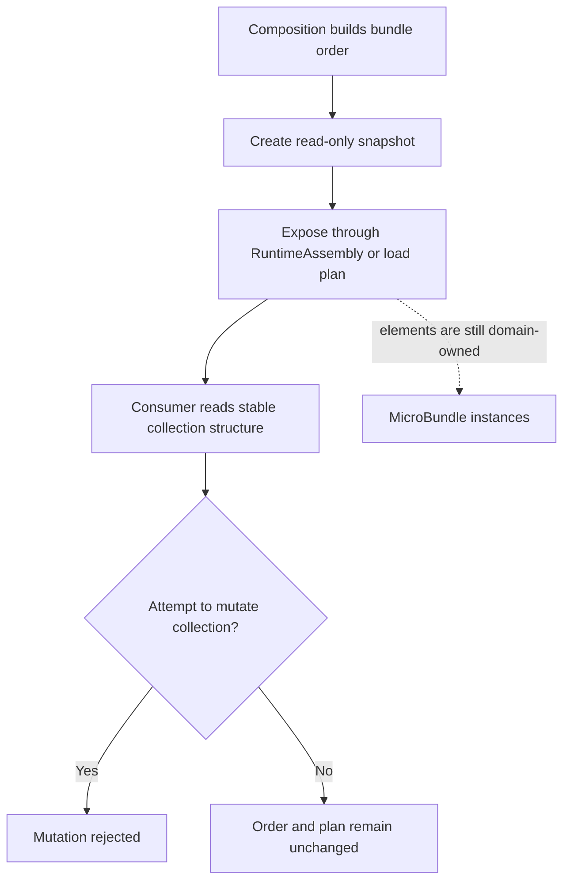

# Preserved additional alpha.7 integration documentation (batch 3)

Verbatim snapshots from `work/alpha7-living-docs-integration`, reviewed 2026-10-21. Historical status statements may be stale. These are recovery copies, not merged/certified content.


---

## docs/PAUSE_POINT.md
Source blob: `cac137cfffa9aa106ea8c550e54c11e071c968e2`


# Archived Pause Point — FSM_COS

> **Archive status:** This note preserves an earlier engineering pause decision and its rationale. It is not a live release checklist or a current CI report.
>
> The detailed status below was captured on October 18, 2026 or earlier. Run IDs, candidate SHAs, package versions, and WebPage integration statements are historical. Do not treat them as evidence for the current candidate.

## Current authorities

- [Alpha.7 release-readiness gate](0.1.0-alpha.7-READINESS.md) — exact-candidate source, CI, package, and documentation gates.
- [Domain completion roadmap](DOMAIN_COMPLETION_ROADMAP.md) — implemented kernel behavior, explicit boundaries, and deferred work.
- [Development and CI modes](DEVELOPMENT.md) — current branch policy and manual publish workflow.
- [Documentation index](../DOCUMENTATION_INDEX.md) — primary document for each topic.
- [WebPage integration guide](WEBPAGE_INTEGRATION.md) — intended host boundary; it is not proof of current end-to-end runtime behavior.

## Durable decision

Keep FSM_COS narrow. It composes requested MicroBundles into a `RuntimeAssembly`; the host owns execution, lifecycle, UI, and presentation after handoff. Continue broader host integration only when it is separately scoped and supported by the host's current source and tests.

The kernel does not own repository localization, content-hash verification, Bootstrap-only composition, background localization, live Deferred promotion, browser lifecycle, or GUI/rendering. Do not describe these as implemented unless the current code and end-to-end tests establish that claim.

## Historical notes

This file previously combined alpha.6 release checkpoints, old `&& false` publication-gate instructions, branch-reconciliation notes, and a WebPage pause decision. Those operational details are intentionally not repeated here because they became stale and duplicated the maintained readiness checklist. Consult repository history if the dated rationale is needed.

## Resume rule

Check the current `development` HEAD, read the alpha.7 readiness gate, and verify current workflow results for that exact SHA. A green run on an earlier commit is not proof for a later candidate. Package readiness is distinct from permission to publish; no publication without explicit owner authorization.

---

**The Singularity Workshop**  
[GitHub](https://github.com/TrentBest) · [Coder Legion](https://coderlegion.com/) · [Patreon](https://www.patreon.com/c/TheSingularityWorkshop) · [PayPal](https://www.paypal.com/donate/?hosted_button_id=3Z7263LCQMV9J)  
[ FSM_API ](https://github.com/TrentBest/FSM_API) · [ FSM_Serialization ](https://github.com/TrentBest/TheSingularityWorkshop.FSM_Serialization) · [ WebPage ](https://github.com/TrentBest/WebPage) · [ FSM_COS Documentation Standard ](https://github.com/TrentBest/TheSingularityWorkshop.FSM_COS/blob/development/DOCUMENTATION_STANDARD.md)  
**Because state shouldn't be a mess.**  
*And because static boundaries are invitations to cause trouble.*


---

## docs/RUNTIME_ASSEMBLY.md
Source blob: `75fb0be2e1bc23f22da29e5676a95b3e65d3db00`


# RuntimeAssembly

> RuntimeAssembly is where FSM_COS stops owning the journey. The deeper rationale is in [FSM_COS Theory](THEORY.md#9-runtimeassembly-is-the-handoff-object).

**RuntimeAssembly is the handoff object produced by FSM_COS.**


*The graphic shows the implemented boundary, not an execution pipeline: `FsmCos.Execute` validates the manifest, resolves and loads the requested dependency closure, arbitrates to convergence, and returns `RuntimeAssembly`. The host-specific examples on the right are responsibilities outside this package.*


## UML class diagram: assembly handoff

This is a simplified, source-derived overview of the handoff relationships, not a complete per-type API inventory. Method signatures are abbreviated for legibility; consult the source and contract sections below for exact generic overloads, parameter types, and nullability.

~~~mermaid
classDiagram
    class FsmCos {
        +Execute(manifest, configurationSource) RuntimeAssembly
    }
    class RuntimeManifest {
        +RuntimeId: ulong
        +Bundles: IReadOnlyList
        +Intent: SemanticIntent
    }
    class RuntimeAssembly {
        +RuntimeId: ulong
        +Bundles: IReadOnlyList~IMicroBundle~
        +LoadedBundles: IReadOnlyList~IMicroBundle~
        +ArbitrationRounds: int
        +Intent: SemanticIntent
        +TryGetBundle(bundleId, bundle) bool
        +TryGetBundle~TBundle~(bundleId, bundle) bool
        +TryGetBundle~TBundle~(bundle) bool
    }
    class IMicroBundle {
        <<MicroBundleDomain contract>>
        +Id: ulong
        +Descriptor
        +Load(context)
        +Arbitrate(context, roundIndex) bool
    }
    class Host {
        <<outside FSM_COS>>
    }

    FsmCos ..> RuntimeManifest : consumes
    FsmCos ..> RuntimeAssembly : returns after convergence
    RuntimeAssembly o-- "0..*" IMicroBundle : exposes loaded capabilities
    Host --> RuntimeAssembly : receives handoff
~~~

RuntimeAssembly is a snapshot of the loaded MicroBundle references and the converged round index. It does not start an Experience, tick FSM_API process groups, render UI, or roll back side effects from failed bundle code.

It is the point where composition ends and host-specific execution can begin.

## The alpha contract

The current implementation exposes:

```csharp
public sealed class RuntimeAssembly
{
    public ulong RuntimeId { get; }
    public IReadOnlyList<IMicroBundle> Bundles { get; }
    public int ArbitrationRounds { get; }
    public SemanticIntent? Intent { get; }
}
```

The assembly records:

- the runtime identity;
- the loaded MicroBundles;
- `ArbitrationRounds`: the zero-based index of the round that reported convergence (`0` means the first round converged), not the total number of `Arbitrate` calls;
- the optional application-owned semantic intent carried by the manifest, when supplied.

It does not become a host, renderer, scheduler, or Experience.

## The handoff

The flow is intentionally simple:

```text
RuntimeManifest
      │
      ▼
   FSM_COS
      │
      ▼
RuntimeAssembly
      │
      ├── WebForge → GUI → browser
      ├── Desktop Forge → native host
      ├── Unity bridge → Unity
      └── another host → its own manifestation
```

The assembly is therefore a **semantic handoff**, not a platform-specific object.

## What the host can do

Once it receives the assembly, the host can:

- inspect the installed bundles;
- connect them to host-specific services;
- construct GUI or presentation layers;
- start an Experience;
- schedule execution;
- allocate resources;
- communicate with platform APIs.

Those actions are deliberately outside FSM_COS.

### Provider declarations are not provider invocation

A loaded bundle's `MicroBundleDescriptor.Providers` advertises provider IDs. The descriptor does not contain the provider instances, their CLR contract types, semantic contract versions, or an invocation mechanism. `RuntimeAssembly.TryGetBundle(...)` locates a loaded MicroBundle; it does not resolve a provider ID declared by that bundle.

Therefore the host or a separately authored integration MicroBundle must explicitly resolve and invoke providers. It should validate the expected semantic contract and compatibility before invocation; matching strings alone are not proof of compatibility. Keep domain-specific policy—such as Physics contact evidence to a Gestures recovery recommendation—outside this composition kernel.

See [MicroBundleDomain's Provider Resolution Contract](https://github.com/TrentBest/TheSingularityWorkshop.MicroBundleDomain/blob/development/docs/PROVIDER_RESOLUTION_CONTRACT.md) for the current descriptor boundary and the minimum checks proposed before standardizing a resolver.

## What the assembly does not promise

A RuntimeAssembly does not promise:

- that an Experience has started;
- that a GUI exists;
- that a browser is open;
- that a Unity scene exists;
- that Warehouse resources have been allocated;
- that networking has begun.

It says:

> **The requested composition was assembled and reached a stable arbitration result.**

## Why this boundary matters

If FSM_COS returned a host-specific runtime object, the composition kernel would quickly accumulate platform dependencies.

Instead:

```text
composition semantics
        ↓
RuntimeAssembly
        ↓
host semantics
        ↓
observable experience
```

That separation is what allows a single composition request to be consumed by different manifestations.

## Related concepts

- [Runtime Manifest](RUNTIME_MANIFEST.md)
- [Consuming MicroBundles](CONSUMING_MICROBUNDLES.md)
- [Runtime Boundary](RUNTIME_BOUNDARY.md)


---

## 🔗 The Singularity Workshop

FSM_COS is one layer in a deliberately troublesome ecosystem:

- **[FSM_API](https://github.com/TrentBest/FSM_API)** — behavior and state.
- **[FSM_COS](https://github.com/TrentBest/TheSingularityWorkshop.FSM_COS)** — composition and runtime assembly.
- **[FSM_Serialization](https://github.com/TrentBest/TheSingularityWorkshop.FSM_Serialization)** — representation and the byte boundary.
- **[WebPage](https://github.com/TrentBest/WebPage)** — browser manifestation and proving ground.
- **[FSM_API_Unity](https://github.com/TrentBest/FSM_API_Unity)** — Unity manifestation.

<p align="center"><em>The Singularity Workshop — Tools for the curious, the bold, and the systemically inclined.</em><br><strong>Because state shouldn't be a mess.</strong><br><em>And because static boundaries are invitations to cause trouble.</em></p>

---

**The Singularity Workshop**  
[GitHub](https://github.com/TrentBest) · [Coder Legion](https://coderlegion.com/) · [Patreon](https://www.patreon.com/c/TheSingularityWorkshop) · [PayPal](https://www.paypal.com/donate/?hosted_button_id=3Z7263LCQMV9J)  
[ FSM_API ](https://github.com/TrentBest/FSM_API) · [ FSM_Serialization ](https://github.com/TrentBest/TheSingularityWorkshop.FSM_Serialization) · [ WebPage ](https://github.com/TrentBest/WebPage) · [ FSM_COS Documentation Standard ](https://github.com/TrentBest/TheSingularityWorkshop.FSM_COS/blob/development/DOCUMENTATION_STANDARD.md)  
**Because state shouldn't be a mess.**  
*And because static boundaries are invitations to cause trouble.*


---

## docs/RUNTIME_BOUNDARY.md
Source blob: `ed0ea1a7d7d1f76683c40053d485aeea01801c53`


# FSM_COS Runtime Boundary

> The boundary is easier to understand once the theory is clear: [FSM_COS Theory](THEORY.md) defines why composition stops where it does.

## Purpose


*Verified against `FsmCos.Execute` and `RuntimeAssembly`: the kernel owns composition; execution and manifestation remain host responsibilities.*


*The catalog and configuration source are external contracts supplied to `FsmCos.Execute`; FSM_COS calls those contracts during composition but does not own their storage or implementation. Serialization remains the separate byte boundary.*

FSM_COS exists to assemble a requested computation. It is not the application or runtime host.

The boundary is:

~~~text
published request
      ↓
   FSM_COS
      ↓
RuntimeAssembly
      ↓
host / Experience execution
~~~

## FSM_COS owns

FSM_COS owns the common computation-composition operations required to turn a RuntimeManifest into a stable RuntimeAssembly:

1. resolve requested MicroBundles;
2. resolve dependency closure;
3. accept optional external configuration through the configuration-source boundary;
4. install/load dependencies before dependents;
5. arbitrate over the installed composition;
6. detect cycles, missing bundles, and non-convergence;
7. return the assembled result.

## FSM_COS does not own

The following remain outside the kernel:

- starting an Experience;
- stepping FSM_API process groups;
- rendering GUI nodes;
- browser or desktop lifecycle;
- Unity scene/object lifecycle;
- Warehouse storage and allocation;
- networking;
- domain rules;
- presentation effects;
- telemetry and metaDev learning;
- user interaction policy.

A host may use the RuntimeAssembly to perform those operations, but those operations are not silently pulled into FSM_COS.

## Unity boundary

A Unity-facing implementation may consume FSM_COS, but Unity-specific code belongs outside this repository's composition kernel.

The same rule applies to the WebPage/browser host:

~~~text
FSM_COS
   ↓
RuntimeAssembly
   ↓
platform adapter / host
   ↓
Unity / browser / desktop / other manifestation
~~~

This prevents the composition package from acquiring platform lifecycle dependencies.

## Configuration boundary

Configuration is supplied independently of the Runtime Manifest. FSM_COS does not read configuration files or interpret their format; it consumes the optional configuration source contract and passes available configuration into the composition lifecycle. When no configuration exists, the MicroBundle uses its defaults.

## Serialization boundary

Serialization is adjacent to composition, but it is not composition.

When a manifest or bundle configuration becomes bytes, the reusable byte-oriented infrastructure belongs to **[TheSingularityWorkshop.FSM_Serialization](https://github.com/TrentBest/TheSingularityWorkshop.FSM_Serialization)**. FSM_COS should consume the resulting semantic/runtime representation rather than absorb the serialization package's responsibility.

See [FSM_COS Theory — Composition is not serialization](THEORY.md#14-composition-is-not-serialization) and [FSM_Serialization Theory](https://github.com/TrentBest/TheSingularityWorkshop.FSM_Serialization/blob/master/docs/THEORY.md).

## Warehouse boundary

A Warehouse may eventually provide the catalog or resolver used by FSM_COS.

That relationship is:

~~~text
RuntimeManifest
      ↓
    FSM_COS
      ↓
 catalog / resolver
      ↓
 Warehouse
~~~

The Warehouse remains responsible for storage and delivery. FSM_COS remains responsible for composition.

## Experience boundary

An Experience may be represented by a set of MicroBundles and therefore be assembled by FSM_COS.

Assembly does not execute the Experience.

That distinction is essential for cases such as a semantic preview: a composition can be loaded and inspected without accidentally starting its presentation Experience.

## The invariant

> **FSM_COS assembles. The host executes and manifests.**


---

## 🔗 The Singularity Workshop

FSM_COS is one layer in a deliberately troublesome ecosystem:

- **[FSM_API](https://github.com/TrentBest/FSM_API)** — behavior and state.
- **[FSM_COS](https://github.com/TrentBest/TheSingularityWorkshop.FSM_COS)** — composition and runtime assembly.
- **[FSM_Serialization](https://github.com/TrentBest/TheSingularityWorkshop.FSM_Serialization)** — representation and the byte boundary.
- **[WebPage](https://github.com/TrentBest/WebPage)** — browser manifestation and proving ground.
- **[FSM_API_Unity](https://github.com/TrentBest/FSM_API_Unity)** — Unity manifestation.

<p align="center"><em>The Singularity Workshop — Tools for the curious, the bold, and the systemically inclined.</em><br><strong>Because state shouldn't be a mess.</strong><br><em>And because static boundaries are invitations to cause trouble.</em></p>

---

**The Singularity Workshop**  
[GitHub](https://github.com/TrentBest) · [Coder Legion](https://coderlegion.com/) · [Patreon](https://www.patreon.com/c/TheSingularityWorkshop) · [PayPal](https://www.paypal.com/donate/?hosted_button_id=3Z7263LCQMV9J)  
[ FSM_API ](https://github.com/TrentBest/FSM_API) · [ FSM_Serialization ](https://github.com/TrentBest/TheSingularityWorkshop.FSM_Serialization) · [ WebPage ](https://github.com/TrentBest/WebPage) · [ FSM_COS Documentation Standard ](https://github.com/TrentBest/TheSingularityWorkshop.FSM_COS/blob/development/DOCUMENTATION_STANDARD.md)  
**Because state shouldn't be a mess.**  
*And because static boundaries are invitations to cause trouble.*


---

## docs/RUNTIME_MANIFEST.md
Source blob: `31242d97835500226e85fd662197af47721407b7`


# Runtime Manifest

> **The manifest says which MicroBundles and versions are requested. Configuration is a separate concern. FSM_COS composes the request.**

The **Runtime Manifest** is the machine-oriented composition request that crosses from authoring/tooling into FSM_COS.

It answers:

> **Which MicroBundles, at which requested versions, belong in this runtime composition?**

It deliberately does **not** answer:

- how a MicroBundle is configured;
- where a MicroBundle artifact is stored;
- how configuration is serialized;
- how the host presents the resulting Experience;
- how the assembled runtime is scheduled after composition.


*Scope note: this is the intended authoring/publication pipeline, not a claim that FSM_COS currently ships those editor, validation, closure-baking, or manifest-publication stages. The implemented contract begins with `RuntimeManifest`; `FsmCos.Execute` validates and composes that request.*

## UML class diagram: manifest and published plan

This is a simplified, source-derived UML overview, not a complete per-type API inventory. The manifest's root requests are distinct from optional published identity/stage metadata and dependency edges. The content hash is recorded in MicroBundleReference; this type does not itself fetch or verify artifact bytes. Exact signatures and nullability remain defined by the source and contract sections below.

~~~mermaid
classDiagram
    class RuntimeManifest {
        +RuntimeId: ulong
        +Bundles: IReadOnlyList~MicroBundleManifestEntry~
        +ExperienceContext: IStateContext
        +LoadPlan: IReadOnlyList~RuntimeManifestEntry~
        +Schedule: RuntimeManifestSchedule
        +Intent: SemanticIntent
        +Empty(runtimeId, context, intent)$ RuntimeManifest
        +ValidateStagedPlan() void
    }
    class MicroBundleManifestEntry {
        <<record struct>>
        +BundleId: ulong
        +Version: string
    }
    class RuntimeManifestEntry {
        <<record>>
        +Reference: MicroBundleReference
        +Stage: ManifestLoadStage
        +IsValid: bool
    }
    class MicroBundleReference {
        <<record struct>>
        +BundleId: ulong
        +Version: string
        +ContentHash: string
        +IsValid: bool
        +Matches(entry) bool
    }
    class ManifestLoadStage {
        <<enumeration>>
        Bootstrap
        Resident
        Deferred
    }
    class RuntimeManifestDependency {
        <<record struct>>
        +BundleId: ulong
        +DependencyId: ulong
        +IsValid: bool
    }
    class RuntimeManifestSchedule {
        +Entries: IReadOnlyList~RuntimeManifestEntry~
        +Dependencies: IReadOnlyList~RuntimeManifestDependency~
        +IndependentEntries: IReadOnlyList~RuntimeManifestEntry~
        +DependencyEntries: IReadOnlyList~RuntimeManifestEntry~
        +DependenciesOf(bundleId) IReadOnlyList
        +IsDependencyReady(bundleId, isLoaded) bool
    }

    RuntimeManifest *-- "0..*" MicroBundleManifestEntry : root requests
    RuntimeManifest o-- "0..*" RuntimeManifestEntry : optional load plan
    RuntimeManifest o-- "0..1" RuntimeManifestSchedule : optional dependency plan
    RuntimeManifestEntry --> MicroBundleReference : identity
    RuntimeManifestEntry --> ManifestLoadStage : intended stage
    RuntimeManifestSchedule o-- "0..*" RuntimeManifestEntry : entries
    RuntimeManifestSchedule o-- "0..*" RuntimeManifestDependency : edges
    RuntimeManifestDependency ..> RuntimeManifestEntry : links by BundleId
~~~

The schedule is a validated dependency plan. It does not localize artifacts, execute a process schedule, or by itself enable deferred loading. The diagram reflects the current source model, including that the root manifest requests a version while published references also carry ContentHash.

## The contract

The current development contract is intentionally small:

```csharp
public sealed record RuntimeManifest(
    ulong RuntimeId,
    IReadOnlyList<MicroBundleManifestEntry> Bundles,
    IStateContext? ExperienceContext = null,
    IReadOnlyList<RuntimeManifestEntry>? LoadPlan = null,
    RuntimeManifestSchedule? Schedule = null,
    SemanticIntent? Intent = null);
```

Each entry identifies one root MicroBundle and the version requested by the manifest:

```csharp
public readonly record struct MicroBundleManifestEntry(
    ulong BundleId,
    string Version);
```

The concrete implementation validates that the ID is non-zero and the version is present.

Conceptually:

```text
RuntimeManifest
├── RuntimeId
├── Bundles
│   ├── MicroBundle ID + requested version
│   ├── MicroBundle ID + requested version
│   └── MicroBundle ID + requested version
├── optional ExperienceContext
├── optional staged LoadPlan + Schedule
└── optional FSM_UserIO SemanticIntent
```

The manifest names **roots**. FSM_COS discovers the dependency closure from those roots.

## Optional intent and published dependency plan

`Intent` carries an optional `FSM_UserIO.SemanticIntent` to the returned `RuntimeAssembly`. It describes application-owned semantic intent; it does not grant device authority or cause an Experience to start.

`LoadPlan` and `Schedule` are optional published metadata. When a schedule is present, FSM_COS resolves the dependency closure before loading and verifies that the scheduled bundle IDs, resolved versions, and dependency edges match the domain-owned MicroBundle declarations. A mismatch fails before any bundle `Load` call. This is a consistency check, not artifact localization or hash verification.

## Example

```csharp
var manifest = new RuntimeManifest(
    RuntimeId: 1001,
    Bundles:
    [
        new MicroBundleManifestEntry(10, "1.2.0"),
        new MicroBundleManifestEntry(20, "3.1.0")
    ]);
```

This means:

- runtime `1001` is being assembled;
- MicroBundle `10` is requested at `1.2.0`;
- MicroBundle `20` is requested at `3.1.0`;
- configuration is **not** embedded in the manifest.

The catalog/resolver is responsible for locating a compatible artifact. FSM_COS verifies the resolved root reports the requested version before loading it.

### Conflicting requests for the same root identity

A manifest must not request the same MicroBundle ID at two different versions. For example, requesting bundle `10` at both `1.2.0` and `2.0.0` is ambiguous: one runtime composition cannot silently satisfy both root requests by choosing whichever catalog result happens to load first. FSM_COS detects conflicting versions for the same root ID and fails before loading the composition.

If two parts of an application genuinely require incompatible versions of one capability, model that incompatibility explicitly rather than relying on duplicate IDs in one manifest.

**An explicit root version also remains authoritative when that same MicroBundle is reached through another root's dependency graph.** FSM_COS resolves the distinct root ID/version requests before invoking any MicroBundle `Load` method, then reuses those selected root instances during dependency traversal. If a requested root version cannot be resolved, composition fails before loading begins. When a published schedule is supplied, its dependency-graph validation uses those same selected root instances, so the schedule check and actual composition cannot silently disagree about the version chosen for an explicitly requested root.

## Version is part of the request

Version belongs in the manifest because the manifest is a publication-level statement of **what composition was requested**.

```text
Manifest
    │
    ├── Bundle 10 → version 1.2.0
    └── Bundle 20 → version 3.1.0

Catalog / Repository
    │
    └── locate those requested artifacts

FSM_COS
    │
    └── compose the resolved artifacts
```

The manifest does not need to know whether an artifact came from an in-memory catalog, a repository, Azure Blob, a package cache, or another delivery mechanism.

## Configuration is deliberately outside the manifest

Configuration answers a different question:

> **How should this particular MicroBundle participate in this particular runtime?**

That information belongs in a separate configuration source.

```text
runtime 1001

MicroBundle 10
    └── configuration file exists
            ↓
        configuration bytes

MicroBundle 20
    └── no configuration file
            ↓
        use MicroBundle defaults
```

FSM_COS exposes the composition boundary through:

```csharp
public interface IMicroBundleConfigurationSource
{
    bool TryGetConfiguration(
        ulong runtimeId,
        ulong bundleId,
        string version,
        out ReadOnlyMemory<byte> configuration);
}
```

The interface is intentionally about **availability**, not storage.

The implementation might read a local configuration file, an Azure Blob, a repository artifact, generated resources, or another application-owned source.

FSM_COS does not choose among those.

### No configuration means defaults

This is an important semantic rule:

```text
configuration exists
        │
        ▼
provide bytes to the MicroBundle
        │
        ▼
MicroBundle interprets its own configuration

configuration absent
        │
        ▼
provide no external configuration
        │
        ▼
MicroBundle loads its defaults
```

There is no empty “default configuration file” requirement. Absence itself has meaning.

## Configuration format is not an FSM_COS concern

FSM_COS does not parse JSON, YAML, XML, binary records, generated C#, or any other configuration representation.

If configuration becomes a serialized byte-level contract, the serialization responsibility remains with the appropriate serialization layer.

```text
representation
     ↓
configuration source
     ↓
FSM_COS
     ↓
MicroBundle
```

## Roots versus dependencies

Suppose the requested root is:

```text
A
├── B
│   └── C
└── D
```

The manifest only needs:

```text
[A @ requested-version]
```

FSM_COS discovers:

```text
C → B → D → A
```

and loads dependencies before the root.

A dependency's domain-owned `MicroBundleDependencyRequest` may still carry dependency-specific configuration for compatibility with the MicroBundleDomain runtime contract. When an external configuration source supplies configuration for that dependency, the external value is used.

That compatibility detail does **not** move configuration into the manifest.

## What does not belong in a Runtime Manifest?

A manifest should not quietly become:

- an application configuration file;
- a GUI layout;
- a browser lifecycle description;
- a Unity scene;
- a Warehouse database;
- an Experience execution script;
- a serialized RuntimeAssembly;
- a repository API response.

The boundary is:

```text
Manifest
    = what MicroBundles + which versions

Configuration
    = how a MicroBundle is configured

Repository / Resolver
    = where the artifact comes from

FSM_COS
    = how the requested composition is assembled

RuntimeAssembly
    = what FSM_COS successfully assembled
```

## Authoring → publication → composition

A rich authoring environment may know far more than the runtime needs:

```text
rich authoring model
        │
        ├── names
        ├── ontology
        ├── variants
        ├── dependencies
        ├── provenance
        └── editor metadata
        │
        ▼
     validation
        │
        ▼
MicroBundle IDs + requested versions
        │
        ▼
 Runtime Manifest
        │
        ├─────────────── optional configuration source
        │                                  │
        ▼                                  ▼
 Catalog / Resolver ───────────────► FSM_COS
                                        │
                                        ▼
                                 RuntimeAssembly
```

This is a compression boundary: authoring can be rich without forcing the composition kernel to become an editor.

## Stability

A useful long-term property is:

> **The same semantic manifest, resolved against the same compatible catalog and versions, should produce the same composition.**

That does not require every host to render or execute the result identically.

It means the composition request remains meaningful when moved between hosts.

## Related documents

- [FSM_COS Architecture](ARCHITECTURE.md)
- [FSM_COS Theory](THEORY.md)
- [Consuming MicroBundles](CONSUMING_MICROBUNDLES.md)
- [RuntimeAssembly](RUNTIME_ASSEMBLY.md)
- [Arbitration and Convergence](ARBITRATION.md)
- [Development](DEVELOPMENT.md)

---

<p align="center"><em>The Singularity Workshop — Tools for the curious, the bold, and the systemically inclined.</em><br><strong>Because state shouldn't be a mess.</strong><br><em>And because static boundaries are invitations to cause trouble.</em></p>

---

**The Singularity Workshop**  
[GitHub](https://github.com/TrentBest) · [Coder Legion](https://coderlegion.com/) · [Patreon](https://www.patreon.com/c/TheSingularityWorkshop) · [PayPal](https://www.paypal.com/donate/?hosted_button_id=3Z7263LCQMV9J)  
[ FSM_API ](https://github.com/TrentBest/FSM_API) · [ FSM_Serialization ](https://github.com/TrentBest/TheSingularityWorkshop.FSM_Serialization) · [ WebPage ](https://github.com/TrentBest/WebPage) · [ FSM_COS Documentation Standard ](https://github.com/TrentBest/TheSingularityWorkshop.FSM_COS/blob/development/DOCUMENTATION_STANDARD.md)  
**Because state shouldn't be a mess.**  
*And because static boundaries are invitations to cause trouble.*


---

## docs/STAGED_MANIFEST_LOADING.md
Source blob: `c40149e20b7e0edfb2555a15ef30203908f50ae9`


# Staged Manifest Loading and Dependency Planning

**Status:** first compatible contract slice is present on `development`; host localization and staged composition are not yet integrated. Do not describe deferred loading as a working end-to-end runtime feature until the host path is implemented and tested.

## UML class diagram: staged metadata and load-plan state

This is a simplified, source-derived overview of the current metadata and state-tracker types, not a claim that staged composition is integrated end to end. Method signatures are abbreviated; the source and the staged-loading contract below define exact signatures and behavior.

~~~mermaid
classDiagram
    class RuntimeManifest {
        +Bundles: IReadOnlyList~MicroBundleManifestEntry~
        +LoadPlan: IReadOnlyList~RuntimeManifestEntry~
        +Schedule: RuntimeManifestSchedule
        +ValidateStagedPlan() void
    }
    class RuntimeManifestLoadPlan {
        +Entries: IReadOnlyList~RuntimeManifestEntry~
        +GetState(bundleId) MicroBundleRuntimeState
        +MarkLocalized(bundleId) void
        +MarkLoaded(bundleId) void
        +EvaluatePromotions(evaluator, context, schedule) IEnumerable
    }
    class RuntimeManifestEntry {
        +Reference: MicroBundleReference
        +Stage: ManifestLoadStage
        +IsValid: bool
    }
    class RuntimeManifestSchedule {
        +Entries: IReadOnlyList~RuntimeManifestEntry~
        +Dependencies: IReadOnlyList~RuntimeManifestDependency~
        +IsDependencyReady(bundleId, isLoaded) bool
    }
    class RuntimeManifestDependency {
        +BundleId: ulong
        +DependencyId: ulong
        +IsValid: bool
    }
    class IManifestLoadEvaluator {
        <<interface>>
        +ShouldLoad(entry, experienceContext) bool
    }
    class ManifestLoadStage {
        <<enumeration>>
        Bootstrap
        Resident
        Deferred
    }
    class MicroBundleRuntimeState {
        <<enumeration>>
        Published
        Localized
        Loaded
    }

    RuntimeManifest o-- "0..*" RuntimeManifestEntry : optional plan
    RuntimeManifest o-- RuntimeManifestSchedule : optional schedule
    RuntimeManifestLoadPlan o-- "1..*" RuntimeManifestEntry : tracked entries
    RuntimeManifestLoadPlan --> RuntimeManifestSchedule : optional dependency gate
    RuntimeManifestLoadPlan ..> IManifestLoadEvaluator : asks for deferred promotion
    RuntimeManifestEntry --> ManifestLoadStage : intended stage
    RuntimeManifestLoadPlan ..> MicroBundleRuntimeState : tracks availability
    RuntimeManifestSchedule o-- "0..*" RuntimeManifestDependency : edges
~~~

This diagram is deliberately not an execution promise. The load-plan type tracks Published → Localized → Loaded state and can evaluate promotion candidates, but a host/repository must perform localization and actual loading. ManifestLoadStage labels intent; it does not automatically make FsmCos defer or promote bundles.

## Four responsibilities, four boundaries


*The animated outline illustrates one valid dependency-first order for the example graph (`C → B → D → A`); it is not a live trace of a running process. The graph is illustrative, while actual dependencies come from each MicroBundle's declarations. This visual does not claim host localization or end-to-end deferred loading is implemented. See [`FsmCos.Execute` / `LoadRoot`](https://github.com/TrentBest/TheSingularityWorkshop.FSM_COS/blob/development/src/FSM_COS/FsmCos.cs) and the [dependency-order test](https://github.com/TrentBest/TheSingularityWorkshop.FSM_COS/blob/development/tests/FSM_COS.Tests/FsmCosTests.cs). The ownership table below remains authoritative for the current boundary.*


The staged-loading work must keep these concerns distinct:

| Concern | Owner | Responsibility |
|---|---|---|
| Dependency plan | Published manifest / FSM_COS contract | Describes which MicroBundles require which prerequisites |
| Process scheduling | FSM_API | Owns sequential process-group scheduling and execution semantics |
| Localization | Host/repository/cache adapter | Makes immutable published artifact bytes available locally and verifies identity/hash |
| Composition | FSM_COS | Resolves the current domain-owned MicroBundle contract, loads dependency closure, arbitrates, and returns a RuntimeAssembly |

FSM_COS must not become a storage engine or introduce a competing process scheduler. A dependency schedule is a description of prerequisites; it is not a substitute for FSM_API scheduling.

## Identity and lifecycle

A `MicroBundleReference` records:

- `BundleId`
- requested `Version`
- `ContentHash`

The reference is an identity claim, not proof that bytes have been downloaded or verified. The repository/localization boundary must validate the artifact against that identity.

The lifecycle remains:

```text
Published ──localize and verify──> Localized ──compose──> Loaded
```

- **Published** — the immutable artifact is identified by the published manifest.
- **Localized** — verified artifact bytes are available in the local cache.
- **Loaded** — the MicroBundle has been instantiated into the active composition.

Localization does not imply in-memory loading.

## Stages and dependency readiness

A manifest entry may be:

- **Bootstrap** — required to establish the initial visible/runnable Experience.
- **Resident** — participates in initial preparation but is not itself a bootstrap prerequisite.
- **Deferred** — eligible for later Experience-owned promotion.

Promotion candidates are considered in Bootstrap → Resident → Deferred order while preserving manifest order within each stage. Dependency readiness still wins: a bootstrap entry cannot be loaded until its prerequisites are loaded. This is planning/state-model behavior today; `FsmCos.Execute` does not yet run a bootstrap-only composition or continue localization in the background.

An `IManifestLoadEvaluator` lets the Experience decide *whether* a deferred capability is wanted. It does not decide whether prerequisites are ready: the dependency schedule/load plan must enforce that separately. A dependent entry cannot be marked Loaded until its prerequisites are Loaded.

Independent entries are entries with no prerequisite edges. Dependency-constrained entries have one or more prerequisites. This classification is useful for broad localization batches; actual composition still obeys dependency order.

## Compatibility with the current composition contract

The current manifest continues to use `MicroBundleManifestEntry` (bundle ID + requested version). Do not replace it with the old branch's `BundleRequest` model: that model lacks the current root-version contract and would conflict with the configuration-source boundary.

The current `FsmCos.Execute` path still resolves domain-owned `IMicroBundle` instances through `IMicroBundleCatalog`, traverses their dependency declarations, loads dependencies before dependents, detects cycles, and arbitrates to convergence. The optional staged metadata validates root identity/version consistency. When a `Schedule` is supplied, FSM_COS also preflights the catalog-resolved dependency closure and rejects scheduled bundle-ID, resolved-version, or dependency-edge drift before any `Load` side effects. It still does **not** execute bootstrap-only composition, perform asynchronous localization, verify content hashes, or promote Deferred entries into an already running RuntimeAssembly.

## Intended end-to-end direction

```text
Forge / publisher
  └─ immutable versioned manifest + dependency edges + stages
          ├─ localization clock → repository/cache batches
          ├─ composition clock  → dependency-ready MicroBundles
          └─ Experience clock   → bootstrap entry and continued operation
                                      │
                                      ▼
                              FSM_COS RuntimeAssembly
```

The three clocks should be able to progress independently. A host should be able to enter a minimum runnable Experience while other eligible artifacts continue localizing, without faking a delay or making the presentation layer act as the scheduler.

The published manifest should describe the dependency graph established by the Forge. The current runtime dependency traversal remains the compatibility behavior; the optional published schedule is now checked against the resolved graph before loading, but it does not yet dictate staged loading order or lifecycle. Do not treat stage metadata as an end-to-end staged runtime until localization and promotion have dedicated implementation and tests.

## Verification still required

- Verify the new planning contracts and tests on the current `development` dependency graph.
- Add consistency tests comparing published dependency edges with the resolved MicroBundle dependency contract.
- Introduce a host/repository localization abstraction only when its contract can be exercised by a real host.
- Integrate deferred promotion without losing configuration precedence, dependency closure, cycle detection, arbitration convergence, or RuntimeAssembly behavior.
- Demonstrate bootstrap entry while localization continues in the background.
- Keep NuGet publishing disabled unless the owner explicitly authorizes it.

---

<p align="center"><em>The Singularity Workshop — Tools for the curious, the bold, and the systemically inclined.</em><br><strong>Because state shouldn't be a mess.</strong><br><em>And because static boundaries are invitations to cause trouble.</em></p>


> **Visual contract note:** The animated outline illustrates one valid dependency-first order for the example graph (`C → B → D → A`); it is not a live trace of a running process. The graph is illustrative, while actual dependencies come from each MicroBundle's declarations. This visual does not claim host localization or end-to-end deferred loading is implemented. See [`FsmCos.LoadBundle`](https://github.com/TrentBest/TheSingularityWorkshop.FSM_COS/blob/development/src/FSM_COS/FsmCos.cs) and the [dependency-order test](https://github.com/TrentBest/TheSingularityWorkshop.FSM_COS/blob/development/tests/FSM_COS.Tests/FsmCosTests.cs). The ownership table above remains authoritative for the current boundary.

---

**The Singularity Workshop**  
[GitHub](https://github.com/TrentBest) · [Coder Legion](https://coderlegion.com/) · [Patreon](https://www.patreon.com/c/TheSingularityWorkshop) · [PayPal](https://www.paypal.com/donate/?hosted_button_id=3Z7263LCQMV9J)  
[ FSM_API ](https://github.com/TrentBest/FSM_API) · [ FSM_Serialization ](https://github.com/TrentBest/TheSingularityWorkshop.FSM_Serialization) · [ WebPage ](https://github.com/TrentBest/WebPage) · [ FSM_COS Documentation Standard ](https://github.com/TrentBest/TheSingularityWorkshop.FSM_COS/blob/development/DOCUMENTATION_STANDARD.md)  
**Because state shouldn't be a mess.**  
*And because static boundaries are invitations to cause trouble.*


---

## docs/THEORY.md
Source blob: `a80bd0a91aabbeebc062f4b24ca1c0d62e16ed7f`


# FSM_COS Theory

<p align="center">
  
</p>

*The left panel represents conceptual authoring context, not an implemented authoring or publishing pipeline inside FSM_COS. At runtime, the kernel consumes the defined `RuntimeManifest`; host-supplied catalog and configuration contracts provide external inputs.*

FSM_COS is the **platform-neutral computation and composition kernel** of The Singularity Workshop ecosystem.

It exists because there is a meaningful architectural operation between:

> **“Here is the runtime I am asking for.”**

and:

> **“Here is the system that will execute or manifest that computation.”**

That operation is **composition**.

FSM_COS takes a published request, discovers the MicroBundles required to satisfy it, accepts optional external configuration through a supplied boundary, loads the reachable composition, gives that composition an opportunity to reconcile itself, and returns a stable `RuntimeAssembly`.

It does not become the application.

It does not become the host.

It does not become the Experience.

It does not become the serializer.

It is the system that **assembles the system**.

For the architectural rationale behind this boundary, see this document together with [FSM_COS Architecture](ARCHITECTURE.md), [Runtime Manifest Theory](MANIFEST_THEORY.md), and [Runtime Boundary](RUNTIME_BOUNDARY.md).

---

## 1. What does “composition of systems” mean?

FSM_COS is intentionally **not an application type**. It does not assume that the computation being assembled is a WebPage, WebApp, desktop application, distributed service, game, spreadsheet, simulation, or any other particular product form.

The engineering abstraction is the computation and the common operational work required to assemble it. A host may later turn that computation into any of those things, or into something with no presentation layer at all.

The name **FSM_COS** is intentionally broader than “bundle loader.”

A loader answers:

> “Can I load this thing?”

A composition system answers:

> “Given a requested computation and its relationships, what complete set of components must exist together, in what dependency-respecting arrangement, with what optional configuration, before the result can be handed to something else?”

That distinction matters.

A MicroBundle is not useful merely because it can be loaded. It is useful because it can participate in a larger composition.

Conceptually:

```text
                 requested system
                       │
                       ▼
              ┌─────────────────┐
              │    FSM_COS       │
              │                  │
              │ resolve          │
              │ configure        │
              │ load             │
              │ reconcile        │
              │ stabilize        │
              └────────┬─────────┘
                       │
                       ▼
                RuntimeAssembly
```

FSM_COS therefore operates on **relationships between systems**, not just individual objects.

See [Runtime Manifest Theory](MANIFEST_THEORY.md) for the deeper distinction between a published request and the assembled result.

---

## 2. The missing layer is assembly

The word **system** here means the computation being assembled, not an application category. FSM_COS is useful precisely because the same assembly mechanics can support many kinds of software.

The broader ecosystem has several important responsibilities:

| Layer | Primary responsibility |
|---|---|
| **FSM_API** | behavioral/state-machine primitives |
| **FSM_COS** | composition and runtime assembly |
| **MicroBundle** | focused capability/content/behavior |
| **FSM_Serialization** | representation and byte boundary |
| **Warehouse** | storage and delivery |
| **Host** | execution and manifestation |
| **Experience** | what is encountered |

FSM_COS is not a replacement for any of those domains. This document only summarizes how FSM_COS consumes the contracts it needs; the authoritative explanation of each dependency remains in that dependency's repository.

It is the boundary that connects a **request for a composition** to a **stable assembled composition**.

The important word is **stable**.

The result should not be handed to a host while dependency resolution is incomplete, a required bundle is missing, a dependency cycle has gone unnoticed, or arbitration is still changing the composition.

That is why FSM_COS has a convergence phase rather than simply returning the list of loaded bundles.

---

## 3. Why the manifest exists

The [Runtime Manifest](RUNTIME_MANIFEST.md) is the published request entering the composition kernel.

It is deliberately smaller than the authoring world that produced it.

Authoring systems may know:

- human-readable names;
- ontology relationships;
- variants;
- visual/editor structure;
- provenance;
- dependency graphs;
- rich configuration models;
- source assets;
- authoring-only metadata.

FSM_COS does not need all of that information at runtime.

The publication boundary turns rich intent into a compact request:

```text
rich authoring model
        │
        ▼
    validation
        │
        ▼
dependency closure
        │
        ▼
 MicroBundle IDs + requested versions
        │
        ▼
 RuntimeManifest
```

This is not “throwing information away” accidentally.

It is **publishing only what the composition kernel needs**.

See [Runtime Manifest](RUNTIME_MANIFEST.md) and [Runtime Manifest Theory](MANIFEST_THEORY.md).

---

## 4. Composition starts with roots, not a giant object graph

A manifest names the requested roots.

Suppose the request is:

```text
A
├── B
│   └── C
└── D
```

The manifest does not need to duplicate the entire graph merely to tell FSM_COS that `A` was requested.

Conceptually:

```text
RuntimeManifest
      │
      ▼
      A
     / \
    B   D
    │
    C
```

FSM_COS discovers the reachable dependency closure.

The resulting installation order is an implementation consequence of those relationships:

```text
C → B → D → A
```

Before installation begins, FSM_COS resolves the entire reachable closure, checks the domain's dependency declarations and identities, detects cycles, and snapshots the resolved graph. That preflight means a missing dependency or malformed graph is rejected before a bundle's `Load` code can create side effects. Once `Load` begins, however, the kernel cannot promise transactional rollback of arbitrary bundle behavior; see [Architecture — Failure and partial side effects](ARCHITECTURE.md#failure-and-partial-side-effects).

This gives the composition system a crucial property:

> **The request describes what is wanted; the composition kernel derives how it must be assembled.**

Missing bundles and dependency cycles are therefore composition failures, not opportunities for the kernel to guess.

See [Architecture — Dependency Resolution](ARCHITECTURE.md#dependency-resolution).

---

## 5. MicroBundles participate in composition

**MicroBundleDomain owns the MicroBundle domain. FSM_COS owns the composition of those participants.**

FSM_COS therefore does not define:

- what a MicroBundle means;
- how its ontology is modeled;
- how its domain metadata should be designed;
- how its implementation is authored.

FSM_COS consumes the domain-owned contract to perform composition work:

```text
domain-owned MicroBundle
          │
          ▼
     catalog / resolver
          │
          ▼
       FSM_COS
          │
     ┌────┼────┐
     ▼    ▼    ▼
   Load Arbitrate dependency closure
          │
          ▼
   RuntimeAssembly
```

The same MicroBundle domain can therefore be consumed by different composition hosts.

> **MicroBundleDomain explains the participant. FSM_COS explains the relationship between participants.**

For concrete developer usage, see [Consuming MicroBundles](CONSUMING_MICROBUNDLES.md). The document focuses on what an FSM_COS developer can do with the contract; it does not attempt to redefine the MicroBundle domain.

---

## 6. Configuration is external to the manifest

The manifest says which MicroBundles and requested versions belong in the composition.

A separate configuration source says how a particular MicroBundle is configured for this runtime.

FSM_COS may consume configuration through `IMicroBundleConfigurationSource`, but it does not read configuration files or define their representation.

If configuration is absent, the MicroBundle receives no external configuration and uses its defaults.

```text
Manifest
   │
   ├── identity + version
   │
   ▼
FSM_COS
   ▲
   │
optional configuration source
```

### The serialization boundary

When configuration crosses a concrete byte representation boundary, that representation belongs to **FSM_Serialization** rather than FSM_COS.

FSM_COS can consume the resulting bytes without becoming another serialization framework.

```text
FSM_Serialization
    ↓ representation

configuration source
    ↓ availability

FSM_COS
    ↓ composition

MicroBundle
    ↓ domain interpretation
```

---

## 7. Loading is installation, not execution

A successful `Load()` means that a MicroBundle has entered the composition.

It does **not** mean:

- an Experience has started;
- a GUI has rendered;
- a browser has opened;
- a Unity scene has loaded;
- a desktop application has entered its lifecycle;
- a process has begun scheduling;
- a user has encountered anything.

This distinction is what lets the same composition travel to different hosts.

```text
             composition
                  │
             RuntimeAssembly
                  │
       ┌──────────┼──────────┐
       ▼          ▼          ▼
     browser    Unity     desktop
```

FSM_COS stops at the handoff.

See [Runtime Boundary](RUNTIME_BOUNDARY.md).

---

## 8. Arbitration is composition negotiation

Dependency loading establishes the initial reachable set.

Arbitration asks a different question:

> **Now that all reachable bundles are installed, does the composition need to change?**

Every loaded MicroBundle receives the shared composition context and can report whether its participation changed the composition.

```text
load complete
     │
     ▼
round 1 ── changed ──► round 2
                         │
                         ├── changed ──► round 3
                         │
                         └── unchanged
                                │
                                ▼
                         stable assembly
```

This is not a universal priority system.

The goal is not to produce a winner.

The goal is **convergence**.

The current alpha implementation bounds arbitration at ten rounds. If the composition does not stabilize, FSM_COS fails rather than handing the host an assembly it already knows is unstable.

See [Arbitration and Convergence](ARBITRATION.md).

Stable here means the participants reported no changes during a complete arbitration round. It is a protocol-level convergence result, not an automatic proof that every domain-specific compatibility rule, external dependency, or host behavior is correct. See [Arbitration and Convergence](ARBITRATION.md) for the exact guarantee and its limits.

---

## 9. RuntimeAssembly is the handoff object

The [RuntimeAssembly](RUNTIME_ASSEMBLY.md) is the concrete result of the composition pass.

It says, in effect:

> “The requested composition has been resolved, installed, and brought to a stable arbitration state.”

It does not say:

> “The application is now running.”

The distinction is deliberate.

```text
RuntimeManifest
      │
      ▼
   FSM_COS
      │
      ▼
RuntimeAssembly
      │
      ▼
      HOST
```

The host decides what execution or manifestation means in its environment.

This is the point at which FSM_COS stops being the owner of the journey.

---

## 10. Same computation, different manifestation

A computation should not become web-specific merely because the first proving ground is WebPage.

The same semantic request can be assembled for multiple hosts:

```text
                 Runtime Manifest
                        │
                        ▼
                     FSM_COS
                        │
                        ▼
                 RuntimeAssembly
                 /        |        \
                /         |         \
           WebPage       Unity     Desktop
              │            │          │
           browser       scene      native host
```

The host-specific behavior begins **after** composition.

This is why WebPage integration belongs in a host document rather than being baked into the kernel.

See [WebPage Integration](WEBPAGE_INTEGRATION.md).

---

## 11. What FSM_COS deliberately does not own

The boundary becomes easier to understand by looking at what is explicitly excluded.

FSM_COS does not own:

- application lifecycle;
- GUI rendering;
- browser lifecycle;
- Unity scene/object lifecycle;
- desktop lifecycle;
- Warehouse persistence;
- storage policy;
- transport protocols;
- networking;
- telemetry policy;
- metaDev adaptation;
- Experience presentation;
- arbitrary scheduling;
- domain-specific business rules;
- serialization formats.

Those concerns may participate in a larger architecture.

They should not be smuggled into the composition kernel merely because the kernel can see them.

The principle is:

> **If a concern can remain outside composition without weakening the composition contract, keep it outside.**

See [Runtime Boundary](RUNTIME_BOUNDARY.md).

---

## 12. The catalog is deliberately outside the algorithm

FSM_COS needs to resolve a bundle identity to an implementation.

It should not need to know where that implementation came from.

The catalog can therefore be supplied from outside:

```text
FSM_COS
   ▲
   │
IMicroBundleCatalog
   ▲
   │
┌──┴──────────────────────────┐
│ in-memory registry          │
│ generated catalog           │
│ cache                       │
│ Warehouse-backed resolver   │
│ domain-specific resolver    │
└─────────────────────────────┘
```

This is another form of boundary discipline.

The composition algorithm owns **what it needs**.

The surrounding system owns **how that need is fulfilled**.

That allows the same composition engine to evolve from an in-memory alpha catalog toward richer delivery infrastructure without rewriting the composition model.

---

## 13. Determinism is a goal of composition

A useful long-term property is:

> **The same semantic request, resolved against the same compatible catalog and bundle versions, should produce the same composition.**

That does not mean every host must render the result identically.

It means the composition boundary itself should be predictable.

Determinism can be undermined by:

- hidden global state;
- unspecified dependency ordering;
- inconsistent bundle identity;
- mutable configuration;
- arbitrary host callbacks;
- unstable arbitration rules.

FSM_COS therefore keeps its alpha algorithm deliberately explicit:

```text
request
  ↓
resolve
  ↓
dependency closure
  ↓
load
  ↓
arbitrate
  ↓
converge
  ↓
assemble
```

The theory is more important than the exact alpha implementation: the kernel must have a clear answer for **when composition is complete**.

---

## 14. Composition is not serialization

This distinction deserves its own statement.

A serialized manifest is a **representation** of a request.

A RuntimeManifest is the **semantic runtime request** consumed by FSM_COS.

A RuntimeAssembly is the **assembled runtime composition** produced by FSM_COS.

Those are three different things:

```text
serialized representation
        │
        │ decode / reconstruct
        ▼
  RuntimeManifest
        │
        │ compose
        ▼
  RuntimeAssembly
        │
        │ hand off
        ▼
       Host
```

The byte representation may change.

The composition semantics should not have to change merely because the representation format changes.

This is precisely why [FSM_Serialization](https://github.com/TrentBest/TheSingularityWorkshop.FSM_Serialization) is a separate package.

---

## 15. Composition is not manifestation

The crane metaphor is useful because it makes the responsibility boundary physical.

The crane:

- receives the request;
- finds the parts;
- assembles them;
- stabilizes the assembly;
- hands it off.

The crane does not become:

- the factory;
- the warehouse;
- the vehicle;
- the building;
- the user experience.

That is FSM_COS.

The crane is intentionally static in the architecture documentation. It is a symbol for the composition boundary: receive the request, gather the parts, stabilize the assembly, and hand it off. The SVG remains the canonical explanatory artifact.

> **FSM_COS assembles the machine. It does not become the machine.**

---

## 16. The architectural equation

The entire kernel can be reduced to:

```text
published manifest
       +
reachable MicroBundles
       +
optional external configuration
       +
dependency ordering
       +
arbitration
       =
stable RuntimeAssembly
```

Or, more simply:

```text
FSM_COS = computation request → composition → stable assembly
```

Not:

```text
FSM_COS = application framework
```

Not:

```text
FSM_COS = serializer
```

Not:

```text
FSM_COS = host
```

Not:

```text
FSM_COS = Experience
```

Its value is precisely that it stops before those responsibilities.

---

## 17. The invariant

The alpha implementation is intentionally small.

The architectural boundary should remain recognizable even when the surrounding ecosystem becomes much larger:

```text
authoring
   │
   ▼
Runtime Manifest
   │
   ▼
┌───────────────────────────────┐
│            FSM_COS            │
│                               │
│ resolve → load → arbitrate    │
│            ↓                  │
│      RuntimeAssembly          │
└───────────────┬───────────────┘
                │
                ▼
              host
                │
                ▼
          manifestation
```

The invariant is:

> **FSM_COS assembles what was requested, returns a stable composition, and hands that composition to something else.**

That is the theory.


---

## Living architecture

The documentation follows the architecture it describes: **static definitions can participate in dynamic behavior**.

The visual system therefore has a semantic motion vocabulary:

| Motion | Meaning |
|---|---|
| **Lift / lower** | work being performed by composition |
| **Pulse** | an active capability or boundary |
| **Travel** | a request or dependency moving between layers |
| **Repetition** | arbitration rounds |
| **Settling** | convergence |
| **Docking / handoff** | composition becoming available to a host |

The rule is simple: **animate the concept, not the decoration**.

A static blueprint remains the canonical explanatory artifact. A living companion makes the same model easier to *feel*. They are two manifestations of one semantic model, not competing representations.


---

## 🔗 The Singularity Workshop

FSM_COS is one layer in a deliberately troublesome ecosystem:

- **[FSM_API](https://github.com/TrentBest/FSM_API)** — behavior and state.
- **[FSM_COS](https://github.com/TrentBest/TheSingularityWorkshop.FSM_COS)** — composition and runtime assembly.
- **[FSM_Serialization](https://github.com/TrentBest/TheSingularityWorkshop.FSM_Serialization)** — representation and the byte boundary.
- **[WebPage](https://github.com/TrentBest/WebPage)** — browser manifestation and proving ground.
- **[FSM_API_Unity](https://github.com/TrentBest/FSM_API_Unity)** — Unity manifestation.

<p align="center"><em>The Singularity Workshop — Tools for the curious, the bold, and the systemically inclined.</em><br><strong>Because state shouldn't be a mess.</strong><br><em>And because static boundaries are invitations to cause trouble.</em></p>

---

**The Singularity Workshop**  
[GitHub](https://github.com/TrentBest) · [Coder Legion](https://coderlegion.com/) · [Patreon](https://www.patreon.com/c/TheSingularityWorkshop) · [PayPal](https://www.paypal.com/donate/?hosted_button_id=3Z7263LCQMV9J)  
[ FSM_API ](https://github.com/TrentBest/FSM_API) · [ FSM_Serialization ](https://github.com/TrentBest/TheSingularityWorkshop.FSM_Serialization) · [ WebPage ](https://github.com/TrentBest/WebPage) · [ FSM_COS Documentation Standard ](https://github.com/TrentBest/TheSingularityWorkshop.FSM_COS/blob/development/DOCUMENTATION_STANDARD.md)  
**Because state shouldn't be a mess.**  
*And because static boundaries are invitations to cause trouble.*


---

## docs/WEBPAGE_INTEGRATION.md
Source blob: `bd0bf35e5ae199b0c44377c72be46bb10c15609b`


# WebPage Integration

## Purpose


WebPage is the first concrete host for FSM_COS. The relationship is intentionally asymmetric:

- **FSM_COS** composes a runtime.
- **WebPage** supplies the bundles available to that runtime and decides how the assembled result is manifested.
- **TheSingularityWorkshop.GUI** constructs the semantic GUI.
- **Blazor** is the browser manifestation layer.
- **Experiences** are what the user encounters; they are not owned by the composition kernel.

The browser should therefore not become a dependency of FSM_COS.

## Package boundary

WebPage consumes the published package. Use a version that is actually available from NuGet. The source project currently declares `0.1.0-alpha.7`; a source declaration does not establish publication status, so verify the [NuGet package page](https://www.nuget.org/packages/TheSingularityWorkshop.FSM_COS) before selecting a version:

~~~xml
<PackageReference Include="TheSingularityWorkshop.FSM_COS" Version="x.y.z" />
~~~

The alpha.7 source candidate targets .NET 8 and directly references FSM_API 1.0.13, MicroBundleDomain 1.0.1, and FSM_UserIO 0.1.0-alpha.1. FSM_UserIO supplies the `SemanticIntent` type exposed as an optional value on `RuntimeManifest` and carried through to `RuntimeAssembly`; NuGet consumers must restore that dependency even when they do not supply an intent. This does not mean every composition requires a non-null intent; confirm host-specific assumptions against that host's source and tests. Keep the dependency decision visible for future minimization rather than implying the package has only two direct dependencies. The kernel itself remains platform-neutral.

A browser-specific adapter is **not** required merely to execute FsmCos.Execute(). An adapter becomes necessary at the point where the assembled result must interact with a host-specific lifecycle or rendering system.

## Composition flow

The first vertical slice should look like:

~~~text
                WebPage
                   │
                   │ RuntimeManifest
                   ▼
              FsmCos.Execute()
                   │
                   ▼
          IMicroBundleCatalog
                   │
        ┌──────────┼──────────┐
        ▼          ▼          ▼
      FSM_API    GUI       Experience
     bundles    bundles      bundles
                   │
                   ▼
             RuntimeAssembly
                   │
                   ▼
          WebPage host bridge
                   │
                   ▼
          GUI / Blazor browser
~~~

The important point is that FsmCos does not need to know which of those bundles represents a page, a GUI, an FSM, or an Experience.

## WebPage catalog

WebPage should own an IMicroBundleCatalog implementation.

A minimal catalog can begin as an in-memory registry:

~~~csharp
public sealed class WebPageMicroBundleCatalog : IMicroBundleCatalog
{
    private readonly IReadOnlyDictionary<ulong, IMicroBundle> _bundles;

    public WebPageMicroBundleCatalog(IEnumerable<IMicroBundle> bundles)
    {
        _bundles = bundles.ToDictionary(bundle => bundle.Id);
    }

    public bool TryResolve(
        ulong bundleId,
        string version,
        out IMicroBundle? bundle)
    {
        if (_bundles.TryGetValue(bundleId, out var candidate) &&
            string.Equals(candidate.Descriptor.Version, version, StringComparison.Ordinal))
        {
            bundle = candidate;
            return true;
        }

        bundle = null;
        return false;
    }

    public bool TryResolve(ulong bundleId, out IMicroBundle? bundle) =>
        _bundles.TryGetValue(bundleId, out bundle);
}
~~~

This is deliberately a WebPage concern. A later catalog can resolve bundles from generated manifests, Warehouse-backed delivery, or another source without changing FsmCos.

## First host integration

The first WebPage integration should not attempt to make FSM_COS responsible for rendering.

Instead:

1. Construct the WebPage catalog.
2. Construct FsmCos with that catalog.
3. Create a RuntimeManifest.
4. Execute the manifest.
5. Inspect the resulting RuntimeAssembly.
6. Pass the assembled semantic components into the existing GUI/Experience host.
7. Let the host drive browser lifecycle and presentation.

Conceptually:

~~~csharp
var catalog = new WebPageMicroBundleCatalog(bundles);
var cos = new FsmCos(catalog);

var assembly = cos.Execute(manifest);

// Host-specific work begins here.
return webPageHost.Manifest(assembly);
~~~

Manifest above is intentionally a host operation, not an FSM_COS API.

## What the first manifest should prove

The first WebPage manifest should be small enough to test the architecture rather than the entire Workshop.

A useful proving slice is:

~~~text
WebPage Runtime
├── FSM/API capability
├── GUI capability
└── one Experience capability
~~~

The test should establish that:

- the manifest identifies the runtime;
- dependencies are discovered by FSM_COS;
- dependencies load before dependents;
- configuration reaches the owning bundle;
- arbitration converges;
- RuntimeAssembly contains the expected bundles;
- WebPage can consume the assembly without adding browser concerns to FSM_COS.

## Platform adapters

Do not create FSM_COS.Blazor, FSM_COS.Unity, FSM_COS.Windows, or similar packages just because the hosts exist.

Those packages would only be justified when a reusable **host contract** has emerged that belongs to more than one consuming application.

For now the cleaner boundary is:

~~~text
FSM_COS
  │
  ▼
RuntimeAssembly
  │
  ├── WebPage host bridge → Blazor
  ├── Unity host bridge   → Unity
  └── Desktop host bridge → desktop runtime
~~~

The host bridge may be application-specific initially. Reusable adapters can be extracted later when their contract is proven.

## Future Warehouse integration

FSM_COS already has the correct abstraction point for eventual Warehouse participation:

~~~text
RuntimeManifest
      ↓
   FsmCos
      ↓
IMicroBundleCatalog
      ↓
 Warehouse-backed resolver
      ↓
 MicroBundle
~~~

The Warehouse does not become part of the FSM_COS package. It supplies or backs the catalog/resolution boundary.

## Current limitation

`0.1.0-alpha.7` is a composition kernel, not a complete runtime-host framework. Package-workflow and WebPage source-level integration results are evidence only for the exact commits they tested; an earlier pass does not prove a later source change. Those checks do not establish that the visible WebPage experience is fully driven by `RuntimeAssembly`. Check the [NuGet package page](https://www.nuget.org/packages/TheSingularityWorkshop.FSM_COS) for actual publication status.

The next meaningful evolution is therefore not adding platform APIs to FSM_COS. It is proving the complete handoff:

~~~text
manifest
   ↓
composition
   ↓
RuntimeAssembly
   ↓
host manifestation
   ↓
observable WebPage
~~~

Once that slice works, the boundary can be evaluated from real usage instead of speculation.

---

## 🔗 The Singularity Workshop

FSM_COS is one layer in a deliberately troublesome ecosystem:

- **[FSM_API](https://github.com/TrentBest/FSM_API)** — behavior and state.
- **[FSM_COS](https://github.com/TrentBest/TheSingularityWorkshop.FSM_COS)** — composition and runtime assembly.
- **[FSM_Serialization](https://github.com/TrentBest/TheSingularityWorkshop.FSM_Serialization)** — representation and the byte boundary.
- **[WebPage](https://github.com/TrentBest/WebPage)** — browser manifestation and proving ground.
- **[FSM_API_Unity](https://github.com/TrentBest/FSM_API_Unity)** — Unity manifestation.

<p align="center"><em>The Singularity Workshop — Tools for the curious, the bold, and the systemically inclined.</em><br><strong>Because state shouldn't be a mess.</strong><br><em>And because static boundaries are invitations to cause trouble.</em></p>

---

**The Singularity Workshop**  
[GitHub](https://github.com/TrentBest) · [Coder Legion](https://coderlegion.com/) · [Patreon](https://www.patreon.com/c/TheSingularityWorkshop) · [PayPal](https://www.paypal.com/donate/?hosted_button_id=3Z7263LCQMV9J)  
[ FSM_API ](https://github.com/TrentBest/FSM_API) · [ FSM_Serialization ](https://github.com/TrentBest/TheSingularityWorkshop.FSM_Serialization) · [ WebPage ](https://github.com/TrentBest/WebPage) · [ FSM_COS Documentation Standard ](https://github.com/TrentBest/TheSingularityWorkshop.FSM_COS/blob/development/DOCUMENTATION_STANDARD.md)  
**Because state shouldn't be a mess.**  
*And because static boundaries are invitations to cause trouble.*


---

## docs/WHAT_IS_FSM_COS.md
Source blob: `63630e62b456c3420cb830ae214ac02ddd146e97`


# What Is FSM_COS? A First Visit

You do not need to know how to program to start understanding FSM_COS. Begin with the problem it solves: **how can a program gather the right pieces of behavior without hard-wiring every possible combination into one giant application?**

FSM_COS is The Singularity Workshop's **runtime composition kernel**. In plain language, it helps a host put compatible pieces together for a requested experience. It does not, by itself, create the whole experience or run the finished application.

## Start with a familiar problem

Imagine you are setting up a workshop for a particular job. You need a set of tools, and some tools require other tools to be available first. You want to describe the job, find the necessary pieces, give them a defined opportunity to reconcile their shared setup, and then hand the prepared setup to the person who will actually do the work.

A software system faces a similar problem. One experience might need several independent capabilities. Some capabilities depend on others. Different hosts may want different combinations.

Without a separate composition step, each application can end up repeating the rules for finding dependencies and wiring capabilities together. FSM_COS gives that composition work a defined home.

The workshop analogy has a limit: FSM_COS is software with specific contracts and algorithms, not a human making judgment calls. The analogy is only a starting point for understanding the responsibilities.

## The idea in one picture


*The picture is the whole promise: a request enters, composition happens at a defined boundary, and the host receives the result. FSM_COS does not become the host application.*


```text
A request for capabilities
          |
          v
   Runtime Manifest
   "I need these pieces"
          |
          v
       FSM_COS
   - finds requested bundles
   - resolves their dependencies
   - loads the composition
   - runs bounded arbitration
          |
          v
    RuntimeAssembly
   "Here is the assembled result"
          |
          v
   The host application
   decides how to use it
```

The manifest describes the request. FSM_COS composes the requested pieces and their dependencies. The resulting `RuntimeAssembly` is handed to the host, which owns the application experience and what happens next.

## Five terms, in everyday language

| Term | Plain-language meaning |
|---|---|
| **Host** | The application or program that provides the overall experience. It might be a desktop app, website, service, simulator, or something else. |
| **MicroBundle** | A unit of behavior that follows the MicroBundle contract. Think of it as a defined capability that can participate in a composition. It is not simply any small NuGet package. |
| **Runtime Manifest** | The request describing which MicroBundles and versions are wanted. It says what is requested, not every detail of how the host presents it. |
| **Dependency** | Another piece that must be available for a requested piece to be composed correctly. |
| **RuntimeAssembly** | The composition result FSM_COS hands to the host. It is a handoff, not a finished application. |

The MicroBundle contract belongs to the separate **MicroBundleDomain** package. FSM_COS consumes that contract; it does not redefine the entire MicroBundle domain.

## A small conceptual example

Suppose a host wants to provide a map experience. For the sake of this example, imagine that the requested map capability depends on a separate capability that supplies map data.

1. The manifest requests the map capability.
2. The catalog gives FSM_COS a way to locate the requested MicroBundles.
3. FSM_COS discovers that the map capability depends on the map-data capability.
4. It resolves the dependency and composes the pieces in dependency order.
5. FSM_COS produces a `RuntimeAssembly` for the host.
6. The host decides how to display the map and how people interact with it.

This is an **illustrative scenario**, not a claim that this repository ships a map MicroBundle. The point is the relationship between a request, its dependencies, the composition step, and the host's responsibility.

## What FSM_COS does—and does not do

**It does:**
- resolve requested MicroBundles and their dependencies through a supplied catalog;
- apply available configuration through the supported composition path;
- load the composition in dependency order;
- perform bounded arbitration, giving participants a limited opportunity to reconcile;
- return a `RuntimeAssembly` to the caller.

**It does not automatically:**
- find or download artifacts from the internet; the host or a repository integration must provide discovery and retrieval;
- turn arbitrary libraries into MicroBundles;
- guarantee that unrelated capabilities are compatible simply because they can be loaded;
- create a user interface, run an application's main loop, or decide how a host presents an experience;
- make every proposed future integration a current feature.

These limits are intentional. Keeping the composition kernel focused makes it possible for different hosts to use it without forcing every host to adopt the same UI, storage system, or execution model.

## How to try something real

If you have Git and the **.NET 8 SDK** installed, clone the source repository and run its minimal consumer:

```bash
git clone https://github.com/TrentBest/TheSingularityWorkshop.FSM_COS.git
cd TheSingularityWorkshop.FSM_COS
dotnet run --project samples/FSM_COS.MinimalConsumer/FSM_COS.MinimalConsumer.csproj
```

The sample creates an in-memory catalog with a report bundle that depends on a data-source bundle. You should see loading messages followed by:

```text
Assembly order: 2 -> 1
```

That output is the important result: FSM_COS loaded the prerequisite before the requested report. The catalog and example bundles are defined by the sample; they are not extra built-in types supplied by FSM_COS.

If you want to verify the behavior with a focused test instead, run:

```bash
dotnet test tests/FSM_COS.Tests/FSM_COS.Tests.csproj --filter "FullyQualifiedName~Execute_loads_dependencies_before_requesting_bundle"
```

This test checks the same dependency-ordering rule. FSM_COS is infrastructure, so its proof is a correct composition handoff—not a window or a screen. To build your own consumer, continue with [Consuming MicroBundles](CONSUMING_MICROBUNDLES.md), which explains the catalog, manifest, configuration, and bundle contracts in practical terms.

## A two-minute exercise

**Without writing code:** think of an experience you know—such as a report, a map, or a classroom page. Name one capability the experience requests, one other capability it might depend on, and the host responsibility that remains outside composition (for example, showing the result on screen). There is no single correct answer; the goal is to practice separating the request, its prerequisites, and the host.

**If you have the .NET 8 SDK:** run the sample above, then open `samples/FSM_COS.MinimalConsumer/Program.cs`. In the `RuntimeManifest`, change the requested root from `reportBundle.Id` to `dataBundle.Id` and run the sample again. The assembly should contain only bundle `2`, because the request no longer asks for the report bundle. Restore the original line afterwards. This small experiment changes the request, not the composition algorithm.

## A learning path, at your own pace

<details>
<summary><strong>I'm completely new to software</strong></summary>

Start here, then read [FSM_COS Theory](THEORY.md) for the reasoning behind the composition boundary. You do not need to memorize the names of every interface. Focus first on the distinction between **requesting pieces**, **assembling pieces**, and **using the result**.
</details>

<details>
<summary><strong>I understand applications, but not this architecture</strong></summary>

Read [Architecture](ARCHITECTURE.md), then [Runtime Manifest](RUNTIME_MANIFEST.md) and [RuntimeAssembly](RUNTIME_ASSEMBLY.md). Together they explain what enters the kernel, what it does, and what leaves it.
</details>

<details>
<summary><strong>I want to write code that uses FSM_COS</strong></summary>

Follow [Consuming MicroBundles](CONSUMING_MICROBUNDLES.md), then use [Development](DEVELOPMENT.md) to build and test the repository. The code examples and tests are the place to verify exact signatures and behavior.
</details>

<details>
<summary><strong>I need the precise limits and design rationale</strong></summary>

Read [Runtime Boundary](RUNTIME_BOUNDARY.md), [Arbitration and Convergence](ARBITRATION.md), and [Staged Manifest Loading](STAGED_MANIFEST_LOADING.md). The staged-loading guide explicitly distinguishes the current contract slice from a complete integrated staged-loading pipeline.
</details>

## The main takeaway

FSM_COS separates **what a host asks for**, **how the necessary pieces are composed**, and **what the host does with the result**. That separation is the value. It gives developers a reusable composition boundary without pretending that composition alone solves discovery, compatibility, presentation, execution, or every other problem in an application.

---

<p align="center"><em>The Singularity Workshop — Tools for the curious, the bold, and the systemically inclined.</em><br><strong>Because state shouldn't be a mess.</strong><br><em>And because static boundaries are invitations to cause trouble.</em></p>

---

**The Singularity Workshop**  
[GitHub](https://github.com/TrentBest) · [Coder Legion](https://coderlegion.com/) · [Patreon](https://www.patreon.com/c/TheSingularityWorkshop) · [PayPal](https://www.paypal.com/donate/?hosted_button_id=3Z7263LCQMV9J)  
[ FSM_API ](https://github.com/TrentBest/FSM_API) · [ FSM_Serialization ](https://github.com/TrentBest/TheSingularityWorkshop.FSM_Serialization) · [ WebPage ](https://github.com/TrentBest/WebPage) · [ FSM_COS Documentation Standard ](https://github.com/TrentBest/TheSingularityWorkshop.FSM_COS/blob/development/DOCUMENTATION_STANDARD.md)  
**Because state shouldn't be a mess.**  
*And because static boundaries are invitations to cause trouble.*


---

## docs/releases/0.1.0-alpha.6.md
Source blob: `85bec69a30927630f857adb51b62d1aba65e3163`


# FSM_COS 0.1.0-alpha.6 — Release Notes

> These notes describe the source candidate's intended contract and limitations. They do not establish publication status or authorize a publication; check the [NuGet package page](https://www.nuget.org/packages/TheSingularityWorkshop.FSM_COS) for availability.

## Intent

Alpha.6 aligns FSM_COS around the versioned MicroBundle manifest and external configuration-source contract while preserving the optional semantic intent signal for hosts.

## Included behavior and contracts

- Runtime roots use `MicroBundleManifestEntry` with an explicit bundle ID and requested version.
- `FsmCos.Execute` accepts an optional `IMicroBundleConfigurationSource`. Configuration is resolved by runtime ID, bundle ID, and version; absent external configuration leaves the MicroBundle's defaults in effect.
- `RuntimeManifest.Intent` optionally carries `FSM_UserIO.SemanticIntent` through to `RuntimeAssembly.Intent`.
- When a `RuntimeManifestSchedule` is supplied, FSM_COS resolves the actual dependency closure before loading and rejects differences in scheduled bundle IDs, resolved versions, or dependency edges before `IMicroBundle.Load` is called.
- Existing dependency ordering, shared-dependency deduplication, cycle detection, and bounded arbitration remain part of composition.

## Package dependencies

- `TheSingularityWorkshop.FSM_API` 1.0.13
- `TheSingularityWorkshop.FSM_UserIO` 0.1.0-alpha.1
- `TheSingularityWorkshop.MicroBundleDomain` 1.0.1

The package workflow is designed to verify both the repository's CI dependency path and a clean restore against the public NuGet feed. The local MicroBundleDomain build used by the primary CI job is not a substitute for public-package compatibility; consult the current Actions run for verification of a specific commit.

## Documentation and verification

- Added a plain-language introduction for readers new to software composition, with a no-code exercise and a small optional coding exercise.
- Added a minimal consumer example in the source repository. It demonstrates an in-memory catalog, a requested MicroBundle, its dependency, and the resulting load order. The sample is a source-repository example and is not included in the NuGet package.
- Expanded consumer guidance with troubleshooting and an explicit explanation of the three direct package dependencies.
- The package workflow now runs the minimal consumer and checks its observed dependency order in both the normal development dependency path and the public-NuGet-feed compatibility path. Verify the Actions run for the exact candidate commit before release review; earlier green runs do not validate later commits.

## Explicit limitations

The staged metadata remains a planning and validation contract. Alpha.6 does **not** claim to implement repository localization, content-hash verification, Bootstrap-only initial composition, background loading, or live promotion of Deferred bundles into an already running `RuntimeAssembly`. Those responsibilities require a verified repository/host boundary and separate end-to-end tests.

FSM_COS remains a platform-neutral composition boundary. Forge authoring, manifest persistence/serialization, repository transport, UI, and application lifecycle remain outside this package.

## Publication safeguards

Publication is a separate owner decision. Before any future publication, verify the exact source commit and generated package, confirm that the full build/test, public-NuGet compatibility, and development-source integration jobs pass for that commit, and obtain explicit owner approval. The workflow publishes only when deliberately dispatched from `development` with its required `publish` boolean checked; ordinary pushes and pull requests do not publish. These notes never authorize publication.

---

**The Singularity Workshop**  
[GitHub](https://github.com/TrentBest) · [Coder Legion](https://coderlegion.com/) · [Patreon](https://www.patreon.com/c/TheSingularityWorkshop) · [PayPal](https://www.paypal.com/donate/?hosted_button_id=3Z7263LCQMV9J)  
[ FSM_API ](https://github.com/TrentBest/FSM_API) · [ FSM_Serialization ](https://github.com/TrentBest/TheSingularityWorkshop.FSM_Serialization) · [ WebPage ](https://github.com/TrentBest/WebPage) · [ FSM_COS Documentation Standard ](https://github.com/TrentBest/TheSingularityWorkshop.FSM_COS/blob/development/DOCUMENTATION_STANDARD.md)  
**Because state shouldn't be a mess.**  
*And because static boundaries are invitations to cause trouble.*


---

## docs/releases/0.1.0-alpha.7.md
Source blob: `0b55c797ce5ba2539697dbb0f0ee7626c35ea7c8`


# FSM_COS 0.1.0-alpha.7 — Release Candidate Notes

> These notes describe the source candidate's intended contract. They do not establish publication status; check the [NuGet package page](https://www.nuget.org/packages/TheSingularityWorkshop.FSM_COS) for availability.

## Why alpha.7 exists

Alpha.7 hardens both the public collection contracts and the composition boundary. Collections exposed as read-only interfaces are backed by read-only snapshots, while the complete dependency graph is resolved and validated before configuration callbacks or bundle loading begin. Identity, version, descriptor-dependency, and runtime dependency-request contracts are checked before composition can proceed.

## Included behavior

- `RuntimeAssembly.Bundles` is a read-only snapshot of the composed bundle order.
- `RuntimeManifestSchedule` exposes read-only snapshots for entries, dependency edges, independent entries, and dependent entries; `RuntimeManifestLoadPlan.Entries` is also a read-only snapshot.
- Composition resolves and snapshots the complete dependency closure before invoking configuration callbacks or any bundle `Load()` method.
- Root IDs and versions, bundle IDs and descriptor IDs, and descriptor dependency declarations versus runtime dependency requests must agree. Null lists, zero IDs, duplicate requests, missing dependencies, mismatches, and cycles fail closed.
- Dependency-graph preflight, cycle validation, and dependency-first loading use iterative traversal, avoiding process-stack exhaustion on deep graphs.
- Root-list and dependency-request snapshots use bounded enumeration rather than trusting a custom collection's reported `Count`; default composition limits are 10,000 bundles, 100,000 dependency requests, and 64 MiB of copied configuration data, with the configuration-byte limit configurable by the host.
- The resolved catalog objects and dependency-request lists are snapshotted for the execution, preventing catalog time-of-check/time-of-use changes from silently swapping the selected graph.
- Dependency configuration and configuration-provider memory are copied before callbacks or loading, preventing mutable backing arrays from changing the selected configuration after validation.
- Regression tests cover mutation through `IList<T>` casts, mutable manifest collections, changing catalogs, deep graphs, malformed dependency contracts, failure callbacks, cycles, and arbitration non-convergence.
- The package workflow generates and verifies the GUI.SVG preflight picture, checks its accessibility markup, and confirms GUI.SVG remains a build-time documentation tool rather than an FSM_COS NuGet dependency.

## Collection immutability in one picture



*The snapshot protects collection structure and ordering. It does not make the referenced MicroBundle instances immutable.*

## Package contract

- Target framework: .NET 8.
- Direct dependencies: FSM_API 1.0.13, FSM_UserIO 0.1.0-alpha.1, and MicroBundleDomain 1.0.1.
- Package version declared by this source: `0.1.0-alpha.7`.

## Explicit limitations

Alpha.7 does not implement repository localization, content-hash verification, Bootstrap-only initial composition, background localization, or live promotion of Deferred bundles into an already running `RuntimeAssembly`. Read-only wrappers protect collection structure, not the domain-owned `IMicroBundle` instances. Graph preflight prevents known identity, resolution, version, and cycle failures from reaching bundle loading, but exceptions from configuration, `Load()`, or `Arbitrate()` do not automatically roll back arbitrary side effects that already occurred.

## Publication

These notes do not indicate that alpha.7 has been published or authorize publication. Use the [readiness gate](https://github.com/TrentBest/TheSingularityWorkshop.FSM_COS/blob/development/docs/0.1.0-alpha.7-READINESS.md) for release evidence and the [NuGet package page](https://www.nuget.org/packages/TheSingularityWorkshop.FSM_COS) for actual feed status.

---

**The Singularity Workshop**  
[GitHub](https://github.com/TrentBest) · [Coder Legion](https://coderlegion.com/) · [Patreon](https://www.patreon.com/c/TheSingularityWorkshop) · [PayPal](https://www.paypal.com/donate/?hosted_button_id=3Z7263LCQMV9J)  
[ FSM_API ](https://github.com/TrentBest/FSM_API) · [ FSM_Serialization ](https://github.com/TrentBest/TheSingularityWorkshop.FSM_Serialization) · [ WebPage ](https://github.com/TrentBest/WebPage) · [ FSM_COS Documentation Standard ](https://github.com/TrentBest/TheSingularityWorkshop.FSM_COS/blob/development/DOCUMENTATION_STANDARD.md)  
**Because state shouldn't be a mess.**  
*And because static boundaries are invitations to cause trouble.*

