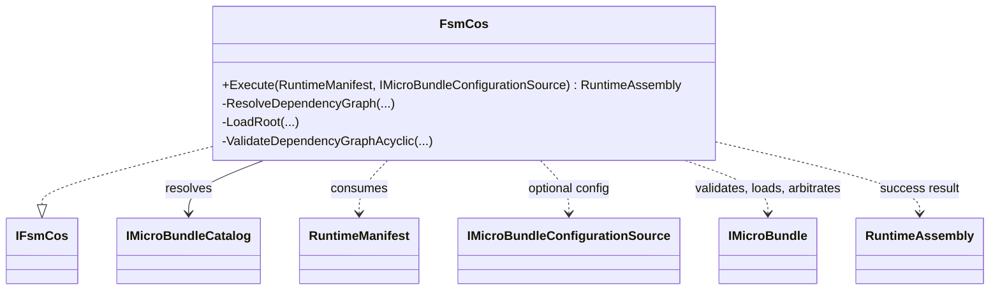
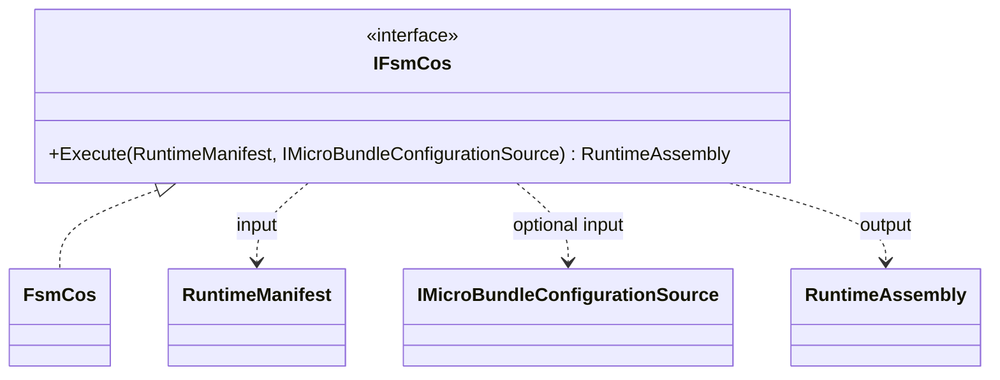
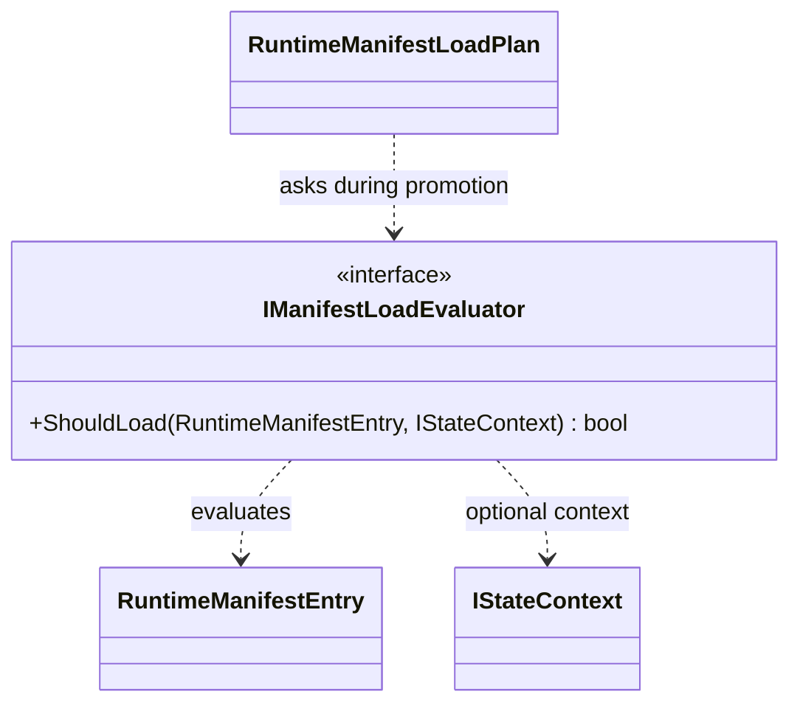
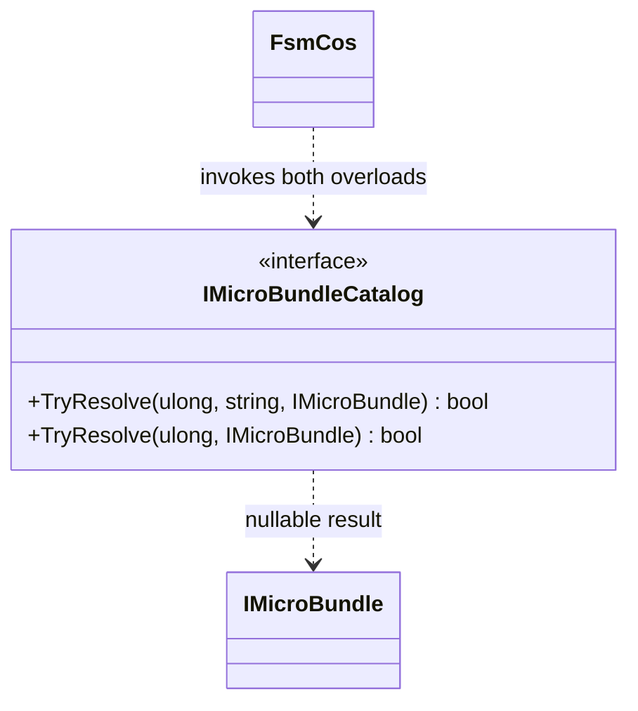
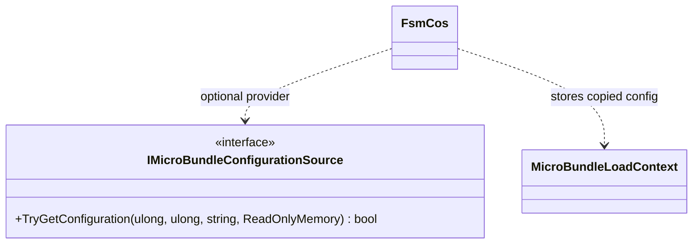
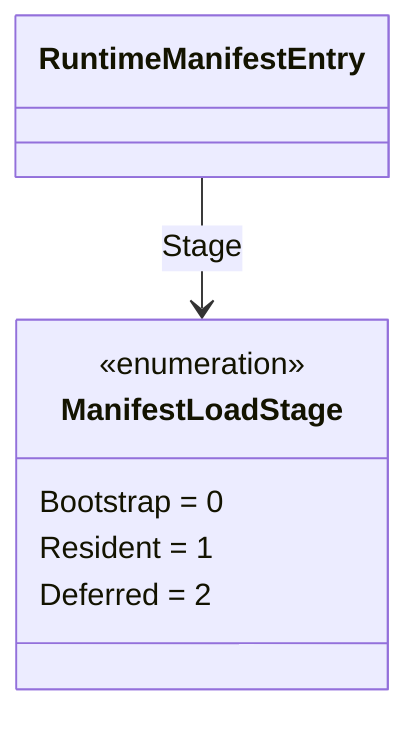
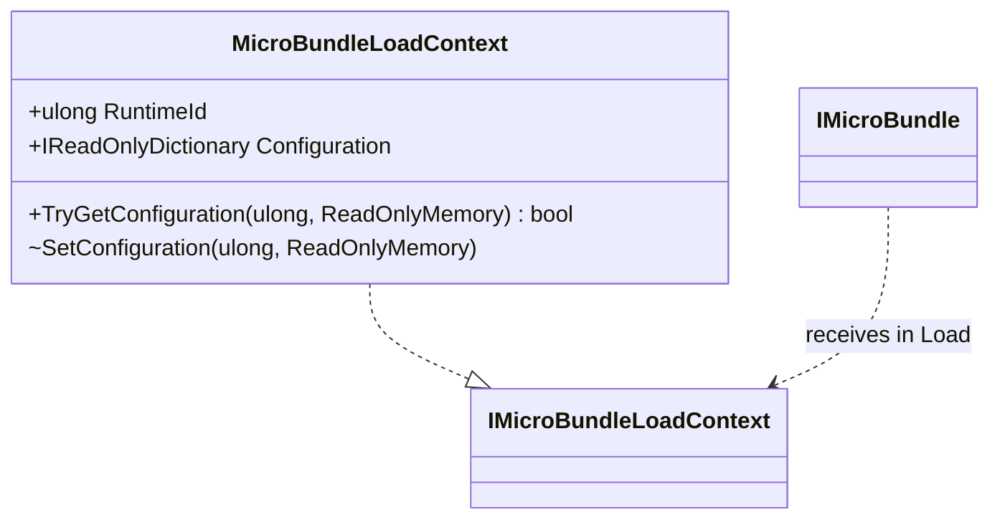
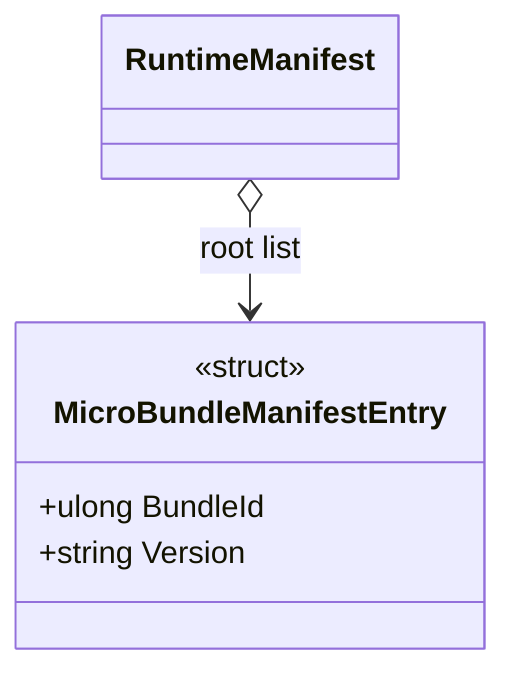
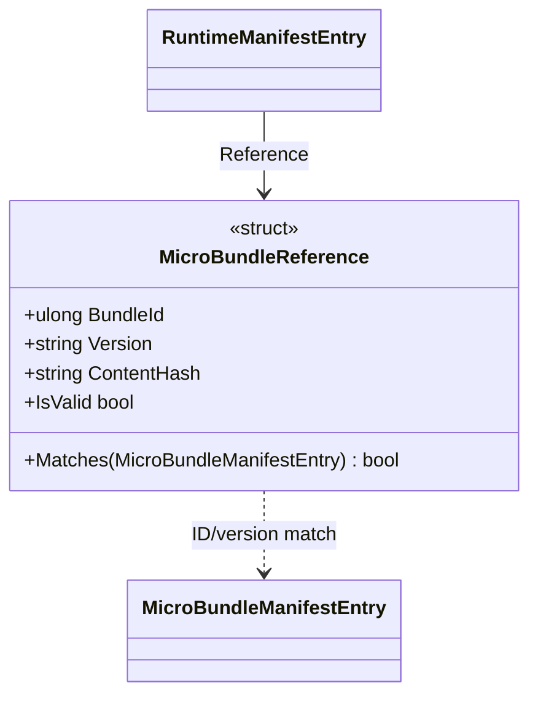
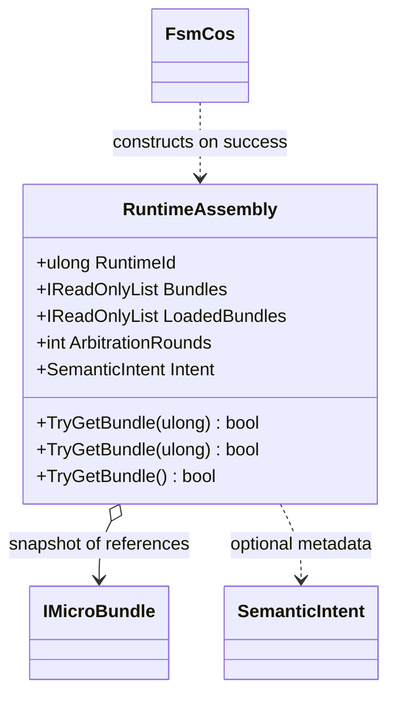

# Preserved per-type UML companion pages

Operation Sith harvest, 2026-10-21. Verbatim contents preserved from `work/alpha7-living-docs-integration`; source branch commit `19567ca49d5a49f13e05286301105b250bcd9e87`. These are historical snapshots, not certification that all pages match current source.

---

## Original path: `docs/UML/src/FSM_COS/FsmCos.md`

Source blob: `b8e36ec439c7b667d4f1d52dd5b9fd2c59dfbe2c`

# FsmCos

**Source:** `src/FSM_COS/FsmCos.cs`  
**Baseline:** `ce43e8f5bf3dfc229f28678fc2e0d944c5c8d38a`  
**Authorship:** manually authored; not GUI.SVG-generated.

## Source-grounded summary

Sealed composition engine implementing IFsmCos. Execute validates/snapshots manifest inputs, resolves root versions and dependency closure, validates identities and graph, loads dependencies before dependents, arbitrates to stability within a bound, and returns RuntimeAssembly only on success.

## Diagram

## Evidence boundary

Resource limits: default 10 arbitration rounds, 10,000 bundles, 100,000 dependency requests, 64 MiB total configuration. Preflight happens before Load callbacks. Iterative graph traversal avoids recursive stack growth. Configuration bytes are copied. If a later Load fails, earlier bundle side effects are not rolled back; tests cover this. A schedule is not the FSM_API process scheduler.

For behavior beyond the declaration summarized here, inspect the implementation and relevant tests at the same baseline. This page is not evidence of hosted rendering or accessibility behavior by itself.

---

**The Singularity Workshop**  
[GitHub](https://github.com/TrentBest) · [Coder Legion](https://coderlegion.com/) · [Patreon](https://www.patreon.com/c/TheSingularityWorkshop) · [PayPal](https://www.paypal.com/donate/?hosted_button_id=3Z7263LCQMV9J)  
[ FSM_API ](https://github.com/TrentBest/FSM_API) · [ FSM_Serialization ](https://github.com/TrentBest/TheSingularityWorkshop.FSM_Serialization) · [ WebPage ](https://github.com/TrentBest/WebPage) · [ FSM_COS Documentation Standard ](https://github.com/TrentBest/TheSingularityWorkshop.FSM_COS/blob/development/DOCUMENTATION_STANDARD.md)  
**Because state shouldn't be a mess.**  
*And because static boundaries are invitations to cause trouble.*

---

## Original path: `docs/UML/src/FSM_COS/IFsmCos.md`

Source blob: `940a2deb97e0ab643a3812ab4b9d2d6e32f7648f`

# IFsmCos

**Source:** `src/FSM_COS/IFsmCos.cs`  
**Baseline:** `ce43e8f5bf3dfc229f28678fc2e0d944c5c8d38a`  
**Authorship:** manually authored; not GUI.SVG-generated.

## Source-grounded summary

Public composition interface with one method: Execute(RuntimeManifest, optional IMicroBundleConfigurationSource) returning RuntimeAssembly.

## Diagram

## Evidence boundary

The signature alone does not promise graph resolution, load order, rollback, thread safety, or lifecycle management; attribute those to implementation/tests.

For behavior beyond the declaration summarized here, inspect the implementation and relevant tests at the same baseline. This page is not evidence of hosted rendering or accessibility behavior by itself.

---

**The Singularity Workshop**  
[GitHub](https://github.com/TrentBest) · [Coder Legion](https://coderlegion.com/) · [Patreon](https://www.patreon.com/c/TheSingularityWorkshop) · [PayPal](https://www.paypal.com/donate/?hosted_button_id=3Z7263LCQMV9J)  
[ FSM_API ](https://github.com/TrentBest/FSM_API) · [ FSM_Serialization ](https://github.com/TrentBest/TheSingularityWorkshop.FSM_Serialization) · [ WebPage ](https://github.com/TrentBest/WebPage) · [ FSM_COS Documentation Standard ](https://github.com/TrentBest/TheSingularityWorkshop.FSM_COS/blob/development/DOCUMENTATION_STANDARD.md)  
**Because state shouldn't be a mess.**  
*And because static boundaries are invitations to cause trouble.*

---

## Original path: `docs/UML/src/FSM_COS/IManifestLoadEvaluator.md`

Source blob: `fdcfd07d53d0585fab1a3f37b85eb71313d8c087`

# IManifestLoadEvaluator

**Source:** `src/FSM_COS/IManifestLoadEvaluator.cs`  
**Baseline:** `ce43e8f5bf3dfc229f28678fc2e0d944c5c8d38a`  
**Authorship:** manually authored; not GUI.SVG-generated.

## Source-grounded summary

Experience-owned decision interface: ShouldLoad(RuntimeManifestEntry, nullable IStateContext). XML remarks exclude dependency resolution, artifact localization, and loading from this contract.

## Diagram

## Evidence boundary

The source establishes a contract and call site, not a particular policy or host evaluator correctness.

For behavior beyond the declaration summarized here, inspect the implementation and relevant tests at the same baseline. This page is not evidence of hosted rendering or accessibility behavior by itself.

---

**The Singularity Workshop**  
[GitHub](https://github.com/TrentBest) · [Coder Legion](https://coderlegion.com/) · [Patreon](https://www.patreon.com/c/TheSingularityWorkshop) · [PayPal](https://www.paypal.com/donate/?hosted_button_id=3Z7263LCQMV9J)  
[ FSM_API ](https://github.com/TrentBest/FSM_API) · [ FSM_Serialization ](https://github.com/TrentBest/TheSingularityWorkshop.FSM_Serialization) · [ WebPage ](https://github.com/TrentBest/WebPage) · [ FSM_COS Documentation Standard ](https://github.com/TrentBest/TheSingularityWorkshop.FSM_COS/blob/development/DOCUMENTATION_STANDARD.md)  
**Because state shouldn't be a mess.**  
*And because static boundaries are invitations to cause trouble.*

---

## Original path: `docs/UML/src/FSM_COS/IMicroBundleCatalog.md`

Source blob: `a9b90a0cb9dda389ed1adeb1c666f1d31472965c`

# IMicroBundleCatalog

**Source:** `src/FSM_COS/IMicroBundleCatalog.cs`  
**Baseline:** `ce43e8f5bf3dfc229f28678fc2e0d944c5c8d38a`  
**Authorship:** manually authored; not GUI.SVG-generated.

## Source-grounded summary

Two overloads resolve domain IMicroBundle: by ID and exact version for root requests, or by ID for dependency requests.

## Diagram

## Evidence boundary

The interface does not specify storage, caching, or thread-safety. FsmCos validates returned bundle identity/version instead of trusting the success flag alone.

For behavior beyond the declaration summarized here, inspect the implementation and relevant tests at the same baseline. This page is not evidence of hosted rendering or accessibility behavior by itself.

---

**The Singularity Workshop**  
[GitHub](https://github.com/TrentBest) · [Coder Legion](https://coderlegion.com/) · [Patreon](https://www.patreon.com/c/TheSingularityWorkshop) · [PayPal](https://www.paypal.com/donate/?hosted_button_id=3Z7263LCQMV9J)  
[ FSM_API ](https://github.com/TrentBest/FSM_API) · [ FSM_Serialization ](https://github.com/TrentBest/TheSingularityWorkshop.FSM_Serialization) · [ WebPage ](https://github.com/TrentBest/WebPage) · [ FSM_COS Documentation Standard ](https://github.com/TrentBest/TheSingularityWorkshop.FSM_COS/blob/development/DOCUMENTATION_STANDARD.md)  
**Because state shouldn't be a mess.**  
*And because static boundaries are invitations to cause trouble.*

---

## Original path: `docs/UML/src/FSM_COS/IMicroBundleConfigurationSource.md`

Source blob: `584605dc5cec917f7dba3e33c56c960e43be8b1f`

# IMicroBundleConfigurationSource

**Source:** `src/FSM_COS/IMicroBundleConfigurationSource.cs`  
**Baseline:** `ce43e8f5bf3dfc229f28678fc2e0d944c5c8d38a`  
**Authorship:** manually authored; not GUI.SVG-generated.

## Source-grounded summary

Optional provider contract keyed by runtime ID, bundle ID, and resolved version; returns ReadOnlyMemory<byte> plus a boolean presence result.

## Diagram

## Evidence boundary

FsmCos copies returned memory before storing it and bounds total configuration bytes. The interface does not guarantee provider purity, confidentiality, persistence, or immutability.

For behavior beyond the declaration summarized here, inspect the implementation and relevant tests at the same baseline. This page is not evidence of hosted rendering or accessibility behavior by itself.

---

**The Singularity Workshop**  
[GitHub](https://github.com/TrentBest) · [Coder Legion](https://coderlegion.com/) · [Patreon](https://www.patreon.com/c/TheSingularityWorkshop) · [PayPal](https://www.paypal.com/donate/?hosted_button_id=3Z7263LCQMV9J)  
[ FSM_API ](https://github.com/TrentBest/FSM_API) · [ FSM_Serialization ](https://github.com/TrentBest/TheSingularityWorkshop.FSM_Serialization) · [ WebPage ](https://github.com/TrentBest/WebPage) · [ FSM_COS Documentation Standard ](https://github.com/TrentBest/TheSingularityWorkshop.FSM_COS/blob/development/DOCUMENTATION_STANDARD.md)  
**Because state shouldn't be a mess.**  
*And because static boundaries are invitations to cause trouble.*

---

## Original path: `docs/UML/src/FSM_COS/ManifestLoadStage.md`

Source blob: `d4a64794c9e38d259bce89a0ef4a01e04307e437`

# ManifestLoadStage

**Source:** `src/FSM_COS/ManifestLoadStage.cs`  
**Baseline:** `ce43e8f5bf3dfc229f28678fc2e0d944c5c8d38a`  
**Authorship:** manually authored; not GUI.SVG-generated.

## Source-grounded summary

Enum values: Bootstrap=0, Resident=1, Deferred=2. They label intended plan roles.

## Diagram

## Evidence boundary

The source explicitly says stage labels do not themselves implement stage-specific loading. FsmCos.Execute does not automatically defer/promote based on this enum. RuntimeManifestLoadPlan separately evaluates candidates.

For behavior beyond the declaration summarized here, inspect the implementation and relevant tests at the same baseline. This page is not evidence of hosted rendering or accessibility behavior by itself.

---

**The Singularity Workshop**  
[GitHub](https://github.com/TrentBest) · [Coder Legion](https://coderlegion.com/) · [Patreon](https://www.patreon.com/c/TheSingularityWorkshop) · [PayPal](https://www.paypal.com/donate/?hosted_button_id=3Z7263LCQMV9J)  
[ FSM_API ](https://github.com/TrentBest/FSM_API) · [ FSM_Serialization ](https://github.com/TrentBest/TheSingularityWorkshop.FSM_Serialization) · [ WebPage ](https://github.com/TrentBest/WebPage) · [ FSM_COS Documentation Standard ](https://github.com/TrentBest/TheSingularityWorkshop.FSM_COS/blob/development/DOCUMENTATION_STANDARD.md)  
**Because state shouldn't be a mess.**  
*And because static boundaries are invitations to cause trouble.*

---

## Original path: `docs/UML/src/FSM_COS/MicroBundleLoadContext.md`

Source blob: `00812fdd377199d84bc82a28a9e0e2591c17f541`

# MicroBundleLoadContext

**Source:** `src/FSM_COS/MicroBundleLoadContext.cs`  
**Baseline:** `ce43e8f5bf3dfc229f28678fc2e0d944c5c8d38a`  
**Authorship:** manually authored; not GUI.SVG-generated.

## Source-grounded summary

Sealed IMicroBundleLoadContext implementation with runtime ID, configuration dictionary view, TryGetConfiguration, and internal SetConfiguration.

## Diagram

## Evidence boundary

The property exposes the private dictionary through IReadOnlyDictionary, not a defensive wrapper. FsmCos snapshots configuration byte buffers before insertion; do not infer deep immutability of arbitrary memory.

For behavior beyond the declaration summarized here, inspect the implementation and relevant tests at the same baseline. This page is not evidence of hosted rendering or accessibility behavior by itself.

---

**The Singularity Workshop**  
[GitHub](https://github.com/TrentBest) · [Coder Legion](https://coderlegion.com/) · [Patreon](https://www.patreon.com/c/TheSingularityWorkshop) · [PayPal](https://www.paypal.com/donate/?hosted_button_id=3Z7263LCQMV9J)  
[ FSM_API ](https://github.com/TrentBest/FSM_API) · [ FSM_Serialization ](https://github.com/TrentBest/TheSingularityWorkshop.FSM_Serialization) · [ WebPage ](https://github.com/TrentBest/WebPage) · [ FSM_COS Documentation Standard ](https://github.com/TrentBest/TheSingularityWorkshop.FSM_COS/blob/development/DOCUMENTATION_STANDARD.md)  
**Because state shouldn't be a mess.**  
*And because static boundaries are invitations to cause trouble.*

---

## Original path: `docs/UML/src/FSM_COS/MicroBundleManifestEntry.md`

Source blob: `ffaab799235e20ce8ee407580296d59b67637b3d`

# MicroBundleManifestEntry

**Source:** `src/FSM_COS/MicroBundleManifestEntry.cs`  
**Baseline:** `ce43e8f5bf3dfc229f28678fc2e0d944c5c8d38a`  
**Authorship:** manually authored; not GUI.SVG-generated.

## Source-grounded summary

Readonly record struct with BundleId and Version; its explicit constructor rejects ID 0 and blank versions.

## Diagram

## Evidence boundary

default(MicroBundleManifestEntry) bypasses the validating constructor. FsmCos.Execute explicitly rejects zero IDs and blank root versions.

For behavior beyond the declaration summarized here, inspect the implementation and relevant tests at the same baseline. This page is not evidence of hosted rendering or accessibility behavior by itself.

---

**The Singularity Workshop**  
[GitHub](https://github.com/TrentBest) · [Coder Legion](https://coderlegion.com/) · [Patreon](https://www.patreon.com/c/TheSingularityWorkshop) · [PayPal](https://www.paypal.com/donate/?hosted_button_id=3Z7263LCQMV9J)  
[ FSM_API ](https://github.com/TrentBest/FSM_API) · [ FSM_Serialization ](https://github.com/TrentBest/TheSingularityWorkshop.FSM_Serialization) · [ WebPage ](https://github.com/TrentBest/WebPage) · [ FSM_COS Documentation Standard ](https://github.com/TrentBest/TheSingularityWorkshop.FSM_COS/blob/development/DOCUMENTATION_STANDARD.md)  
**Because state shouldn't be a mess.**  
*And because static boundaries are invitations to cause trouble.*

---

## Original path: `docs/UML/src/FSM_COS/MicroBundleReference.md`

Source blob: `df6a239a39a15256a79dcf786dc95782a2b09e56`

# MicroBundleReference

**Source:** `src/FSM_COS/MicroBundleReference.cs`  
**Baseline:** `ce43e8f5bf3dfc229f28678fc2e0d944c5c8d38a`  
**Authorship:** manually authored; not GUI.SVG-generated.

## Source-grounded summary

Readonly record struct of BundleId, Version, ContentHash, with IsValid and Matches(MicroBundleManifestEntry).

## Diagram

## Evidence boundary

IsValid checks nonzero ID and nonblank version/hash. Matches compares ID and version ordinally. Neither verifies content hash against artifact bytes nor resolves an artifact.

For behavior beyond the declaration summarized here, inspect the implementation and relevant tests at the same baseline. This page is not evidence of hosted rendering or accessibility behavior by itself.

---

**The Singularity Workshop**  
[GitHub](https://github.com/TrentBest) · [Coder Legion](https://coderlegion.com/) · [Patreon](https://www.patreon.com/c/TheSingularityWorkshop) · [PayPal](https://www.paypal.com/donate/?hosted_button_id=3Z7263LCQMV9J)  
[ FSM_API ](https://github.com/TrentBest/FSM_API) · [ FSM_Serialization ](https://github.com/TrentBest/TheSingularityWorkshop.FSM_Serialization) · [ WebPage ](https://github.com/TrentBest/WebPage) · [ FSM_COS Documentation Standard ](https://github.com/TrentBest/TheSingularityWorkshop.FSM_COS/blob/development/DOCUMENTATION_STANDARD.md)  
**Because state shouldn't be a mess.**  
*And because static boundaries are invitations to cause trouble.*

---

## Original path: `docs/UML/src/FSM_COS/RuntimeAssembly.md`

Source blob: `9ef9dc5390f37e369503c29921829b36d5606a7c`

# RuntimeAssembly

**Source:** `src/FSM_COS/RuntimeAssembly.cs`  
**Baseline:** `ce43e8f5bf3dfc229f28678fc2e0d944c5c8d38a`  
**Authorship:** manually authored; not GUI.SVG-generated.

## Source-grounded summary

Sealed composition result. Internal constructor snapshots bundle references into an array wrapped by Array.AsReadOnly. Exposes RuntimeId, Bundles/LoadedBundles, ArbitrationRounds, optional SemanticIntent, and lookup overloads.

## Diagram

## Evidence boundary

Lookup methods search the snapshot by ID and/or type. The list wrapper prevents normal list mutation but does not make bundle instances immutable or roll back side effects.

For behavior beyond the declaration summarized here, inspect the implementation and relevant tests at the same baseline. This page is not evidence of hosted rendering or accessibility behavior by itself.

---

**The Singularity Workshop**  
[GitHub](https://github.com/TrentBest) · [Coder Legion](https://coderlegion.com/) · [Patreon](https://www.patreon.com/c/TheSingularityWorkshop) · [PayPal](https://www.paypal.com/donate/?hosted_button_id=3Z7263LCQMV9J)  
[ FSM_API ](https://github.com/TrentBest/FSM_API) · [ FSM_Serialization ](https://github.com/TrentBest/TheSingularityWorkshop.FSM_Serialization) · [ WebPage ](https://github.com/TrentBest/WebPage) · [ FSM_COS Documentation Standard ](https://github.com/TrentBest/TheSingularityWorkshop.FSM_COS/blob/development/DOCUMENTATION_STANDARD.md)  
**Because state shouldn't be a mess.**  
*And because static boundaries are invitations to cause trouble.*

