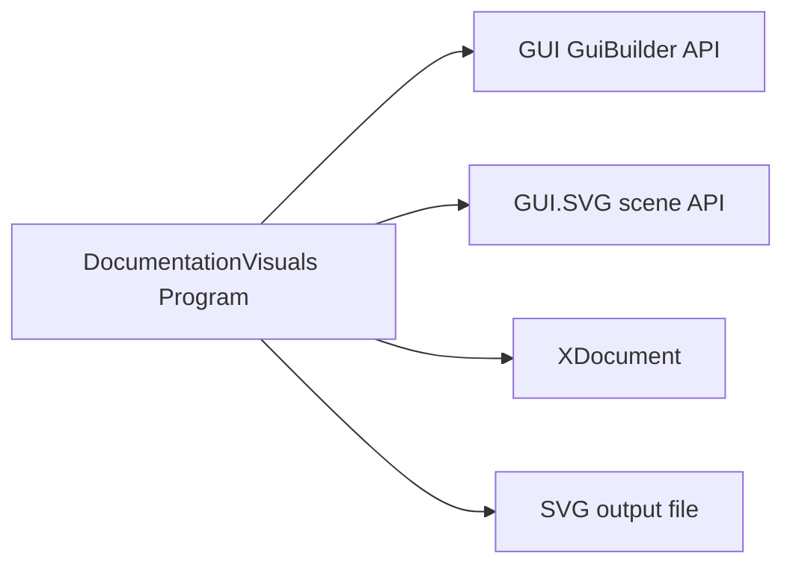
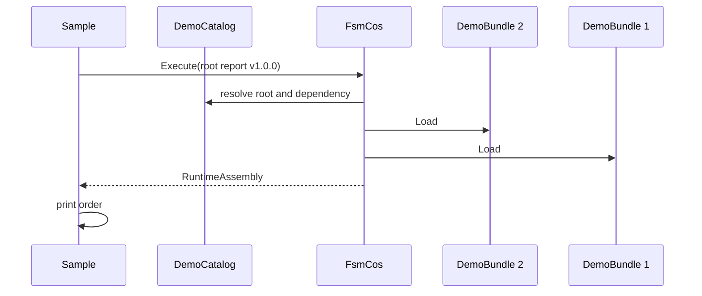
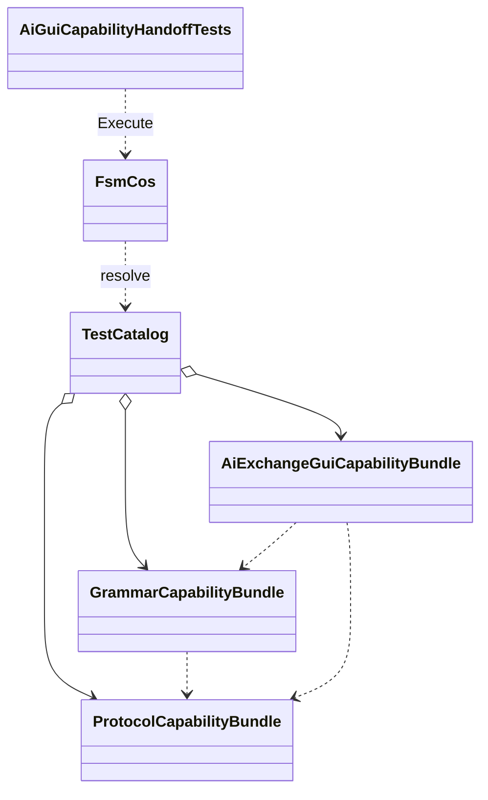
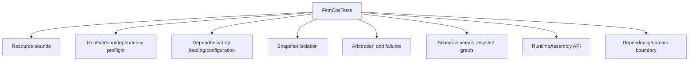
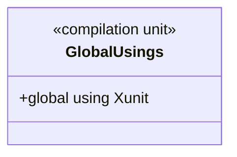
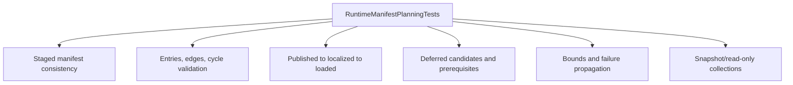
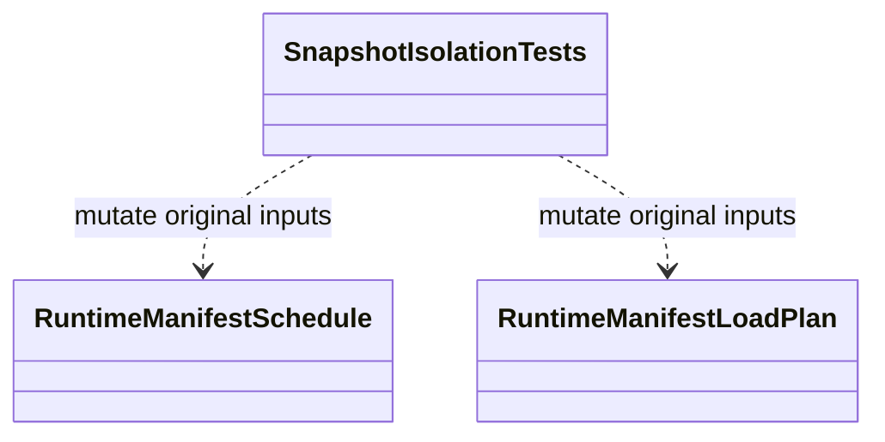

# Preserved integration branch samples, test companions, and verification files

Operation Sith harvest, 2026-10-21. Verbatim contents from `work/alpha7-living-docs-integration`, source branch commit `19567ca49d5a49f13e05286301105b250bcd9e87`. This archive exists for recovery and comparison; sample/source/script/workflow text here is inert documentation, not active code. Do not copy the workflow without security and no-publish review.


---

## Original path: `docs/UML/samples/DocumentationVisuals/Program.md`

Source blob: `58605853f36bd057a8a06e4766654e3b6c45b569`

```text


# DocumentationVisuals Program

**Source:** `samples/DocumentationVisuals/Program.cs`  
**Baseline:** `ce43e8f5bf3dfc229f28678fc2e0d944c5c8d38a`  
**Authorship:** manually authored; not GUI.SVG-generated.

## Source-grounded summary

Top-level sample uses GUI GuiBuilder and GUI.SVG APIs to author an SVG contract map and writes to the command-line path or docs/assets/fsm-cos-preflight.svg. It also imports XDocument.

## Diagram



## Evidence boundary

The source scene describes itself as a contract map, not a live execution trace. Connector motion is explanatory. This sample does not provide runtime telemetry from a running FsmCos instance.

For behavior beyond the declaration summarized here, inspect the implementation and relevant tests at the same baseline. This page is not evidence of hosted rendering or accessibility behavior by itself.

---

**The Singularity Workshop**  
[GitHub](https://github.com/TrentBest) · [Coder Legion](https://coderlegion.com/) · [Patreon](https://www.patreon.com/c/TheSingularityWorkshop) · [PayPal](https://www.paypal.com/donate/?hosted_button_id=3Z7263LCQMV9J)  
[ FSM_API ](https://github.com/TrentBest/FSM_API) · [ FSM_Serialization ](https://github.com/TrentBest/TheSingularityWorkshop.FSM_Serialization) · [ WebPage ](https://github.com/TrentBest/WebPage) · [ FSM_COS Documentation Standard ](https://github.com/TrentBest/TheSingularityWorkshop.FSM_COS/blob/development/DOCUMENTATION_STANDARD.md)  
**Because state shouldn't be a mess.**  
*And because static boundaries are invitations to cause trouble.*

```


---

## Original path: `docs/UML/samples/FSM_COS.MinimalConsumer/Program.md`

Source blob: `5a971e7da37d82b4d7c94bd3c6d7d9f9cfee1571`

```text


# MinimalConsumer Program

**Source:** `samples/FSM_COS.MinimalConsumer/Program.cs`  
**Baseline:** `ce43e8f5bf3dfc229f28678fc2e0d944c5c8d38a`  
**Authorship:** manually authored; not GUI.SVG-generated.

## Source-grounded summary

Top-level console sample defines DemoCatalog and DemoBundle. It requests report bundle ID 1/version 1.0.0; report declares data bundle ID 2 as prerequisite. It prints the composed order.

## Diagram



## Evidence boundary

This is an in-memory example of dependency-first composition, not production catalog/storage/network/lifecycle code.

For behavior beyond the declaration summarized here, inspect the implementation and relevant tests at the same baseline. This page is not evidence of hosted rendering or accessibility behavior by itself.

---

**The Singularity Workshop**  
[GitHub](https://github.com/TrentBest) · [Coder Legion](https://coderlegion.com/) · [Patreon](https://www.patreon.com/c/TheSingularityWorkshop) · [PayPal](https://www.paypal.com/donate/?hosted_button_id=3Z7263LCQMV9J)  
[ FSM_API ](https://github.com/TrentBest/FSM_API) · [ FSM_Serialization ](https://github.com/TrentBest/TheSingularityWorkshop.FSM_Serialization) · [ WebPage ](https://github.com/TrentBest/WebPage) · [ FSM_COS Documentation Standard ](https://github.com/TrentBest/TheSingularityWorkshop.FSM_COS/blob/development/DOCUMENTATION_STANDARD.md)  
**Because state shouldn't be a mess.**  
*And because static boundaries are invitations to cause trouble.*

```


---

## Original path: `docs/UML/tests/FSM_COS.Tests/AiGuiCapabilityHandoffTests.md`

Source blob: `5f68e95cb0c6a43fccc8c1f16944016780e23636`

```text


# AiGuiCapabilityHandoffTests

**Source:** `tests/FSM_COS.Tests/AiGuiCapabilityHandoffTests.cs`  
**Baseline:** `ce43e8f5bf3dfc229f28678fc2e0d944c5c8d38a`  
**Authorship:** manually authored; not GUI.SVG-generated.

## Source-grounded summary

Three test methods check core assembly reference boundaries, composition of ProtocolAI/GrammarAI/GUI capabilities with dependency-first ordering and typed retrieval, and a grammar reference to a protocol symbol.

## Diagram



## Evidence boundary

Fixtures are private to this test file. Assertions do not prove every integration path, hosted rendering, accessibility-tree exposure, keyboard support, or screen-reader behavior.

For behavior beyond the declaration summarized here, inspect the implementation and relevant tests at the same baseline. This page is not evidence of hosted rendering or accessibility behavior by itself.

---

**The Singularity Workshop**  
[GitHub](https://github.com/TrentBest) · [Coder Legion](https://coderlegion.com/) · [Patreon](https://www.patreon.com/c/TheSingularityWorkshop) · [PayPal](https://www.paypal.com/donate/?hosted_button_id=3Z7263LCQMV9J)  
[ FSM_API ](https://github.com/TrentBest/FSM_API) · [ FSM_Serialization ](https://github.com/TrentBest/TheSingularityWorkshop.FSM_Serialization) · [ WebPage ](https://github.com/TrentBest/WebPage) · [ FSM_COS Documentation Standard ](https://github.com/TrentBest/TheSingularityWorkshop.FSM_COS/blob/development/DOCUMENTATION_STANDARD.md)  
**Because state shouldn't be a mess.**  
*And because static boundaries are invitations to cause trouble.*

```


---

## Original path: `docs/UML/tests/FSM_COS.Tests/FsmCosTests.md`

Source blob: `b2ed4061e6e6a56681636d5897cb656425f2e179`

```text


# FsmCosTests

**Source:** `tests/FSM_COS.Tests/FsmCosTests.cs`  
**Baseline:** `ce43e8f5bf3dfc229f28678fc2e0d944c5c8d38a`  
**Authorship:** manually authored; not GUI.SVG-generated.

## Source-grounded summary

Large unit-test suite with private test catalogs, bundles, configuration providers, and malformed/mutating fixtures. Coverage areas include constructor/resource limits, preflight identity/version/graph validation, dependency-first load, configuration snapshotting, failure propagation, arbitration convergence, schedule consistency, and RuntimeAssembly lookup/snapshot.

## Diagram



## Evidence boundary

Representative assertions include full-closure preflight before Load, deep-chain traversal without recursive stack growth, cycle rejection, configuration copy/limits, non-convergence failure, and read-only assembly snapshot. This page maps test assertions; it does not claim exhaustive coverage of every hostile or concurrent production scenario.

For behavior beyond the declaration summarized here, inspect the implementation and relevant tests at the same baseline. This page is not evidence of hosted rendering or accessibility behavior by itself.

---

**The Singularity Workshop**  
[GitHub](https://github.com/TrentBest) · [Coder Legion](https://coderlegion.com/) · [Patreon](https://www.patreon.com/c/TheSingularityWorkshop) · [PayPal](https://www.paypal.com/donate/?hosted_button_id=3Z7263LCQMV9J)  
[ FSM_API ](https://github.com/TrentBest/FSM_API) · [ FSM_Serialization ](https://github.com/TrentBest/TheSingularityWorkshop.FSM_Serialization) · [ WebPage ](https://github.com/TrentBest/WebPage) · [ FSM_COS Documentation Standard ](https://github.com/TrentBest/TheSingularityWorkshop.FSM_COS/blob/development/DOCUMENTATION_STANDARD.md)  
**Because state shouldn't be a mess.**  
*And because static boundaries are invitations to cause trouble.*

```


---

## Original path: `docs/UML/tests/FSM_COS.Tests/GlobalUsings.md`

Source blob: `4bbd52233ea90e6fa1769686eccbb1c905cf518a`

```text


# GlobalUsings

**Source:** `tests/FSM_COS.Tests/GlobalUsings.cs`  
**Baseline:** `ce43e8f5bf3dfc229f28678fc2e0d944c5c8d38a`  
**Authorship:** manually authored; not GUI.SVG-generated.

## Source-grounded summary

Compilation-unit file containing exactly `global using Xunit;`; defines no runtime type.

## Diagram



## Evidence boundary

Makes xUnit names available throughout this test project. It is compilation configuration, not behavioral evidence.

For behavior beyond the declaration summarized here, inspect the implementation and relevant tests at the same baseline. This page is not evidence of hosted rendering or accessibility behavior by itself.

---

**The Singularity Workshop**  
[GitHub](https://github.com/TrentBest) · [Coder Legion](https://coderlegion.com/) · [Patreon](https://www.patreon.com/c/TheSingularityWorkshop) · [PayPal](https://www.paypal.com/donate/?hosted_button_id=3Z7263LCQMV9J)  
[ FSM_API ](https://github.com/TrentBest/FSM_API) · [ FSM_Serialization ](https://github.com/TrentBest/TheSingularityWorkshop.FSM_Serialization) · [ WebPage ](https://github.com/TrentBest/WebPage) · [ FSM_COS Documentation Standard ](https://github.com/TrentBest/TheSingularityWorkshop.FSM_COS/blob/development/DOCUMENTATION_STANDARD.md)  
**Because state shouldn't be a mess.**  
*And because static boundaries are invitations to cause trouble.*

```


---

## Original path: `docs/UML/tests/FSM_COS.Tests/RuntimeManifestPlanningTests.md`

Source blob: `a5908f7fa99460e6901858b309598eca627b2c88`

```text


# RuntimeManifestPlanningTests

**Source:** `tests/FSM_COS.Tests/RuntimeManifestPlanningTests.cs`  
**Baseline:** `ce43e8f5bf3dfc229f28678fc2e0d944c5c8d38a`  
**Authorship:** manually authored; not GUI.SVG-generated.

## Source-grounded summary

33 test methods cover bounded input enumeration, staged root/version consistency, schedule validation and deep/cyclic graphs, stage ordering, deferred promotion readiness, invalid/duplicate identities and edges, load-plan transitions, mismatched schedules, snapshot/read-only behavior, and propagated failures.

## Diagram



## Evidence boundary

This suite tests metadata and state-tracker contracts. It does not prove real artifact localization, hosted lifecycle behavior, or automatic hot swapping.

For behavior beyond the declaration summarized here, inspect the implementation and relevant tests at the same baseline. This page is not evidence of hosted rendering or accessibility behavior by itself.

---

**The Singularity Workshop**  
[GitHub](https://github.com/TrentBest) · [Coder Legion](https://coderlegion.com/) · [Patreon](https://www.patreon.com/c/TheSingularityWorkshop) · [PayPal](https://www.paypal.com/donate/?hosted_button_id=3Z7263LCQMV9J)  
[ FSM_API ](https://github.com/TrentBest/FSM_API) · [ FSM_Serialization ](https://github.com/TrentBest/TheSingularityWorkshop.FSM_Serialization) · [ WebPage ](https://github.com/TrentBest/WebPage) · [ FSM_COS Documentation Standard ](https://github.com/TrentBest/TheSingularityWorkshop.FSM_COS/blob/development/DOCUMENTATION_STANDARD.md)  
**Because state shouldn't be a mess.**  
*And because static boundaries are invitations to cause trouble.*

```


---

## Original path: `docs/UML/tests/FSM_COS.Tests/SnapshotIsolationTests.md`

Source blob: `4a4b69d6f512d52d7a2b6712042e6d8a2505808a`

```text


# SnapshotIsolationTests

**Source:** `tests/FSM_COS.Tests/SnapshotIsolationTests.cs`  
**Baseline:** `ce43e8f5bf3dfc229f28678fc2e0d944c5c8d38a`  
**Authorship:** manually authored; not GUI.SVG-generated.

## Source-grounded summary

Three tests verify schedule snapshots of caller entries/edges, load-plan snapshots of caller entries, and mutation rejection for derived schedule collections through list interfaces.

## Diagram



## Evidence boundary

These assertions establish collection-level isolation for the tested objects, not deep immutability of referenced records or arbitrary MicroBundle instances.

For behavior beyond the declaration summarized here, inspect the implementation and relevant tests at the same baseline. This page is not evidence of hosted rendering or accessibility behavior by itself.

---

**The Singularity Workshop**  
[GitHub](https://github.com/TrentBest) · [Coder Legion](https://coderlegion.com/) · [Patreon](https://www.patreon.com/c/TheSingularityWorkshop) · [PayPal](https://www.paypal.com/donate/?hosted_button_id=3Z7263LCQMV9J)  
[ FSM_API ](https://github.com/TrentBest/FSM_API) · [ FSM_Serialization ](https://github.com/TrentBest/TheSingularityWorkshop.FSM_Serialization) · [ WebPage ](https://github.com/TrentBest/WebPage) · [ FSM_COS Documentation Standard ](https://github.com/TrentBest/TheSingularityWorkshop.FSM_COS/blob/development/DOCUMENTATION_STANDARD.md)  
**Because state shouldn't be a mess.**  
*And because static boundaries are invitations to cause trouble.*

```


---

## Original path: `samples/DocumentationVisuals/Program.cs`

Source blob: `842f7a9e7929b2c71b97fd5a1149e4024d18de01`

```text
using TheSingularityWorkshop.Workshop.Gui;
using TheSingularityWorkshop.Workshop.Gui.Svg;
using System.Xml.Linq;

var output = args.Length > 0
    ? Path.GetFullPath(args[0])
    : Path.GetFullPath("docs/assets/fsm-cos-preflight.svg");

var scene = GuiBuilder.Create("svg-scene", "fsm-cos-preflight")
    .Text("FSM_COS validation and composition path")
    .Property("description",
        "Generated with GUI.SVG from a controlled scene. Shows full dependency-closure preflight, identity and dependency contract validation, optional schedule validation, iterative dependency-first loading, bounded arbitration, host handoff, and distinct failure boundaries. Connector motion is explanatory and honors reduced-motion preferences. It is a contract map, not a live execution trace.");

scene.Child("svg-rect", "background", node => node
    .Property("width", "100").Property("height", "56.25")
    .Property("fill", "#0b1725"));

scene.Child("svg-defs", "definitions", defs => defs
    .Child("svg-marker", "arrowhead", marker => marker
        .Property("refX", "5").Property("refY", "5")
        .Property("markerWidth", "3").Property("markerHeight", "3")
        .Property("orient", "auto")
        .Child("svg-polygon", "arrowhead-shape", polygon => polygon
            .Property("points", "0,0 10,5 0,10").Property("fill", "#7ee0bd"))));

scene.Child("svg-text", "heading", text => text
    .Text("FSM_COS  |  VALIDATION / COMPOSITION / HANDOFF")
    .Property("x", "3").Property("y", "3.2")
    .Property("font-family", "sans-serif").Property("font-size", "2.1")
    .Property("font-weight", "700").Property("fill", "#eef6ff"));

scene.Child("svg-rect", "manifest-box", node => node
    .Property("x", "3").Property("y", "6").Property("width", "18").Property("height", "8")
    .Property("rx", "1").Property("fill", "#173b4c").Property("stroke", "#7ee0bd").Property("stroke-width", "0.3"));
scene.Child("svg-text", "manifest-label", text => text
    .Text("RuntimeManifest").Property("x", "12").Property("y", "10.5")
    .Property("text-anchor", "middle").Property("font-family", "sans-serif").Property("font-size", "1.45").Property("fill", "#eef6ff"));

scene.Child("svg-rect", "roots-box", node => node
    .Property("x", "25").Property("y", "6").Property("width", "20").Property("height", "8")
    .Property("rx", "1").Property("fill", "#173b4c").Property("stroke", "#7ee0bd").Property("stroke-width", "0.3"));
scene.Child("svg-text", "roots-label", text => text
    .Text("Resolve root IDs").Property("x", "35").Property("y", "9.4")
    .Property("text-anchor", "middle").Property("font-family", "sans-serif").Property("font-size", "1.5").Property("fill", "#eef6ff"));
scene.Child("svg-text", "roots-sub-label", text => text
    .Text("and exact versions").Property("x", "35").Property("y", "11.5")
    .Property("text-anchor", "middle").Property("font-family", "sans-serif").Property("font-size", "1.3").Property("fill", "#d6e7f4"));

scene.Child("svg-rect", "identity-box", node => node
    .Property("x", "49").Property("y", "6").Property("width", "22").Property("height", "8")
    .Property("rx", "1").Property("fill", "#302b58").Property("stroke", "#b9a7ff").Property("stroke-width", "0.3"));
scene.Child("svg-text", "identity-label", text => text
    .Text("Validate bundle identity").Property("x", "60").Property("y", "9.4")
    .Property("text-anchor", "middle").Property("font-family", "sans-serif").Property("font-size", "1.4").Property("fill", "#eef6ff"));
scene.Child("svg-text", "identity-sub-label", text => text
    .Text("descriptor + dependency requests").Property("x", "60").Property("y", "11.5")
    .Property("text-anchor", "middle").Property("font-family", "sans-serif").Property("font-size", "1.05").Property("fill", "#d6e7f4"));

scene.Child("svg-rect", "schedule-box", node => node
    .Property("x", "75").Property("y", "6").Property("width", "22").Property("height", "8")
    .Property("rx", "1").Property("fill", "#302b58").Property("stroke", "#b9a7ff").Property("stroke-width", "0.3"));
scene.Child("svg-text", "schedule-label", text => text
    .Text("Optional schedule check").Property("x", "86").Property("y", "9.4")
    .Property("text-anchor", "middle").Property("font-family", "sans-serif").Property("font-size", "1.35").Property("fill", "#eef6ff"));
scene.Child("svg-text", "schedule-sub-label", text => text
    .Text("closure + edges").Property("x", "86").Property("y", "11.5")
    .Property("text-anchor", "middle").Property("font-family", "sans-serif").Property("font-size", "1.25").Property("fill", "#d6e7f4"));

scene.Child("svg-line", "manifest-to-roots", line => line
    .Property("x1", "21").Property("y1", "10").Property("x2", "24").Property("y2", "10")
    .Property("stroke", "#7ee0bd").Property("stroke-width", "0.45").Property("class", "flow-line").Property("marker-end", "url(#arrowhead)"));
scene.Child("svg-line", "roots-to-identity", line => line
    .Property("x1", "45").Property("y1", "10").Property("x2", "48").Property("y2", "10")
    .Property("stroke", "#7ee0bd").Property("stroke-width", "0.45").Property("class", "flow-line").Property("marker-end", "url(#arrowhead)"));
scene.Child("svg-line", "identity-to-schedule", line => line
    .Property("x1", "71").Property("y1", "10").Property("x2", "74").Property("y2", "10")
    .Property("stroke", "#7ee0bd").Property("stroke-width", "0.45").Property("class", "flow-line").Property("marker-end", "url(#arrowhead)"));

scene.Child("svg-rect", "load-box", node => node
    .Property("x", "75").Property("y", "21").Property("width", "22").Property("height", "8")
    .Property("rx", "1").Property("fill", "#173b4c").Property("stroke", "#7ee0bd").Property("stroke-width", "0.3"));
scene.Child("svg-text", "load-label", text => text
    .Text("Load dependencies first").Property("x", "86").Property("y", "24.4")
    .Property("text-anchor", "middle").Property("font-family", "sans-serif").Property("font-size", "1.35").Property("fill", "#eef6ff"));
scene.Child("svg-text", "load-sub-label", text => text
    .Text("then dependents").Property("x", "86").Property("y", "26.5")
    .Property("text-anchor", "middle").Property("font-family", "sans-serif").Property("font-size", "1.25").Property("fill", "#d6e7f4"));

scene.Child("svg-line", "schedule-to-load", line => line
    .Property("x1", "86").Property("y1", "14").Property("x2", "86").Property("y2", "20")
    .Property("stroke", "#7ee0bd").Property("stroke-width", "0.45").Property("class", "flow-line").Property("marker-end", "url(#arrowhead)"));

scene.Child("svg-rect", "arbitration-box", node => node
    .Property("x", "49").Property("y", "21").Property("width", "22").Property("height", "8")
    .Property("rx", "1").Property("fill", "#173b4c").Property("stroke", "#7ee0bd").Property("stroke-width", "0.3"));
scene.Child("svg-text", "arbitration-label", text => text
    .Text("Bounded arbitration").Property("x", "60").Property("y", "24.4")
    .Property("text-anchor", "middle").Property("font-family", "sans-serif").Property("font-size", "1.4").Property("fill", "#eef6ff"));
scene.Child("svg-text", "arbitration-sub-label", text => text
    .Text("stop when stable or fail").Property("x", "60").Property("y", "26.5")
    .Property("text-anchor", "middle").Property("font-family", "sans-serif").Property("font-size", "1.15").Property("fill", "#d6e7f4"));
scene.Child("svg-line", "load-to-arbitration", line => line
    .Property("x1", "75").Property("y1", "25").Property("x2", "72").Property("y2", "25")
    .Property("stroke", "#7ee0bd").Property("stroke-width", "0.45").Property("class", "flow-line").Property("marker-end", "url(#arrowhead)"));

scene.Child("svg-rect", "assembly-box", node => node
    .Property("x", "25").Property("y", "21").Property("width", "20").Property("height", "8")
    .Property("rx", "1").Property("fill", "#173b4c").Property("stroke", "#7ee0bd").Property("stroke-width", "0.3"));
scene.Child("svg-text", "assembly-label", text => text
    .Text("RuntimeAssembly").Property("x", "35").Property("y", "24.4")
    .Property("text-anchor", "middle").Property("font-family", "sans-serif").Property("font-size", "1.4").Property("fill", "#eef6ff"));
scene.Child("svg-text", "assembly-sub-label", text => text
    .Text("only on success").Property("x", "35").Property("y", "26.5")
    .Property("text-anchor", "middle").Property("font-family", "sans-serif").Property("font-size", "1.25").Property("fill", "#d6e7f4"));
scene.Child("svg-line", "arbitration-to-assembly", line => line
    .Property("x1", "49").Property("y1", "25").Property("x2", "46").Property("y2", "25")
    .Property("stroke", "#7ee0bd").Property("stroke-width", "0.45").Property("class", "flow-line").Property("marker-end", "url(#arrowhead)"));

scene.Child("svg-rect", "host-box", node => node
    .Property("x", "3").Property("y", "21").Property("width", "18").Property("height", "8")
    .Property("rx", "1").Property("fill", "#173b4c").Property("stroke", "#7ee0bd").Property("stroke-width", "0.3"));
scene.Child("svg-text", "host-label", text => text
    .Text("Host owns execution").Property("x", "12").Property("y", "24.4")
    .Property("text-anchor", "middle").Property("font-family", "sans-serif").Property("font-size", "1.25").Property("fill", "#eef6ff"));
scene.Child("svg-text", "host-sub-label", text => text
    .Text("FSM_COS hands off").Property("x", "12").Property("y", "26.5")
    .Property("text-anchor", "middle").Property("font-family", "sans-serif").Property("font-size", "1.15").Property("fill", "#d6e7f4"));
scene.Child("svg-line", "assembly-to-host", line => line
    .Property("x1", "25").Property("y1", "25").Property("x2", "22").Property("y2", "25")
    .Property("stroke", "#7ee0bd").Property("stroke-width", "0.45").Property("class", "flow-line").Property("marker-end", "url(#arrowhead)"));

scene.Child("svg-rect", "preflight-failure-box", node => node
    .Property("x", "3").Property("y", "36").Property("width", "44").Property("height", "10")
    .Property("rx", "1").Property("fill", "#3a202c").Property("stroke", "#ff8c9d").Property("stroke-width", "0.3"));
scene.Child("svg-text", "preflight-failure-label", text => text
    .Text("Preflight rejection").Property("x", "25").Property("y", "40")
    .Property("text-anchor", "middle").Property("font-family", "sans-serif").Property("font-size", "1.5").Property("font-weight", "700").Property("fill", "#fff1f3"));
scene.Child("svg-text", "preflight-failure-sub-label", text => text
    .Text("Bad identity, missing dependency, cycle, or schedule mismatch: reject before Load()").Property("x", "25").Property("y", "42.5")
    .Property("text-anchor", "middle").Property("font-family", "sans-serif").Property("font-size", "1.15").Property("fill", "#ffd5dc"));

scene.Child("svg-rect", "runtime-failure-box", node => node
    .Property("x", "53").Property("y", "36").Property("width", "44").Property("height", "10")
    .Property("rx", "1").Property("fill", "#3a202c").Property("stroke", "#ff8c9d").Property("stroke-width", "0.3"));
scene.Child("svg-text", "runtime-failure-label", text => text
    .Text("Runtime failure").Property("x", "75").Property("y", "40")
    .Property("text-anchor", "middle").Property("font-family", "sans-serif").Property("font-size", "1.5").Property("font-weight", "700").Property("fill", "#fff1f3"));
scene.Child("svg-text", "runtime-failure-sub-label", text => text
    .Text("Provider configuration / Load / arbitration / non-convergence: no assembly").Property("x", "75").Property("y", "42.5")
    .Property("text-anchor", "middle").Property("font-family", "sans-serif").Property("font-size", "1.1").Property("fill", "#ffd5dc"));

// Static red connectors make the two failure classes explicit branches of the flow.
scene.Child("svg-line", "identity-to-preflight-failure-diagonal", line => line
    .Property("x1", "60").Property("y1", "14").Property("x2", "46").Property("y2", "17")
    .Property("stroke", "#ff8c9d").Property("stroke-width", "0.35").Property("stroke-dasharray", "0.7 0.5"));
scene.Child("svg-line", "identity-to-preflight-failure-vertical", line => line
    .Property("x1", "46").Property("y1", "17").Property("x2", "46").Property("y2", "35")
    .Property("stroke", "#ff8c9d").Property("stroke-width", "0.35").Property("stroke-dasharray", "0.7 0.5"));
scene.Child("svg-line", "identity-to-preflight-failure-entry", line => line
    .Property("x1", "46").Property("y1", "35").Property("x2", "44").Property("y2", "36")
    .Property("stroke", "#ff8c9d").Property("stroke-width", "0.35").Property("stroke-dasharray", "0.7 0.5"));
scene.Child("svg-line", "arbitration-to-runtime-failure", line => line
    .Property("x1", "60").Property("y1", "29").Property("x2", "60").Property("y2", "36")
    .Property("stroke", "#ff8c9d").Property("stroke-width", "0.35").Property("stroke-dasharray", "0.7 0.5"));

scene.Child("svg-text", "stage-note", text => text
    .Text("LoadPlan stages are metadata; they do not automatically defer loading. Load failures do not roll back prior side effects.")
    .Property("x", "3").Property("y", "51.5")
    .Property("font-family", "sans-serif").Property("font-size", "1.25").Property("fill", "#d6e7f4"));

var svg = new SvgGuiRenderer().Render(scene.Build(), width: 1600, height: 900);

// The pinned GUI.SVG renderer emits the SVG scene; this small, controlled post-pass
// adds CSS motion plus a reduced-motion fallback without changing the scene contract.
XNamespace svgNamespace = "http://www.w3.org/2000/svg";
var document = XDocument.Parse(svg);
document.Root!.Add(new XElement(svgNamespace + "style", """
@keyframes fsm-cos-flow { to { stroke-dashoffset: -2.2; } }
.flow-line { stroke-dasharray: 0.75 0.45; animation: fsm-cos-flow 2.8s linear infinite; }
@media (prefers-reduced-motion: reduce) {
  .flow-line { animation: none !important; stroke-dasharray: none !important; }
}
"""));
var livingSvg = document.ToString(SaveOptions.DisableFormatting);
Directory.CreateDirectory(Path.GetDirectoryName(output)!);
File.WriteAllText(output, livingSvg + Environment.NewLine);
Console.WriteLine($"Generated FSM_COS living preflight visual with GUI.SVG: {output}");

```


---

## Original path: `scripts/verify_nuget_package.py`

Source blob: `de18eeda0274afdf17ef1686e90483ab9018e9e1`

```text
#!/usr/bin/env python3
"""Verify the NuGet package produced by FSM_COS matches its project contract."""

from __future__ import annotations

import argparse
import posixpath
import re
import sys
import zipfile
from pathlib import Path
from xml.etree import ElementTree as ET


def local_name(tag: str) -> str:
    return tag.rsplit("}", 1)[-1]


def child_text(element: ET.Element, name: str) -> str | None:
    child = next((item for item in element if local_name(item.tag) == name), None)
    return child.text.strip() if child is not None and child.text else None


def fail(message: str) -> None:
    raise ValueError(message)


def verify(package_dir: Path, project_path: Path) -> None:
    project = ET.parse(project_path).getroot()
    property_group = next((item for item in project if local_name(item.tag) == "PropertyGroup"), None)
    if property_group is None:
        fail(f"No PropertyGroup found in {project_path}")

    project_values = {
        local_name(item.tag): (item.text or "").strip()
        for item in property_group
    }
    package_id = project_values.get("PackageId")
    assembly_name = project_values.get("AssemblyName") or project_path.stem
    version = project_values.get("Version")
    readme_name = project_values.get("PackageReadmeFile")
    license_name = project_values.get("PackageLicenseFile")
    if not all((package_id, version, readme_name, license_name)):
        fail("Project must declare PackageId, Version, PackageReadmeFile, and PackageLicenseFile.")

    packages = sorted(package_dir.glob("*.nupkg"))
    if len(packages) != 1:
        fail(f"Expected exactly one .nupkg in {package_dir}; found {len(packages)}.")

    package = packages[0]
    with zipfile.ZipFile(package) as archive:
        names = set(archive.namelist())
        svg_names = sorted(name for name in names if name.lower().endswith(".svg"))
        for svg_name in svg_names:
            try:
                svg_root = ET.fromstring(archive.read(svg_name))
            except ET.ParseError as error:
                fail(f"SVG is not well-formed XML: {svg_name}: {error}")

            role = svg_root.attrib.get("role")
            if "/section-dividers/" in svg_name:
                if role != "presentation" or svg_root.attrib.get("aria-hidden") != "true":
                    fail(f"Decorative section divider must be hidden from assistive technology: {svg_name}.")
            elif "/section-markers/" in svg_name:
                if role != "img" or not svg_root.attrib.get("aria-label", "").strip():
                    fail(f"Section marker must expose an accessible image label: {svg_name}.")
            else:
                children = {local_name(item.tag): item for item in svg_root}
                title = children.get("title")
                description = children.get("desc")
                labelled_ids = set(svg_root.attrib.get("aria-labelledby", "").split())
                title_id = title.attrib.get("id") if title is not None else None
                description_id = description.attrib.get("id") if description is not None else None
                required_ids = {title_id, description_id}
                if (
                    role != "img"
                    or title is None
                    or description is None
                    or not title_id
                    or not description_id
                    or not required_ids.issubset(labelled_ids)
                ):
                    fail(
                        "Substantive SVG must have a title, description, role='img', "
                        f"and matching aria-labelledby references: {svg_name}."
                    )
        nuspecs = [name for name in names if name.lower().endswith(".nuspec")]
        if len(nuspecs) != 1:
            fail(f"Expected exactly one .nuspec in {package.name}; found {len(nuspecs)}.")

        nuspec = ET.fromstring(archive.read(nuspecs[0]))
        metadata = next((item for item in nuspec if local_name(item.tag) == "metadata"), None)
        if metadata is None:
            fail("The package .nuspec has no metadata element.")

        actual_id = child_text(metadata, "id")
        actual_version = child_text(metadata, "version")
        if actual_id != package_id:
            fail(f"Package ID mismatch: project={package_id!r}, package={actual_id!r}.")
        if actual_version != version:
            fail(f"Package version mismatch: project={version!r}, package={actual_version!r}.")

        required_files = {
            readme_name,
            license_name,
            "README.md",
            "SECURITY.md",
            "DOCUMENTATION_STANDARD.md",
            "DOCUMENTATION_INDEX.md",
            f"docs/releases/{version}.md",
            "docs/assets/fsm-cos-overview.svg",
            "docs/assets/fsm-cos-preflight.svg",
            "docs/assets/fsm-cos-crane.svg",
        }
        missing = sorted(required_files - names)
        if missing:
            fail("Package is missing required files: " + ", ".join(missing))

        # Maintainer-only readiness/audit and historical planning records must
        # remain in the repository, not leak into the consumer-facing package.
        forbidden_files = {
            "docs/0.1.0-alpha.7-READINESS.md",
            "docs/LIVING_DOCUMENTATION_AUDIT.md",
            "docs/BRANCH_RECONCILIATION.md",
            "docs/CONTINUATION_BRIEF_ALPHA6_FORGE_ANYAPP_WEBPAGE.md",
            "docs/DEPENDENCY_ALIGNMENT_CHECKLIST.md",
            "docs/ECOSYSTEM_INTEGRATION_MAP.md",
            "docs/PAUSE_POINT.md",
        }
        unexpected = sorted(forbidden_files & names)
        if unexpected:
            fail("Package contains maintainer-only or historical documents: " + ", ".join(unexpected))

        markdown_link = re.compile(r"!?\[[^\]]*\]\(([^)]+)\)|^\[[^\]]+\]:\s*<?([^>\s]+)>?", re.MULTILINE)
        for markdown_name in sorted(name for name in names if name.lower().endswith(".md")):
            markdown = archive.read(markdown_name).decode("utf-8-sig")
            for match in markdown_link.finditer(markdown):
                target = (match.group(1) or match.group(2) or "").strip().split()[0].strip("<>")
                if not target or target.startswith(("#", "http://", "https://", "mailto:", "data:")):
                    continue
                target_path = target.split("#", 1)[0].split("?", 1)[0]
                if not target_path:
                    continue
                resolved = posixpath.normpath(posixpath.join(posixpath.dirname(markdown_name), target_path))
                if resolved not in names and not any(
                    name.startswith(resolved.rstrip("/") + "/") for name in names
                ):
                    fail(
                        f"Markdown link in {markdown_name} points outside the package or to a missing file: "
                        f"{target!r} (resolved to {resolved!r})."
                    )

        assembly_path = f"lib/net8.0/{assembly_name}.dll"
        if assembly_path not in names:
            fail(f"Package is missing target assembly {assembly_path!r}.")
        xml_doc_path = f"lib/net8.0/{assembly_name}.xml"
        if xml_doc_path not in names:
            fail(f"Package is missing XML API documentation {xml_doc_path!r}.")

        project_dependencies = {
            item.attrib["Include"]: item.attrib["Version"]
            for group in project
            if local_name(group.tag) == "ItemGroup"
            for item in group
            if local_name(item.tag) == "PackageReference"
            and item.attrib.get("Include")
            and item.attrib.get("Version")
            and "WorkshopUseRepositorySources' == 'true'" not in item.attrib.get("Condition", "")
        }
        dependencies_node = next(
            (item for item in metadata if local_name(item.tag) == "dependencies"),
            None,
        )
        package_dependencies: dict[str, str] = {}
        if dependencies_node is not None:
            for group in dependencies_node.iter():
                if local_name(group.tag) == "dependency":
                    package_dependencies[group.attrib.get("id", "")] = group.attrib.get("version", "")

        if any(dependency_id.casefold() == "thesingularityworkshop.gui.svg" for dependency_id in package_dependencies):
            fail("GUI.SVG is build-time documentation tooling and must not be a runtime NuGet dependency.")

        if set(package_dependencies) != set(project_dependencies):
            fail(
                "Package dependency IDs differ from the project contract: "
                f"project={sorted(project_dependencies)}, package={sorted(package_dependencies)}."
            )

        def lower_bound(version_range: str) -> str:
            # NuGet may encode a PackageReference as a lower-bounded range, e.g. [1.2.3, ).
            return version_range.strip().lstrip("[(").split(",", 1)[0].rstrip("]) ").strip()

        for dependency_id, dependency_version in project_dependencies.items():
            actual_dependency_version = package_dependencies.get(dependency_id, "")
            if lower_bound(actual_dependency_version) != dependency_version:
                fail(
                    f"Dependency mismatch for {dependency_id}: project={dependency_version!r}, "
                    f"package={actual_dependency_version!r}."
                )

        readme_metadata = child_text(metadata, "readme")
        if readme_metadata != readme_name:
            fail(f"Package readme metadata mismatch: project={readme_name!r}, package={readme_metadata!r}.")

        print(f"Verified {package.name}")
        print(f"  identity: {actual_id} {actual_version}")
        print(f"  dependencies: {', '.join(sorted(project_dependencies))}")
        print(f"  package documentation: {len(required_files)} required files present")
        print("  assembly and XML API documentation: present")


def main() -> int:
    parser = argparse.ArgumentParser(description=__doc__)
    parser.add_argument("--package-dir", required=True, type=Path)
    parser.add_argument("--project", required=True, type=Path)
    args = parser.parse_args()
    try:
        verify(args.package_dir, args.project)
    except (OSError, KeyError, ValueError, ET.ParseError, zipfile.BadZipFile) as error:
        print(f"Package verification failed: {error}", file=sys.stderr)
        return 1
    return 0


if __name__ == "__main__":
    raise SystemExit(main())

```


---

## Original path: `.github/workflows/package.yml`

Source blob: `8b700ceb3ae8f3eff228d85eb77fef269b2e572d`

```text
name: Pack and publish

on:
  push:
    branches:
      - master
      - development
  pull_request:
  workflow_dispatch:
    inputs:
      publish:
        description: 'Publish the verified package to NuGet.org'
        required: true
        default: false
        type: boolean

permissions:
  contents: read

jobs:
  build-and-test:
    runs-on: ubuntu-24.04
    steps:
      - name: Checkout
        uses: actions/checkout@3d3c42e5aac5ba805825da76410c181273ba90b1 # v7

      - name: Checkout MicroBundleDomain development dependency
        if: ${{ (github.event_name == 'pull_request' && github.base_ref == 'development') || github.ref == 'refs/heads/development' }}
        uses: actions/checkout@3d3c42e5aac5ba805825da76410c181273ba90b1 # v7
        with:
          repository: TrentBest/TheSingularityWorkshop.MicroBundleDomain
          ref: development
          path: _dependencies/MicroBundleDomain

      # Pin the SVG authoring implementation so generated documentation stays reproducible.
      # This source/tooling dependency is confined to the visual generator, not the FSM_COS package.
      - name: Checkout GUI.SVG source for documentation visual generation
        if: ${{ (github.event_name == 'pull_request' && github.base_ref == 'development') || github.ref == 'refs/heads/development' }}
        uses: actions/checkout@3d3c42e5aac5ba805825da76410c181273ba90b1 # v7
        with:
          repository: TrentBest/TheSingularityWorkshop.GUI
          ref: 6fd9632547421034212f9a64a2e429b86d4bab4a
          path: _dependencies/GUI

      - name: Setup .NET
        uses: actions/setup-dotnet@a98b56852c35b8e3190ac28c8c2271da59106c68 # v6
        with:
          dotnet-version: 8.0.x

      - name: Generate FSM_COS validation visual with GUI.SVG
        if: ${{ (github.event_name == 'pull_request' && github.base_ref == 'development') || github.ref == 'refs/heads/development' }}
        run: dotnet run --project samples/DocumentationVisuals/DocumentationVisuals.csproj --configuration Release -- docs/assets/fsm-cos-preflight.svg

      - name: Verify committed GUI.SVG visual is current
        if: ${{ (github.event_name == 'pull_request' && github.base_ref == 'development') || github.ref == 'refs/heads/development' }}
        run: git diff --exit-code -- docs/assets/fsm-cos-preflight.svg

      - name: Upload generated FSM_COS validation visual
        if: ${{ (github.event_name == 'pull_request' && github.base_ref == 'development') || github.ref == 'refs/heads/development' }}
        uses: actions/upload-artifact@cf430e030ddbb5b0abf93d22962f4752f3646cd9 # v7
        with:
          name: fsm-cos-generated-visuals
          path: docs/assets/fsm-cos-preflight.svg

      - name: Pack MicroBundleDomain development dependency
        if: ${{ (github.event_name == 'pull_request' && github.base_ref == 'development') || github.ref == 'refs/heads/development' }}
        run: |
          dotnet restore _dependencies/MicroBundleDomain/TheSingularityWorkshop.MicroBundleDomain.slnx
          dotnet build _dependencies/MicroBundleDomain/TheSingularityWorkshop.MicroBundleDomain.slnx --configuration Release --no-restore
          mkdir -p _dependencies/nuget
          dotnet pack _dependencies/MicroBundleDomain/TheSingularityWorkshop.MicroBundleDomain.csproj --configuration Release --no-build --output _dependencies/nuget

      - name: Configure development dependency feed
        if: ${{ (github.event_name == 'pull_request' && github.base_ref == 'development') || github.ref == 'refs/heads/development' }}
        shell: bash
        run: |
          set -euo pipefail
          mkdir -p .ci
          cat > .ci/NuGet.Development.config <<EOF
          <?xml version="1.0" encoding="utf-8"?>
          <configuration>
            <packageSources>
              <clear />
              <add key="MicroBundleDomainDevelopment" value="$GITHUB_WORKSPACE/_dependencies/nuget" />
              <add key="nuget.org" value="https://api.nuget.org/v3/index.json" />
            </packageSources>
            <packageSourceMapping>
              <packageSource key="MicroBundleDomainDevelopment">
                <package pattern="TheSingularityWorkshop.MicroBundleDomain" />
              </packageSource>
              <packageSource key="nuget.org">
                <package pattern="*" />
              </packageSource>
            </packageSourceMapping>
          </configuration>
          EOF

      - name: Restore using development dependencies
        if: ${{ (github.event_name == 'pull_request' && github.base_ref == 'development') || github.ref == 'refs/heads/development' }}
        run: dotnet restore TheSingularityWorkshop.FSM_COS.sln --configfile .ci/NuGet.Development.config

      - name: Restore using published NuGet dependencies
        if: ${{ !( (github.event_name == 'pull_request' && github.base_ref == 'development') || github.ref == 'refs/heads/development' ) }}
        run: dotnet restore TheSingularityWorkshop.FSM_COS.sln --source https://api.nuget.org/v3/index.json

      - name: Build
        run: dotnet build TheSingularityWorkshop.FSM_COS.sln --configuration Release --no-restore

      - name: Run .NET security analyzers on the runtime assembly
        run: >
          dotnet build src/FSM_COS/FSM_COS.csproj
          --configuration Release
          --no-restore
          -p:EnableNETAnalyzers=true
          -p:AnalysisLevel=latest-all
          -p:BuildProjectReferences=false
          -warnaserror

      - name: Run and verify minimal consumer sample
        shell: bash
        run: |
          set -euo pipefail
          output="$(dotnet run --project samples/FSM_COS.MinimalConsumer/FSM_COS.MinimalConsumer.csproj --configuration Release --no-build)"
          printf '%s\n' "$output"
          grep -Fq "Assembly order: 2 -> 1" <<< "$output"

      - name: Test with coverage
        run: >
          dotnet test tests/FSM_COS.Tests/FSM_COS.Tests.csproj
          --configuration Release
          --no-build
          --verbosity normal
          --collect:"XPlat Code Coverage;Format=cobertura"
          --results-directory ./TestResults
          --logger "trx;LogFileName=testresults.trx"

      - name: Prepare coverage report
        shell: bash
        run: |
          set -euo pipefail
          coverage_file="$(find ./TestResults -type f -name 'coverage.cobertura.xml' -print -quit)"
          if [[ -z "$coverage_file" ]]; then
            echo "No coverage.cobertura.xml file was produced."
            find ./TestResults -maxdepth 4 -type f -print || true
            exit 1
          fi
          cp "$coverage_file" ./TestResults/coverage.cobertura.xml

          # Keep one canonical Cobertura report so Codecov does not ingest the same
          # test coverage multiple times from the nested collector output and root copy.
          find ./TestResults -type f -name 'coverage.cobertura.xml' ! -path './TestResults/coverage.cobertura.xml' -delete
          remaining_coverage_files="$(find ./TestResults -type f -name 'coverage.cobertura.xml' | wc -l)"
          if [[ "$remaining_coverage_files" -ne 1 ]]; then
            echo "Expected exactly one canonical Cobertura report, found $remaining_coverage_files."
            find ./TestResults -type f -name 'coverage.cobertura.xml' -print
            exit 1
          fi
          echo "Prepared canonical coverage report: ./TestResults/coverage.cobertura.xml"

      - name: Upload coverage to Codecov
        uses: codecov/codecov-action@fb8b3582c8e4def4969c97caa2f19720cb33a72f # v6
        with:
          token: ${{ secrets.CODECOV_TOKEN }}
          slug: TrentBest/TheSingularityWorkshop.FSM_COS
          files: ./TestResults/coverage.cobertura.xml
          fail_ci_if_error: true

      - name: Pack
        run: dotnet pack src/FSM_COS/FSM_COS.csproj --configuration Release --no-build --output ./artifacts

      - name: Verify NuGet package contents and metadata
        run: python3 scripts/verify_nuget_package.py --package-dir ./artifacts --project src/FSM_COS/FSM_COS.csproj

      - name: Upload NuGet package artifact
        uses: actions/upload-artifact@cf430e030ddbb5b0abf93d22962f4752f3646cd9 # v7
        with:
          name: fsm-cos-nuget-package
          path: ./artifacts/*.nupkg

      - name: Upload test and coverage artifacts
        uses: actions/upload-artifact@cf430e030ddbb5b0abf93d22962f4752f3646cd9 # v7
        with:
          name: fsm-cos-test-results
          path: ./TestResults/*

  public-package-compatibility:
    runs-on: ubuntu-24.04
    steps:
      - name: Checkout
        uses: actions/checkout@3d3c42e5aac5ba805825da76410c181273ba90b1 # v7

      - name: Setup .NET
        uses: actions/setup-dotnet@a98b56852c35b8e3190ac28c8c2271da59106c68 # v6
        with:
          dotnet-version: 8.0.x

      # Deliberately do not add the CI-only local MicroBundleDomain feed here.
      # This proves the published dependency contract used by downstream consumers.
      - name: Restore from public NuGet
        run: dotnet restore TheSingularityWorkshop.FSM_COS.sln --source https://api.nuget.org/v3/index.json

      - name: Audit direct and transitive NuGet dependencies
        shell: bash
        run: |
          set -euo pipefail
          audit_output="$(dotnet list TheSingularityWorkshop.FSM_COS.sln package --vulnerable --include-transitive)"
          printf '%s\\n' "$audit_output"
          if grep -Eiq 'has the following vulnerable packages|vulnerable package(s)? found' <<< "$audit_output"; then
            echo "Dependency audit reported vulnerable packages; review advisories before release."
            exit 1
          fi

      - name: Build against published dependencies
        run: dotnet build TheSingularityWorkshop.FSM_COS.sln --configuration Release --no-restore

      - name: Run and verify minimal consumer against published dependencies
        shell: bash
        run: |
          set -euo pipefail
          output="$(dotnet run --project samples/FSM_COS.MinimalConsumer/FSM_COS.MinimalConsumer.csproj --configuration Release --no-build)"
          printf '%s\n' "$output"
          grep -Fq "Assembly order: 2 -> 1" <<< "$output"

      - name: Test against published dependencies
        run: dotnet test tests/FSM_COS.Tests/FSM_COS.Tests.csproj --configuration Release --no-build --verbosity normal

      - name: Pack against published dependencies
        run: dotnet pack src/FSM_COS/FSM_COS.csproj --configuration Release --no-build --output ./artifacts-public

      - name: Verify public-feed NuGet package contents and metadata
        run: python3 scripts/verify_nuget_package.py --package-dir ./artifacts-public --project src/FSM_COS/FSM_COS.csproj

      - name: Upload public-feed package artifact
        uses: actions/upload-artifact@cf430e030ddbb5b0abf93d22962f4752f3646cd9 # v7
        with:
          name: fsm-cos-nuget-package-public-feed
          path: ./artifacts-public/*.nupkg

  source-integration:
    runs-on: ubuntu-24.04
    steps:
      # Place each repository as a sibling so the csproj's relative source references resolve.
      - name: Checkout FSM_COS source
        uses: actions/checkout@3d3c42e5aac5ba805825da76410c181273ba90b1 # v7
        with:
          path: FSM_COS

      - name: Checkout FSM_API source
        uses: actions/checkout@3d3c42e5aac5ba805825da76410c181273ba90b1 # v7
        with:
          repository: TrentBest/FSM_API
          ref: development
          path: FSM_API

      - name: Checkout FSM_UserIO source
        uses: actions/checkout@3d3c42e5aac5ba805825da76410c181273ba90b1 # v7
        with:
          repository: TrentBest/FSM_UserIO
          ref: development
          path: FSM_UserIO

      - name: Checkout MicroBundleDomain source
        uses: actions/checkout@3d3c42e5aac5ba805825da76410c181273ba90b1 # v7
        with:
          repository: TrentBest/TheSingularityWorkshop.MicroBundleDomain
          ref: development
          path: TheSingularityWorkshop.MicroBundleDomain

      - name: Setup .NET
        uses: actions/setup-dotnet@a98b56852c35b8e3190ac28c8c2271da59106c68 # v6
        with:
          dotnet-version: 8.0.x

      - name: Restore complete development source graph
        working-directory: FSM_COS
        run: dotnet restore TheSingularityWorkshop.FSM_COS.sln -p:WorkshopUseRepositorySources=true

      - name: Build complete development source graph
        working-directory: FSM_COS
        run: dotnet build TheSingularityWorkshop.FSM_COS.sln --configuration Release --no-restore -p:WorkshopUseRepositorySources=true

      - name: Verify minimal consumer against development source graph
        working-directory: FSM_COS
        shell: bash
        run: |
          set -euo pipefail
          output="$(dotnet run --project samples/FSM_COS.MinimalConsumer/FSM_COS.MinimalConsumer.csproj --configuration Release --no-build)"
          printf '%s\n' "$output"
          grep -Fq "Assembly order: 2 -> 1" <<< "$output"

      - name: Test complete development source graph
        working-directory: FSM_COS
        run: dotnet test tests/FSM_COS.Tests/FSM_COS.Tests.csproj --configuration Release --no-build --verbosity normal -p:WorkshopUseRepositorySources=true

  publish_nuget:
    needs: [build-and-test, public-package-compatibility, source-integration]
    # Publishing is available only when deliberately dispatched from master
    # with the boolean input checked. Pushes and pull requests never publish.
    if: ${{ github.event_name == 'workflow_dispatch' && inputs.publish == true && github.ref == 'refs/heads/master' }}
    runs-on: ubuntu-24.04
    permissions:
      contents: read
      id-token: write

    steps:
      - name: Download NuGet package
        uses: actions/download-artifact@9000827ccba6bdab643e8b6fd33ac0654aef8333 # v8
        with:
          name: fsm-cos-nuget-package-public-feed
          path: ./artifacts-public

      - name: Authenticate with NuGet Trusted Publishing
        uses: NuGet/login@8d196754b4036150537f80ac539e15c2f1028841 # v1
        id: login
        with:
          user: TheSingularityWorkshop

      - name: Publish package to NuGet.org
        run: dotnet nuget push "./artifacts-public/*.nupkg" --source "https://api.nuget.org/v3/index.json" --api-key "${{ steps.login.outputs.NUGET_API_KEY }}" --skip-duplicate

```
