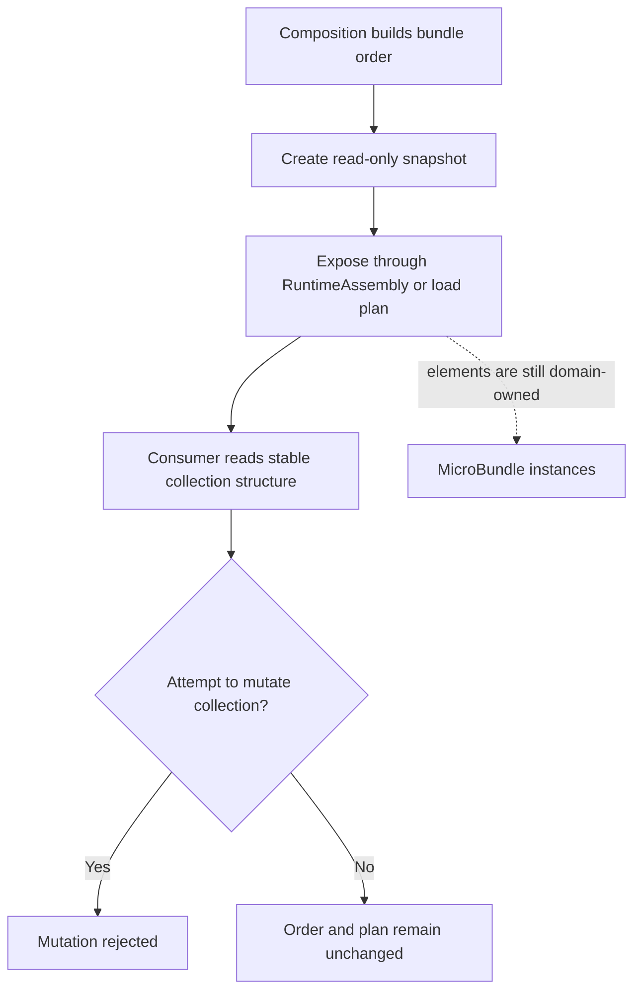

# FSM_COS 0.1.0-alpha.7 — Release Candidate Notes

> These notes describe the source candidate's intended contract. They do not establish publication status; check the [NuGet package page](https://www.nuget.org/packages/TheSingularityWorkshop.FSM_COS) for availability.

## Why alpha.7 exists

Alpha.7 hardens both the public collection contracts and the composition boundary. Collections exposed as read-only interfaces are backed by read-only snapshots, while the complete dependency graph is resolved and validated before configuration callbacks or bundle loading begin. Identity, version, descriptor-dependency, and runtime dependency-request contracts are checked before composition can proceed.

## Included behavior

- `RuntimeAssembly.Bundles` is a read-only snapshot of the composed bundle order.
- `RuntimeManifestSchedule` exposes read-only snapshots for entries, dependency edges, independent entries, and dependent entries; `RuntimeManifestLoadPlan.Entries` is also a read-only snapshot.
- Composition resolves and snapshots the complete dependency closure before invoking configuration callbacks or any bundle `Load()` method.
- Root IDs and versions, bundle IDs and descriptor IDs, and descriptor dependency declarations versus runtime dependency requests must agree. Null lists, zero IDs, duplicate requests, missing dependencies, mismatches, and cycles fail closed.
- Dependency-graph preflight, cycle validation, and dependency-first loading use iterative traversal, avoiding process-stack exhaustion on deep graphs.
- Root-list and dependency-request snapshots use bounded enumeration rather than trusting a custom collection's reported `Count`; default composition limits are 10,000 bundles, 100,000 dependency requests, and 64 MiB of copied configuration data, with the configuration-byte limit configurable by the host.
- The resolved catalog objects and dependency-request lists are snapshotted for the execution, preventing catalog time-of-check/time-of-use changes from silently swapping the selected graph.
- Dependency configuration and configuration-provider memory are copied before callbacks or loading, preventing mutable backing arrays from changing the selected configuration after validation.
- Regression tests cover mutation through `IList<T>` casts, mutable manifest collections, changing catalogs, deep graphs, malformed dependency contracts, failure callbacks, cycles, and arbitration non-convergence.
- The package workflow generates and verifies the GUI.SVG preflight picture, checks its accessibility markup, and confirms GUI.SVG remains a build-time documentation tool rather than an FSM_COS NuGet dependency.

## Collection immutability in one picture

*The snapshot protects collection structure and ordering. It does not make the referenced MicroBundle instances immutable.*

## Package contract

- Target framework: .NET 8.
- Direct dependencies: FSM_API 1.0.13, FSM_UserIO 0.1.0-alpha.1, and MicroBundleDomain 1.0.1.
- Package version declared by this source: `0.1.0-alpha.7`.

## Explicit limitations

Alpha.7 does not implement repository localization, content-hash verification, Bootstrap-only initial composition, background localization, or live promotion of Deferred bundles into an already running `RuntimeAssembly`. It also does not implement manifest refresh, developer-consented side-by-side version replacement, atomic host routing changes, generation reference/lease tracking, unload/retirement, or serialize-then-relinquish shutdown; these remain planned host/runtime lifecycle work. Read-only wrappers protect collection structure, not the domain-owned `IMicroBundle` instances. Graph preflight prevents known identity, resolution, version, and cycle failures from reaching bundle loading, but exceptions from configuration, `Load()`, or `Arbitrate()` do not automatically roll back arbitrary side effects that already occurred.

## Publication

These notes describe the source candidate, not proof that a package is available. Check the [NuGet package page](https://www.nuget.org/packages/TheSingularityWorkshop.FSM_COS) for published versions.
