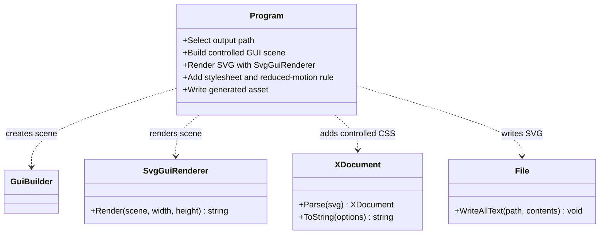

# Documentation Visual Generator

**Source:** [`Program.cs`](Program.cs)  
**Source file blob:** `ab74c7ea6c3805d4ffe4b61d61c4c53dde3b0063`  
**Authorship:** manually authored and checked against the current `development` source; not generated from reflection.

## Purpose

This build-time sample uses GUI.SVG to generate `docs/assets/fsm-cos-preflight.svg` from a controlled scene. It communicates the source-backed composition sequence, separates preflight rejection from runtime failure, and illustrates the handoff boundary. A controlled XML post-pass adds subtle connector motion and a `prefers-reduced-motion` fallback.

The image is explanatory documentation, not live runtime telemetry, not an interactive application, and not a diagram automatically derived from the FSM_COS source AST.

## UML class card

## Use cases

1. **Regenerate the living picture:** run `dotnet run --project samples/DocumentationVisuals/DocumentationVisuals.csproj --configuration Release -- docs/assets/fsm-cos-preflight.svg` from the repository root after restoring the pinned GUI.SVG source dependency.
2. **Detect stale assets:** compare the generated output with the committed SVG; the package workflow has a `git diff --exit-code` guard for this purpose.
3. **Review motion accessibility:** confirm the reduced-motion media rule disables animation and removes the dashed-line pattern. Actual browser behavior and assistive-technology exposure require separate testing.
4. **Update the contract safely:** change the controlled scene and generated asset together; do not hand-edit the SVG without a reproducible generator change.

## Important boundaries

- GUI.SVG is a build-time tooling dependency of this sample; the FSM_COS runtime project does not reference GUI.SVG.
- The seven animated connectors describe a fixed documented sequence, not current runtime state.
- The reduced-motion rule is present in source output; hosted rendering, accessibility-tree behavior, and screen-reader behavior are not claimed verified.
- The generator uses the GUI.SVG revision pinned by `.github/workflows/package.yml`; validate against that exact revision rather than assuming the current default branch has the same API.

## Reproduce

See [Living SVG](../../docs/LIVING_SVG.md), [Gallery](../../docs/GALLERY.md), and the package workflow. A successful local run or exact-head CI result must be recorded separately; this page does not claim that verification has just passed.

---

## 🔗 Resources & Support

- [FSM_COS](https://github.com/TrentBest/TheSingularityWorkshop.FSM_COS) · [FSM_API](https://github.com/TrentBest/FSM_API) · [FSM_Serialization](https://github.com/TrentBest/TheSingularityWorkshop.FSM_Serialization) · [WebPage](https://github.com/TrentBest/WebPage)
- [GitHub](https://github.com/TrentBest) · [Coder Legion](https://coderlegion.com/) · [Profile](https://coderlegion.com/user/The%2BSingularity%2BWorkshop) · [Patreon](https://www.patreon.com/c/TheSingularityWorkshop) · [PayPal](https://www.paypal.com/donate/?hosted_button_id=3Z7263LCQMV9J)

<!-- THE SINGULARITY WORKSHOP FOOTER -->

<em>The Singularity Workshop — Tools for the curious, the bold, and the systemically inclined.</em> <strong>Because state shouldn't be a mess.</strong> <em>And because static boundaries are invitations to cause trouble.</em>

