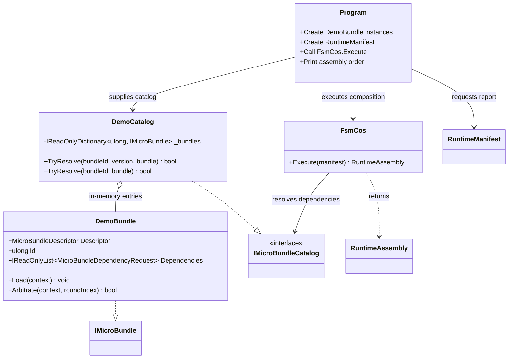

# Minimal Consumer Sample

**Source:** [`Program.cs`](Program.cs)  
**Source file blob:** `0e403eed8d81f041e8dbcd73878bbd0271fba45b`  
**Authorship:** manually authored and checked against the current `development` source; not generated from reflection.

## Purpose

Demonstrates the smallest useful consumer path: define two MicroBundles, declare that the requested report depends on a data source, resolve them through an in-memory `IMicroBundleCatalog`, submit a `RuntimeManifest`, and let `FsmCos.Execute` return a dependency-ordered `RuntimeAssembly`.

The sample is illustrative. It does not implement persistence, network resolution, application execution, or a production catalog.

## UML class card

The diagram summarizes the sample's local types and their roles. Public API signatures are abbreviated; the C# source and referenced package contracts remain authoritative.

## Use cases

1. **Run a minimal consumer:** restore and run the `FSM_COS.MinimalConsumer` project with the repository's documented development or published dependency mode.
2. **Observe dependency closure:** request only the report bundle and see the catalog resolve its prerequisite.
3. **Verify order:** inspect the printed assembly order; the data source must precede the report.
4. **Replace the catalog:** implement `IMicroBundleCatalog` against a real host-owned source without changing the manifest/composition boundary.

## Important boundaries

- The sample catalog is in-memory and resolves exact versions when requested.
- `DemoBundle.Load` writes a console message; this is sample behavior, not an FSM_COS logging promise.
- `Arbitrate` returns `false` to model a stable demo bundle.
- FSM_COS composes bundles and returns an assembly; the host owns execution and manifestation.

## Reproduce

Run `samples/FSM_COS.MinimalConsumer/FSM_COS.MinimalConsumer.csproj` under the repository's supported .NET SDK and dependency setup. CI's consumer verification is the authoritative automated check; this companion page is documentation, not evidence of a fresh run.
