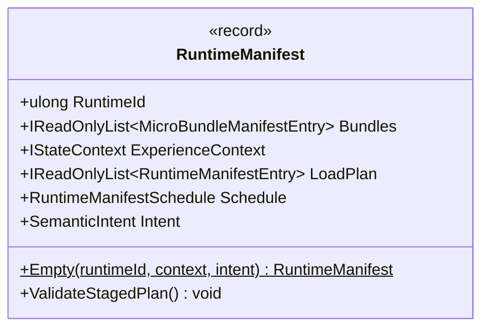

# ✳️ FSM_COS — `RuntimeManifest`

> **Purpose:** describe the versioned root MicroBundles requested for one runtime composition, plus optional context and published-plan metadata.

**Source:** [`RuntimeManifest.cs`](RuntimeManifest.cs)  
**Broader diagram and use cases:** [`RuntimeManifestUML.md`](RuntimeManifestUML.md)  
**Package contract:** [Runtime Manifest](../../docs/RUNTIME_MANIFEST.md)  
**Execution path:** [Execute Sequence](../../docs/EXECUTION_SEQUENCE.md)

## UML class card

This class card is an interim, source-grounded representation in Mermaid. It is not yet generated by the GUI source-derived UML pipeline; the GUI integration remains a separate coordination dependency.

## Contract and behavior

- `RuntimeId` identifies the requested runtime composition.
- `Bundles` is the host's list of root MicroBundle IDs and requested versions. FSM_COS resolves their dependency closure; the list is not itself the complete closure.
- `ExperienceContext` optionally supplies state context to the composition arbitration process.
- `LoadPlan` and `Schedule` are optional published identity/stage metadata. They do not fetch artifacts or localize bytes.
- `Intent` optionally carries a host-provided `SemanticIntent`; it does not itself grant authority or start an experience.
- `Empty(...) ` constructs a manifest with no root bundles while preserving optional context and intent.

`ValidateStagedPlan()` checks consistency between requested roots and optional staged metadata. It rejects invalid/duplicate planned identities, missing requested roots, version disagreement, and disagreement between a supplied load plan and schedule. Enumeration is bounded by `RuntimeManifestSchedule.DefaultMaximumEntryCount`. When both optional plan fields are absent, the method returns without staged-plan checks.

## Failure and non-promises

- A null `Bundles` value is rejected.
- Invalid plan entries, duplicate IDs in the selected plan, missing requested roots, version mismatches, and plan/schedule identity or stage disagreements are rejected. The exact exception type for malformed schedule collections is defined by the implementation path (for example, duplicate keys passed to `ToDictionary` can surface as `ArgumentException`); callers should not rely on every malformed collection producing the same exception type.
- The method validates metadata consistency only. It does not prove that content hashes were checked, artifact bytes were localized, bundles were loaded, or staged execution is active.
- The record's public API and nullability are defined by the C# source; this page is explanatory and must be kept in sync with it.

## Verification

The staged-plan behavior is exercised by [`RuntimeManifestPlanningTests.cs`](../../tests/FSM_COS.Tests/RuntimeManifestPlanningTests.cs). Use that suite as the first evidence source when changing validation behavior.

## Related documentation

- [Runtime Manifest contract](../../docs/RUNTIME_MANIFEST.md)
- [Staged Manifest Loading](../../docs/STAGED_MANIFEST_LOADING.md)
- [Runtime Boundary](../../docs/RUNTIME_BOUNDARY.md)

---

**The Singularity Workshop**  
[GitHub](https://github.com/TrentBest) · [Coder Legion](https://coderlegion.com/) · [Patreon](https://www.patreon.com/c/TheSingularityWorkshop) · [PayPal](https://www.paypal.com/donate/?hosted_button_id=3Z7263LCQMV9J)  
[ FSM_API ](https://github.com/TrentBest/FSM_API) · [ FSM_Serialization ](https://github.com/TrentBest/TheSingularityWorkshop.FSM_Serialization) · [ WebPage ](https://github.com/TrentBest/WebPage) · [ FSM_COS Documentation Standard ](https://github.com/TrentBest/TheSingularityWorkshop.FSM_COS/blob/development/DOCUMENTATION_STANDARD.md)  
**Because state shouldn't be a mess.**  
*And because static boundaries are invitations to cause trouble.*
